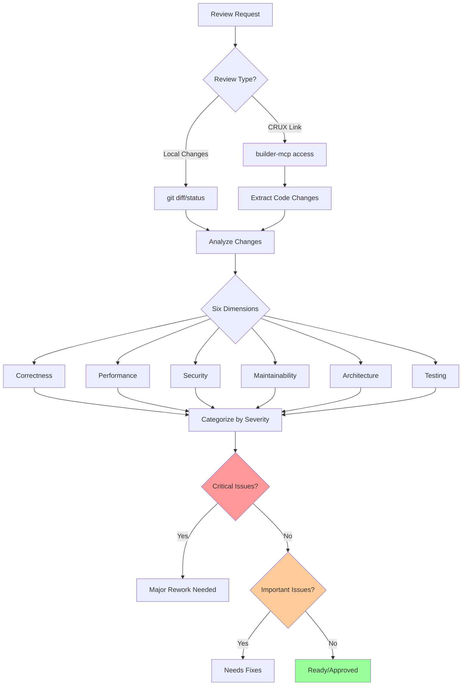

# Peer debate — 2026-10-19T05:18:09Z
Topic: JeiOS M3c step 7 bootstrap fixture: does blocking recv make the two-process ring-3 ping-pong deterministic, fixture mechanism, transfer proof, lost-wakeup analysis, new kernel surface?
Rounds: 2   Roles: claude=implementor codex=adversarial-reviewer
Context file: /tmp/step7.md


[R1 CLAUDE] I checked the code at 08b09be. Blocking recv does make the two-process ping-pong deterministic, and step 7 needs no new kernel surface. One gap, though: ring-3 code cannot tell a WOKEN delivery from a delivery that never parked. So the "WOKEN proof" has to be forced and observed by the bootstrap. Running the ping-pong and hoping a park happened is not enough.

## Lost wakeup: closed (verified in code)
- **Recv side.** Probe, `wait_register` and `je_sched_block_current` all run inside one int 0x80 with IF=0 (`syscall.c:540-561`).
- **Send side.** Enqueue plus `je_endpoint_kern_send_wake`, which arbitrates WOKEN on the peer end and then calls `je_sched_wake_ipc` (`endpoint_kern.c:298`), is also a single IF=0 syscall.
- On one CPU these two sections are atomic with respect to each other, so only two orderings exist:
  - **Send before register:** the message is queued, the probe sees it as non-empty, and the receiver never parks.
  - **Register before send:** arbitrate finds WAITING, wins, and moves the receiver BLOCKED_IPC→READY.
  - There is no third interleaving. Timer preemption only happens in user mode, between syscalls, which is harmless because the message is already queued.

## Double-block deadlock: impossible with a single token
Invariant: exactly one message is either queued or held by a running thread that sends it next. A thread parks only when its inbound queue is empty. If both threads were parked, both queues would be empty and nobody would hold the token, so a send must have been lost. That cannot happen if each send returns OK; with one message in flight, QUEUE_FULL is impossible. **The stubs must assert send==OK every round.**

**Edge case:** `WAITERS_BUSY` returns EMPTY without blocking (`syscall.c:554`). With one thread per end it should never fire, so the stub records an EMPTY from a blocking recv as a failure.

## Q1 — Fixture mechanism
Use `je_endpoint_kern_seed(vm, A, B, &sA, &sB)`. Then `vm_s3_scratch_write` (it exists at `main.c:193`) puts sA into A's arena slot and sB into B's, before `je_thread_create_user`. The stub loads its handle from a fixed arena address.

Alternatives I reject:
- **Handle in a register at entry:** edits `je_thread_create_user`, which is tested code, so it would be owner-gated.
- **"get bootstrap handle" syscall:** new ABI surface.
- **Hardcoded handle value:** relies on table internals, which is dishonest.

## Q3 + forced WOKEN — one handshake proves (a), (b) and the WOKEN-carries-cap path
1. **B parks first, provably.** Create only B's thread. B writes a pre-recv marker, then does a blocking recv on sB with a generous timeout, e.g. 0x10000 ticks.
   - The bootstrap waits until the marker is set, the post-recv word is still unset, `je_sched_death_reason` shows no death, and `je_sched_dispatches_of(B)` stays unchanged across ≥2 timer ticks.
   - If B were READY, for instance preempted just before int 0x80, round-robin would dispatch it again and the count would rise. A stable count therefore means B is BLOCKED_IPC.
   - This uses existing API only. **Assumption to verify:** that `dispatches_of` increments on every dispatch.
2. **Create A's thread.** A creates C (c0, c1) with the ring-3 create syscall and sends c1 as a cap over sA. That wakes B WOKEN, and B's continuation mints the cap into its own table through the reserved-head path (`syscall.c:253`). This is the first ring-3 test of the continuation's cap delivery.
3. **B sends on the minted handle; A blocking-recvs on c0.** A checks the payload. A keeps c1 until this message arrives, because B's message is the "minted" acknowledgement (the frozen D2 dead-cap rule, as in s5). Only then does A close c1.

## Q2 — Ping-pong after the handshake
- **Rounds:** N=8 over S. A sends `{tag='A', i}`; B checks it and replies `{tag='B', i^0xA5}`; A checks the reply.
- **Each side records:** a round counter, the last status, and a sticky failure word that holds the first bad status, including any 14.
- **Delivery mix:** later rounds mix immediate and WOKEN delivery under the natural schedule. Both are legitimate, and round 1 already carries the forced WOKEN proof.
- **Honesty:** ping-pong with one message in flight does **not** prove FIFO. FIFO stays proven by the hosted tests; don't claim it here.

## Q5 — Timeout
- The timeout has to be finite: A6-3 requires a nonzero value no larger than `JE_IPC_MAX_WAIT`.
- Pick a generous value, assert every recv status is OK, and treat a recorded 14 as an explicit failure. The timeout only breaks a hang; it is never a passing path.
- The bootstrap's own `sp` bound is the outer hang-breaker. Order the bounds so a lost wakeup shows up as "status 14 recorded" before the bootstrap's spin bound trips; that gives a clearer diagnostic.

## Q4 — Closure and "not a supervisor"
- **Baseline:** both stubs `exit(0)` after N rounds. The bootstrap reaps both, checks both `death_reason == EXIT` with code 0, destroys both VMs, and asserts `je_endpoint_kernel_allocated()==0` and page baseline restored.
- **What makes it a fixture:** bounded rounds, a one-shot seed, explicit teardown, no respawn, and no kernel code running while the users talk.
- **Optional stretch:** B's final recv expects PEER_CLOSED when A dies. The wake comes from `kep_teardown` → `kern_peer_close_wake` (`endpoint_kern.c:44`), which looks like it runs from `je_vm_destroy`, i.e. when the bootstrap destroys A. That makes it deterministic, but it couples to the reap order. I'd ship the baseline and add this only after confirming where the hook fires.

## Q6 — New kernel surface: none
The work is `user_demo.S` (two stubs), `main.c` (driver) and docs, so it is not owner-gated. If the other side wants an explicit kernel "woken-by-send" counter instead of the dispatch-count inference, that is an edit to `endpoint_kern.c` or `sched.c` (tested code) and goes to the owner. I think the inference is sound enough that we shouldn't need it.

## Open points for Codex
1. Does anyone see a hole in the dispatch-count-stability inference that B is parked?
2. Should PEER_CLOSED closure be in step 7 or deferred?
[R1 CODEX] codex
I agree that blocking recv removes the old cooperative-spin hang, but I would narrow “deterministic” to the stated protocol and verified scheduler contracts.
- The lost-wakeup argument is sound if probe, waiter registration, and park remain one IF=0 critical section, and send enqueue/wake is likewise atomic. The only valid orderings are send-before-registration (probe observes the queued message) and registration-before-send (send wins WOKEN arbitration). `WAITERS_BUSY` must be treated as a fixture failure, not retried silently.
- The dispatch-count proof is only an inference. It depends on `dispatches_of(B)` incrementing on every dispatch and timer-driven scheduling actually revisiting READY B. Stable count proves “B was not dispatched,” not directly `BLOCKED_IPC`. Use it only as documented fixture evidence, with the check completing well before the recv timeout. If those counter semantics are not already tested, do not present this as a kernel proof.
- The transfer sequence has a likely semantic contradiction: Claude says A sends `c1` and later “keeps c1.” If capability transfer is move semantics, A must lose `c1`; if it is copy semantics, document that explicitly. The test must assert the existing D2 behavior rather than retain/close the handle speculatively. B’s minted handle is convincingly exercised when B sends through it and A receives on `c0`; send failure is sticky failure.
- Scratch injection is the right fixture mechanism: seed with `je_endpoint_kern_seed`, write handles to reserved arena addresses before user-thread creation, and document those addresses as fixture ABI. A syscall or entry register would add unnecessary surface.
- Use A-send-first / B-recv-first. After transfer, use the seed pair for eight bounded rounds. A sends `{round}`, B validates and replies, A validates. On the final reply B exits; A receives it and exits. This avoids both sides entering a terminal recv. Do not claim FIFO from this test.
- If the recv ABI does not expose WOKEN versus immediate delivery, ring-3 cannot assert that return cause directly. The forced “B parked before A exists” setup plus subsequent send is causal evidence for one WOKEN delivery, but the claim should be phrased that way. Later ping-pong rounds may be immediate.
- Finite timeouts are appropriate only as fail-fast paths: every timeout, `WAITERS_BUSY`, or non-OK result fails the fixture. Add an outer bootstrap deadline so a stuck syscall cannot hang the harness. A timeout must never count as progress.
- Closure should compare endpoint/page allocations against a recorded pre-fixture baseline, not assume absolute zero. Both programs exit with code zero; bootstrap reaps, destroys both VMs, and checks no delta. PEER_CLOSED during teardown is optional and should not be coupled into this proof; it adds destroy-order dependence. “Not a supervisor” means one-shot setup, bounded rounds, explicit teardown, and no respawn/restart.
Thus no new kernel surface is needed, conditional on the existing scratch writer and dispatch counter semantics. If either is unverified, first document or validate those contracts; do not add a new wake counter to tested scheduler/endpoint code without owner escalation.
I agree that blocking recv removes the old cooperative-spin hang, but I would narrow “deterministic” to the stated protocol and verified scheduler contracts.
- The lost-wakeup argument is sound if probe, waiter registration, and park remain one IF=0 critical section, and send enqueue/wake is likewise atomic. The only valid orderings are send-before-registration (probe observes the queued message) and registration-before-send (send wins WOKEN arbitration). `WAITERS_BUSY` must be treated as a fixture failure, not retried silently.
- The dispatch-count proof is only an inference. It depends on `dispatches_of(B)` incrementing on every dispatch and timer-driven scheduling actually revisiting READY B. Stable count proves “B was not dispatched,” not directly `BLOCKED_IPC`. Use it only as documented fixture evidence, with the check completing well before the recv timeout. If those counter semantics are not already tested, do not present this as a kernel proof.
- The transfer sequence has a likely semantic contradiction: Claude says A sends `c1` and later “keeps c1.” If capability transfer is move semantics, A must lose `c1`; if it is copy semantics, document that explicitly. The test must assert the existing D2 behavior rather than retain/close the handle speculatively. B’s minted handle is convincingly exercised when B sends through it and A receives on `c0`; send failure is sticky failure.
- Scratch injection is the right fixture mechanism: seed with `je_endpoint_kern_seed`, write handles to reserved arena addresses before user-thread creation, and document those addresses as fixture ABI. A syscall or entry register would add unnecessary surface.
- Use A-send-first / B-recv-first. After transfer, use the seed pair for eight bounded rounds. A sends `{round}`, B validates and replies, A validates. On the final reply B exits; A receives it and exits. This avoids both sides entering a terminal recv. Do not claim FIFO from this test.
- If the recv ABI does not expose WOKEN versus immediate delivery, ring-3 cannot assert that return cause directly. The forced “B parked before A exists” setup plus subsequent send is causal evidence for one WOKEN delivery, but the claim should be phrased that way. Later ping-pong rounds may be immediate.
- Finite timeouts are appropriate only as fail-fast paths: every timeout, `WAITERS_BUSY`, or non-OK result fails the fixture. Add an outer bootstrap deadline so a stuck syscall cannot hang the harness. A timeout must never count as progress.
- Closure should compare endpoint/page allocations against a recorded pre-fixture baseline, not assume absolute zero. Both programs exit with code zero; bootstrap reaps, destroys both VMs, and checks no delta. PEER_CLOSED during teardown is optional and should not be coupled into this proof; it adds destroy-order dependence. “Not a supervisor” means one-shot setup, bounded rounds, explicit teardown, and no respawn/restart.
Thus no new kernel surface is needed, conditional on the existing scratch writer and dispatch counter semantics. If either is unverified, first document or validate those contracts; do not add a new wake counter to tested scheduler/endpoint code without owner escalation.
[R2 CLAUDE] I agree with most of it, but two of Codex's points rest on wrong premises, and it missed one real risk. I checked these against `main` @ 08b09be.

**Agreed (no change):**
- **Lost wakeup is closed.** In `syscall.c:545-563` the probe, `wait_register` and `je_sched_block_current` all run in one IF=0 syscall. A send that lands before registration is seen by the probe, so the receiver never parks. A send that lands after registration wins the WOKEN arbitration. TIMED_OUT from the timer ISR uses the same single arbitrate CAS, and the ISR cannot preempt an IF=0 syscall. No third ordering exists.
- **Ping-pong shape.** A sends first, B receives first, 8 rounds, B exits after its final reply and A exits after receiving it. Only one message is ever in flight per direction, so QUEUE_FULL can't happen. Don't claim FIFO.
- **Timeouts.** Each timeout is a fail-fast path only, with an outer bootstrap spin bound like s6's `200000000ull`.
- **"Fixture not supervisor."** One-shot setup, bounded rounds, explicit teardown, no respawn.
- **No new kernel surface.**

**Disputed:**
1. **Transfer is copy, not move.** Transfer takes an extra owning reference (`retain_inflight`) and the sender keeps its handle. s5 relies on this: `main.c:859-861` has XA close its own `c1` explicitly *after* XB mints. So "A must lose c1" is wrong. The ring-3 version should match s5:
   - A gets OK from its own `close(c1)` after B's minted handle is confirmed working.
   - Assert the endpoint pool count stays at 2 at that point (the end is kept alive by B's reference).
2. **WAITERS_BUSY can't be seen from ring 3.** `syscall.c:215` and `:554` map it to `JE_ABI_H_EMPTY`. The real rule: a blocking recv (nonzero R10) that returns EMPTY must have hit WAITERS_BUSY, because A6-3 never returns EMPTY for a nonzero timeout otherwise. So "nonzero-timeout recv returned 13" is the fixture-failure check.
3. **Better WOKEN evidence than dispatch counts.** Create only B's thread first. B writes a pre-recv marker, then does a blocking recv with a large timeout. The bootstrap checks that the marker is set and the post-recv status slot stays unwritten over K timer ticks (K far below the timeout). Only then does it create A's thread (`je_thread_create_user` mid-run, as s6 does). A non-parking return writes the status at once, so no write after K ticks means B is parked, inferred from the syscall contract. Then assert B's status is 0, not 14. Phrase it as "one causally-forced WOKEN delivery"; later rounds may be immediate deliveries, as Codex said.
4. **Leak check.** Assert both the baseline delta *and* that the baseline is 0. s5 and s6 already assert `je_endpoint_kernel_allocated()==0` at this point, so a delta-only check is weaker than what's already established.

**Missed:**
- **The transfer should arrive through the WOKEN continuation, and that path has never run end-to-end.** `endpoint_kern.h:97` reads bytes *and caps* on resume. s6 only proved TIMED_OUT, and s5 minted through the non-blocking kernel forwarders. If B is parked when A sends the cap-carrying message, step 7 is the first ring-3 run of mint-on-wake. That is the strongest version of both proofs, so do it deliberately. The catch: if it fails, the fix sits in `sched.c` / continuation code, which was step 6's owner-gated surface. That triggers escalation to the owner, not a fixture workaround.
- **The handle-injection helper exists but has never run.** `vm_s3_scratch_write` (`main.c:193`) is `__attribute__((unused))`, and its comment reserves it for exactly this fixture. Use it, drop the attribute, and record it as first use: it's main.c fixture code, not tested kernel code. Write the handles before `je_thread_create_user` and document the arena offsets as fixture ABI only, not process ABI.
- **There's no third process.** `JE_VM_MAX_PROCESSES=2`, so the transferred channel has to be A's own `endpoint_create` channel C (A keeps `c0`, sends `c1`). B checks the minted handle is nonzero and differs from its seeded handle, sends on it, and A receives on `c0`.

Sequence:
1. Seed S across A and B, inject the handles, create B.
2. Confirm B is parked, then create A.
3. A creates C and sends `c1` over S, which wakes B; B mints the handle.
4. B sends on the minted handle; A receives on `c0` and checks the payload.
5. A closes `c1` (OK).
6. 8 ping-pong rounds on S.
7. Both exit 0; bootstrap reaps and destroys both, and the pool is back to 0.

Any non-OK result, a 13 or 14 from a blocking recv, or hitting the spin bound fails the fixture.
[R2 CODEX] codex
Claude’s blocking conclusion is sound, but the transfer sequence and two evidence claims need tightening.
Agree:
- The lost-wakeup proof is valid if `probe → wait_register → block` remains one IF=0 syscall path (`syscall.c:545-563`). A send either appears in the probe or wins WOKEN arbitration; timer expiry cannot interleave.
- Forced initial park is the right evidence tactic: create B’s thread, verify its pre-recv marker, wait fewer ticks than the timeout, then create A.
- No new kernel surface is required. Use `vm_s3_scratch_write` before `je_thread_create_user`; document offsets as fixture-only ABI.
- Transfer is copy/retain semantics, not move semantics. A may close `c1` after B mints it.
- Two processes suffice: A creates channel C, sends `c1` over seeded channel S, and B uses the minted end to send to A’s `c0`.
- Eight bounded rounds, explicit close, no respawn, and an outer watchdog are appropriate.
Disputes:
1. “Close after B has used it” does not prove retained ownership.
Claude’s listed sequence has B mint, use the new handle, then A closes `c1`. That only proves use before close. To prove the retained reference, A must close `c1` before B uses the transferred handle.
Use a small control handshake:
1. B mints `cB`, sends `MINTED` over S, then blocks for `GO`.
2. A receives `MINTED`, closes `c1`, sends `GO`.
3. B receives `GO`, sends on `cB`; A receives on `c0`.
The successful post-close send is the meaningful assertion. Endpoint-pool count is only a leak check; it does not distinguish copy from move semantics.
2. `minted_handle != seeded_handle` is weak evidence.
Handles are opaque. A distinct live endpoint should not reuse B’s live seeded slot, but value inequality is not the proof. The proof is: mint succeeds, sender close succeeds, post-close send on the minted handle succeeds, and A receives the expected payload.
3. “Nonzero timeout returning EMPTY means WAITERS_BUSY” should not be presented as directly observed.
The fixture can assert that a nonzero-timeout receive never returns ABI `EMPTY`, consistent with the mapping at `syscall.c:215` and `:554`. But unless the ABI exposes the internal cause, label WAITERS_BUSY as the inferred internal path, not a ring-3 observation.
4. Requiring endpoint baseline `== 0` is valid only for a clean isolated run.
The general fixture should require `post_count == pre_count`; separately, a clean-boot run may require both to be zero. Otherwise unrelated bootstrap-owned endpoints make the test falsely fail.
Missed issue: final closure must not rely on close racing a queued message. Make the final ping-pong an explicit acknowledgement protocol:
- B sends the final reply and blocks for `DONE`.
- A receives it, sends `DONE`, closes its S handle, and exits.
- B receives `DONE`, closes its S handle and transferred handle, then exits.
That gives deterministic teardown and avoids assuming queued messages survive peer closure.
The “causally forced WOKEN” claim is valid only for the deliberately staged first receive and the cap-transfer receive: B is proven parked before A exists/send occurs. Later ping-pong receives may be immediate deliveries, so they prove functional progress and timeout absence, not independently observed WOKEN causes.
One additional prerequisite must be checked: `JE_VM_MAX_PROCESSES=2` must refer to A and B, with bootstrap slot 0 outside that quota. If bootstrap consumes one VM process slot, this fixture cannot exist as described.
If the cap-bearing WOKEN continuation fails, that is a scheduler/continuation defect in the step-6 tested path and must be escalated to the owner; the fixture must not bypass it with polling or a new kernel shortcut.
Claude’s blocking conclusion is sound, but the transfer sequence and two evidence claims need tightening.
Agree:
- The lost-wakeup proof is valid if `probe → wait_register → block` remains one IF=0 syscall path (`syscall.c:545-563`). A send either appears in the probe or wins WOKEN arbitration; timer expiry cannot interleave.
- Forced initial park is the right evidence tactic: create B’s thread, verify its pre-recv marker, wait fewer ticks than the timeout, then create A.
- No new kernel surface is required. Use `vm_s3_scratch_write` before `je_thread_create_user`; document offsets as fixture-only ABI.
- Transfer is copy/retain semantics, not move semantics. A may close `c1` after B mints it.
- Two processes suffice: A creates channel C, sends `c1` over seeded channel S, and B uses the minted end to send to A’s `c0`.
- Eight bounded rounds, explicit close, no respawn, and an outer watchdog are appropriate.
Disputes:
1. “Close after B has used it” does not prove retained ownership.
Claude’s listed sequence has B mint, use the new handle, then A closes `c1`. That only proves use before close. To prove the retained reference, A must close `c1` before B uses the transferred handle.
Use a small control handshake:
1. B mints `cB`, sends `MINTED` over S, then blocks for `GO`.
2. A receives `MINTED`, closes `c1`, sends `GO`.
3. B receives `GO`, sends on `cB`; A receives on `c0`.
The successful post-close send is the meaningful assertion. Endpoint-pool count is only a leak check; it does not distinguish copy from move semantics.
2. `minted_handle != seeded_handle` is weak evidence.
Handles are opaque. A distinct live endpoint should not reuse B’s live seeded slot, but value inequality is not the proof. The proof is: mint succeeds, sender close succeeds, post-close send on the minted handle succeeds, and A receives the expected payload.
3. “Nonzero timeout returning EMPTY means WAITERS_BUSY” should not be presented as directly observed.
The fixture can assert that a nonzero-timeout receive never returns ABI `EMPTY`, consistent with the mapping at `syscall.c:215` and `:554`. But unless the ABI exposes the internal cause, label WAITERS_BUSY as the inferred internal path, not a ring-3 observation.
4. Requiring endpoint baseline `== 0` is valid only for a clean isolated run.
The general fixture should require `post_count == pre_count`; separately, a clean-boot run may require both to be zero. Otherwise unrelated bootstrap-owned endpoints make the test falsely fail.
Missed issue: final closure must not rely on close racing a queued message. Make the final ping-pong an explicit acknowledgement protocol:
- B sends the final reply and blocks for `DONE`.
- A receives it, sends `DONE`, closes its S handle, and exits.
- B receives `DONE`, closes its S handle and transferred handle, then exits.
That gives deterministic teardown and avoids assuming queued messages survive peer closure.
The “causally forced WOKEN” claim is valid only for the deliberately staged first receive and the cap-transfer receive: B is proven parked before A exists/send occurs. Later ping-pong receives may be immediate deliveries, so they prove functional progress and timeout absence, not independently observed WOKEN causes.
One additional prerequisite must be checked: `JE_VM_MAX_PROCESSES=2` must refer to A and B, with bootstrap slot 0 outside that quota. If bootstrap consumes one VM process slot, this fixture cannot exist as described.
If the cap-bearing WOKEN continuation fails, that is a scheduler/continuation defect in the step-6 tested path and must be escalated to the owner; the fixture must not bypass it with polling or a new kernel shortcut.

---
## Step-7 fixture adversarial review (proof-honesty: no pass-by-luck asm bug; strengthened recv-length/close-result/not-dying/clean-exit asserts + marker + abi.h doc fix; the exit-op-2 bug was caught by the added clean-exit assert)
### Claude
No asm bug makes it pass by luck in the scenarios you listed. I did find two assertion gaps that make the proof weaker than claimed (#1, #2), plus some secondary issues. This was a static review; I didn't rebuild or rerun anything.

## Findings

1. **A message with no bytes would pass the tag check on stale data** (`Aloop`, `Bloop`). No recv checks the returned length in RDX bits 31:0. After round 1, 0x40001540 already holds 0xbb on A's side and 0xaa on B's. If rounds 2–4 delivered OK with zero bytes, `cmpb` would still match. B also checks only the cap count (bits 63:32), never the length. Fix: require RDX == 1 on every recv, and RDX == 1 | (1<<32) on B's cap recv.

2. **The "DONE teardown" closes are never checked.** A's `close c0` / `close hS` and B's `close cB` / `close hS` ignore RAX. The final `allocated()==0` can't catch a failed close, because the teardown hook (`kep_teardown`) reclaims leaked ends at reap anyway. So the explicit-teardown claim isn't asserted. That includes B closing cB after its peer end (c0) is already closed. Fix: check RAX == 0 and add `Aerr_`/`Berr_` codes for each close.

3. **From ring 3, WOKEN and immediate delivery look the same.** Both return RAX = 0. The asm header's "the asserts require WOKEN delivery" overclaims: only B's first recv is forced to be WOKEN, and that rests on reading user memory.
   - A dead B also holds progress == 1. A fault at the int, or the BAD_RETURN check in `je_sched_block_current`, both leave it there.
   - It isn't a false pass: B's death peer-closes S, so A's cap send fails with status 12. But the "B is parked" line still prints.
   - Since this fixture is the only test of the "mint on wake" path, gate on kernel state. At minimum, assert `je_sched_death_reason(&vm_s3, pPong, …) == JE_ERR_INVALID` (B not DYING) before creating A. Better: a BLOCKED_IPC or waiter-registered accessor, or a counter of continuation deliveries. Either one touches `sched.c`, which needs owner approval.
   - Reword the header so it doesn't claim every recv is WOKEN.

4. **The watchdogs can't fire within the smoke run.** Each spin is `sti; hlt`, about one PIT tick at ~100 Hz (`platform.c:69`). 400M spins is about 46 days; 200M is about 23 days. The 0x4000-tick recv timeout "hang-breaker" is about 164 s. The QEMU harness kills the run at 15 s (`emulator.py:9`). A hang, or a stub killed by a fault with progress below 6 (the driver never polls `je_sched_death_reason`), always shows up as the harness's "terminal marker not observed", never as an s7 diagnostic. Fix: a tick-based deadline plus death-reason polling.

5. **The 0x200-tick park window is about 5 s of the 15 s smoke budget.** That's a flake risk on slow CI, and far more than needed: B runs only about 3 instructions between `progress=1` and `int 0x80`, so 0x10–0x20 ticks is already overwhelming evidence. Also, `t0` is taken before B starts, so the window includes B's startup time.

6. **No harness checks the s7 marker.** `tools/smoke.py` and `integration.py` list no M3c-s7 line. The fixture is covered only indirectly ("init complete" reached, no "JeiOS fatal"). If the block were deleted or guarded out, every test would still pass. Add the s7 OK marker to the NX-present expected list.

7. **Stale offsets in comments.** The asm header says 0x2000/0x2008/0x2010/0x2040/0x2048/0x2050, the `A_send1_S` comment says 0x2058, the `A_blockrecv_S` comment says 0x2040, and main.c says "inject … at arena 0x2000". The code uses 0x1500–0x1558, which is correct. The header also omits the cap array at 0x1550.

8. **s7 only runs on NX-present profiles** (it sits in the `else` at `main.c:325`). The "discharged end-to-end" claim should say NX profiles only.

9. **Noise:** `endpoint_kern.c`'s only change is one added blank line. Drop it.

## Confirmed clean

- **Q1:** Taken together, progress == 1 held while B is alive and the recv status 0 do force the first delivery to be WOKEN. The gap is that "alive" isn't checked (#3).
- **Q2:** The happens-before is a real data dependency, not a scheduling assumption: close(c1) → send(GO) → B's recv(GO) returns → send(cB). It holds even with timer preemption. A checks the close result (`Aerr_close`). If the close had really closed end 1, B's send would fail via the PEER_CLOSED preflight (`endpoint.c:600`), and A's c0 recv would return 13.
- **Q3:** Registers are safe. `trap_entry.S:23-56` saves and restores every GPR, and `int` doesn't clobber RCX/R11 the way `syscall` does. A parked thread re-runs `int 0x80` from its saved frame. So r13, r14, r15 and the RCX loop counter survive. 0x1500–0x155f is inside the RW page at 0x1000, which is zeroed at build (`vm.c:240`). The stack is at the top of the arena, clear of it. Code sizes are 733 and 675 bytes, under the 1024-byte guard.
- **Q4:** The send ABI is right: R10 bits 7:0 = 1, R8 nonzero, R9 = 0. c1 holds all rights (0xf), so 0xe is a valid subset, and TRANSFER is held (`resolve_send_cap`). The cap names c1's own end, so cB → end 0 → A's c0 is correct.
- **Q5:** Mixing a blocking timeout with cap receive is legal (decode puts no reserved-zero rule on R10). The park saves r8/r9 (`wait_r8`/`wait_r9`), and `finish_blocked_recv` mints, copies the handle array, then commits.
- **Q6:** Every `Aerr_`/`Berr_` path writes a nonzero status, then progress 99. The driver checks 99 before ≥6, and there's no jump to progress 6 that skips an assert, apart from the unchecked closes in #2 and the length gap in #1.
- **Q7:** Drain-first holds on both paths. `kern_peer_close_wake` skips an end whose inbound isn't empty. The continuation (`peek_caps_at`) and the plain poll path (`endpoint.c:659`) return PEER_CLOSED only when the queue count is 0, so B gets DONE after A closes hS. The DONE handshake can't deadlock.

### Codex
codex
I’m reviewing this as a proof/assembly audit, not treating the green runs as dispositive. I’ll first load the repository’s review guidance and the relevant ABI/endpoint implementation, then trace each claimed ordering and register invariant against the actual code.
codex
I’m using the repository’s CRUX code-review skill because this is an adversarial review of a code change. The first read-only inspection was blocked by the sandbox’s network namespace setup, so I’m retrying the same read-only command with the required escalation.
exec
/usr/bin/bash -lc "sed -n '1,260p' /home/ANT.AMAZON.COM/lubuel/.codex/plugins/cache/aim/AmazonBuilderCoreAIAgents-core/1.0.6533229075/skills/crux-code-reviews/SKILL.md; printf '\\n--- files ---\\n'; printf '%s\\n' README.md docs/HANDOFF.md docs/ROADMAP.md docs/AGENT_START.md docs/DESIGN.md docs/CODING_STANDARD.md; printf '\\n--- status ---\\n'; git status --short --branch" in /home/ANT.AMAZON.COM/lubuel/oss/jeios-workspace/jeios
 succeeded in 0ms:
---
name: crux-code-reviews
description: Amazon's internal code review system (CRUX) similar to GitHub PRs. Use when creating or revising CRs, addressing feedback, reviewing code, encountering cr CLI errors, or reviewing code changes at code.amazon.com/reviews/.
version: 1.0.0
tags:
- skill
- code-review
- cr-cli
- crux
- cr
metadata:
  brazil_package_name: AmazonBuilderCoreAISkillSet
  brazil_package_interface: '1.0'
  brazil_version: 1.0.35694.0
  commit: 8d51924f0c3dfe0a65c1d806cf90fe90f5331d34
---

# CRUX Code Reviews

## Overview
CRUX is Amazon's internal code review system, similar to GitHub pull requests. This skill covers working with code reviews using the cr CLI tool, understanding CRUX workflows, and managing multi-package reviews that can span multiple repositories and commits.

## Usage
Use this skill when:
- Creating new code reviews with `cr` command
- Addressing reviewer feedback on existing CRs
- Reviewing code changes (local or remote CRUX reviews)
- Encountering cr CLI errors or sync issues
- Working with multi-package reviews
- Managing code review workflows at Amazon

When NOT to use:
- General git operations unrelated to code reviews
- Non-Amazon code review systems (ex. Github PRs)

## Core Concepts

### What is CRUX?
CRUX is Amazon's internal code review system that operates similarly to GitHub pull requests. Key characteristics:
- **Multi-package support**: CRs can span multiple packages (repositories)
- **Multi-commit support**: Each package can contribute multiple commits to a single CR
- **Multiple revisions**: One CR can have multiple revisions, each representing a group of packages at specific commit(s)
- **Brazil integration**: Works seamlessly with Amazon's Brazil build system
- **Template support**: The `cr` command automatically applies a package's `.crux_template.md` to the CR description — no manual handling needed
- **Stacked CRs**: Downstream CRs can declare upstream CR dependencies that must ship before merging
- **Remote operations are automatic**: `cr` pushes the review branch for you — you never run `git push`

### CR CLI Tool
The `cr` command-line tool is used to create and manage code reviews:
- **Create reviews**: `cr` creates a new review for the current package
- **Update reviews**: `cr -r CR-ID` updates an existing review (long form: `cr --update-review CR-ID`)
- **Force a new review**: `cr --new-review` creates a brand-new CR even when the commit already references another CR — use when the user explicitly asks for a *new* CR
- **Multi-package**: `--all`, `-i`, `--exclude` options for package selection
- **Commit ranges**: `--parent`, `--range` options for specifying commits

> **Never run `git push`.** The `cr` command pushes the review branch to the remote for you. There is no `--cr`, `--update`, or `--list` option — if unsure of syntax, run `cr --help` rather than guessing.

### Code Review Workflow
1. **Development** - Make changes in Brazil workspace
2. **Staging** - `git add` modified files
3. **Committing** - Create commits with clear messages
4. **Sync Check** - Confirm the branch has a destination to merge into (a tracking/upstream branch, so CRUX can resolve a merge target) and isn't behind or diverged from it
5. **CR Creation** - Upload review using `cr` tool
6. **Review Process** - Address feedback and iterate
7. **Merge** - Complete review and merge changes

## Instructions

### Quick Start
You **MUST** reference these detailed guides when working with specific workflows:

- **[Creating New Reviews](references/creating-reviews.md)** - You **MUST** reference this doc when creating new code reviews from staging changes to uploading reviews
- **[Addressing Feedback](references/addressing-feedback.md)** - You **MUST** reference this doc when handling reviewer comments and responding to reviewers
- **[Creating Revisions](references/creating-revisions.md)** - You **MUST** reference this doc when syncing, committing, and publishing new revisions to existing CRs
- **[Reviewing Code](references/reviewing-code.md)** - You **MUST** reference this doc when providing comprehensive feedback on local or remote reviews

### Workspace Overview
**Tool Dependencies:**
- **WorkspaceGitDetails** (builder-mcp tool) - Provides git repositories, statuses, and diffs for workspace packages
- **Fallback:** If WorkspaceGitDetails unavailable, use `brazil workspace show --format json` and git commands at package source locations

Agents **SHOULD** use WorkspaceGitDetails when available for efficient workspace analysis. When unavailable, agents **MUST** use the brazil CLI fallback approach.

### CR CLI Reference

#### Basic Commands
```bash
cr                              # Create new review for current package (default title + template description)
cr -r CR-ID                     # Update existing review
cr --update-review CR-ID        # Update existing review (long form of -r)
cr --new-review                 # Force-create a brand-new review even if commit references a CR
cr --help                       # Show all available options
```

#### Package Selection
```bash
cr --all                          # Include all modified packages
cr -i Pkg1 -i Pkg2  # Include specific packages
cr --exclude "TestPkg"            # Exclude specific packages
```

#### Commit Ranges
```bash
cr --parent "HEAD^"             # Review single commit
cr --range "abc123:def456"      # Review specific range
```

#### Review Options
```bash
cr --summary "Title"            # Override the auto-generated title (only when the user wants a custom title)
cr --description "Details"      # Override the default/template description (only when the user wants a custom description)
cr --reviewers "user1,user2"    # Assign reviewers
cr --issue "SIM-123"            # Link SIM issues
cr --tags payments              # Apply comma-separated tags to the revision
cr --open                       # Open in browser
cr --auto-publish               # Auto publish the CR after analyzers pass
cr --auto-merge                 # Auto merge the CR after all approver requirements are met
cr --stack CR-123456,CR-789012  # Add upstream CR dependencies (stacked CRs)
```

> Prefer plain `cr` (or `cr -r CR-ID`). The auto-generated title and the template-based description are almost always correct — only pass `--summary`/`--description` when the user explicitly asks to customize them.

> Do **not** pass `--auto-publish` unless the user explicitly requests it. CRs default to draft, giving the author a chance to review the diff, run analyzers, and iterate before notifying reviewers. Auto-publishing leads to premature notifications and multiple public revisions of unfinished work.

## Supporting Files

### references/creating-reviews.md
Complete workflow for creating new code reviews, including pre-review checks, selecting commits and packages, and cr CLI usage.

### references/addressing-feedback.md
Detailed process for handling reviewer feedback and responding to reviewers.

### references/creating-revisions.md
Complete workflow for syncing, committing, and publishing new revisions to existing code reviews, including pulling a CR locally when needed.

### references/reviewing-code.md
Comprehensive code review framework covering six critical dimensions: correctness, performance, security, maintainability, architecture, and testing.

## Quick Reference

| Task | Command | Reference |
|------|---------|-----------|
| Create new CR | `cr` | [Creating Reviews](references/creating-reviews.md) |
| Force a brand-new CR | `cr --new-review` | [Creating Reviews](references/creating-reviews.md) |
| Stacked CR | `cr --stack CR-123456` | [Creating Reviews](references/creating-reviews.md) |
| Address feedback | N/A | [Addressing Feedback](references/addressing-feedback.md) |
| Update existing CR | `cr -r CR-123456` | [Creating Revisions](references/creating-revisions.md) |
| Review code changes | N/A | [Reviewing Code](references/reviewing-code.md) |
| Multi-package CR | `cr -i Pkg1 -i Pkg2` | [Creating Reviews](references/creating-reviews.md) |

## Common Patterns

### CR Title Format
This section applies only to values passed to `cr --summary`. You MUST NOT add `[PackageName]` to a Git commit subject based on this convention. Only use a package prefix in a commit when the user or documented repository policy explicitly requires it.

`cr` auto-generates a title that is almost always correct — prefer it. Only set a custom title with `--summary` when the user asks. When you do set a custom title, include the package name:
- Single package: `[PackageName] Summary of changes`
- Multiple packages: `[PackageName + N others] Summary of changes`

Example:
- CR title: `[MyService] Fix utility class suppression`
- Commit subject: `Fix utility class suppression`

### Creating a New CR vs. Updating an Existing One
- **User asks to create a CR** → run `cr` (or `cr --new-review` if the commit already references a shipped/closed CR and the user wants a fresh one). Do **not** update an unrelated existing CR.
- **User asks to update/revise a specific CR** → run `cr -r CR-ID`.
- If the working commit carries a `cr:` trailer pointing at an existing CR but the user explicitly wants a *new* review, use `--new-review`.

### Single Package Review
```bash
cr --open
```

### Multi-Package Review
```bash
# Every package must be listed: -i replaces the default, it does not add to it
cr -i ServiceA -i ServiceB --open
```

### Stacked CRs (CR Dependencies)
When a large change is split into sequential CRs, declare the upstream CR as a dependency so the downstream CR is blocked from merging until the upstream ships:
```bash
# Create a downstream CR that depends on an upstream CR
cr --summary "[MyService] Add feature (part 2)" --stack CR-123456 --open

# Multiple upstream dependencies
cr --summary "[MyService] Final integration" --stack CR-123456,CR-789012 --open
```

After the upstream CR merges, rebase the downstream branch locally and publish a new revision so the commit graph cleanly applies to the destination branch.

### Update Existing Review
```bash
# Update the CR
cr -r CR-123456 --open
```

## Common Mistakes

### Not Committing Before CR
**Problem:** Running `cr` with unstaged or uncommitted changes
**Fix:** Agents **MUST** ensure changes are committed before running `cr`

### Running `git push`
**Problem:** Pushing the branch manually before/after running `cr`
**Fix:** **Never** run `git push`. `cr` pushes the review branch to the remote for you.

### Inventing `cr` Flags
**Problem:** Guessing options like `cr --cr CR-ID`, `cr --update`, or `cr --list` — none of these exist
**Fix:** Update a CR with `cr -r CR-ID` (or `cr --update-review CR-ID`). There is no command to list CRs. Run `cr --help` instead of guessing.

### Squashing Stacked Commits
**Problem:** When the branch carries leftover commits from another CR, squashing them into one commit
**Fix:** Use a commit range to include only the intended commit(s) — `cr --parent "HEAD^"` or `cr -i "Pkg[HEAD^:HEAD]"`. Do not squash unrelated commits together. See [Creating Reviews](references/creating-reviews.md).

### Forgetting Multi-Package Context
**Problem:** Not considering impact across related packages
**Fix:** Agents **MUST** use `-i` or `--all` options when changes span packages. `-i` is an allowlist that replaces the default — without these flags, only the current package is included and other packages' changes are silently excluded.

For detailed guidance on any of these workflows, refer to the specific reference documents linked above.

--- files ---
README.md
docs/HANDOFF.md
docs/ROADMAP.md
docs/AGENT_START.md
docs/DESIGN.md
docs/CODING_STANDARD.md

--- status ---
## feat/m3c-bootstrap-fixture
M  docs/HANDOFF.md
M  docs/IMPLEMENTATION.md
M  docs/adr/0009-m3c-capability-ipc.md
M  docs/adr/debates/README.md
A  docs/adr/debates/m3c-step7-bootstrap-fixture.md
M  kernel/arch/x86_64/user_demo.S
M  kernel/core/endpoint_kern.c
M  kernel/core/main.c

exec
/usr/bin/bash -lc "sed -n '1,260p' README.md; printf '\\n--- AGENT_START ---\\n'; sed -n '1,300p' docs/AGENT_START.md; printf '\\n--- HANDOFF ---\\n'; sed -n '1,360p' docs/HANDOFF.md; printf '\\n--- ROADMAP ---\\n'; sed -n '1,360p' docs/ROADMAP.md; printf '\\n--- DESIGN ---\\n'; sed -n '1,420p' docs/DESIGN.md; printf '\\n--- CODING_STANDARD ---\\n'; sed -n '1,360p' docs/CODING_STANDARD.md; printf '\\n--- IMPLEMENTATION ---\\n'; sed -n '1,300p' docs/IMPLEMENTATION.md; printf '\\n--- ADR0009 ---\\n'; sed -n '1,420p' docs/adr/0009-m3c-capability-ipc.md" in /home/ANT.AMAZON.COM/lubuel/oss/jeios-workspace/jeios
 succeeded in 0ms:
# JeiOS

JeiOS is an experimental operating system with a fresh C kernel. Its design
combines Unix interoperability, an NT-inspired object/service model, and an
integrated, deeply customizable desktop. Privacy, explicit authority, recoverable
operations and qualified hardware support are long-term goals.

**Current stage: M1/M2 single-CPU kernel foundation.** The AMD64 BIOS prototype
boots, handles fatal CPU exceptions, validates Multiboot2 memory information,
enforces read-only/NX mappings where supported, allocates RAM, and preemptively
runs seven guarded kernel threads. Its diagnostic workload verifies registers,
sleep/wakeup, heap contents and resource reclamation, then halts.

There is no userspace, application sandbox, SMP, filesystem, graphics, networking,
dynamic module loader or ARM implementation. This is not a daily-use or hardened OS.

## Start here

Coding agents: begin with [the starting guide](docs/AGENT_START.md) for the current
baseline, all owner requirements, issue dependencies and checkpoint rules.

- [Detailed design](docs/DESIGN.md): full product architecture and future contracts.
- [M3a implementation proposal](docs/M3A.md): proposed boundaries and M3b/M3c contracts.
- [Accelerators and media](docs/ACCELERATORS.md): open standards, conservative offloading,
  and planned FFmpeg/HandBrake/Blackmagic RAW integration; no runtime support yet.
- [Init/service design](docs/INIT.md), [encryption and nearby sharing](docs/ENCRYPTION.md),
  and [filesystem recommendation](docs/STORAGE.md): planned contracts and acceptance gates.
- [Identity and device management](docs/IDENTITY.md): local login, E2E sync, family and fleet contracts.
- [Domains and centralized policy](docs/DOMAINS.md): native joining and separate AD/GPO compatibility targets.
- [Multitouch input](docs/INPUT.md) and [hardware security keys](docs/SECURITY_KEYS.md): planned OS-wide integration.
- [Fresh-kernel mobile project](docs/MOBILE.md): shared core, capability parity and future Android app layer.
- [Implementation ledger](docs/IMPLEMENTATION.md): current M1/M2 mechanisms, evidence and limits.
- [Hardware policy](docs/HARDWARE.md) and [security model](docs/SECURITY.md).
- [Development](docs/DEVELOPMENT.md): build, emulator tests and fault modes.
- [Roadmap](docs/ROADMAP.md): gated milestones and dependency order.
- [Agent handoff](docs/HANDOFF.md) and [AGENTS.md](AGENTS.md): continuation instructions.
- [References](docs/REFERENCES.md): primary architecture sources.

## Build and verify

On x86-64 Linux with GCC, binutils, make and Python 3:

```sh
make check
```

With GRUB PC utilities, xorriso and QEMU installed:

```sh
make smoke integration
```

Normal outputs are in `build/0/`; each fault mode uses a separate directory.
See DEVELOPMENT.md for sanitizer requirements, CPU/memory profiles and limitations.

The OS core uses C11 with small architecture-specific assembly bridges. Early
AMD64 is the first compatibility target; AArch64 requires a separate port.
Modern features are enabled only after their OS prerequisites are implemented.
The desktop, native SDK, privacy controls and mobile/IoT ecosystem remain planned.

Original JeiOS code is licensed under [Apache License 2.0](LICENSE), selected by
the owner on 2026-10-13. Third-party components retain their own licenses and
require provenance/compatibility review. No external kernel source has been
imported. See [the licensing decision](docs/adr/0005-licensing.md).

## Core standards direction

[POSIX.1-2024 and LDAPv3](docs/STANDARDS.md) are accepted core requirements,
implemented in stages across desktop/mobile. Both remain planned; neither current
conformance nor directory login is claimed. Organizational enrollment is optional.

--- AGENT_START ---
# Coding-agent starting guide

Updated 2026-10-16. Read this with ../AGENTS.md, HANDOFF.md and IMPLEMENTATION.md.
Owner requested a sustained coding-agent handoff. This guide records requirements
and continuation order; it does not claim later milestones are implemented.

Current status and timestamped history: [HANDOFF.md](HANDOFF.md). Ecosystem-wide
[zero trust](ZERO_TRUST.md) is an owner requirement; enforcement remains planned.

## Product philosophy across every subsystem

Owner clarification 2026-10-14: seamless everyday defaults plus granular,
customizable power-user/developer/organization control govern the whole OS and
ecosystem. Read the overall product vision near the start of DESIGN.md.
Security profiles are one application; apply the same progressive disclosure,
per-area customization, automation, coherent cross-device behavior and honest
recovery principles to all subsystem work. These are requirements, not implemented
features. Keep interface complexity separate from actual authority and capability.

## Establish the correct baseline

Foundation PR: https://github.com/auto44e/jeios/pull/1
PR #1 merged into main at `03aa2f380d8e49262abd1720a3b8db37517cbb31`.
Start new implementation branches from updated main; check for newer concurrent
work before editing. The additional multitouch/security-key requirements are
proposed documentation only. Verify CI for the exact implementation head used.

Implemented: M1 exceptions, validated memory discovery/protected mappings, and M2
bounded allocation plus seven trusted preemptible kernel workers on one AMD64 CPU.
Not implemented: userspace, capabilities/IPC, SIMD context, SMP, filesystem,
networking, GPU/NPU/media runtime, login, sync, encryption or domains.

## Work sequence and project-ready tasks

| Order | Issue | Dependency | Completion evidence |
| --- | --- | --- | --- |
| 1 | [#2: boundary contracts](https://github.com/auto44e/jeios/issues/2) | M1/M2 baseline | Reviewed ADR, register/state/VM/ABI contracts |
| 2 | [#3: private VM and bounded images](https://github.com/auto44e/jeios/issues/3) | #2 | Ownership, zeroing, permissions and rollback tests |
| 3 | [#4: CPL3 scheduling and local faults](https://github.com/auto44e/jeios/issues/4) | #2, #3 | Actual CPL3 execution, timer preemption, survivor progress |
| 4 | [#5: syscalls and user copies](https://github.com/auto44e/jeios/issues/5) | #3, #4 | Pointer/arithmetic failure tests and narrow fault recovery |
| 5 | [#6: qualify M3a](https://github.com/auto44e/jeios/issues/6) | #2–#5 | Adversarial QEMU and regression evidence on exact head |
| 6 | [#7: M3b handles](https://github.com/auto44e/jeios/issues/7) | #6 | Type/generation/rights/lifetime tests |
| 7 | [#8: M3c IPC and init](https://github.com/auto44e/jeios/issues/8) | #7 | Bounded transfer/wait/close/cancel semantics |
| Backlog | [#9: later owner requirements](https://github.com/auto44e/jeios/issues/9) | Relevant roadmap gates | Split into bounded tasks when prerequisites exist |

All eight issues start planned/open, not in progress or done. No assignee or
calendar deadline was invented. Project destination:
https://github.com/users/auto44e/projects/1/views/1
Issue creation does not imply membership in the project board.

Read [M3A.md](M3A.md) for the concrete proposal. Its temporary 2 MiB user arena,
limits, ABI numbers, interrupt entry and NX-required launch policy are proposed
engineering choices, not previously implemented interfaces or a frozen owner ABI.
Resolve these in the first ADR. Keep M3a/M3b/M3c distinct and reviewable.

## Owner requirements and authoritative design locations

| Requirement | Source and placement | Implementation boundary |
| --- | --- | --- |
| Fresh C11 core, modular services, Unix interoperability/NT-style object model | [DESIGN](DESIGN.md), ADR 0001/0002 | No foreign kernel-source fusion; ring 0 is trusted |
| Privacy, explicit authority, graceful failures; customization with good defaults | [SECURITY](SECURITY.md), [DESIGN](DESIGN.md) | UI complexity never grants rights; no telemetry/cloud-login requirement |
| OS-wide touchscreen/trackpad multitouch | [INPUT](INPUT.md), M4/M7/E1 | Qualified transports, secure routing, native toolkit/accessibility; foreign apps may use pointer fallback |
| Built-in hardware MFA security keys | [SECURITY_KEYS](SECURITY_KEYS.md), M4-M9 | CTAP/FIDO2 broker, native/WebAuthn boundaries, recovery; preboot/PQ capabilities qualified separately |
| Fresh-kernel mobile and ecosystem Android app support | [MOBILE](MOBILE.md), dedicated auto44e/jeios-mobile | Owner chose native C kernel; QEMU ARM64 first, Pixel candidates unqualified; AOSP is reference/future app layer |
| Native configurable init and supervision | [INIT](INIT.md), M3c/M4 | Minimal fixed-plan init first, full supervisor later |
| Single-device local login through multi-device/family/multi-user/fleet management | [IDENTITY](IDENTITY.md), M3 onward | Separate principal/device/session/tenant and management vs data-key authority |
| E2E protection built into identity/sync design; several pairing methods | [IDENTITY](IDENTITY.md), [ENCRYPTION](ENCRYPTION.md) | Qualified key lifecycle, entropy and reviewed protocols; no ad hoc crypto |
| PQ protection, nearby sharing and honest RAM/endpoint trust limits | [ENCRYPTION](ENCRYPTION.md), M5/M6/M9/P2 | Encryption is not universal secrecy from a privileged running OS |
| ext4 as provisional initial OS default | [STORAGE](STORAGE.md), M5 | Owner decision; still no filesystem code or production qualification |
| Raw-disk access without forced formatting; temporary/sidecar file-like views | [STORAGE](STORAGE.md) | Explicit range authority/leases and metadata; never silently format |
| Broad open-source filesystem interoperability | [STORAGE](STORAGE.md) | Qualify each format/version/read/write profile independently |
| Native domains and AD/Group Policy-like management | [DOMAINS](DOMAINS.md) | Native directory distinct from Microsoft AD DS compatibility |
| Windows/macOS/Linux domain interoperability | [DOMAINS](DOMAINS.md) | Explicit provider/endpoint matrix; Samba AD and FreeIPA/LDAP/Kerberos separately scoped |
| GPU/NPU across all planned platforms; open standards by default | [ACCELERATORS](ACCELERATORS.md), M4/M8 | Native drivers and tested per-device support; no universal availability claim |
| Smart CPU→GPU/NPU offloading, configurable APIs, conservative defaults | [ACCELERATORS](ACCELERATORS.md) | Eligible backend implementations, resource/latency/power budgets, precision and CPU fallback |
| Built-in FFmpeg, HandBrake and Blackmagic RAW support | [ACCELERATORS](ACCELERATORS.md), M5–M8 | Userspace integration; separate upstream licenses and native SDK feasibility |
| Apache-2.0 selected for original project code | [LICENSE](../LICENSE), [ADR 0005](adr/0005-licensing.md) | Implemented licensing; third-party provenance/terms still reviewed |
| Old AMD64 compatibility, AArch64/mobile/IoT and coherent customizable desktop | [HARDWARE](HARDWARE.md), [ROADMAP](ROADMAP.md), [DESIGN](DESIGN.md) | Qualified profiles and dependency gates; no shortcut past isolation |

## Sustained implementation discipline

Work one bounded gate at a time; continue routine implementation and fixes without
reasking already decided owner preferences. Keep small reviewable commits. Record
new architectural decisions and rationale in ADRs. Ask only when a material owner
decision or access limitation genuinely blocks useful work. Do not silently relax
security, replace standards-first goals with mandatory vendor dependencies, or
claim a later gate because its design document exists.

Before each change, inspect current code, open issues/PRs and tests to avoid
redoing work or overwriting another agent. Prioritize executable user-page aliases,
unsaved architectural state, safe TSS/CR3 switching, exact copy fixups, lifetime
and reclamation. A security invariant that cannot be upheld blocks the feature;
record the failure and next bounded fix rather than forging a passing gate.

At each checkpoint update HANDOFF, IMPLEMENTATION and ROADMAP in the same change:
implemented/tested/planned/blocked, exact commit and commands, observed results,
changed contracts, known failures and next task. Update related security/hardware
claims and issue state only to match evidence. Keep local and remote CI distinct.
Run `make check`; in this managed environment use
`ASAN_OPTIONS=detect_leaks=0 make check` only if LeakSanitizer cannot inspect tasks,
and disclose that limitation. Boot changes require `make smoke integration` with
new meaningful QEMU tests, exact expected results and a live survivor for fault
containment. Run `git diff --check` and validate documentation links.

Before ending a work session leave reproducible build/run instructions, current
branch/commit, a clean committed checkpoint where possible, remaining test failures,
resource/accounting invariants and next step. Do not merge/release, assign reviewers,
change credentials, contact vendors or import restricted source without applicable
authorization. The owner asked to approve PR #1; that is not an instruction to
invent an independent reviewer or silently bypass self-review restrictions.

## Cryptographic relock requirement — 2026-10-14

ENCRYPTION.md now requires a configurable ordinary-lock path to withdraw protected
user-domain keys and plaintext access without a power cycle. Include process/cache/
DMA cleanup, credential-gated reopening, background exceptions and truthful failure
status. Screen lock alone is insufficient; reboot equivalence is not assumed.
Key-domain and lifecycle design precede storage/identity format freeze; runtime
qualification remains a later gate. No implementation was added.

## Protected system and version management — owner decision 2026-10-14

STORAGE.md records seamless protected/versioned system deployments by default,
full owner customization including an immutability off switch, and independent
intuitive OS/built-in-app update/rollback in both protected and mutable modes.
Native apps must participate through lifecycle and schema compatibility contracts.
Write protection, deployment history, trust policy and data encryption are distinct.
Mutable-mode direct edits require explicit conflict/checkpoint handling; rollback
must not silently revert user documents or bypass data/anti-rollback constraints.
Accepted direction, not implemented behavior; M3a remains next.

## Multiple default filesystems — owner decision 2026-10-14

STORAGE.md now records Btrfs, OpenZFS and a mobile backend as first-class long-term
default choices selected by qualified device profiles. F2FS is the proposed mobile
candidate. Owners can select a conforming custom backend, including as system
default with additional boot/recovery qualification, or use a visibly experimental
profile. Native APIs keep workflows coherent without claiming identical features.
ext4 stays the initial bring-up target. No automatic reformat/conversion or new
implementation is implied. M3a remains next.

## F2FS approval and agent tasks — 2026-10-14T20:43:47-04:00

Owner approved F2FS as the provisional mobile default, subject to actual JeiOS
qualification. This supersedes earlier candidate-only wording; device support,
feature flags and production readiness are not implied. Btrfs/OpenZFS remain
long-term default targets; ext4 remains the initial core bring-up backend.

Ready-to-start bounded work:
- [Core #13](https://github.com/auto44e/jeios/issues/13): backend contract ADR,
  hosted fake-block-device and conformance harness.
- [Core #14](https://github.com/auto44e/jeios/issues/14): F2FS format/provenance
  review and bounded read-only hosted metadata probe with negative tests.
- [Mobile #7](https://github.com/auto44e/jeios-mobile/issues/7): mobile F2FS
  workload/qualification profile and shared-backend integration plan.

These issues are open/unassigned at creation; no coding agent has been launched
by creating them and project-board membership has not been verified. Hosted
prototypes can proceed independently while runtime integration waits for M3/M4/M5
and relevant mobile execution/driver gates. No writes to real user media.
M3a remains the next core kernel gate; MP0 remains the mobile architecture gate.

## Core standards workstreams — 2026-10-16

Read [STANDARDS.md](STANDARDS.md). POSIX.1-2024 and built-in LDAPv3 are accepted
core commitments; staged runtime implementation remains blocked on native gates.
[POSIX #15](https://github.com/auto44e/jeios/issues/15) defines the profile and
conformance roadmap; [LDAP #16](https://github.com/auto44e/jeios/issues/16) defines
the isolated provider and identity-broker contract. Begin bounded design work
without displacing M3a. Mobile parity reuses these contracts and implementations.
Historical wording that treats generic LDAP as only a candidate is superseded.

## Curl-inspired CI direction — 2026-10-16

[CI_STRATEGY.md](CI_STRATEGY.md) records the owner's short/long-term testing goal:
portable regressions, compiler diversity, sanitizers/static analysis, replayable
failure injection and fuzzing, supplemented by native kernel execution and storage
crash-recovery qualification. [Core #18](https://github.com/auto44e/jeios/issues/18)
is the first bounded CI implementation task. Existing gates remain mandatory;
M3a and mobile MP0 remain next. This update adds planning only, not workflow jobs.

## Ecosystem assurance direction — 2026-10-16

[CODING_STANDARD.md](CODING_STANDARD.md) defines NASA/JPL-inspired risk profiles
and ten project rules. Core #19 tracks baseline audit and enforcement, alongside
CI #18. Apply across core, services, apps, tooling and mobile; no compliance audit
or new CI checks are claimed. M3a remains next.

--- HANDOFF ---
# Agent handoff: M1/M2 kernel foundation

## Current status — observed 2026-10-18 (read this first)

Implemented and merged beyond M3a: **M3b** (typed handle table, ADR 0008) is in
progress on x86-64, and a second architecture, **ARM64 (MP1)**, now boots.

- **M3b** (issue #7, ADR 0008 accepted, Option A): the pure handle table, the
  handle syscalls (`handle_self`/`close`/`query`/`rights`), the rights ABI, AND
  **attenuation** (`handle_dup`, op 9) are all merged. Attenuation made rights
  enforcement genuinely ring-3-observable: a process derives a rights-reduced
  handle and `handle_rights` on it returns DENIED (QEMU `M3b-s1` proof). SELF is
  the only object kind; dup is SELF-only (structurally type-gated — a destroyable
  type would be a latent UAF without a retain, which M3c must add). **#7 stays
  OPEN** (landed "Refs #7"): its remaining acceptance — bounded per-object
  **reference count + overflow**, destruction-on-last-reference, and the
  **service-instance vs slot generation** split — needs a destroyable object and
  is M3c work.
- **ARM64 MP1 step 1** (jeios-mobile#1, ADR 0002): boots on QEMU `virt-8.2` /
  `cortex-a72` (direct `-kernel`, no firmware) — entry EL1, stack, TCR_EL1 interim,
  BSS clear, DTB pointer recorded, bounded PL011 console, ordered markers. Separate
  `kernel/arch/aarch64/` + `mk/aarch64.mk` (`make aarch64`, `make smoke-aarch64`);
  the x86-64 flow is untouched. **Not yet enforced (deferred to MP2+):** VBAR
  vectors + the D5 trap frame (ESR/FAR/ELR/SPSR) + the deliberate-fault test, the
  TBI behavioral test, DTB *validation*, and the MMU.
- **M3c** (issue #8, **ADR 0009 accepted**): in progress. The contract is frozen
  (endpoint/channel object, split refcount + destruction, bounded data-only
  messages, waits, transactional attenuated transfer, bootstrap fixture; two
  owner-gated decisions — terminal-destruction/no-incarnation-counter, and the
  process-death release walk as its own owner-signed PR). **D-SEQ step 2
  (lifecycle)** is implemented: `kernel/core/endpoint.c` + `endpoint.h` — the
  endpoint pool, channel record, **split refcount** (`handle_refs` vs
  `inflight_refs`), retain/release, destruction-on-last-ref, `REFOVERFLOW`, the
  endpoint-aware alloc/dup/close seam (table stays pure), and retain-before-commit
  endpoint dup (while `dup_self` stays SELF-only). Step 2 kept create kernel-only;
  **step 3 (owner-signed) is now done**: the process-death **release walk** (via a
  generic `je_vm` teardown hook run inside an **IRQ critical section** in
  `je_vm_destroy` — A3-1), the **typed close dispatcher** (ring-3 HANDLE_CLOSE
  routes endpoint handles through the endpoint layer — A3-3), and **ring-3
  `endpoint_create` (op 10)** returning both handles **packed in RDX** (A3-2)
  shipped together. Proven in QEMU: `M3c-s3a` (kernel self-test: survivor-peer
  PEER_CLOSED, record freed on survivor close) and `M3c-s3b` (ring-3 create →
  typed close → fault → reap reclaims the channel; pool baseline held across
  >POOL_CAP cycles). ADR 0009 was amended (A3-1/A3-2/A3-3, owner-approved) for the
  IRQ-save death-path change and the packed-RDX ABI shape. Earlier, ADR 0009 D4a
  appended endpoint rights (`SEND=0x2`…), an owner-approved ABI change that flipped
  the tested `dup(self,0x2)` result INVALID→DENIED (Option A; see IMPLEMENTATION.md
  "M3c rights-bit discrepancy"). **Step 4 (non-blocking data IPC) is now done**:
  `try_send` (op 11) / `try_recv` (op 12) move bounded, copied, **data-only**
  messages through per-end inbound ring queues (Model A: send on end i → peer
  inbound), honoring the D6 copy ordering (send: preflight → copy_from_user into
  stack staging → enqueue; recv: peek → copy_to_user → infallible commit, so a
  copy-out fault leaves the message queued). Statuses QUEUE_FULL/SHORT_BUFFER/
  PEER_CLOSED/EMPTY (10–13) added; `JE_ABI_MSG_MAX=64`, DEPTH=4 (policy bounds,
  ~2.1 KB pool). D9 data-only is enforced (R10 cap_count must be 0). An
  owner-approved touch to the tested lifecycle path discards/zeroes inbound
  queues on close/free (free condition unchanged). Proven ring-3 by the `M3c-s4`
  self-loopback marker (direction, FIFO, SHORT_BUFFER, copy-out-fault rollback →
  delivered once, QUEUE_FULL, data-only reject, drain-then-PEER_CLOSED) — which
  does NOT prove cross-address-space delivery (one process holds both ends; that
  needs transfer). **ABI forward note:** the single RDX scalar can't return
  received capability handles, so **step 5 MUST add a new op / out-register
  extension, not overload `try_recv`** (R8/R9 and RDX[63:32] reserved now).
  **Step 5 (capability transfer) is now done** (frozen by ADR 0009 A5): `try_send`
  carries 0..2 caps (descriptors queued + inflight-retained on the target, D3.2);
  `try_recv` mints fresh attenuated handles in the receiver's table (D8). D9 =
  cycles allowed but reclaimed on last-handle removal (A5-1); stale cap → handle 0
  (A5-2); `maybe_free_record` got the `allocated` guard + detach-before-release
  discard order (A5-3); ABI uses the pre-reserved R8/R9 path (A5-4). Proven: hosted
  cap mint/dead-cap/cycle-reclaim + the `M3c-s5` kernel self-test (cross-TABLE
  transfer over a seeded channel, message across distinct tables, S+C reclaimed).
  **Transfer sequencing:** the sender must retain the transferred end until the
  receiver mints (closing first → dead cap, A5-2). **Ring-3 two-process transfer
  deferred to step 7** (recorded decision: multi-process choreography is step 7's
  subject; the spin-based two-stub proof raced the single-CPU cooperative
  scheduler). **Remaining D-SEQ:** step 6 (waits, owner-gated — edits `sched.c`),
  7 (bootstrap fixture + the deferred ring-3 two-process transfer proof). #8 closes
  when the sequence completes; #7's deferred refcount/overflow is already
  discharged (endpoints are genuinely destroyed + reclaimed on process death).
  **Step 6 (blocking recv waits) is now done** (owner-gated; frozen by ADR 0009 A6
  + A6-CLARIFY-1/2). `try_recv` with a nonzero R10 timeout blocks until WOKEN /
  PEER_CLOSED / TIMED_OUT / CANCELLED (A6-2 internal-only in v1); R10==0 is the
  unchanged non-blocking poll. Mechanism: a per-end waiter + one
  `je_endpoint_wait_arbitrate` CAS, `je_sched_block_current` (pre-park
  `je_uframe_check` + 2-byte `int 0x80` rewind), a `wait_pending` continuation
  prologue in `je_syscall_dispatch` that finishes from the owned reference (no
  handle re-resolve, copy-out after the context switch), guarded
  `BLOCKED_IPC→READY` wake, one idempotent `je_endpoint_wait_release` owner (called
  by `mark_dying`). New ABI statuses `TIMED_OUT=14`/`CANCELLED=15`; R10 timeout
  bounded by `JE_IPC_MAX_WAIT`. Proven: `M3c-s6` (TIMED_OUT end-to-end, ring 3) +
  hosted `test_endpoint` 27–28 (the pure waiter layer, all four causes via the
  CAS, reserved-head, release). **Deferred to step 7:** the full two-process ring-3
  WOKEN handshake (the wake bridges are wired; step 7 schedules two cooperating
  user processes) — honest, same as the step-5 ring-3 deferral.
  **Step 7 (bootstrap fixture) is now done — M3c (#8) is functionally complete.**
  `M3c-s7` injects a kernel-seeded channel into two ring-3 processes and discharges
  BOTH deferrals end-to-end: the two-process WOKEN handshake (B confirmed parked
  before A exists -> A's send is a causally-forced wake) AND the two-process
  capability transfer over the WOKEN continuation (A sends c1 as a cap, B mints it
  on wake, A closes c1 BEFORE B uses the mint -> retained-ownership proof via the
  post-close send reaching A's c0), then a bounded ping-pong + DONE teardown, both
  exit 0, pool reclaims to 0. Blocking recv (step 6) is what made the two-process
  ping-pong deterministic (a parked receiver yields; no spin deadlock). No new
  kernel surface. **D-SEQ steps 1-7 all complete.**
  **Remaining D-SEQ:** none.

Full qualification evidence for M3a is in `docs/M3A_RETRO.md`; the per-PR ledger is
`docs/IMPLEMENTATION.md`. Everything above is QEMU/hosted-verified and
peer-cross-reviewed (AI-assisted, not independent human qualification); the owner is
the merge gate.

**Decision-record policy (active 2026-10-19, `docs/adr/0000-decision-record-policy.md`):**
every recorded decision from now on carries three parts — (1) the decision + why,
(2) predictions if other choices had been made, (3) flex options to revisit (tag
`FLEX (planning review)` for ones to take to the main planning agent at the
pause). A one-time **retroactive sweep** PR brings ADRs 0001–0009 + prior
owner-gated calls into this format; it is scheduled right **before** the final
doc-sync + retro at the M3c/MP2 pause. ADR 0009's A5 amendment (step-5 transfer:
D9 reclamation invariant, stale-cap S1 null-marker, the `maybe_free_record` guard,
the R8/R9 transfer ABI) is the first decision written in the new format.

## M3a #5 step (b): recoverable user copies + exception fixup — observed 2026-10-17T19:50:00+00:00

Branch `feat/m3a-5b-user-copy`. The FINAL M3a piece. `kernel/core/usercopy.c` +
`kernel/arch/x86_64/usercopy.S` add `copy_from_user`/`copy_to_user` (ADR D9) and
the dev-only `copy_probe` syscall (op 3). Every copy prevalidates the span
(canonical, no wrap, in-arena, per-page present+permission) before touching it,
copies through ONE approved assembly site, and a per-thread copy scope + the
#PF-handler fixup (`je_usercopy_try_fixup`, called from `je_trap_dispatch`)
recover ONLY a not-present (P=0) fault at the EXACT copy-site RIP with an active,
owner-matched, direction-matched scope and CR2 in the declared span. Any other
kernel #PF — protection fault, different RIP, no scope — stays fatal. A recovered
fault → JE_ABI_INVALID (treated as a copy failure, not masked).

Dispatch order: `cs==8` vector-14 → try fixup → else existing kernel PANIC; then
the user int 0x80 / fault-terminate paths unchanged. The dev-only fixup-injection
op (op 4) and its user stub are compiled ONLY under `-DJE_DEV_COPY_INJECT`
(TEST_MODE 11); a `make check` `nm` assertion proves those symbols are absent
from the default kernel.

Peer: design done via a 2-round cross-talk DEBATE (the new peer-debate tool). The
debate's key refinement: recover only P=0 not-present faults, treat a protection
fault after validation as fatal (don't mask a validator bug). Codex's follow-up
check corrected the injection to run from a real CPL3 syscall context (genuine
owner/scope), flagged a stale bootstrap self-test call (removed), and had me
tighten `cs&3==0` to exact `cs==8`.

Tested in QEMU (this env): `make check` PASS (op-3 decode test + ABI isolation +
dev-inject-absent-from-default-ELF assertions), `make smoke` PASS — the boot runs
the copy_probe battery (valid+zero OK; null/kernel-range/len>256 INVALID; valid
bytes verified moved) with peer B live. `make integration` PASS — 11 modes; mode
11 proves the fixup RECOVERS a copy-site #PF (dev inject) while modes 4/5 still
PANIC on a kernel-origin fault (not wrongly recovered). All three CI smoke
profiles pass; M2's 4 markers unchanged. Honest limits recorded: no SMAP/SMEP, so
the net covers the approved site only; fail-closed under uncorrupted-kernel
invariants, not absolute. This COMPLETES the ADR 0007 M3a userspace boundary
(#2–#5). AI-assisted review only; not independent human qualification.

## M3a #5 step (a): v0 syscall dispatcher — observed 2026-10-17T17:40:00+00:00

Branch `feat/m3a-5a-syscall-dispatch`. The DPL3 `int 0x80` gate now dispatches a
real experimental v0 syscall (previously it routed straight to death). New
`kernel/core/syscall.c` (`je_syscall_decode` pure + unit-tested; `je_syscall_dispatch`
glue), `include/jeios/abi.h` (separate, explicitly-numbered ABI status/ops,
never the internal `status.h`). trap.c routes user-origin `int 0x80` to the
dispatcher before the fault path; kernel-origin 0x80 stays fatal.

Ops: `abi_query(which)` (version/profile in RDX), `yield()` (reschedule via the
kind-aware path, RAX=OK written before switching), `exit(code)` (DEATH_EXIT +
code). Unknown op → UNSUPPORTED (full 64-bit decode); recognized op with a
nonzero reserved arg → INVALID, no side effect. Every non-switching return goes
through `je_sched_return_to_user` → re-validates+sanitizes the frame, terminating
(DEATH_BAD_RETURN) rather than IRETQ a bad frame.

Owner-approved tested-code touch (kept M2+step4 green): the step-4 death record
gained `reason {FAULT,EXIT,BAD_RETURN}` + `exit_code` (the `0xbad` magic vector
removed); a sibling `je_sched_exit_current` was added rather than renaming the
tested `je_sched_fault_terminate`.

Peer: pre-write design vote (both agents) caught the direct-return-skips-validation
gap (fixed by `je_sched_return_to_user`). Codex cross-review found no
escape/UAF/ABI-leak and drove three closures: test asserts RDX=0 on INVALID/
UNSUPPORTED; a new QEMU stub proves BAD_RETURN *through the syscall return path*;
and these doc updates.

Tested in QEMU (this env): `make check` PASS (+`test_syscall` + abi.h isolation
grep), `make smoke` PASS — boot proves exit(42)→clean EXIT, abi_query/yield
return results to ring 3, unknown op→UNSUPPORTED+survives, bad-frame-on-return→
BAD_RETURN death, all with peer B live and page accounting restored.
`make integration` PASS (10 modes). All three CI smoke profiles pass locally;
M2's 4 markers unchanged. Next: step (b) — copy_from/to_user + copy_probe +
exception-fixup copy sites (the only genuinely tricky remaining piece). NOT yet
claimed: any user-copy/pointer handling, a stable ABI. AI-assisted review only;
not independent human qualification.

## M3a #4 step 4: fault-local process death + D6 int 0x80 gate + H1 fix — observed 2026-10-17T15:30:00+00:00

Branch `feat/m3a-4-step4-fault-local`. #4's core acceptance: a synchronous USER
fault — or a user `int 0x80`, or bad-return-state — terminates ONLY the
offending process; the kernel and peers keep running.

- `je_trap_dispatch` routes a user-origin ((cs&3)==3) synchronous fault in the
  explicit terminate-list {0,1,3,4,5,6,7,10,11,12,13,14,16,17,19} OR a user
  `int 0x80` to `je_sched_fault_terminate`. NMI(2)/#DF(8)/#MC(18)/reserved and
  any kernel-origin fault stay fatal PANIC (unchanged).
- `je_sched_fault_terminate` marks the current user thread DYING (death record),
  returns a LIVE successor's frame. It does NOT free the dying task's kstack/CR3
  (kernel C still runs on that RSP0 kstack); the bootstrap reaper frees it later.
  Triple-checks cs/ss + kind==USER + frame==rsp0_top-sizeof before acting.
- **H1 security fix:** `je_sched_interrupt` previously called `abort_scheduler()`
  (whole-kernel halt) when a *next* user thread's saved frame failed
  `je_uframe_check` — a userspace DoS (ring-3 sets a bad RSP, never faults,
  kernel dies at its next dispatch). The shared `select_and_install_next` now
  terminates that thread and retries another candidate; bootstrap is always a
  live fallback. A user task can no longer halt the kernel via a bad saved frame.
- D6 gate: `idt[0x80].attributes=0xee` (present, DPL3, IST=0, 64-bit interrupt
  gate — IF cleared on entry). Only vector 0x80 is user-reachable; kernel 0x80
  PANICs; every other gate stays DPL0 (user int of any other vector -> #GP ->
  terminate). No syscall handler yet — a user int 0x80 is an unsupported op
  routed to death (ADR amendment option 3 satisfied).
- Reaper `je_sched_reap_dead` (bootstrap, slot 0, asserts IF=0): for each DYING
  user slot, assert not-current / not-active-CR3 / not-active-RSP0, then
  `je_sched_drop_user` (restore kstack guard) + `je_vm_destroy`. New DYING slot
  state; `vm.c` UNTOUCHED (the vm record stays READY until destroy; D5's
  DYING/REAPABLE are modeled in the scheduler slot). Invariant recorded:
  single-CPU, PCID off, IF=0 in the fault handler — SMP would need a per-CPU
  off-stack handshake.

Tested in QEMU (this env): `make check` PASS, `make smoke` PASS — the normal boot
runs the two-task acceptance: A (reads an unmapped arena page) dies by user #PF
(vector 14, cs=0x33, CR2=the unmapped page); B (heartbeat loop) is proven to
advance AFTER A's death (heartbeat + dispatch + preemption all strictly increased
from the post-death snapshot); A is reaped from bootstrap while B stays live; then
the user `int 0x80` and bad-RSP(H1) death causes are each exercised and
terminated fault-locally with B still running; B torn down with page accounting
back to the pre-step-4 baseline. `make integration` PASS — 10 modes; mode 10
FLIPPED from step 3: user `xorps` #UD now terminates the task (fault-local) and
the kernel reaches the normal halt (asserts no "JeiOS fatal:"). All three CI
smoke profiles pass locally; M2's 4 markers unchanged (owner sign-off condition).

Peer: pre-write design vote (both agents) found the H1 kernel-DoS in merged main
and the "first entry rides a real trap" rule; Codex cross-review then confirmed no
UAF/escape and flagged hardening (reaper now self-asserts IF=0; ss checked in
terminate) + test gaps (int 0x80 and H1 death now runtime-tested, not just
claimed) + wording, all addressed.

Honest claims: synchronous user faults, bad-return-state, and user int 0x80 kill
only the offender; a peer is shown to progress after the death; the faulted
process is reclaimed (per-cause reaps + aggregate page-count equality); the D6
gate is present and leads to death. NOT claimed: two-task isolation qualification,
syscalls/ABI, copy-in/out, a process exit path, general/complete reclamation
across all paths, SMP. #4 acceptance is met; #5 is the integrated qualification +
syscalls. AI-assisted review only; not independent human qualification.

## M3a #4 step 3: CPL3 entry/return — real ring-3 execution — observed 2026-10-17T12:20:00+00:00

Branch `feat/m3a-4-step3-cpl3-entry`. The scheduler now IRETQs into ring 3.
Added: thread kind (kernel/user) + `je_thread_create_user` (synthesizes the
initial user frame on the process's held kstack, requires NX per D2);
`je_sched_interrupt` validates the incoming frame by kind and, for a user next
thread, runs `je_uframe_check` (pure, hostable, unit-tested) to validate+sanitize
RFLAGS, sets TSS.RSP0, loads the process CR3 before the single IRETQ; kernel
threads get RSP0=0 + kernel root. `je_sched_reap` excludes user threads (kstack
is vm-owned — avoids double-free); `je_sched_drop_user` detaches + restores the
kstack guard before `je_vm_destroy`. D7 `je_arch_cpu_policy_init` sets
CR0.EM/MP/TS, clears CR4.OSFXSR/OSXMMEXCPT/OSXSAVE/FSGSBASE, nulls DS/ES/FS/GS.
Gates stay DPL0 — the D6 `int 0x80` gate lands in step 4 (ADR amendment: present
by end of #4, wired to fault-local death; option 3, owner-approved).

Peer process: pre-write design vote (both agents) caught the reap double-free and
the first-entry-must-ride-a-real-trap rule; Codex cross-review then found four
defects, all fixed: incomplete segment/FSGSBASE normalization, D7 marker
overclaim (now proven by an executing #UD test, mode 10), an RFLAGS/DF
contract-vs-impl mismatch (DF now cleared, test asserts it), and an ignored
`drop_user` teardown result (now checked).

Tested in QEMU (this env): `make check` PASS (+`test_uframe`), `make smoke` PASS
(a built-in ring-3 loop reached CPL3, survived >=16 preemptions, advanced its
heartbeat ~9-17M times, torn down clean), `make integration` PASS (10 modes; new
mode 10 = user `xorps` at CPL3 -> `#UD` from a cs=0x33 frame, hardware D7 proof).
All three CI smoke profiles pass locally; M2 markers unchanged (sign-off
condition). Next (step 4): fault-local offender death + install/wire the D6
`int 0x80` gate to it. NOT yet claimed: inter-process isolation, fault-locality,
the gate, syscalls. AI-assisted review only; not independent human qualification.

## M3a #4 step 2: real per-process page tables + CR3 (CPL0) — observed 2026-10-17T11:45:00+00:00

Branch `feat/m3a-4-step2-vm-backend`. The real arch backend
(`kernel/arch/x86_64/vm_backend.c`) now implements the frozen #3 `je_vm_ops`
against actual page tables, producing a real per-process CR3. `paging.c` grew a
small seam: `je_kernel_pd_phys`, `je_user_alias_set/get` (RW↔RO_NX CAS, A/D
masked), `je_arch_cr3_read/load`, `je_arch_kernel_root_phys`. Topology matches
the merged #3 audit: `PML4[0] P|U → PDPT[0] P,!U (shared kernel PD) → PDPT[1]
P|U → PD[0] P|U → PT`. Intermediates also carry W (effective write = AND of W
across levels under CR0.WP); leaves encode CODE=RX, RODATA=R/NX, DATA=RW/NX.

Owner-approved, done: (1) hardened `je_arch_page_guard`/`restore` to refuse any
non-exact-RW leaf (fixes a latent bug where the guard path could silently
un-demote a published RO_NX alias); (2) `_Static_assert(JE_PHYSICAL_LIMIT <=
JE_VM_ARENA_BASE)` + `<= 4 GiB` pinning the uint32_t root. Two real bugs found
during bring-up and fixed: guard rejected fresh stack pages until A/D (bits 5,6)
were masked; CR3 load triple-faulted until all intermediate entries carried W.
Cross-review (Codex) then found and I fixed three more: OOB on an invalid
`frame.process` in install/clear_pte, missing alias-enum validation, and
`read_user_pte` not rejecting a present leaf lacking U.

Tested in QEMU (this env): `make check` PASS, `make smoke` PASS (mode 0 drives
the full build→audit→CR3 load→arena read→data RW→restore→destroy path with clean
page accounting), `make integration` PASS — all 9 fault modes, incl. new mode 8
(read arena under kernel root → `#PF err 0 cr2=0x40000000`) and mode 9 (write
USER_CODE under process root → `#PF err 3 cr2=0x40000000`).

SCOPE: CPL0 only. NO ring-3, NO `sched.c` CR3 switch, NO TSS.RSP0 — step 3.
Does not claim U/S ring-3 enforcement or user-mode NX fetch (unprovable at CPL0).
Next (step 3): scheduler installs CR3 + TSS.RSP0, validates the user return
frame, IRETQs to ring 3. AI-assisted review only; not independent human
qualification.

## M3a #4 step 1: ring-3 GDT descriptors — observed 2026-10-17T11:00:00+00:00

First step of M3a #4 on branch `feat/m3a-4-step1-gdt-user` from `main`
`11375f1`. Appends user (DPL=3) descriptors to the GDT (grown 5→7 entries):
`gdt[5]` user data (selector 0x2b), `gdt[6]` user code (selector 0x33, L=1),
after the existing kernel/TSS selectors (ADR 0007 D6). No user task executes
yet — this only makes the selectors available for the CPL3 entry work in later
#4 steps.

Implemented: GDT growth + the mode-2 fault-test fix. Because the GDT now covers
index 6, the old mode-2 selector 0x28 became valid (would not fault); the test
and tools/integration.py now use 0x38 (index 7, past the limit) → #GP error 0x38.
A pre-write design review caught that leaving 0x28 would make the test hang
rather than fail. IMPLEMENTATION.md and DEVELOPMENT.md mode-2 references updated.

Tested (this env; QEMU/GRUB available): `make check` PASS, `make smoke` PASS,
`make integration` PASS — mode 2 observes #GP vector=0x0d error=0x38; all seven
fault modes pass. Descriptor bytes decoded (data P=1 DPL=3 type=0x2; code P=1
DPL=3 type=0xa L=1). No M1/M2 regression; no sched.c change in this step.
Planned next (#4): step 2 real per-process page-table backend + CR3; then CPL3
entry/TSS.RSP0; fault-local death; the two-task QEMU containment proof. The
`int 0x80` DPL3 gate is deferred to #5 (a handler-less DPL3 gate would be
user-triggerable kernel death). Owner signed off on the upcoming sched.c change
(per-process reap + ring-aware frame validation) conditioned on no regression.
AI-assisted review only; not independent human qualification.

## Boot toolchain verified in this environment — observed 2026-10-17T08:08:00+00:00

The QEMU/GRUB boot toolchain is installed and working on the current build
machine (Ubuntu 24.04 "noble"), so the serial-marker boot evidence that gates
M3a #4 and later runtime claims can be produced here:

- `qemu-system-x86_64` 8.2.2 (`qemu-system-x86`), SeaBIOS present
  (`/usr/share/seabios/bios.bin`). The kernel is a BIOS/legacy-PC target; OVMF
  (UEFI) is NOT required and its absence is irrelevant.
- `grub-pc-bin` (i386-pc modules at `/usr/lib/grub/i386-pc`), plus
  `grub-mkrescue`/`xorriso`, so `make iso` builds a bootable multiboot2 image.
  Note: the kernel is multiboot2-only (header magic `0xe85250d6`), so QEMU
  `-kernel` (multiboot1) CANNOT load it directly — GRUB is required.

Verified now at `main`: `make smoke` PASS (normal boot prints the ordered markers
through "initialization complete; halted", NX enforced) and `make integration`

--- ROADMAP ---
# Gated roadmap

Coding-agent continuation: [AGENT_START.md](AGENT_START.md) maps owner requirements,
current baseline and linked issue dependencies. Future designs remain unimplemented.


No milestone has a calendar deadline. Each gate requires code, failure tests,
implementation-status updates, and a handoff with observed evidence. Existing
M0 stubs do not count as completing future modules.

| Gate | Scope | Pass criteria | Dependencies |
| --- | --- | --- | --- |
| M0 | Freestanding AMD64 bootstrap, serial, core helpers, design | Build + ELF checks + host tests; boot smoke separately observed | Initial scaffold |
| M1 | Exceptions, boot block validation, RAM reservations, correct mappings | Known exception produces bounded diagnostic; malformed boot maps rejected; kernel/data permissions match qualified CPU | M0 |
| M2 | Page/heap allocation, timers, IRQs, kernel threads and context | Exhaustion/rollback tests; preemption/context correctness; lock/context rules; NX and guarded stacks where supported | M1 |
| M3 | User address spaces, handles, IPC, syscalls, minimal init | Two isolated tasks run; illegal access contained; stale/denied handles rejected; no raw pointer ABI | M2 |
| M4 | Service supervisor, device graph, buffer grants, basic driver | Crash-loop budget; generation revocation; device timeout; DMA containment qualified or explicit legacy policy | M3 |
| M5 | Read-only initfs then durable storage and configuration | Checked image parser, durability/error behavior, interrupted commit/recovery tests | M4 |
| M6 | POSIX subset, networking, native service SDK | Tested interfaces, per-app network mediation and revocation, portable tool builds | M3-M5 |
| M7 | Framebuffer/software compositor, shell/settings, native UI contracts | Accessible interaction, scoped prompts, data themes, recovery shell, complexity/authority independence | M5-M6 |
| M8 | Hardware acceleration and advanced CPU state | Named GPU driver, reset isolation, feature migration/context tests, benchmarked fallbacks | M4 and per-feature gates |
| M9 | Secure boot/update/encryption and hardened profile qualification | Signed/recoverable images, anti-downgrade policy, keys outside repo, power-loss and security review evidence | M5 plus platform support |
| P1 | AArch64 board/emulator | Own boot/traps/timer/MMU tests; shared core checks; no invented feature support | M1 contracts; platform port parallel to later work |
| P2 | Enhanced ARM / confidential workloads | Platform-qualified features, context/ABI/fault tests, explicit guarantees | P1 and relevant M3/M8/M9 contracts |
| E1 | Mobile | Named board/device, power/touch/display/modem separation and update path | P1, M7-M9 plus device drivers |
| E2 | 64-bit MMU IoT | Headless profile, scoped management, offline recovery, power loss tolerance | Relevant M4-M9 mechanisms |

## Current gate status and next task

M0, M1a, M1b and the scoped M2 BSP foundation are implemented on
main (foundation PR #1 merged 2026-10-13); see IMPLEMENTATION.md and HANDOFF.md for exact evidence.
M1 has validated maps/reservations, fatal exceptions and hardware permission tests.
**Update 2026-10-18:** M3a (the userspace boundary) is complete and qualified
(see `docs/M3A_RETRO.md`). **M3b** (typed handles, ADR 0008) is complete and
merged — the handle table, the handle syscalls, the rights ABI, and attenuation
(which made rights enforcement genuinely ring-3-observable) all shipped. A second
architecture, **ARM64 MP1 step 1** (ADR 0002), now boots on QEMU virt-8.2.
**M3c** (capability IPC + waits + init, **ADR 0009** accepted) is in progress: its
contract is frozen and **D-SEQ step 2 (endpoint lifecycle — pool + split refcount
+ destruction + retain-on-dup, create kernel-only)** is implemented; the remaining
steps are the owner-signed death-path + ring-3 create, non-blocking data IPC,
capability transfer, waits, and the bootstrap fixture.
M2 has bounded page/heap allocation, timer preemption, guarded kernel threads,
yield/sleep/exit and deferred stack reclamation. This is not a general scheduler,
SMP implementation, userspace sandbox, or complete hardening milestone.

Next is M3, split into independently reviewable subgates:

- **M3a:** private user address spaces, ring-3 entry/return, user-copy fault
  containment and a bounded user program loader. Prove two actual CPL3 tasks
  cannot access each other's memory or kernel state. A task fault must be local.
  The boundary contract is frozen in [ADR 0007](adr/0007-m3a-userspace-boundary.md)
  (accepted 2026-10-17); issues #3–#6 implement and qualify against it. Issue #3
  (hosted per-process VM builder + bounded image loader) is implemented and
  hosted-tested — see IMPLEMENTATION.md "M3a #3". Issue #4 is being landed in
  reviewable, individually QEMU-verified steps: step 1 (ring-3 GDT descriptors),
  step 2 (real per-process page tables + CR3, CPL0-verified), step 3 (CPL3
  entry/return — real ring-3 execution under preemption, CR3 + TSS.RSP0, D7
  enforcement), step 4 (fault-local process death + the D6 int 0x80 gate + the H1
  kernel-DoS fix — a synchronous user fault / user int 0x80 / bad-return-state
  kills only the offender, a peer is proven to keep running, the dead process is
  reclaimed). Steps 1–4 are merged/landing; #4 acceptance ("illegal access kills
  only the offender; peers survive") is met in QEMU. Issue #5 is the integrated
  two-task isolation qualification + the real syscall handler (copy-in/out) behind
  the int 0x80 gate, landing in steps: step (a) — the v0 syscall dispatcher
  (abi_query/yield/exit, UNSUPPORTED/INVALID, ABI isolated from internal status,
  validated syscall returns) — and step (b) — copy_from/to_user + copy_probe with
  per-page prevalidation and the exact-RIP exception-fixup copy sites — are both
  done and QEMU-verified. With #2–#5 complete, the ADR 0007 M3a userspace
  boundary is implemented end to end (private address spaces, ring-3 execution,
  fault-local death, bounded syscalls, recoverable user copies), proven in QEMU
  and peer-cross-reviewed (not independent human qualification).
- **M3b:** typed handles with generation counters, rights attenuation, explicit
  object lifetime and checked syscall layouts. Test stale/forged handles and
  denied operations without side effects.
- **M3c:** bounded capability-aware IPC, waiting/cancellation semantics and init
  process startup, with race/timeout/lifetime tests.

Before calling M3 hardened, resolve entropy/canary strategy, general wait queues
and synchronization, spurious IRQ handling and a security review of the user/kernel
transition. Broader hardening remains a separate acceptance claim. Do not expand
storage, network, GPU or desktop scope as a substitute for these boundaries.

## Decision gates

Before imports: record provenance and review compatibility with the selected
Apache-2.0 project license; preserve each dependency's terms.
Before stable ABI: specify native wire layout, rights/lifetime and concurrency.
Before hardened profile: define exact minimum hardware and firmware/update policy.
Before accelerated desktop: select native toolkit/compositor strategy in an ADR.
Before foreign compatibility: scope exact ABI/application set and security mapping.

## Additional owner requirements (2026-10-13)

These design additions do not change the current implementation focus (M3b, then M3c).

- M3c/M4: [INIT.md](INIT.md), configurable supervisor with good defaults,
  generation-safe readiness, bounded restarts, recovery and explicit authority.
- M5a-c: [STORAGE.md](STORAGE.md), initfs/RAM filesystem, read-only ext4 candidate,
  then independently qualified writable storage. Production default remains open.
- M5/M6/M9/P2: [ENCRYPTION.md](ENCRYPTION.md), key lifecycle before format freeze,
  optional nearby sharing, reviewed PQ protection, qualified memory encryption
  and separate confidential-execution gates. No new crypto code is authorized
  for production use merely by this design; library/protocol review is required.

- M3/M4 through M9: [IDENTITY.md](IDENTITY.md), local principals/sessions first,
  then durable identity records, multi-method pairing and E2E sync qualification.
  Family/tenant membership and fleet scale require additional acceptance evidence;
  no cloud account is required for unmanaged local login.
- M5 and later format gates: owner-approved provisional ext4 default, raw block
  I/O with exclusive range leases, temporary/sidecar views without reformatting,
  and a qualified filesystem interoperability matrix. Additional formats are
  planned individually; no blanket current read/write support is implied.

- Enterprise follow-on after M3-M6/M9 prerequisites: [DOMAINS.md](DOMAINS.md),
  native directory/join lifecycle and centralized policy gates, followed by
  independently qualified AD DS client and selected GPO mapping gates.

  The interoperability matrix includes Windows/macOS/Linux endpoints, Microsoft
  and Samba AD providers, and separately scoped FreeIPA/LDAP/Kerberos integration.
  Qualify cross-platform agents and policy mappings individually.

## Accelerator/media requirements and license decision (2026-10-13)

Apache-2.0 is selected for original project code; see ADR 0005.
[M3A.md](M3A.md) supplies a proposed implementation sequence, not a completed gate.
M3a and M3b are complete; M3c IPC/init is in progress (ADR 0009; endpoint lifecycle landed). The ARM64 MP track runs alongside (MP1 booted).

[ACCELERATORS.md](ACCELERATORS.md) defines open-standards-first GPU/NPU support
across planned platforms, qualified per device. M4 supplies device/buffer/DMA
boundaries; M5/M6 supplies application/storage prerequisites and software media
ports with qualified CPU state; M7 adds desktop integration; M8 qualifies GPU/NPU
backends and measured automatic offloading. FFmpeg, HandBrake and Blackmagic RAW
are userspace integration targets, not current codecs or kernel features.

## Multitouch and security keys (2026-10-13)

[INPUT.md](INPUT.md): M4 input transports/lifecycle, M7 compositor/toolkit/secure
UI and accessibility, E1 touch device qualification. [SECURITY_KEYS.md](SECURITY_KEYS.md):
M4 authenticator transports, M5/M6 credential broker/storage, M7 enrollment UI,
M9 authentication/recovery qualification. Preboot support is a separate gate.
These requirements extend the later backlog; M3a remains the next kernel task.

## Fresh-kernel mobile track

[MOBILE.md](MOBILE.md) links auto44e/jeios-mobile: MP0 ARM64 contract, MP1-MP3
native virtual execution/isolation, MP4 Pixel feasibility, MP5-MP6 physical mobile
bring-up/services, AC0-AC2 future Android compatibility. Fresh C kernel remains
shared; no AOSP/Linux host or lunch target. (M3a and M3b are complete; M3c is in progress; ARM64 MP1 booted.)

## Zero trust throughout the ecosystem — 2026-10-14

[ZERO_TRUST.md](ZERO_TRUST.md) maps enforcement to M3a isolation, M3b rights,
M3c IPC, M4-M6 brokers/network/storage, M7-M9 consent/identity/recovery and mobile
qualification. Treat this as a requirement across gates, not a completed feature
or a reason to skip M3a. See HANDOFF.md for dated current status and history.

## Core standards commitment — 2026-10-16

[STANDARDS.md](STANDARDS.md): target POSIX.1-2024 as a core application environment;
M6 remains an initial tested subset followed by complete-profile qualification.
Built-in LDAPv3 provider/identity integration is also core, with optional enrollment.
M3-M6 and security prerequisites still apply; M3a and M3b are complete and M3c is the current focus.
Track [POSIX #15](https://github.com/auto44e/jeios/issues/15) and
[LDAP #16](https://github.com/auto44e/jeios/issues/16). Certification, AD DS/GPO and
cloud enrollment are separate goals, not implied completion.

## Curl-inspired CI direction — 2026-10-16

[CI_STRATEGY.md](CI_STRATEGY.md) records the owner's short/long-term testing goal:
portable regressions, compiler diversity, sanitizers/static analysis, replayable
failure injection and fuzzing, supplemented by native kernel execution and storage
crash-recovery qualification. [Core #18](https://github.com/auto44e/jeios/issues/18)
is the first bounded CI implementation task. Existing gates remain mandatory;
M3a and mobile MP0 remain next. This update adds planning only, not workflow jobs.

## Ecosystem coding discipline — 2026-10-16

[CODING_STANDARD.md](CODING_STANDARD.md) applies NASA/JPL-inspired rules with
stricter critical-component profiles. [Core #19](https://github.com/auto44e/jeios/issues/19)
tracks audit and enforcement with CI #18. Incremental adoption supports each gate;
it does not replace M3a or establish NASA certification.

--- DESIGN ---
# JeiOS system design

## Overall product vision: approachable defaults, deep owner control

Owner clarification: 2026-10-14T19:59:09-04:00. This philosophy governs the
entire JeiOS OS/ecosystem, not only security. Everyday users should have a coherent,
seamless and intuitive experience without needing to understand implementation
details. Power users, developers and organizations should be able to progressively
inspect, customize, automate, replace and administer supported components in depth.

Apply this to installation/onboarding, desktop and mobile interaction, themes and
window management, accessibility, apps and compatibility, files/storage, networking,
identity/sync, privacy/security, hardware/drivers, audio/media, CPU/GPU/NPU resource
policy, power/performance, init/services, updates/recovery and developer tools.
Good defaults must be complete useful workflows, not a deliberately limited edition.
Advanced controls must be discoverable, documented and supported interfaces rather
than requiring undocumented patches for ordinary customization.

Presets are starting points, not rigid user classes or one global slider.
Allow per-area complexity and configuration: expert audio with simple networking,
a custom shell with stock updates, or deep developer tools with hardened security.
Separate presentation detail, functional configuration, administrative authority,
security policy and hardware capability. Changing one must not silently change
the others. Explicit authorized policy changes remain available to owners within
the device/workspace's disclosed management boundaries.

Provide simple task-oriented UI with progressive disclosure, searchable settings,
plain explanations and accessible input. Expose appropriate advanced configuration
through GUI, CLI and documented APIs with equivalent policy enforcement; not every
low-level operation needs a prominent everyday screen. Versioned configuration,
validation, dry runs where useful, export/import, automation and effective-setting
inspection should make complex setups reproducible. Explain dependencies and
tradeoffs instead of silently ignoring unsupported settings.

Support a spectrum from stock, mostly automatic experiences to deeply customized,
experimental ("YOLO"), finely tuned and tightly controlled deployments. These are
composable choices, not a ranking where more restriction or more complexity is
always better. The authorized owner chooses the balance; organizations can define
and disclose policy for the devices/workspaces they manage.

Prefer scoped changes, previews and reversible transactions where feasible.
Clearly identify destructive, irreversible or system-wide effects. Recovery should
offer a known-good usable environment without needlessly discarding customization.
A reset-to-defaults action must identify affected data/settings and cannot promise
to undo prior data loss or compromise. Do not mistake customizability for a promise
that every component is hot-swappable or every hardware feature exists.

Carry coherent concepts, configuration semantics and workflows across desktop,
mobile, IoT and future device types, adapting interaction to screen, input, power
and hardware. Aim for functional parity where practical; publish explicit support
differences and fallbacks. Cloud accounts and vendor services must not be mandatory
merely to access ordinary local use or expert controls.

Acceptance must cover both audiences: ordinary end-to-end tasks with sensible
defaults and little friction, and documented advanced workflows with predictable
results, configuration portability, accessible explanations and tested recovery.
Qualify each subsystem as it is implemented. This is an accepted product direction,
not evidence that any future UI, service, API or parity target already exists.


Version: 0.2, 2026-10-12. Status: long-term architecture plus M1/M2 BSP implementation.
Audience: the project owner, kernel contributors, system developers, and future
AI agents. This is the primary design document; implementation evidence lives in
HANDOFF.md. Requirements use **must**, **should**, and **may** deliberately. A
requirement here is not a claim that the source currently implements it.

## 0. Current implementation versus target design

M1 exception entry, validated boot-memory discovery and protected mappings are
implemented. M2 adds bounded page/heap allocation, PIC/PIT interrupts, seven
preemptible guarded kernel workers, sleep/wakeup and exit/reaping. These are
single-CPU AMD64 mechanisms; there is no userspace or sandbox yet. The runtime
self-test checks registers, memory and resource accounting before halting.

Read [IMPLEMENTATION.md](IMPLEMENTATION.md) for exact limits and current contracts,
and [HANDOFF.md](HANDOFF.md) for observed tests. Historical mentions of M0 describe
the original scaffold. All other subsystem designs below remain requirements or
proposals until the implementation ledger says otherwise. In particular the first
heap is page-granular, not a slab allocator; general wait queues, canary/entropy
setup, SMP and hardened application boundaries remain future work.

## 1. Product intent and constraints

JeiOS starts a new kernel rather than mechanically combining existing kernels.
The long-term objective is an everyday system which feels coherent for users,
provides structured interfaces for developers, and remains comprehensively
customizable for enthusiasts. The same underlying services should eventually
serve workstation, server, mobile, and appropriate 64-bit IoT profiles.

The owner has specified a C OS core, modular architecture, old 64-bit machine
compatibility, modern CPU/GPU enablement, graceful failures, security/privacy
inspired by GrapheneOS and CalyxOS, granular complexity, a macOS-inspired top
level, and Linux-style desktop ricing. Earlier discussion supplies architectural
inspiration from Linux, BSD, and NT, not a requirement to merge their source.

Concrete constraints:

- Hardware support and security support are separate promises. Old machines may
  boot without satisfying a modern hardened profile.
- Modern features must not leak into baseline instruction paths.
- Interface simplicity must not obscure failures or increase authority.
- The OS must support offline use without a vendor account or telemetry.
- APIs must be explicit enough to audit, test, and describe to future agents.
- A fresh kernel has no automatic access to Linux's hardware ecosystem or native
  Windows/macOS applications. Driver and ABI compatibility are distinct projects.
- No claim of production reliability, formal verification, performance superiority,
  or equivalence to mature hardened OSes is justified by the initial scaffold.

### 1.1 Non-goals for the first release sequence

M0-M3 do not target a complete desktop, accelerated GPUs, cellular service, a web
browser, Linux kernel module loading, WDM/KMDF compatibility, Win32, Darwin binary
compatibility, or secure daily use. The first useful target is a reproducibly
booting and diagnostically understandable kernel with isolated userspace.

## 2. Architecture decision: modular core with service isolation

Adopt a small privileged kernel with explicitly layered internal subsystems and
an NT-inspired executive vocabulary. Critical execution mechanisms stay in
kernel space: traps, scheduling, address-space control, capabilities, IPC,
interrupt routing, and the minimal device primitives needed for progress.
Higher-level policy and suitable drivers should run as isolated user services.

This is a design direction, not a declaration that M0 is a complete microkernel.
Initially all implemented C runs at ring 0. We will decide service boundaries by
measured performance, recovery behavior, driver requirements, and trust budget.
A large hybrid core can evolve from the wrong defaults; each new privileged
subsystem therefore needs a documented reason to be privileged.

| Layer | Responsibilities | Intended trust and ownership |
| --- | --- | --- |
| Architecture/platform | Entry, traps, page tables, CPU state, interrupt controller, firmware discovery | Kernel, narrow architecture-specific contracts |
| Kernel mechanisms | Threads, memory objects, handles, IPC, timers, IRQ/DMA grants | Kernel; minimal authority and bounded operations |
| Executive interfaces | Objects, asynchronous I/O, device lifecycle, security checks | Mechanisms in kernel; management policy in services |
| System services | Configuration, storage, network, package/update, diagnostics, audio/display brokers | Separate processes with explicit capabilities |
| Application environment | Native SDK, POSIX layer, later compatibility environments | Sandboxed processes and scoped brokers |
| User experience | Stock shell, settings, file manager, compositor policy, theme/widget services | Replaceable interfaces; no inherent extra privilege |

### 2.1 Why this shape

A single scheduler and VM manager prevent contradictory ownership and locking.
NT-inspired objects and requests offer predictable developer conventions; they
do not require reproducing NT's internal implementation. BSD-style capability
ideas and Unix conventions can coexist with a coherent native object API.
Linux-derived lessons guide device breadth, feature negotiation, and scalable
execution. The macOS-inspired experience is implemented through public services,
not through hidden shell-only authority.

Rejected as initial approaches: running three native kernel implementations in a
single address space; loading arbitrary foreign binary drivers; and designing a
novel stable driver binary ABI before a real device lifecycle exists. Full
microkernel separation remains a possible outcome, but committing prematurely to
an unmeasured IPC cost or forcing every driver into userspace would also be risky.

## 3. Modularity means three different things

**Build modules** have separate source ownership and dependency contracts. M0
supports this form. **Loadable privileged modules** add code to the kernel address
space and are fully trusted. **Isolated service modules** have process or VM
boundaries and capability-scoped interfaces. Only the last category contains
arbitrary memory corruption in the way people often expect from modularity.

### 3.1 Build-time module contract

Each subsystem must describe provided interfaces, dependencies, owned resources,
initialization order, partial failure cleanup, and shutdown preconditions. The
initial `je_module` list is explicitly ordered, validated before side effects,
and rolled back in reverse order on failure. A failed initializer undoes its own
partial allocations. Successful initializers have infallible cleanup callbacks.
M0 has no dependency resolver, version loader, concurrency, or restart manager.

Next registry design: stable subsystem names, versioned interface descriptors,
acyclic dependency graph, optional dependencies, required-versus-optional boot
criticality, bounded initialization deadlines, and explicit diagnostic status.
Reject duplicate names, cycles, unsatisfied versions, and inconsistent readiness.
Do not attempt to restart a kernel module after suspected corruption of shared
memory. Optional features may remain unavailable while boot continues.

### 3.2 Future privileged loading

Keep kernel internal APIs source-level and versioned by build at first. A module
manifest should bind architecture, exact kernel ABI/build identity, dependencies,
capabilities requested, integrity signature, and provenance. Signing validates
origin and authorization, not freedom from bugs. No auto-download during boot.

Loading requires executable mapping validation, relocation bounds checks,
W^X, an authorized policy decision, and an unpublished-to-live state transition.
Unloading must stop new calls, quiesce existing calls and DMA, revoke handles,
remove IRQ callbacks, synchronize references, then free code. A busy module stays
loaded. Never free a module because a timeout elapsed while callbacks still run.
Unsigned development modules require a deliberate development trust profile
with visible consequences independent of UI difficulty settings.

### 3.3 Service lifecycle

Use states: discovered -> authorized -> starting -> ready -> quiescing -> stopped;
failed and quarantined are distinct terminal/control states. A supervisor may
restart only when its restart contract permits it. Track monotonic generation
numbers so replies and capabilities from an old instance cannot target a new one.
Backoff, restart budgets, and crash loops prevent an unstable driver from
consuming all resources. Dependencies must see service unavailable rather than
waiting forever. Persistent state requires recovery before readiness.

## 4. Language, tools, and memory discipline

C11 is the baseline language for the kernel and core services. GNU assembler is
used only where exact architecture instructions or entry conventions demand it.
C cannot establish its own initial stack/page tables or fully describe trap
entry. Host tooling may use Python; later UI language selection is open.

Use fixed-width types for serialized and hardware fields. Internal `size_t` and
pointers must never enter on-disk or IPC formats without a defined encoding.
Check addition, multiplication, alignment, offsets, and truncation before using
untrusted lengths. Define signedness and endianness. Avoid C bitfields for device
registers. Volatile is not a lock or a cross-core memory-ordering mechanism.

Every public core interface must state whether it allocates, sleeps, may be
called with interrupts disabled, accepts user pointers, retains a pointer,
transfers ownership, or invokes callbacks. Document output state on failure.
Use explicit statuses; do not conflate unsupported, denied, busy, exhausted,
timed out, and hardware failure. Destructors must safely handle every legal
partial initialization state, not arbitrary invalid memory.

### 4.1 Hardening sequence

Compiler stack protection remains disabled pending canary initialization and
a validated failure/entropy strategy; this must be resolved before claiming a
hardened userspace boundary. M1/M2 now provide guarded stacks, validated mappings,
zero-initialized heap/stack allocations, and non-executable data where supported. Later add control-flow protections supported by the
compiler, hardened heap metadata, delayed reuse or quarantine where useful,
randomized layouts, and verified entropy before claiming cryptographic security.

Use compiler warnings as errors, host UB sanitizers for portable algorithms,
address sanitizers where available, fuzzers for parsers, and static analysis.
Portable helpers can be hosted; hardware paths need emulation and real hardware.
A successful build does not prove memory safety. Memory tagging reduces certain
risks and is not complete temporal/spatial safety. Do not hand-roll cryptography.

### 4.2 Build constraints

Baseline AMD64 objects use `-march=x86-64`, no red zone, no floating point/SIMD
register generation, freestanding compilation, and no hosted runtime dependency.
Future optimized translation units carry separate target flags and cannot be
called without feature enablement. Toolchain upgrades must preserve baseline
code generation and boot evidence. Production builds need pinned compiler,
linker, firmware/bootloader inputs, reproducibility reports, and artifact hashes.

## 5. Boot and platform abstraction

The first platform is QEMU's legacy PC using GRUB Multiboot2. It is a convenient
experimental entry path, not the final boot trust architecture. The ELF lives
at 1 MiB, enters in 32-bit protected mode, establishes a three-level path into
four-level paging, identity maps the first GiB using 2 MiB pages, loads a GDT,
sets EFER.LME, and enters 64-bit C with an aligned stack. The BSP alone runs.
Interrupts remain disabled during early setup. CPUID checks long mode before
using the long-mode MSR. M1 validates and copies loader data; M2 enables IRQ0 only
after memory and thread state are initialized.

The assembly and linker enforce placement within the bootstrap map. ELF segments
are RX, R, and RW, but the initial page tables are temporarily RWX; segment flags
alone are not hardware enforcement. M1 installs an IDT/TSS and then replaces
those maps with read-only code/rodata, guarded stacks and NX data where available.
Unexpected kernel faults produce a fatal diagnostic. Userspace recovery and
process separation are still required before running untrusted code.

### 5.1 M1 boot information contract

Parse the Multiboot2 block only after verifying its address range is mapped,
minimum fixed header size is accessible, total size has sane upper limits, each
tag has a minimum size, aligned increments cannot overflow, and the terminal tag
is consistent. Validate memory-map stride, types, overlapping regions, arithmetic,
reserved ranges, and the block's lifetime. Treat firmware tables as untrusted.
Reserve kernel, stack, boot block, page tables, modules, firmware, MMIO, and low
memory before allocator use. Never treat all identity-mapped addresses as RAM.

Translate loader-specific data into an internal `boot_context` with explicit
physical ranges, entry capabilities, framebuffer metadata, firmware handles,
and a measured/trust-state descriptor. It must never carry unchecked firmware
pointers into unrelated services. Copy or pin retained information and document
when loader memory can be reclaimed.

### 5.2 Platform evolution

Add UEFI x86-64 and later AArch64 entry paths sharing only the validated internal
context. Legacy BIOS support remains a distinct boot profile. AArch64 bring-up
needs exception-level normalization, granule discovery, translation setup,
cache maintenance, vector table, timer, GIC, PSCI, and DT/ACPI handling as
appropriate. CPU ISA compatibility alone does not imply a board can boot.

Platform interfaces should cover physical memory, timers, CPUs, interrupts,
firmware discovery, MMIO attributes, reset/poweroff, and safe DMA primitives.
Keep ACPI/DT parsing distinct from the generic device graph. Hardware errata and
firmware quirks must be named policies with affected versions and tests.

## 6. CPU compatibility and feature enablement

Interpret 'oldest 64-bit system' as a long-term per-ISA goal, beginning with early
AMD64 PCs. Alpha, SPARC64, MIPS64, POWER, IA-64, and other historical systems are
separate ports with different firmware, endianness, drivers, and toolchains;
they are not covered by an AMD64 binary. First AArch64 baseline target is Armv8-A
on a selected emulator/board, not older non-AArch64 64-bit architectures.

For every feature maintain four facts: hardware present, platform usable,
OS implementation ready, and policy allowed. Enabled is their intersection.
The initial portable helper combines hardware/OS/policy masks only; a future
platform mask must be added when firmware/device prerequisites are real.
Required features missing from the usable set cause explicit refusal, not a
false success or silent substitution with weaker isolation.

### 6.1 x86 specifics

Discover leaf availability before querying CPUID. Use architecture-defined tests
for NX, XSAVE family, SMEP/SMAP, CET, protection keys, virtualization, invariant
TSC, topology, and performance/power hints. CPUID advertising AVX does not alone
permit AVX execution: CR4.OSXSAVE, XCR0 bits, and adequate per-thread context
storage must be configured. AMX has large extended state and additional policy
requirements. Do not run those instructions in baseline kernel C.

Use eager, validated state restoration initially; avoid speculative/lazy
approaches with poorly understood security consequences. Size XSAVE buffers from
validated architectural enumeration, honor alignment and instruction format,
and initialize state before cross-process use. Keep debug state and future
protection registers in the context-switch contract. Precise implementation must
cite current Intel and AMD manuals and relevant errata, not only Linux examples.

### 6.2 AArch64 specifics

MTE labels allocations and can detect classes of memory misuse. PAC authenticates
selected pointers under configured keys. BTI constrains some indirect branch
entry behavior. Permission overlays can reduce access within an address space;
POE2 adds richer compartment controls. RME/CCA Realms target a different trust
boundary for confidential workloads and depend on hardware, firmware, a monitor,
and virtualization support. TrustZone is another distinction, not a convenient
per-application isolation API for ordinary userspace.

Treat feature availability as register-discovered plus platform-qualified. Save,
restore, and initialize per-thread tagging/control/protection state. MTE tag
storage, allocation alignment, synchronous/asynchronous fault mode, signal/debug
semantics, and ABI pointer tagging must be designed together. SVE/SME context is
variable-size; vector-length choices affect migration and signal formats.
Architectural descriptions of new features do not establish that current retail
hardware exposes them. Research-only targets stay research-only in the support
matrix until execution tests exist.

### 6.3 Heterogeneous scheduling

A scheduler can exploit performance/efficiency cores, cache topology, NUMA,
vector capabilities, thermal state, and power budgets only when the platform can
report them reliably. Initially use straightforward per-CPU queues and explicit
classes rather than inventing a complex algorithm before correctness.

Migration must respect each task's required instruction and state feature set.
Global portable exposure may be the intersection across online CPUs; opt-in
specialized tasks may use restricted affinity. CPU hotplug cannot silently strand
such tasks or move them to an incompatible CPU. Expose latency-oriented versus
throughput-oriented intent with quotas and admission control, not unlimited
realtime priority. Device IRQ affinity and DMA locality are part of placement.

## 7. Memory and virtual address spaces

Maintain separate physical page ownership, virtual mappings, and memory object
rights. Pages have explicit states: free, kernel, user-owned, pinned for DMA,
shared, device/MMIO, and quarantined. The allocator must never return reserved
or device memory. Zero memory before exposing it to another security domain.

Address spaces define permissions, executable policy, backing, fault behavior,
and share semantics. Default user mappings are non-executable; executable code
cannot also be writable at the same time where enforcement is possible. JITs
use a mediated transition or carefully specified aliases with a bounded threat
model. Kernel code is not writable; read-only metadata stays read-only. On
hardware without NX the OS cannot guarantee non-executable data even if its
mapping model records an intended permission.

Implement checked user-copy functions that recover from validly contained page
faults without making arbitrary kernel faults recoverable. Kernel pointers never
cross the syscall boundary. Guard stacks and emergency exception stacks require
separate mappings and verified trap entry. TLB shootdown must be coordinated
before freeing or repurposing pages. Page table edits must avoid stale access
rights across CPUs and devices.

### 7.1 Allocation and pressure

M2 uses reserved static bootstrap metadata, a physical page allocator and a
bounded page-granular heap. A slab/size-class heap is a later efficiency step. Account memory by security domain, including pinned device
buffers and driver metadata. No unbounded allocation in interrupt context. Use
preallocated pools for critical completions and diagnostics. Exhaustion returns
an explicit status or invokes a documented pressure policy.

Reclaim must avoid killing the update/storage broker while it owns a transaction.
Define emergency reserve access, per-domain limits, and out-of-memory victim
selection. Invalid heap metadata is suspected corruption: terminate the affected
isolated service or stop the kernel if the integrity boundary is kernel memory.
Do not continue using an allocator whose metadata has been corrupted.

## 8. Threads, processes, and execution context

A process owns an address space, handle table, security domain, resource account,
and executable identity. A thread owns stack, registers, priority, CPU affinity,
feature requirements, and cancellation state. Shared address spaces and shared
handles are explicit operations, not ambiguous defaults.

Implement a kernel idle thread, timer-driven preemption, sleeping wait queues,
and race-free wakeup before userspace concurrency. Publish lock ordering,
interrupt-safe lock rules, and context in which sleeping is forbidden. Use C11
atomics and architecture barriers with a documented memory model. Start with
coarse locking where understandable; optimize only with contention evidence.

Priority inversion needs bounded mitigation or inheritance for latency-critical
paths. Cancellation is advisory until a defined point; it cannot invalidate
memory still referenced by a completion. Real-time audio should eventually use
preallocated buffers, explicit deadlines, and a supervised graph; it cannot be
made reliable simply by elevating every audio thread to maximum priority.

## 9. NT-inspired objects and native APIs

Objects represent processes, threads, memory regions, channels, events, timers,
files, devices, and I/O requests. Users receive opaque handles with rights, not
raw kernel pointers. A handle table includes generation counters so slot reuse
does not revive stale references. Explicit rights attenuation can create weaker
handles; duplicating a handle cannot add rights.

--- CODING_STANDARD ---
# Ecosystem coding and assurance policy

Owner direction: 2026-10-16T20:01:26-04:00, reaffirmed
2026-10-16T20:08:52-04:00. Apply the spirit of NASA/JPL engineering throughout
JeiOS. This is a tailored project policy proposed in PR #17, not NASA certification,
literal Power of Ten conformance, or evidence that existing code has been audited.
Automated enforcement and baseline assessment are tracked in
[core #19](https://github.com/auto44e/jeios/issues/19), alongside
[CI #18](https://github.com/auto44e/jeios/issues/18).

## Scope and risk profiles

Apply to original code, tests, build tools, packaging, services, SDKs, desktop,
mobile and future IoT integrations. Human and AI contributions use the same rules.
Classify by failure impact and authority, not implementation language or directory.
These are JeiOS profiles, not NASA software classifications.

| Profile | Typical components | Required emphasis |
| --- | --- | --- |
| Critical | Kernel, boot, privileged drivers, isolation, identity/key services, storage commits, updates/recovery, release tooling | Resource bounds, explicit invariants, failure/rollback evidence, independent review before a hardened/release qualification claim |
| Service | Contained brokers, networking, compatibility runtimes, persistent app services | Validated interfaces, quotas, cancellation, restart/recovery, concurrency and hostile-input tests |
| Application/tool | Ordinary UI, SDK examples, development utilities | Language-appropriate lint/type checks, error handling, tests proportionate to risk, reproducible dependencies |

A UI authorization prompt, image packager or signing helper can be critical.
An unclassified component must be assessed before privileged integration. A service
profile assumes demonstrated containment; a module running in ring 0 is critical.
Do not impose C syntax restrictions on Python or other future userspace languages.
The shared kernel remains C11 with architecture assembly at documented boundaries.

## Ten JeiOS rules

| ID | Rule | Review or test evidence |
| --- | --- | --- |
| JCS-01 | Keep control flow simple and functions focused. Critical C prohibits direct/indirect recursion and setjmp/longjmp absent an approved deviation. A forward cleanup goto is permitted when it makes ownership unwind explicit. | Call/cleanup review; flag functions over roughly 60 logical lines for decomposition or recorded rationale, not arbitrary splitting. |
| JCS-02 | Bound work, buffers, retries, stack use and queues. Each finite critical loop needs a demonstrable input/capacity bound or explicit budget. | Limit and timeout tests; document maximum work per dispatch. Persistent scheduler/event loops require progress/block/yield and shutdown semantics where applicable. |
| JCS-03 | Specify ownership, lifetime and allocation context. No unbounded allocation; prohibit blocking allocation in interrupt, fault and other nonblocking paths. | Exhaustion, fail-Nth allocation, partial-init unwind and use-after-free checks. Use preallocation/pools for deterministic paths. |
| JCS-04 | Validate external inputs before use, including sizes, arithmetic, alignment, encodings and authority. Check fallible results; justify deliberate ignored results locally. | Boundary, overflow, malformed-input, permission-denial and error propagation tests. Internal helpers may rely on documented validated preconditions. |
| JCS-05 | Encode meaningful invariants with side-effect-free assertions and explicit failure policy. Runtime input validation must survive release builds. | Pre/postcondition and failure tests; malformed user/network data must not become a kernel assertion crash. No artificial assertion quota. |
| JCS-06 | Minimize scope and mutable shared state. Document lock order, caller context, atomic ordering and cancellation ownership. | Concurrency/lifetime review and targeted race schedules as concurrency lands; volatile is not synchronization. |
| JCS-07 | Keep preprocessing, pointer manipulation and unsafe boundaries small and visible. Prefer typed helpers; validate callbacks and document their allowed targets/lifetimes. | Review casts, pointer arithmetic, macro evaluation and dispatch tables. No hidden multiple evaluation or unsupported configuration claims. |
| JCS-08 | Build with documented strict warnings and appropriate static analysis. Resolve new findings or record narrow reviewed deviations. | Exact tool versions/configuration and results; no blanket suppression or lowering warnings to pass. Analyzer coverage must name the files/configurations checked. |
| JCS-09 | Trace behavior to a requirement/contract and repeatable evidence, especially failure paths. | PR links contract, changed invariant, positive/negative tests and exact build/target; preserve regression inputs and distinguish host, emulator and physical evidence. |
| JCS-10 | Keep changes reviewable, dependencies traceable and exceptions explicit. Test infrastructure itself must detect known defects. | Review record, provenance, version pin/update policy, gate failure demonstrations and deviation register. Never fabricate independent review or a passing check. |

## Deliberate adaptations of the Power of Ten

The original C-oriented paper restricts allocation after initialization, function
pointers, pointer indirection, recursion and control flow. It also advocates small
functions, assertions, narrow scope, checked results and strong analysis. JeiOS
adopts the analyzability goal with the explicit adaptations above. Dynamic process
and filesystem workloads need allocation; drivers need reviewed dispatch tables.
These mechanisms require quotas, exhaustion handling, clear lifetimes and tests.
Only paths with a justified deterministic contract prohibit runtime allocation.

Do not translate a timing budget into a claim of proved worst-case execution time.
Do not treat passing sanitizers, high coverage or a style checker as proof of
memory safety, functional correctness or security. Assembly needs register/stack,
clobber, interrupt, barrier and architecture-precondition review plus execution
tests; a C analyzer cannot validate it by implication.

Assertions detect internal contract violations. Recovery must match the failure
domain: reject invalid input, fail a transaction, terminate an isolated service,
or stop safely on unrecoverable kernel corruption. Never continue with corrupted
authority or persistent state merely to avoid a crash.

## Adoption, review and deviations

After adoption, new and materially changed original code must address applicable
rules in its PR. Existing code has no retroactive compliance claim: first inventory
critical paths and record findings, then fix them in bounded changes. A known
critical defect blocks the affected qualification claim; an untouched baseline
finding needs an owner and disposition, not silent grandfathering.

PR evidence must identify profile, applicable rule IDs, changed contracts, tests,
unverified checks and deviations. Independent review is required before claiming
critical hardened/release qualification. If another qualified reviewer is not
available, record that gap; author/AI self-review is not independent assurance.
Development may continue with that qualification explicitly unclaimed.

A deviation record includes ID, rule, exact scope/revision, reason, alternatives,
risk, mitigation, verification evidence, responsible owner, actual reviewer/status
and expiry or a concrete revisit trigger. Pending is not approved. Put records
under docs/deviations/ when first needed; do not invent a reviewer or waiver.
Rule-specific permissions above are policy adaptations, not hidden deviations.

Imported code retains its provenance, language and license. Evaluate exposure,
upstream quality, update strategy and integration tests; isolate it where possible.
Do not relabel it as conforming or perform an enormous style rewrite just to match
local rules. Any critical dependency needs evidence suitable for its actual role.

## Delivery stages and enforcement status

1. Now: publish this policy in core and reference it from mobile contributor
   instructions. Preserve M3a and MP0 as next gates. Documentation is not enforcement.
2. Near term (#19 with #18): classify current components, audit critical baseline,
   map each rule to a checker or manual review, and add bounded CI checks. Record
   tool versions and prove a representative violation fails each new gate.
3. As services arrive: extend failure injection, parser fuzzing, concurrency tests,
   durable-state recovery and traceability to POSIX/LDAP requirements. Qualify
   native targets separately; keep diagnostics and test outcomes honest.
4. Before hardened/release claims: complete applicable reviews and unresolved-risk
   disposition, verify reproducible evidence and target-specific recovery. Use
   deeper structural coverage or formal models where the identified risk warrants
   them; neither 100% coverage nor formal verification is claimed today.

Existing checks and gaps remain documented in [CI_STRATEGY.md](CI_STRATEGY.md).
This policy change adds no analyzer, workflow, branch-protection setting or runtime
mechanism. It does not certify safety-critical or aerospace use.

## Primary references reviewed 2026-10-17 UTC

- [NASA NPR 7150.2D, Chapter 4](https://nodis3.gsfc.nasa.gov/displayDir.cfm?Internal_ID=N_PR_7150_002D_&page_name=Chapter4): project coding standards, static analysis, repeatable tests, requirements and target validation.
- [Gerard J. Holzmann, The Power of Ten](https://spinroot.com/gerard/pdf/P10.pdf): compact, analyzable rules for safety-critical C, published with NASA/JPL affiliation.

These are engineering references. NASA requirements apply within their own scope;
JeiOS does not claim agency approval or complete compliance by citing them.

--- IMPLEMENTATION ---
# Implementation ledger: M1 and M2

Coding-agent continuation: [AGENT_START.md](AGENT_START.md) maps owner requirements,
current baseline and linked issue dependencies. Future designs remain unimplemented.


This file records current contracts and execution evidence as gates are built.
DESIGN.md describes the broader target architecture. No entry below implies
userspace isolation, SMP safety, driver containment or production readiness.

## M1a: exception entry

The IDT has 256 ring-0 interrupt gates. Assembly normalizes CPU error-code and
non-error-code exceptions, saves all 15 ordinary registers, clears direction,
aligns the C call stack and invokes a bounded fatal handler. `je_trap_frame`
has compile-time size/offset assertions. In 64-bit mode the CPU frame includes
SS:RSP even at CPL0. Return infrastructure uses IRETQ, with no user transitions,
SIMD state, GS switching or speculative execution mitigation claims yet.

A new GDT retains the existing kernel selectors and adds an available 64-bit TSS.
TSS IST1 is a separate 16 KiB double-fault stack; IST2 is a separate NMI stack.
Each has a reserved leading guard page to unmap during M1b. No IRQ is enabled in
M1a. Exceptions print vector/error/RIP and CR2 for page faults, then halt. Recursive
panic attempts halt directly. These development addresses are local serial data;
there is no remote collection. Production diagnostics/redaction remains future.

Fault modes 1/2/3 inject UD2, an invalid data selector, and a page fault with an
absent page-fault gate respectively. The last case exercises an actual CPU double
fault and the TSS emergency path; a software `int $8` would not produce the same
error-code frame. Fault builds live in `build/<mode>/`; normal build is `build/0/`.
The emulator harness requires exact expected vector/error and terminal markers;
QEMU exit or elapsed time without evidence is failure.

References: Intel SDM Volume 3A, Interrupt and Exception Handling / IA-32e mode,
64-bit stack frames, IST and TSS; Volume 2, LIDT/LTR/IRET.
https://cdrdv2-public.intel.com/868137/325462-089-sdm-vol-1-2abcd-3abcd-4.pdf

## Verification history

M1a: GCC/ELF checks, hosted core tests, QEMU normal boot and modes 1, 2, 3
passed before proceeding to M1b. Mode 2 uses GDT selector 0x38, just beyond the
installed table limit, to deterministically exercise #GP with error code 0x38.
(Originally 0x28; the GDT grew to 7 entries when ring-3 user descriptors were
added for M3a #4, so 0x28 became the valid user-data selector and the test moved
to 0x38.) Consult HANDOFF.md for final observed
results after the complete phase sequence.

## M1b: boot data and protected mappings

A portable Multiboot2 parser copies bounded memory-map records and reservation
intervals. It rejects undersized/truncated tags, bad alignment/strides, unsupported
map versions, wrapping physical ranges, ambiguous overlapping maps, malformed
module bounds/strings, missing/duplicate maps and absent terminal tags. Unknown
memory types are never allocatable. Fixed-capacity overflow returns a failure;
output remains invalid. The image must be ordinary RAM. Low 1 MiB, the complete
image (including BSS page tables/stacks), boot block and modules stay reserved.
The parser retains no loader pointers. The architecture validates the loader
address against the bootstrap map before reading; it cannot prove faulty firmware
has provided physically backed memory merely from the mapping. A bad access is a
fatal diagnosed exception, not recoverable firmware parsing.

Fresh 4 KiB supervisor page tables identity-map complete type-1 RAM pages from
1 MiB up to a deliberate 1 GiB implementation limit. Holes and reserved firmware
ranges remain unmapped. Kernel text is read-only/executable, rodata read-only,
and writable RAM non-executable when NX exists. CR0.WP enforces supervisor writes;
EFER.NXE is enabled before installing NX entries. There are no writable aliases
for code. The bootstrap, double-fault and NMI stacks have unmapped leading guards.
On NX-absent CPUs the same read-only/guard checks apply, but data non-execution is
explicitly unavailable. This is an early identity-mapped kernel, not KASLR or a
user/kernel split. Page-table metadata itself remains writable by trusted kernel
code; no privileged module isolation is claimed.

Validation: 20,000 deterministic parser mutations plus explicit truncation,
overflow, overlap, module and reservation cases pass ASan/UBSan. Local leak
checking is disabled (`ASAN_OPTIONS=detect_leaks=0`) because the execution sandbox
cannot inspect process threads; address and undefined-behavior checks stay active.
CI keeps default leak checking. CPU fault tests observe code-write #PF (error 3),
guard read #PF (0), data execute #PF (17), and a real stack exhaustion double fault
using the emergency IST. NX-absent normal boot also passes.

Source: GNU Multiboot2 specification, Boot information format, memory-map and
module tags: https://www.gnu.org/software/grub/manual/multiboot2/html_node/Boot-information-format.html

## M2: physical allocation and a bounded heap

`je_pages` describes only the first GiB with one 16-bit state per 4 KiB page.
An entry is reserved, free, an exact allocation head/length, or a continuation.
Initialization derives free pages exclusively from validated type-1 RAM and
reservations. Allocation searches for a contiguous run, limited to 256 pages.
Failure does not change accounting; frees validate the complete extent before
mutation. Interior pointers, wrong lengths, double frees, unaligned addresses and
reserved pages are rejected. Total free memory does not imply a contiguous run.
No compaction, buddy allocator, NUMA, high physical memory or reclaim exists yet.

The first heap intentionally uses one contiguous page extent per object rather
than claiming a slab allocator. It supports 64 live objects, each 1 byte through
1 MiB, with separate trusted allocation records. This trades memory efficiency
for simple ownership and rollback. Every successful extent is zeroed, including
padding, before returning it. A failed mapping returns the pages to the allocator.
Free identifies an exact returned pointer before dereferencing metadata. Freed
memory is not scrubbed immediately; it is cleared before its next heap exposure.
Raw page allocations are not zeroed by the portable allocator; the thread-stack
consumer explicitly clears its pages before use. Future userspace grants must do
the same. Stale pointers after address reuse are not detected by this kernel heap.

Portable algorithms require external serialization. `je_kalloc`/`je_kfree`
disable and restore interrupts around the whole transaction on the BSP. This is
not an SMP lock. Large zeroing/scans can extend interrupt latency; hard real-time
claims are not supported. IRQ handlers do not allocate or call these wrappers.
Page-table guards are changed only while interrupts are disabled; INVLPG updates
the BSP. There is no remote TLB shootdown or concurrent page-table mutation.

Hosted tests cover exact frees, reserved-page protection, full exhaustion,
fragmentation despite enough total memory, zero-on-reuse, mapping failure rollback,
invalid sizes/pointers and heap metadata capacity. The emulator workload performs
allocations from independently preemptible threads and checks content/accounting.

## M2: execution and scheduling

The legacy dual 8259 PIC is remapped to vectors 32–47. All lines remain masked
except IRQ0. PIT channel 0 runs mode 2 at approximately 100 Hz. This is a tick
source, not a calibrated wall clock, real-time deadline guarantee, APIC driver,
SMP system or arbitrary hardware interrupt framework. Unexpected vectors remain
fatal; comprehensive spurious IRQ/device recovery is future platform work.

A fixed table has eight slots: bootstrap/idle monitor at 0 and seven worker slots.
States are EMPTY, RUNNING, READY, SLEEPING and ZOMBIE. The timer handler saves the
current trap-frame pointer, wakes due sleepers, places a running task back in the
ready set, and chooses the next ready slot round-robin. It acknowledges IRQ0
before the frame switch. The assembly epilogue restores another task's registers
and IRETQ frame. Kernel stacks have 16 KiB usable space plus one unmapped guard.
Synthetic first frames enter a C trampoline with the AMD64 SysV stack alignment
and a fallback return address. Thread callbacks return through `je_thread_exit`.

Yield/sleep use kernel-only interrupt vector 0x81. Duration zero yields; positive
duration records an absolute tick deadline under interrupt exclusion. Overflow
is rejected before state mutation. The sleeping thread's interrupt return restores
its disabled state; it reenables interrupts only when the original call had them
enabled. IRQ handlers never sleep. Exit marks the task ZOMBIE and switches away;
stacks are reaped only from bootstrap after every worker has exited. Guards are
remapped before physical pages return to the allocator. Reaping an active set is
busy. No cancellation, priority classes, general wait queues, mutexes, user
credentials, cross-CPU migration or SIMD/FPU context management exists yet.

The idle loop tests completion with interrupts disabled, then executes STI/HLT
as one adjacent instruction pair. This avoids the usual check-then-sleep lost
wakeup window. All scheduler state changes are serialized on this one CPU;
creation/init/reap are caller-restricted to interrupt-disabled bootstrap context.
The completion count uses a C11 atomic. Tick wrap is treated as an invariant
failure instead of silently breaking absolute wake deadlines.

### Boot workload and success contract

The normal development kernel runs a diagnostic workload then halts:

1. Fill all seven worker slots and reject an eighth without consuming pages.
2. Each worker allocates zeroed memory and writes a distinct pattern.
3. An assembly loop holds/checks all 15 ordinary GPRs while waiting for timer tick
   64. It never yields inside that loop, so progress requires hardware interrupts.
4. Each worker checks sleep-overflow refusal, yields, sleeps for a distinct delay,
   verifies the wake time and its retained heap bytes, frees memory and exits.
5. Bootstrap requires multiple dispatches for every worker and at least 16 timer
   context switches, reaps all stacks, and compares free pages with the start.

A success marker alone is not used to infer scheduling: it is reached only after
these checks. Timeout, unexpected fatal marker, incorrect CPU profile, missing
vector/error pair or accounting mismatch fails the external harness. This workload
is kernel self-test/demo code; it is not an application manager or isolated tasks.

Primary timer reference: Intel Core M Platform I/O Datasheet, legacy interrupt
controller initialization and 8254 timer register descriptions:
https://www.intel.com/content/dam/www/public/us/en/documents/datasheets/core-m-processor-platform-i-o-datasheet.pdf

## Remaining boundaries before M3

M1/M2 complete the scoped BSP foundation gates, not every hardening goal in the
long-term design. There is no secure entropy service, compiler stack-canary setup,
heap quarantine, KASLR, stack-clash protection, user-copy recovery, process address
space, handle generation system or capability enforcement. Fatal kernel corruption
stops the entire machine. One-page guards do not detect arbitrary stack jumps.
The low-level physical allocator and page mapping APIs assume trusted callers.
Before launching untrusted code, establish ring-3 entry, a user/kernel mapping
split, validated copy primitives, per-process lifetime/authority rules and vetted
hardening prerequisites. Do not present seven ring-0 threads as sandboxed apps.

The M3a userspace-boundary contract is now frozen in
[ADR 0007](adr/0007-m3a-userspace-boundary.md) (accepted 2026-10-17): 2 MiB
per-process arena, NX-required launch, enforced no-FPU/SIMD policy, experimental
ABI v0, user-copy fixup discipline and proof-by-test acceptance.

## M3a #3: hosted per-process VM builder and bounded image loader

Issue #3 implements the address-space builder and bounded built-in image loader
as a HOSTED-ONLY model behind an injected backend (`je_vm_ops`); see
`include/jeios/vm.h` and `kernel/core/vm.c`. It proves, in host-compiled tests
under ASan/UBSan, the ownership/alias/rollback/admission logic the real #4 arch
backend will drive — it does NOT exercise real paging.

- `je_vm_image_validate`: pure D8 validation — version, per-segment permission
  bitmask (R|X→code, R→rodata, R|W→data; rejects 0, unknown bits, W|X,
  X/W-without-R), page-aligned target/size, subtraction-based source/arena bounds
  (no pre-rounding wrap), page-granule overlap, stack/guard exclusion, an
  underflow-safe ≤64 user-page budget, and entry inside an RX segment's source.
- `je_vm_build`: NX gate (D2), 2-process limit, atomic underflow-safe admission
  (tables + user + the concrete 5-page kstack run + kernel reserve), then a
  journalled build in D3 publication order (zero → copy → unmap loader alias →
  demote identity alias RO/NX → flush → install leaf PTE for USER_CODE/RODATA;
  install RW/NX for USER_DATA). Any failure unwinds the journal in reverse.
- `je_vm_destroy`: teardown as the exact reverse (clear PTE → flush → restore
  alias → free), releasing the kstack run.
- `je_vm_audit`: arena-bounded walk asserting no present leaf outside the arena,
  no guard-page mapping, each leaf owned by a USER_* extent with a kind-matching
  perm and the correct identity-alias state (RO_NX for code/rodata, RW for data),
  completeness and one-to-one mapping, and cross-process root/extent disjointness.

Verification (hosted, at this change): `ASAN_OPTIONS=detect_leaks=0 make check`
adds `test_vm` PASS — validation, admission, audit, permissions,
zero-before-expose, the fail-at-every-step rollback proof (exact `je_pages`
restoration), and teardown. `vm.c` also compiles into the kernel ELF under the
freestanding flags. Not implemented/claimed here: real CR3/TLB, CPL3 execution,
U/S or NX hardware enforcement, GDT/TSS/syscalls — all issue #4 in QEMU. No
independent human qualification; remote CI observed separately.

## M3a #4 step 2 — real per-process page tables + CR3 (CPL0) — 2026-10-17

`kernel/arch/x86_64/vm_backend.c` implements the real `je_vm_ops` seam against
actual page tables, and `paging.c` gains the kernel-share / user-alias / CR3
seam (`je_kernel_pd_phys`, `je_user_alias_set/get`, `je_arch_cr3_read/load`,
`je_arch_kernel_root_phys`). The #3 builder now drives real hardware: each
process gets a private PML4/PDPT/PD/PT (one TABLE extent) wired
`PML4[0]→PDPT→PDPT[0]=shared kernel PD (U clear)→…` and `PDPT[1]→PD[0]→PT`
mapping only the 2 MiB arena. Intermediate entries carry W|U (effective write
permission is the AND of W across levels under CR0.WP); leaf bits decide the
real per-page permission (CODE=RX, RODATA=R/NX, DATA=RW/NX). `out_root` is the
PML4 physical, a valid CR3 (`_Static_assert` pins frames < 1 GiB).

Owner-approved tested-code changes: `je_arch_page_guard` now refuses any leaf
that is not the exact allocator-default RW pattern (masking CPU Accessed/Dirty),
so the guard path can no longer silently un-demote a published RO_NX user alias
(ADR D3); the same A/D mask applies to the user-alias CAS.

Verified in QEMU (this env): `make check` PASS, `make smoke` PASS — mode 0 boots
through `M3a-s2: process built; audit ok; root distinct` / `arena mapped under
proc root; data RW; kernel root restored` / `process destroyed; page accounting
restored`. `make integration` PASS — all 9 fault modes, including the two new
step-2 probes: mode 8 (read arena under the kernel root) → `#PF err 0`
`cr2=0x40000000` (arena genuinely unmapped in the kernel root); mode 9 (write
the USER_CODE page under the process root) → `#PF err 3` `cr2=0x40000000`
(RX leaf is read-only; CR0.WP enforces it even at CPL0).

SCOPE / not claimed here: CPL0 construction and CPL0 CR3 load only. NO ring-3
execution, NO `sched.c` CR3 switch, NO TSS.RSP0 — those are step 3 and proven in
QEMU there. CPL0 cannot prove U/S ring-3 enforcement, user-mode NX fetch, or
scheduler address-space switching; this step does not assert them. AI-assisted
peer review only; not independent human qualification.

## M3a #4 step 3 — CPL3 entry/return (real ring-3 execution) — 2026-10-17

The scheduler now enters ring 3. `sched.c` gains a thread kind (kernel/user); a
user thread binds a vm process's CR3 and a per-process TSS.RSP0.
`je_thread_create_user` synthesizes the initial ring-3 trap frame (GPRs zero,
cs=0x33, ss=0x2b, rip=arena+entry, rsp=arena top, rflags forced safe) on the
process's held kernel stack and guards that stack's first page. `je_sched_interrupt`
validates the incoming frame by thread kind, and for a user next-thread runs the
pure validator `je_uframe_check` (`kernel/core/uframe.c`, hostable + unit-tested)
to re-validate+**sanitize** RFLAGS every dispatch (force IF=1/IOPL=0, clear
NT/TF/RF/VM/AC/ID/DF), then sets TSS.RSP0 and loads the process CR3 before the
one shared IRETQ. Kernel next-threads get RSP0=0 (fail-closed) + the kernel root.
`je_sched_reap` excludes user threads (their kstack is vm-owned, freed by
`je_vm_destroy` — avoids a double-free); `je_sched_drop_user` detaches a user
thread and restores its kstack guard before teardown. D7 (`je_arch_cpu_policy_init`)
sets CR0.EM/MP/TS and clears CR4.OSFXSR/OSXMMEXCPT/OSXSAVE/FSGSBASE before any
user thread, and normalizes DS/ES/FS/GS to null (no-TLS, ADR D6). Gates stay DPL0
(the D6 `int 0x80` gate lands in step 4 per the amendment).

Verified in QEMU (this env): `make check` PASS (adds `test_uframe`:
bounds/selectors/canonical/rflags-sanitize), `make smoke` PASS — a built-in
ring-3 program (`incq [heartbeat]; jmp`, assembled in `user_demo.S`) reached CPL3,
survived >=16 timer preemptions and advanced its heartbeat ~9-17M times across
runs, then was torn down with restored page accounting. `make integration` PASS —
10 fault modes; new mode 10 launches a user task that executes `xorps` at CPL3 and
observes `#UD` (vector 6) from a `cs=0x33` frame, proving D7 denies SIMD to ring
3 by **hardware**, not a compiler flag. All three CI smoke profiles pass locally
(no-NX cleanly skips step 3 per D2); M2 markers unchanged (owner sign-off
condition).

SCOPE / not claimed here: ONE built-in trusted task, timer-only. NOT claimed:
inter-process isolation, fault-local offender death (a user fault still PANICs
until step 4), the `int 0x80` gate, syscalls, kernel-unreachable-from-ring3 as a
positive claim, SMEP/SMAP, SMP, remote CI, independent human qualification.

## M3a #4 step 4 — fault-local death + D6 int 0x80 gate + H1 fix — 2026-10-17

#4's core acceptance. A synchronous USER fault, a user `int 0x80`, or
bad-return-state terminates ONLY the offending process; kernel + peers survive.
`je_trap_dispatch` routes user-origin faults in an explicit terminate-list (and
user int 0x80) to `je_sched_fault_terminate`, which marks the current user thread
DYING and returns a live successor's frame (NMI/#DF/#MC/reserved + kernel-origin
faults stay fatal). The dying task's kstack/CR3 are freed later by the bootstrap
reaper `je_sched_reap_dead` (asserts IF=0; not-current / not-active-CR3 /

--- ADR0009 ---
# ADR 0009: Freeze the M3c bounded-capability-IPC contract

Status: **proposed**, 2026-10-18. Scope: M3c only (issue
[#8](https://github.com/auto44e/jeios/issues/8)). No kernel code accompanies this
ADR; it converts the M3c proposals into reviewed decisions that a sequence of
small PRs implements and tests against, exactly as ADR 0007 fronted M3a and ADR
0008 fronted M3b. Reviewed baseline: `main` at the M3b attenuation merge
(`956bbcb`); M3b (the typed handle table, syscalls `self`/`close`/`query`/
`rights`/`dup`, and ring-3-observable rights enforcement) is complete per
[IMPLEMENTATION.md](../IMPLEMENTATION.md). Two decisions in this ADR are
**owner-gated** and called out explicitly (D-OWNER-1, D-OWNER-2).

## Context

M3b gave each process a handle table that can name objects, but the only object
kind is **SELF** — immortal, resource-free, no pointer. M3c introduces the first
**destroyable, transferable** kernel object: an **endpoint** (one end of a
two-ended **channel**), the substrate for bounded message IPC between the two
user processes. This is the milestone the handle table has been built toward: it
exercises the refcount/destruction machinery ADR 0008 deliberately deferred, and
it is the first place a handle names something that can go away.

The design is deliberately minimal and fail-closed, matching M3a/M3b: single CPU,
IF=0 on the syscall path, two processes max (`JE_VM_MAX_PROCESSES = 2`), no SMP,
no supervisor. The claim is "experimental single-CPU bounded capability IPC
between two processes, qualified by test," never a general message bus, a service
framework, or a restartable supervisor.

M3c is too contract-heavy to build safely without this ADR: it adds object
lifetime with destruction, a transfer transaction, and blocking/wake semantics,
each of which has invariants that are cheap to freeze on paper and expensive to
discover in code. This ADR freezes them; the PR sequence (D-SEQ) implements them.

## Decision

### D1. Scope and security claim

M3c delivers: bounded **endpoints/channels** with a per-object reference count and
destruction on last reference; **copied, bounded, data-only messages**
(`try_send`/`try_recv`, non-blocking first); **blocking waits** with deadline and
cancellation (later PR); **transactional, attenuated capability transfer** of an
endpoint handle to the other process (later PR); and a **fixed-plan bootstrap
fixture** (not an init/supervisor). Retained from M3a/M3b: one CPU, IF=0, the
per-process handle table, the v0 syscall gate, `copy_from/to_user`. **Not** in
M3c: SMP, dynamic service discovery, endpoint restart-in-place, more than two
processes, a general supervisor, or any stable ABI promise.

### D2. The endpoint/channel object and its storage

A **channel** is one kernel record holding **both ends**:

```
channel { generation; end[2] { state; refs; queue[JE_EP_QUEUE_DEPTH]; } }
```

- A handle's bound object pointer is `&channel->end[i]`; the **peer** is
  `end[i ^ 1]`, in the **same record**, so a peer pointer can never dangle.
- Channels live in a fixed **kernel pool** (`JE_EP_POOL_CAP` records), not inline
  in `je_vm_process` and not the general heap — a bounded pool makes exhaustion a
  defined `NOSLOTS`-style failure and keeps accounting simple.
- An end is in exactly one logical state: `OPEN`, `PEER_CLOSED` (the other end is
  gone), or `CLOSED`.
- **Close semantics with multiple owning refs (frozen):** `endpoint_close` drops
  ONE handle's owning ref. The end becomes `CLOSED` and signals the peer only when
  its **handle-ref count reaches 0** (no duplicate/transferred handle to it
  remains); queued-capability and waiter refs keep the *channel record* alive for
  reclamation but do not keep a fully-unhandled end `OPEN`. On the last handle
  closing an end: the peer end transitions `OPEN → PEER_CLOSED`; the closing end's
  **inbound** queue is discarded (its messages can never be read), and any
  **capabilities** in that discarded queue are released (D3). A peer doing `recv`
  on a `PEER_CLOSED` end **drains remaining queued messages first, then reports
  EOF**; a `send` to a `PEER_CLOSED` end fails with `PEER_CLOSED`. The channel
  *record* is freed only when D3's full condition holds.
- **Non-exclusive receive (stated so nothing claims point-to-point):** because
  transfer is mint/copy (D8), two processes may hold handles to the *same* end and
  both `recv` from it. M3c does not promise exclusive receive; a message is
  delivered to whichever holder dequeues it first.

### D3. Reference counting, ownership, and destruction

Each end carries **two** counts, frozen as separate fields so a later PR never has
to split a single one (which would be a tested-code change):

- **`handle_refs`** — LIVE handle slots naming the end (acquired at mint incl.
  `dup`/transfer, released at close). Drives the end's `OPEN`/`CLOSED` state (D2).
- **`inflight_refs`** — non-handle owning references: queued capabilities (an end
  transferred into a queue) and registered waiters. Keep the channel *record*
  alive for reclamation but do **not** keep the end `OPEN`.

**Pool-record ownership is separate from these counts** (resolving the earlier
circularity): the pool slot is allocated at `channel` creation and **freed when
BOTH ends have `handle_refs == 0` AND `inflight_refs == 0`** — i.e. no handle, no
queued cap, no waiter references either end. The record is not itself a counted
"reference"; it is the thing being reference-counted.

The owning references are enumerated and frozen; nothing else may hold an end (or
a waiter's target) across a syscall boundary:

1. a **LIVE handle slot** → `handle_refs` (mint/close);
2. a **queued capability** → `inflight_refs` (transfer PR; data-only until then);
3. a **waiter** → `inflight_refs` on the end, AND the waiter record itself holds a
   reference to the **blocked thread/process** that MUST be unlinked/tombstoned by
   process death before that thread's storage is reused (see D7) — a waiter→thread
   pointer is NOT protected by the endpoint ref alone, so D-OWNER-1's
   "every alias is owning" is made true only by this explicit unlink rule.

`resolve_slot()` stays a **borrowed** lookup for non-blocking ops. **No borrowed
end pointer may be held across anything that can reschedule or call
`je_vm_destroy`** (a `copy_*_user` fault is always fixed up and never routed to
fault-death or the scheduler — frozen here, relying on the M3a exact-RIP fixup).
Any op that makes an end outlive the syscall (queue a message/cap, register a
waiter, mint a handle via `dup`/transfer) MUST **acquire its owning ref before it
commits** and **release it on every failure path** (ADR 0008 D8). A woken thread
uses the **waiter's owned ref**, never a re-resolve of the original handle.
Because an end with a LIVE handle always holds `handle_refs ≥ 1`, an object a
process can still name cannot be destroyed — handles cannot dangle by construction.

### D4. Reference bound and overflow (testable, policy not hardware)

Acquiring an owning reference past a **configured** `JE_EP_REF_MAX` fails with
`JE_ABI_H_REFOVERFLOW`, **acquires nothing, and leaves the object unchanged** (it
does NOT saturate-and-continue — a stuck-at-max count would silently leak). This
is a deliberately small policy bound (not a `uint32` limit, which 2 processes
could never reach) so the overflow path is reachable in tests, and is documented
as policy, never a hardware maximum. `JE_EP_REF_MAX` MUST be ≥ the largest count
of simultaneous *non-handle* refs the design can force (so a legitimate waiter or
queued-cap acquire cannot spuriously overflow); the lifecycle PR pins the exact
value with a `_Static_assert` tying it to `JE_EP_QUEUE_DEPTH` + max waiters.

### D4a. Endpoint rights (frozen; distinct from SELF's INSPECT)

Endpoints need their own rights so attenuation (D8) and the per-op checks mean
something. Frozen as new bits in the rights ABI (appended to `JE_ABI_RIGHTS_KNOWN`
by the lifecycle PR, pinned by `_Static_assert`): **`SEND`**, **`RECV`**,
**`TRANSFER`** (may grant the end to another process), and reuse of **`INSPECT`**
(may read metadata/rights). `endpoint_create` returns the creator a handle with
**all four**. `try_send` requires `SEND`, `try_recv` requires `RECV`, transfer
requires `TRANSFER` on the source. `handle_dup`/transfer may only ever produce an
**equal-or-weaker** subset (ADR 0008), so e.g. a `RECV`-only end can be handed out
without granting `SEND` or `TRANSFER`. `close` requires **no** right (as for SELF,
so dropping all rights never leaks a slot).

### D5. Accounting (preserve-accounting acceptance)

A transferred end outlives its creator, so charging it to the creator's quota
would leak the charge when the creator dies. Therefore:

- a **pool-global** bound (`JE_EP_POOL_CAP`) caps total live channels;
- a **per-process creation quota** caps how many a process may create;
- the charge is **released when the channel record is destroyed**, regardless of
  which process holds the ends at that point.

`try_send` with a full queue → a defined `QUEUE_FULL`; pool exhaustion on create →
a defined `NOSLOTS`-style status; neither mutates state.

### D6. Message copy ordering (cheap rollback)

Messages are **fixed-max-size, copied, data-only** (no capabilities until the
transfer PR). The copy order makes rollback free and is frozen:

- **Send:** `copy_from_user` into a **kernel staging buffer**, THEN enqueue. A
  fault during the copy mutates no queue.
- **Recv:** peek, `copy_to_user`, THEN dequeue. A fault leaves the message queued.
- **Short buffer:** return the required length in RDX and do **not** dequeue
  (truncation would be silent data loss) — a defined `SHORT_BUFFER` status.
- **Cross-address-space:** there is **no** direct copy between address spaces. Send
  copies into the kernel queue in the sender's context; recv copies out in the
  receiver's own context. This resolves user-buffer validity without pinning
  pages. A blocked receiver's buffer is **re-validated at copy time after wake**
  (not merely prevalidated before blocking); a copy fault there is recovered by the
  M3a exact-RIP fixup and surfaced as **`JE_ABI_INVALID`** (the existing
  recovered-copy-fault status — there is no `EFAULT` in this ABI), leaving the
  message queued (no dequeue on a faulting copy-out).

### D7. Blocking / wait state machine (single terminal result)

Non-blocking `try_send`/`try_recv` come first (D-SEQ). Blocking is a later PR and
adds a bounded **waiter** with exactly one terminal transition producing the
syscall result:

```
WAITING -> WOKEN | TIMED_OUT | CANCELLED | PEER_CLOSED
```

Frozen for the waits PR:

- **Deadline mandatory, bounded.** No unbounded block; the deadline is in timer
  ticks (the existing M2 clock), and the **timer ISR performs the waiter's
  terminal transition itself** (it must do the `WAITING→TIMED_OUT` transition and
  deliver the result, not merely mark the thread READY — `sched.c` already wakes
  SLEEPING threads from the ISR).
- **Tie-break / linearization (one result, never two).** If more than one trigger
  is eligible at once, priority is fixed: **`PEER_CLOSED` > `WOKEN` > `CANCELLED`
  > `TIMED_OUT`**, and if a message is already queued when a receiver would block,
  it does **not** block (immediate `WOKEN`-equivalent delivery). The transition is
  a single compare-and-set on the waiter state under IF=0, so exactly one path
  wins and the losers are no-ops.
- **Receiver-only blocking in v1.** `recv` may block; **`send` does NOT block** in
  M3c (a full queue returns `QUEUE_FULL` immediately), so there is no blocked-
  sender staging-buffer lifetime to manage. (Blocking send is a later milestone.)
- **Process death unlinks waiters (D3.3).** Destroying a process must remove or
  tombstone every waiter it owns *before* the thread/frame storage is reused, so a
  later wake/timeout cannot write stale memory. This, plus registering a waiter
  edits the scheduler, means the **waits PR touches `sched.c` (tested code) and is
  therefore OWNER-GATED**, like the death-path PR (D-OWNER-2) — it is an isolated,
  owner-signed PR, not bundled.

IF=0 makes the check/enqueue/block sequence atomic on this CPU, but the ADR still
requires the timeout-vs-wake-vs-cancel linearization above to be specified and
tested; a blocked thread enters a new `THREAD_BLOCKED_IPC` scheduler state.

### D8. Transfer (later PR; frozen here even though deferred)

Capability transfer grants an endpoint handle to the **other** process. It is a
**destination-side mint**, never a raw handle copy (ADR 0008's security model),
and it is **transactional**: reserve the destination slot → validate+attenuate
rights → **acquire the object reference before the destination commit** (D8 of
ADR 0008) → commit; **roll back every reservation/reference on any failure**
(destination table full, target not live, rights superset, refoverflow). Whether
transfer is a **move** (consumes the source handle) or a **mint/copy** (source
keeps a handle) is frozen as: **mint/copy with independent attenuation** — the
sender keeps its (possibly stronger) handle; the receiver gets a fresh,
independently-closable, equal-or-weaker handle to the same end. Messages stay
**data-only until this PR lands**, because a capability in a queue is a new owning
reference (D3.2) and a capability graph needs its cycle invariant (D9) frozen
first.

### D9. Capability-graph cycle safety (frozen before any cap may be queued)

A transferred end sitting in another end's queue is an owning reference, so
unmanaged queued capabilities could form a reference cycle that never reaches
`refs == 0` (a leak, not a UAF, given D3's owning-ref rule — but still a defined
failure to prevent). The transfer PR MUST ship a stated graph invariant that
bounds nesting; candidate invariants were debated but **none is adopted yet** —
the transfer PR owns proving one. Until then (D8), messages are data-only, and
that is **enforced, not just prose**: the message wire format carries a `cap_count`
field (and reserved flag bits), and the non-blocking-IPC PR (D-SEQ step 4) rejects
any send with `cap_count != 0` or nonzero reserved bits as `JE_ABI_INVALID`. So a
capability can never be queued before D9's invariant and the transfer transaction
(D8) exist, and no cycle can form before its invariant is frozen.

### D-SEQ. PR sequence (each small, independently testable, mergeable)

1. **ADR 0009** (this document; owner-accepts D-OWNER-1/2).
2. **Lifecycle (kernel-only create):** the endpoint pool, channel record, the
   **split refcount** (D3: handle-refs vs in-flight-refs), retain/release,
   `endpoint_close`, `_REFOVERFLOW`, and `handle_dup` gaining
   **retain-before-commit** for the endpoint type (the M3b dup path was kept
   SELF-only precisely so this PR adds the destroyable-object retain). Endpoints
   are created ONLY by in-kernel direct tests here — **no ring-3 `endpoint_create`
   yet** (D-OWNER-2 safety). Tests: explicit-close, direct pool/refcount/
   destruction-on-last-ref, `_REFOVERFLOW` at `JE_EP_REF_MAX`.
3. **Process-death release walk + ring-3 `endpoint_create` (owner-signed):** wire
   `release_all` into `je_vm_destroy` (the owner-gated death path) AND expose the
   `endpoint_create` syscall. These ship **together** so a user process can create
   an endpoint only once its death reclaims it. QEMU evidence: fault a holder,
   assert the peer is closed and pool usage returns to baseline; repeated
   fault/exit cycles do not exhaust the pool.
4. **Non-blocking data IPC:** `try_send`/`try_recv`, data-only (D6), with the
   enforced `cap_count == 0` / reserved-flags rule (D9) so no capability can be
   queued before its invariant exists.
5. **Capability transfer:** transactional attenuated mint, rollback-tested, and
   the D9 cycle invariant (this PR owns proving one). Flips messages from
   data-only to capability-carrying.
6. **Waits:** `THREAD_BLOCKED_IPC` + deadline + cancellation (D7). Edits `sched.c`
   (tested code) — **owner-gated**, like the death-path PR.
7. **Bootstrap fixture:** kernel injects an endpoint pair into the two processes,
   bounded ping-pong + closure, honest "fixture not supervisor."

**Step-7 design annotation (2026-10-19).** Transcript:
[`docs/adr/debates/m3c-step7-bootstrap-fixture.md`](debates/m3c-step7-bootstrap-fixture.md)
(ADR 0000 part 4). **Decision + why:** step 7 discharges the two honest ring-3
deferrals (step-5 two-process capability transfer, step-6 two-process WOKEN
handshake) in one fixture, because **blocking recv (step 6) is what makes the
two-process ping-pong deterministic** — a receiver that would spin now PARKS and
yields the CPU to the sender, and the lost-wakeup is closed by the entry-probe
snapshot being in the same IF=0 syscall path as the park (a send either shows up
in the probe, so the receiver does not park, or wins the WOKEN arbitrate on an
already-parked receiver). Fixture mechanism: `je_endpoint_kern_seed` creates the
S channel across A and B, and the bootstrap writes each seeded handle into the
process's arena (the reserved `vm_s3_scratch_write`) **before** `je_thread_create_user`
— fixture-only ABI, no new kernel surface, not owner-gated. Evidence tactics
(review-sharpened): (1) **causally-forced WOKEN** — create B first, confirm it
parked (status slot stays unwritten for K ticks ≪ timeout), *then* create A, so
the first delivery is provably a wake not a race; (2) the **capability transfer
rides the WOKEN continuation** (the cap-bearing mint-on-wake path that never ran
end-to-end before — s5 used forwarders, s6 only TIMED_OUT); (3) **retained
ownership proven by closing `c1` BEFORE B uses the minted handle** (a MINTED/GO
handshake; the post-close send succeeding is the proof — copy not move semantics,
since pool-count and handle-value inequality are weak); (4) a bounded ping-pong
then an explicit **DONE ack** teardown so closure never races a queued message.
A nonzero-timeout recv returning ABI EMPTY, or a 14 (TIMED_OUT) on a path that
should WOKEN, or hitting the watchdog, **fails** the fixture. **Prediction if
other choices were made:** a spin-based two-stub (the step-5/6 attempt) deadlocks
the cooperative single CPU; a small-timeout ping-pong that "passes via timeout"
would mask a lost-wakeup bug — so the fixture asserts WOKEN, not mere progress, on
the staged receives. **If the cap-bearing WOKEN continuation fails, that is a
step-6 tested-path (sched.c/continuation) defect → escalate to the owner, never a
fixture workaround.** **Flex (planning review):** whether a future cooperative-
yield primitive or a 3rd process would simplify the fixture.

(Codex's ordering: transfer before waits, so the lifetime/cancellation state space
isn't multiplied before transfer's semantics are frozen. Note the two owner-gated,
tested-path PRs — step 3 death path and step 6 `sched.c` block state — are each
isolated, per the D-OWNER-2 rationale.)

## D-OWNER-1. Incarnation / restart (owner decision; recommended resolution)

ADR 0008 D-RESOLVED deferred the object-wide "service-instance vs slot-generation"
question to M3c. **Resolution for M3c: terminal destruction, no restart-in-place.**
An endpoint, once destroyed, is gone; a "new instance" is always a new pool record
(the pool slot carries a `generation` ONLY as internal double-free/stale-index
defence — it is never exposed to ring 3, since handles bind `&end[i]` pointers, not
pool indices; if it ends up with no internal consumer the lifecycle PR drops it
rather than ship dead surface). **No shipped incarnation counter** — untested ABI
with no consumer.

**This decision is explicitly CONDITIONAL on D3 (review finding):** it is sound
*only because* every live alias to an end is an owning reference (handle, queued
cap, or waiter) and **no escaped raw pointer to an end may survive its release**
(the borrowed-pointer rule in D3). Terminal destruction + mint-fresh destination
handles (D8) then leaves no cross-process stale *handle* possible. If a later
milestone introduces a non-owning alias or restart-in-place, the incarnation
question reopens with its own ADR. Given D3 as frozen, this closes the ADR 0008
incarnation question for M3c.

## D-OWNER-2. Process-death release walk is its own owner-signed PR (the split)

Reclaiming a dying process's endpoints (a `release_all` that drops each of its
LIVE endpoint handles' refs, closing peers and freeing now-unreferenced channels)
has to run on process teardown — which lives in `je_vm_destroy` (`kernel/core/
vm.c`), the path the tested fault-death flow uses. Changing its resource-release
behaviour is a **death-path semantic change** and therefore owner-gated (ADR 0008
D7), **even if `sched.c` stays byte-identical**.

**Decision (owner-approved 2026-10-18): the release walk is its OWN separate,
owner-signed PR — it is NOT bundled into the lifecycle PR (D-SEQ step 2).** The
lifecycle PR ships the endpoint pool + refcount + `endpoint_close` + direct pool
tests, but — crucially — **does NOT expose `endpoint_create` to ring 3 until the
teardown PR lands** (see the safety note below). Endpoints in the lifecycle PR are
created only by in-kernel direct tests, never by a user process that could then
die holding one.

**SAFETY (review finding — the gap is not merely cosmetic).** `je_vm_destroy`
currently zeroes the handle table. With endpoints but no release walk, a process
dying with a LIVE endpoint handle would leave its `refs` and creation charge
**permanently unreclaimed**, and repeated fault/exit cycles would **exhaust the
fixed pool** — a recoverability/availability failure, not a bounded cosmetic leak.
Therefore the gap window must expose **no user path that creates an endpoint**:
the lifecycle PR keeps `endpoint_create` kernel-only (direct tests), and the
ring-3 `endpoint_create` syscall is introduced **in or after** the owner-signed
release-walk PR, so a user process can never die holding an endpoint before
teardown reclaims it. This makes the split safe, not just honest.

**Why the split is the right fit here (recorded per owner request):**

- **It keeps an owner-gated, previously-tested-path change isolated and legible.**
  Every tested-path edit in this project (the M3a H1 fault-death fix, the #4
  death records) has been its own reviewable change with its own QEMU evidence;
  bundling the release walk into a feature PR would hide a death-path semantic
  change inside unrelated new surface, exactly what the D7 gate exists to prevent.
- **The two changes have genuinely different risk and evidence.** Lifecycle is
  pure-ish pool/refcount logic providable by hosted + explicit-close tests; the
  release walk is a death-path change whose proof is a *QEMU fault-death* run
  (fault a holder, assert the peer is closed and pool usage returns to baseline).
  Different blast radius → different PR, so a reviewer can reason about each in
  isolation.
- **It avoids a false "done" while keeping the gap honest.** The lifecycle PR
  states "process-death cleanup not yet wired," so nothing overclaims; the gap is
  closed deliberately in the signed PR rather than assumed away.

**Why NOT bundle (the alternative considered and rejected):** the counter-argument
(Claude's) was that an unwired `release_all` helper is dead code whose only real
test is in situ, so wire it and prove it in the lifecycle PR as one owner ask. That
is sound engineering in the abstract, but here it **widens an owner-gated PR to
also carry a feature**, making the death-path change harder to review in isolation
and coupling its merge to the lifecycle feature's. The helper is not left dangling:
it lands *with* its wiring and its QEMU evidence in the very next PR, so it is never
merged as untested dead code — it is merely deferred by one small PR to keep the
gate clean. On balance the isolation of the owner-gated change outweighed the
one-PR-later cost.

## Consequences

- A later milestone needing SMP-safe endpoints, restart/supervision, >2 processes,
  or a queued-capability graph beyond D9's invariant writes a new ADR.
- The bounded pool / queue / ref / message-size values (`JE_EP_POOL_CAP`,
  `JE_EP_QUEUE_DEPTH`, `JE_EP_REF_MAX`, the message max) are frozen with concrete
  numbers in the lifecycle PR and pinned by `_Static_assert`; this ADR fixes that
  they are small, configured policy bounds, not hardware limits.
- New `JE_ABI_H_*`/IPC statuses (`QUEUE_FULL`, `SHORT_BUFFER`, `PEER_CLOSED`,
  `REFOVERFLOW`, the wait terminals) are appended to the v0 ABI namespace and
  pinned, keeping `abi.h` independent of `status.h`/`handle.h` (the glue maps).

AI-assisted design (a two-round role-assigned peer debate: implementor vs
adversarial reviewer); not independent human qualification. The owner is the merge
gate and the decider of D-OWNER-1 and D-OWNER-2 (both resolved above with owner
approval on 2026-10-18); on acceptance, D-SEQ step 2 (lifecycle) may begin.

## AMENDMENT (2026-10-18, owner-approved) — step-3 wiring decisions

Two decisions were needed to implement D-SEQ step 3 (the owner-signed process-death
release walk + typed close dispatcher + ring-3 `endpoint_create`). Both were raised
by an implementor-vs-adversarial-reviewer debate on the *wiring* and approved by the
owner; they refine, not contradict, the frozen contract above.

### A3-1. `je_vm_destroy` runs the release walk + unwind + table-zero as ONE
### IRQ-disabled critical section (owner-gated death-path behaviour change)

The release walk is invoked through a **generic teardown hook** on `je_vm`
(`void (*teardown)(void *ctx, je_handle_table *t)` + `void *teardown_ctx`,
zero-defaulted by `je_vm_init`), called inside `je_vm_destroy` **after** the
`!vm`/`state != READY` checks and **immediately before** `unwind()`. This is the
single choke point covering the reap path (`sched.c`) and every direct `main.c`
caller, and it keeps `vm.c` endpoint-agnostic (the hook is NULL in the vm unit
test, which gains a fake-hook ordering case). The pool is one kernel-owned static
in a new `endpoint_kern.c`; `je_vm` never holds an endpoint-typed pointer.

The debate found a **real tested-path hazard** in the naive "walk then unwind at
IF=0" plan: the direct `je_vm_destroy` callers in `main.c` can run with **IF=1**

exec
/usr/bin/bash -lc "sed -n '1,320p' /home/ANT.AMAZON.COM/lubuel/.codex/plugins/cache/aim/AmazonBuilderCoreAIAgents-core/1.0.6533229075/skills/crux-code-reviews/references/reviewing-code.md" in /home/ANT.AMAZON.COM/lubuel/oss/jeios-workspace/jeios
 succeeded in 0ms:
# Reviewing Code Changes

## Overview
Comprehensive framework for providing code review feedback on both local changes and remote CRUX code reviews. This covers analyzing code modifications across six critical dimensions: correctness, performance, security, maintainability, architecture, and testing.

## Review Framework
You **MUST** analyze code across these six dimensions:

1. **Correctness** - Logic accuracy, edge cases, potential bugs
2. **Performance** - Algorithmic complexity, memory usage, scalability
3. **Security** - Vulnerabilities, input validation, security practices
4. **Maintainability** - Code clarity, documentation, sustainability
5. **Architecture** - Design patterns, separation of concerns, integration
6. **Testing** - Test coverage, quality, testability

## Review Process

### For Local Changes
1. **Change Analysis**
   - Identify modified files in the workspace
   - Understand the purpose and context of modifications
   - Check for related files that might need updates

### For Remote CRUX Reviews
1. **Access Review**
   - Use builder-mcp to access CRUX review URLs
   - If URL contains specific revision number, review that revision
   - Extract code changes and context from the review

### Common Review Steps
2. **Executive Summary**
   - Brief description of what was changed and why
   - Overall quality assessment of the modifications
   - Key concerns or strengths in the changes

3. **Categorized Feedback**
   - Organize by the six dimensions above
   - Use severity indicators: Critical, Important, Minor
   - Provide specific file and line references

4. **Recommendations**
   - For local changes: improvements needed prior to raising a new cr or new cr revision
   - For remote reviews: Feedback for the author
   - Identify missing tests or documentation
   - Flag potential integration issues

5. **Assessment**
   - For local: Ready to commit, Needs fixes, Major rework needed
   - For remote: Approve, Request changes, or Needs discussion
   - Summary of must-fix vs nice-to-have items

## Quality Gates
You **MUST** flag these production-critical issues:

- Resource leaks (memory, connections, file handles)
- Race conditions in concurrent code
- Missing error handling or logging
- Input validation vulnerabilities
- Performance bottlenecks in critical paths
- Security vulnerabilities

## Review Categories

### Correctness
**Key Questions:**
- Does the code work as intended?
- Are edge cases handled properly?
- Are null checks in place?
- Are error conditions addressed?

**Common Issues:**
- Off-by-one errors in loops
- Null pointer exceptions
- Incorrect conditional logic
- Missing error handling

### Performance
**Key Questions:**
- What's the algorithmic complexity (O(n))?
- Are there unnecessary database queries?
- Is memory usage reasonable?
- Will this scale under load?

**Common Issues:**
- N+1 query problems
- Inefficient algorithms
- Memory leaks
- Blocking operations in critical paths

### Security
**Key Questions:**
- Is input properly validated?
- Are there SQL injection vulnerabilities?
- Is sensitive data properly handled?
- Are authentication/authorization checks in place?

**Common Issues:**
- SQL injection vulnerabilities
- XSS vulnerabilities
- Hardcoded secrets
- Missing input validation

### Maintainability
**Key Questions:**
- Is the code readable and well-documented?
- Are variable names descriptive?
- Is there code duplication?
- Can others easily understand and modify it?

**Common Issues:**
- Poor naming conventions
- Lack of comments
- Code duplication
- Overly complex functions

### Architecture
**Key Questions:**
- Does it follow SOLID principles?
- Are abstractions appropriate?
- Is separation of concerns maintained?
- Does it fit the existing system design?

**Common Issues:**
- Tight coupling
- Violation of single responsibility
- Inappropriate dependencies
- Breaking existing patterns

### Testing
**Key Questions:**
- Are unit tests included?
- Is test coverage adequate?
- Are edge cases tested?
- Are integration tests needed?

**Common Issues:**
- Missing unit tests
- Poor test coverage
- No edge case testing
- Brittle tests

## Severity Levels

### Critical
**Must fix before merging**
- Security vulnerabilities
- Correctness issues that cause failures
- Breaking changes without proper migration
- Resource leaks

### Important
**Should fix for maintainability and team standards**
- Performance issues
- Architecture violations
- Missing documentation
- Inadequate testing

### Minor
**Nice-to-have improvements for code quality**
- Style improvements
- Better variable names
- Code organization
- Additional comments

## Review Output Structure

### Standard Review Format
```markdown
## Change Analysis
Modified files: [list of files]
Purpose: [brief description of changes]
Review type: [Local changes | CRUX CR-XXXXXX revision X]

## Executive Summary
[Brief assessment of overall quality and readiness]

## Critical Issues
[Must-fix items that block merging]

## Important Issues
[Should-fix items for maintainability]

## Minor Improvements
[Nice-to-have suggestions]

## Positive Observations
[Good practices to reinforce]

## Assessment: [Ready to commit/Approved | Needs fixes | Major rework needed]
[Summary of next steps]
```

### Feedback Examples
```markdown
**Critical - Line 45**: SQL injection vulnerability
Current: `query = "SELECT * FROM users WHERE id = " + userId`
Fix: Use parameterized queries: `query = "SELECT * FROM users WHERE id = ?"`

**Important - Lines 23-35**: Consider extracting validation logic
The validation code is duplicated. Extract to a separate validator class.

**Minor - Line 12**: Variable naming
`d` is unclear. Consider `duration` or `delayInSeconds`
```

## Code Review Flow



## Amazon Engineering Standards

### Code Quality Principles
- SOLID principles adherence
- Proper error handling and logging
- Resource management best practices
- Security-first mindset
- Scalability considerations
- Clean code principles

### Review Checklist
- [ ] Code compiles and tests pass
- [ ] Logic is correct and handles edge cases
- [ ] Performance is acceptable for expected load
- [ ] Security vulnerabilities are addressed
- [ ] Code is readable and maintainable
- [ ] Architecture fits system design
- [ ] Tests provide adequate coverage

## Remote Review Access

### CRUX Review URLs
For CRUX review links, you **MUST** use builder-mcp to access code.amazon.com URLs:

**Supported URL formats:**
- Base review: `https://code.amazon.com/reviews/CR-233943152`
- Specific revision: `https://code.amazon.com/reviews/CR-233943152/revisions/4#/details`
- Diff view: `https://code.amazon.com/reviews/CR-233943152/revisions/4#/diff`

**Process:**
1. Use builder-mcp to access the URL
2. Extract code changes and context
3. Apply the six-dimension review framework
4. Provide structured feedback

## Quick Reference

| Focus Area | Key Questions |
|------------|---------------|
| Correctness | Edge cases handled? Null checks? Error conditions? |
| Performance | O(n) complexity? Memory usage? Database queries? |
| Security | Input validation? SQL injection? XSS prevention? |
| Maintainability | Clear naming? Documentation? Code duplication? |
| Architecture | SOLID principles? Proper abstractions? Dependencies? |
| Testing | Unit tests? Integration tests? Edge case coverage? |

## Common Patterns

### Local Change Review
```bash
# Check what files were modified
git status --porcelain

# Review the changes
git diff

# Provide structured feedback based on six dimensions
```

### Remote CRUX Review
```bash
# Access via builder-mcp
# Extract changes from specific revision
# Apply review framework
# Provide feedback in CRUX interface
```

## Common Mistakes

### Focusing Only on Syntax
**Problem:** Only checking for syntax errors or style issues instead of deeper analysis
**Fix:** Address correctness, performance, and security concerns first. Use the six-dimension framework systematically.

### Missing Context
**Problem:** Reviewing code without understanding business requirements or system architecture

codex
The repository’s own ADR treats this as a proof fixture, so I’m checking two layers separately: whether the driver’s observations establish the claimed causal facts, and whether the stubs remain valid under the actual syscall entry/return convention. The latter is where “green by luck” failures usually hide.
exec
/usr/bin/bash -lc "printf '%s\\n' '--- changed diff stat ---'; git diff --stat; printf '%s\\n' '--- relevant symbols and syscall ABI ---'; rg -n \"int \\"'$0x80|syscall|r12|r13|r14|r15|JE_ABI|try_recv|try_send|cap_count|handle-out|endpoint_kern|scratch|THREAD_BLOCKED_IPC|WOKEN|PEER_CLOSED" kernel mk include tests docs/adr/0009-m3c-capability-ipc.md docs/adr/debates/m3c-step7-bootstrap-fixture.md 2>/dev/null | head -n 500; printf '"'%s\\n' '--- assembly with line numbers ---'; nl -ba kernel/arch/x86_64/user_demo.S | sed -n '650,1030p'; printf '%s\\n' '--- main step 7 with line numbers ---'; nl -ba kernel/core/main.c | sed -n '880,1035p'" in /home/ANT.AMAZON.COM/lubuel/oss/jeios-workspace/jeios
 succeeded in 0ms:
--- changed diff stat ---
--- relevant symbols and syscall ABI ---
--- assembly with line numbers ---
   650	 * lesson). Scratch layout (arena 0x40001xxx): 0x1380 create status, 0x1388 recv
   651	 * status (expect 14), 0x1390 a liveness counter the bootstrap polls. */
   652	.globl je_user_eprecv_to_start
   653	.globl je_user_eprecv_to_end
   654	je_user_eprecv_to_start:
   655	    /* create() -> RDX packs {h0 low32, h1 high32} */
   656	    movq $10, %rax
   657	    xorq %rdi,%rdi; xorq %rsi,%rsi; xorq %rdx,%rdx; xorq %r10,%r10; xorq %r8,%r8; xorq %r9,%r9
   658	    int $0x80
   659	    movq %rax, 0x40001380       /* create status (expect 0) */
   660	    movq %rdx, %r14
   661	    movl %r14d, %r14d           /* h0 = low32 */
   662	    /* recv(h0, dst, cap=64, timeout=0x40 ticks). Nothing is ever sent to h0's
   663	     * inbound, so this blocks; after ~0x40 ticks the ISR stamps TIMED_OUT and the
   664	     * continuation returns 14 here. */
   665	    movq $12, %rax
   666	    movq %r14, %rdi
   667	    movq $0x40001340, %rsi
   668	    movq $64, %rdx
   669	    movq $0x40, %r10           /* nonzero timeout -> block */
   670	    xorq %r8,%r8; xorq %r9,%r9
   671	    int $0x80
   672	    movq %rax, 0x40001388      /* recv status after wake (expect TIMED_OUT = 14) */
   673	    /* liveness heartbeat so the bootstrap can confirm the thread resumed. */
   674	50:
   675	    incq 0x40001390
   676	    jmp 50b
   677	je_user_eprecv_to_end:
   678	
   679	/* M3c step 7 (ADR 0009 D-SEQ step 7) — the bootstrap fixture's two ring-3 stubs.
   680	 * A (PINGER) and B (PONGER) share a kernel-seeded channel S; the bootstrap injects
   681	 * each process's S handle at arena 0x40001500 BEFORE the thread starts (fixture
   682	 * ABI, not process ABI). Blocking recv (step 6) is what makes this deterministic:
   683	 * a receiver with nothing queued PARKS and yields to the peer, so there is no
   684	 * cooperative-scheduler deadlock. Each stub writes a monotonic progress word at
   685	 * 0x40001508 (the bootstrap polls it) and a final status at 0x40001510 (0 = all
   686	 * asserts held; nonzero = the failing step). Timeout on every blocking recv is a
   687	 * large hang-breaker; the asserts require WOKEN delivery (status 0), never 14.
   688	 *
   689	 * Scratch (per-process, same offsets — distinct address spaces):
   690	 *   0x2000 seeded S handle (injected)      0x2008 progress word
   691	 *   0x2010 final status (0 ok)             0x2040 recv byte buffer
   692	 *   0x2048 recv handle-out (u32)           0x2050 send payload scratch
   693	 * Message tags: MINTED=0x4d GO=0x60 DONE=0xd0 PINGv=0xaa PONGv=0xbb XFERv=0xcc
   694	 * Timeout ticks = 0x4000 (large; a WOKEN path never reaches it). */
   695	
   696	/* ---- A / PINGER ---- holds S handle hS; creates C, transfers c1 to B. */
   697	.globl je_user_ping_start
   698	.globl je_user_ping_end
   699	je_user_ping_start:
   700	    movq 0x40001500, %r15         /* hS = seeded S handle (injected) */
   701	    movq $1, 0x40001508           /* progress = 1: started */
   702	    /* create C -> RDX packs {c0 low32, c1 high32} */
   703	    movq $10, %rax
   704	    xorq %rdi,%rdi; xorq %rsi,%rsi; xorq %rdx,%rdx; xorq %r10,%r10; xorq %r8,%r8; xorq %r9,%r9
   705	    int $0x80
   706	    cmpq $0, %rax
   707	    jne  Aerr_create
   708	    movq %rdx, %r14               /* c0 = low32 */
   709	    movl %r14d, %r14d
   710	    movq %rdx, %r13
   711	    shrq $32, %r13                /* c1 = high32 */
   712	    /* send a cap-carrying message over S: 1 byte XFERv + cap[0] = {c1 handle,
   713	     * rights=0xe (SEND|RECV|TRANSFER)}. R10[7:0]=cap_count=1, R8=cap array ptr. */
   714	    movq %r13, 0x40001550         /* u64[0] low32 = c1 handle */
   715	    movl $0xe, %eax
   716	    shlq $32, %rax
   717	    orq  %rax, 0x40001550         /* high32 = rights 0xe */
   718	    movb $0xcc, 0x40001558        /* 1 payload byte XFERv */
   719	    movq $11, %rax                /* try_send */
   720	    movq %r15, %rdi               /* hS */
   721	    movq $0x40001558, %rsi        /* ubuf (1 byte) */
   722	    movq $1, %rdx                 /* len = 1 */
   723	    movq $1, %r10                 /* cap_count = 1 */
   724	    movq $0x40001550, %r8         /* cap array */
   725	    xorq %r9,%r9
   726	    int $0x80
   727	    cmpq $0, %rax
   728	    jne  Aerr_xfer
   729	    movq $2, 0x40001508           /* progress = 2: cap sent */
   730	    /* recv MINTED ack on S (blocks until B mints + replies -> WOKEN). */
   731	    call A_blockrecv_S
   732	    cmpb $0x4d, 0x40001540        /* expect MINTED tag */
   733	    jne  Aerr_minted
   734	    /* close c1 BEFORE B uses the transferred handle (prove retained ownership). */
   735	    movq $6, %rax                 /* handle_close */
   736	    movq %r13, %rdi
   737	    xorq %rsi,%rsi; xorq %rdx,%rdx; xorq %r10,%r10; xorq %r8,%r8; xorq %r9,%r9
   738	    int $0x80
   739	    cmpq $0, %rax
   740	    jne  Aerr_close
   741	    movq $3, 0x40001508           /* progress = 3: c1 closed */
   742	    /* send GO on S. */
   743	    movb $0x60, 0x40001558
   744	    call A_send1_S
   745	    /* recv on c0 the transferred-channel reply B sends on its minted handle. */
   746	    movq $12, %rax                /* try_recv */
   747	    movq %r14, %rdi               /* c0 */
   748	    movq $0x40001540, %rsi
   749	    movq $64, %rdx
   750	    movq $0x4000, %r10            /* block */
   751	    xorq %r8,%r8; xorq %r9,%r9
   752	    int $0x80
   753	    cmpq $0, %rax                 /* expect OK (WOKEN) */
   754	    jne  Aerr_c0recv
   755	    cmpb $0xcc, 0x40001540        /* expect XFERv echoed on the transferred channel */
   756	    jne  Aerr_c0val
   757	    movq $4, 0x40001508           /* progress = 4: transfer round-trip OK */
   758	    /* ping-pong on S: 4 rounds. A sends PING, blocks for PONG. */
   759	    movq $4, %rcx
   760	Aloop:
   761	    movb $0xaa, 0x40001558
   762	    call A_send1_S
   763	    call A_blockrecv_S
   764	    cmpb $0xbb, 0x40001540        /* expect PONG */
   765	    jne  Aerr_pong
   766	    decq %rcx
   767	    jnz  Aloop
   768	    movq $5, 0x40001508           /* progress = 5: ping-pong done */
   769	    /* DONE ack teardown: A sends DONE, closes c0 + hS, exits. */
   770	    movb $0xd0, 0x40001558
   771	    call A_send1_S
   772	    movq $6, %rax                 /* close c0 */
   773	    movq %r14, %rdi
   774	    xorq %rsi,%rsi; xorq %rdx,%rdx; xorq %r10,%r10; xorq %r8,%r8; xorq %r9,%r9
   775	    int $0x80
   776	    movq $6, %rax                 /* close hS */
   777	    movq %r15, %rdi
   778	    xorq %rsi,%rsi; xorq %rdx,%rdx; xorq %r10,%r10; xorq %r8,%r8; xorq %r9,%r9
   779	    int $0x80
   780	    movq $0, 0x40001510           /* final status = 0 OK */
   781	    movq $6, 0x40001508           /* progress = 6: done */
   782	    movq $4, %rax                 /* exit(0) */
   783	    xorq %rdi,%rdi
   784	    int $0x80
   785	A_hang: jmp A_hang
   786	
   787	/* helper: send the 1 byte at 0x2058 on hS (r15). clobbers rax/rdi/rsi/rdx/r10/r8/r9. */
   788	A_send1_S:
   789	    movq $11, %rax
   790	    movq %r15, %rdi
   791	    movq $0x40001558, %rsi
   792	    movq $1, %rdx
   793	    xorq %r10,%r10; xorq %r8,%r8; xorq %r9,%r9
   794	    int $0x80
   795	    cmpq $0, %rax
   796	    jne  Aerr_send
   797	    ret
   798	/* helper: blocking recv 1+ bytes on hS into 0x2040. */
   799	A_blockrecv_S:
   800	    movq $12, %rax
   801	    movq %r15, %rdi
   802	    movq $0x40001540, %rsi
   803	    movq $64, %rdx
   804	    movq $0x4000, %r10            /* block */
   805	    xorq %r8,%r8; xorq %r9,%r9
   806	    int $0x80
   807	    cmpq $0, %rax                 /* must be OK (WOKEN); 13/14 -> fail */
   808	    jne  Aerr_recv
   809	    ret
   810	Aerr_create:  movq $11, 0x40001510; jmp Afail
   811	Aerr_xfer:    movq $12, 0x40001510; jmp Afail
   812	Aerr_minted:  movq $13, 0x40001510; jmp Afail
   813	Aerr_close:   movq $14, 0x40001510; jmp Afail
   814	Aerr_c0recv:  movq $15, 0x40001510; jmp Afail
   815	Aerr_c0val:   movq $16, 0x40001510; jmp Afail
   816	Aerr_pong:    movq $17, 0x40001510; jmp Afail
   817	Aerr_send:    movq $18, 0x40001510; jmp Afail
   818	Aerr_recv:    movq $19, 0x40001510; jmp Afail
   819	Afail:
   820	    movq $99, 0x40001508          /* progress = 99: failed (status slot has which) */
   821	    movq $4, %rax; movq $1, %rdi; int $0x80   /* exit(1) */
   822	Afail_hang: jmp Afail_hang
   823	je_user_ping_end:
   824	
   825	/* ---- B / PONGER ---- holds S handle hS; receives the cap, mints, uses it. */
   826	.globl je_user_pong_start
   827	.globl je_user_pong_end
   828	je_user_pong_start:
   829	    movq 0x40001500, %r15         /* hS */
   830	    movq $1, 0x40001508           /* progress = 1: started (pre-recv marker) */
   831	    /* blocking recv the cap-carrying message on S (B parks here until A sends;
   832	     * this is the CAUSALLY-FORCED WOKEN — the bootstrap confirms B parked before
   833	     * creating A). R8 = handle-out (u32), R9 = slot cap = 1. */
   834	    movq $12, %rax
   835	    movq %r15, %rdi
   836	    movq $0x40001540, %rsi        /* byte buf */
   837	    movq $64, %rdx
   838	    movq $0x4000, %r10            /* block */
   839	    movq $0x40001548, %r8         /* handle-out array */
   840	    movq $1, %r9                  /* 1 slot */
   841	    int $0x80
   842	    cmpq $0, %rax                 /* OK (WOKEN) */
   843	    jne  Berr_recv
   844	    /* RDX high32 must report 1 cap delivered; byte payload XFERv. */
   845	    movq %rdx, %rbx
   846	    shrq $32, %rbx
   847	    cmpq $1, %rbx
   848	    jne  Berr_ncaps
   849	    cmpb $0xcc, 0x40001540
   850	    jne  Berr_xval
   851	    movl 0x40001548, %r14d        /* cB = minted transferred handle (u32) */
   852	    testl %r14d, %r14d
   853	    jz   Berr_mint                /* 0 = dead cap -> fail */
   854	    movq $2, 0x40001508           /* progress = 2: cap minted */
   855	    /* send MINTED ack on S, then block for GO (so A can close c1 before we use cB). */
   856	    movb $0x4d, 0x40001558
   857	    call B_send1_S
   858	    call B_blockrecv_S
   859	    cmpb $0x60, 0x40001540        /* expect GO */
   860	    jne  Berr_go
   861	    movq $3, 0x40001508           /* progress = 3: GO received (A has closed c1) */
   862	    /* use the transferred handle cB AFTER A closed c1: send XFERv on it -> lands
   863	     * on A's c0. This is the retained-ownership proof (post-close send succeeds). */
   864	    movb $0xcc, 0x40001558
   865	    movq $11, %rax
   866	    movl %r14d, %edi              /* cB */
   867	    movq $0x40001558, %rsi
   868	    movq $1, %rdx
   869	    xorq %r10,%r10; xorq %r8,%r8; xorq %r9,%r9
   870	    int $0x80
   871	    cmpq $0, %rax
   872	    jne  Berr_cbsend
   873	    movq $4, 0x40001508           /* progress = 4: used transferred handle post-close */
   874	    /* ping-pong: 4 rounds. B blocks for PING, replies PONG. */
   875	    movq $4, %rcx
   876	Bloop:
   877	    call B_blockrecv_S
   878	    cmpb $0xaa, 0x40001540        /* expect PING */
   879	    jne  Berr_ping
   880	    movb $0xbb, 0x40001558        /* PONG */
   881	    call B_send1_S
   882	    decq %rcx
   883	    jnz  Bloop
   884	    movq $5, 0x40001508
   885	    /* DONE: B blocks for DONE, then closes cB + hS, exits. */
   886	    call B_blockrecv_S
   887	    cmpb $0xd0, 0x40001540        /* expect DONE */
   888	    jne  Berr_done
   889	    movq $6, %rax                 /* close cB */
   890	    movl %r14d, %edi
   891	    xorq %rsi,%rsi; xorq %rdx,%rdx; xorq %r10,%r10; xorq %r8,%r8; xorq %r9,%r9
   892	    int $0x80
   893	    movq $6, %rax                 /* close hS */
   894	    movq %r15, %rdi
   895	    xorq %rsi,%rsi; xorq %rdx,%rdx; xorq %r10,%r10; xorq %r8,%r8; xorq %r9,%r9
   896	    int $0x80
   897	    movq $0, 0x40001510           /* final status = 0 OK */
   898	    movq $6, 0x40001508
   899	    movq $4, %rax; xorq %rdi,%rdi; int $0x80   /* exit(0) */
   900	B_hang: jmp B_hang
   901	
   902	B_send1_S:
   903	    movq $11, %rax
   904	    movq %r15, %rdi
   905	    movq $0x40001558, %rsi
   906	    movq $1, %rdx
   907	    xorq %r10,%r10; xorq %r8,%r8; xorq %r9,%r9
   908	    int $0x80
   909	    cmpq $0, %rax
   910	    jne  Berr_send
   911	    ret
   912	B_blockrecv_S:
   913	    movq $12, %rax
   914	    movq %r15, %rdi
   915	    movq $0x40001540, %rsi
   916	    movq $64, %rdx
   917	    movq $0x4000, %r10
   918	    xorq %r8,%r8; xorq %r9,%r9
   919	    int $0x80
   920	    cmpq $0, %rax
   921	    jne  Berr_brecv
   922	    ret
   923	Berr_recv:   movq $21, 0x40001510; jmp Bfail
   924	Berr_ncaps:  movq $22, 0x40001510; jmp Bfail
   925	Berr_xval:   movq $23, 0x40001510; jmp Bfail
   926	Berr_mint:   movq $24, 0x40001510; jmp Bfail
   927	Berr_go:     movq $25, 0x40001510; jmp Bfail
   928	Berr_cbsend: movq $26, 0x40001510; jmp Bfail
   929	Berr_ping:   movq $27, 0x40001510; jmp Bfail
   930	Berr_done:   movq $28, 0x40001510; jmp Bfail
   931	Berr_send:   movq $29, 0x40001510; jmp Bfail
   932	Berr_brecv:  movq $30, 0x40001510; jmp Bfail
   933	Bfail:
   934	    movq $99, 0x40001508
   935	    movq $4, %rax; movq $1, %rdi; int $0x80
   936	Bfail_hang: jmp Bfail_hang
   937	je_user_pong_end:
   938	
   939	.section .note.GNU-stack,"",@progbits
--- main step 7 with line numbers ---
   880	            /* Tear down both procs (no user thread was created — built only for
   881	             * their tables). S + C must reclaim to baseline 0 via the release
   882	             * walk in je_vm_destroy. */
   883	            if (je_vm_destroy(&vm_s3, XA)!=JE_OK) fail("JeiOS fatal: s5 XA destroy\r\n");
   884	            if (je_vm_destroy(&vm_s3, XB)!=JE_OK) fail("JeiOS fatal: s5 XB destroy\r\n");
   885	            if (je_endpoint_kernel_allocated()!=0u) fail("JeiOS fatal: s5 pool leak after teardown\r\n");
   886	            je_arch_console_write("M3c-s5: cross-table capability transfer OK (XA mints C, transfers C.e1 to XB via the kernel send/recv cap FORWARDERS over seeded S; XB mints it in its OWN table and messages XA on c0 across tables); S+C reclaimed. [syscall-decode/copy layer exercised by test_syscall decode + hosted tests; ring-3 two-process transfer deferred to step 7]\r\n");
   887	        }
   888	
   889	        /* --- M3c step 6 (ADR 0009 A6): blocking recv that TIMES OUT (end-to-end
   890	         * through the real scheduler, ring 3). A single user thread calls
   891	         * recv(h0, timeout) on an end nobody sends to -> it PARKS (BLOCKED_IPC);
   892	         * the timer naturally advances je_timer_ticks past the deadline; the ISR
   893	         * stamps TIMED_OUT via the single arbitrate CAS and makes it READY; the
   894	         * continuation prologue re-enters the recv and returns 14. Deterministic
   895	         * with ONE ring-3 thread + the natural timer tick (no second spinning
   896	         * process — the step-5 spin-hang lesson). Proves: park, timer-ISR terminal
   897	         * transition, restart-site resume, continuation delivery, waiter release. */
   898	        {
   899	            uint32_t R=vm_s3_build(PROG_EPRECV_TO);
   900	            if (je_thread_create_user(&vm_s3, R)!=JE_OK) fail("JeiOS fatal: s6 recv thread\r\n");
   901	            je_arch_console_write("M3c-s6: ring-3 thread blocks on recv(timeout); waiting for timer-driven TIMED_OUT...\r\n");
   902	            /* Run until the thread has written its post-wake recv status (0x1388)
   903	             * AND advanced its liveness counter (0x1390) — i.e. it parked, the
   904	             * timer woke it TIMED_OUT, and the continuation resumed it. */
   905	            uint64_t sp=0;
   906	            for (;;) {
   907	                (void)je_arch_irq_save();
   908	                uint64_t beat=vm_s3_scratch(R, 0x1390);
   909	                if (beat>=2u) break;    /* resumed and looping past the recv */
   910	                if (++sp>200000000ull) fail("JeiOS fatal: s6 no TIMED_OUT wake\r\n");
   911	                __asm__ volatile("sti; hlt":::"memory");
   912	            }
   913	            (void)je_arch_irq_save();
   914	            uint64_t cstat=vm_s3_scratch(R, 0x1380);
   915	            uint64_t rstat=vm_s3_scratch(R, 0x1388);
   916	            if (cstat!=0u) fail("JeiOS fatal: s6 create status != 0\r\n");
   917	            if (rstat!=14u) fail("JeiOS fatal: s6 recv status != TIMED_OUT(14)\r\n");
   918	            if (je_sched_drop_user(&vm_s3, R)!=JE_OK) fail("JeiOS fatal: s6 drop_user\r\n");
   919	            if (je_vm_destroy(&vm_s3, R)!=JE_OK) fail("JeiOS fatal: s6 destroy\r\n");
   920	            if (je_endpoint_kernel_allocated()!=0u) fail("JeiOS fatal: s6 pool leak after teardown\r\n");
   921	            je_arch_console_write("M3c-s6: blocking recv TIMED_OUT end-to-end (ring-3 thread parked, timer ISR stamped the terminal transition, continuation resumed with status 14, waiter released, channel reclaimed). [WOKEN/PEER_CLOSED/CANCELLED proven in the pure hosted tests + arbitrate CAS; the full two-process ring-3 WOKEN handshake rides on step 7's bootstrap fixture]\r\n");
   922	        }
   923	
   924	        /* --- M3c step 7 (ADR 0009 D-SEQ step 7): the bootstrap fixture. Two ring-3
   925	         * processes A(PINGER)+B(PONGER) share a kernel-SEEDED channel S; the kernel
   926	         * injects each process's S handle into its arena before its thread starts
   927	         * ("fixture not supervisor"). Discharges the two honest deferrals in ONE
   928	         * end-to-end run: (1) the two-process blocking WOKEN handshake (B parks on
   929	         * recv, A's send wakes it — causally forced: B is created + confirmed
   930	         * parked BEFORE A exists), and (2) the two-process CAPABILITY TRANSFER over
   931	         * the WOKEN continuation (A creates C, sends c1 as a cap; B mints it on
   932	         * wake; A closes c1 BEFORE B uses the minted handle — proving retained/copy
   933	         * ownership; B's post-close send on the minted handle reaches A's c0). Then
   934	         * a bounded 4-round ping-pong and an explicit DONE teardown; both exit 0;
   935	         * the pool reclaims to 0. Deterministic because blocking recv YIELDS (no
   936	         * spin) and the entry-probe+park is one IF=0 path (no lost wakeup). */
   937	        {
   938	            uint32_t pPing=vm_s3_build(PROG_PING);
   939	            uint32_t pPong=vm_s3_build(PROG_PONG);
   940	            if (vm_s3.procs[pPing].root==vm_s3.procs[pPong].root) fail("JeiOS fatal: s7 roots not distinct\r\n");
   941	            /* Seed S across A and B; inject each end's handle at arena 0x2000. */
   942	            je_handle hA=0u, hB=0u;
   943	            if (je_endpoint_kern_seed(&vm_s3, pPing, pPong, &hA, &hB)!=JE_EP_OK)
   944	                fail("JeiOS fatal: s7 seed\r\n");
   945	            if (hA==0u || hB==0u) fail("JeiOS fatal: s7 seed zero handle\r\n");
   946	            if (je_endpoint_kernel_allocated()!=1u) fail("JeiOS fatal: s7 seed pool != 1\r\n");
   947	            vm_s3_scratch_write(pPing, 0x1500, hA);
   948	            vm_s3_scratch_write(pPong, 0x1500, hB);
   949	            /* Create B FIRST and confirm it PARKED on its blocking recv (progress
   950	             * reaches 1 = pre-recv marker, and the final-status slot stays unwritten
   951	             * across K ticks far below the 0x4000 timeout). A non-parking return
   952	             * would write progress>=2 immediately. This makes A's later send a
   953	             * CAUSALLY-FORCED WOKEN (B was blocked before A ever ran). */
   954	            if (je_thread_create_user(&vm_s3, pPong)!=JE_OK) fail("JeiOS fatal: s7 B thread\r\n");
   955	            je_arch_console_write("M3c-s7: B(ponger) created; confirming it parks on blocking recv...\r\n");
   956	            uint64_t t0=je_sched_ticks(); uint64_t sp=0;
   957	            for (;;) {
   958	                (void)je_arch_irq_save();
   959	                if (vm_s3_scratch(pPong, 0x1508)>=1u) break;   /* reached the pre-recv marker */
   960	                if (++sp>200000000ull) fail("JeiOS fatal: s7 B never started\r\n");
   961	                __asm__ volatile("sti; hlt":::"memory");
   962	            }
   963	            /* let >=0x200 ticks pass; B must still be parked (progress stays 1). */
   964	            for (;;) {
   965	                (void)je_arch_irq_save();
   966	                if (je_sched_ticks()-t0>=0x200ull) break;
   967	                if (vm_s3_scratch(pPong, 0x1508)!=1u) break;   /* advanced early? checked below */
   968	                __asm__ volatile("sti; hlt":::"memory");
   969	            }
   970	            (void)je_arch_irq_save();
   971	            if (vm_s3_scratch(pPong, 0x1508)!=1u) fail("JeiOS fatal: s7 B did not park (progress advanced pre-A)\r\n");
   972	            je_arch_console_write("M3c-s7: B is parked (progress==1 held across ticks); creating A(pinger) -> its send is a causally-forced WOKEN\r\n");
   973	            if (je_thread_create_user(&vm_s3, pPing)!=JE_OK) fail("JeiOS fatal: s7 A thread\r\n");
   974	            /* Run until BOTH reach progress 6 (done), or one fails (progress 99), or
   975	             * the watchdog trips (a hang = a real lost-wakeup/deadlock bug -> fail). */
   976	            uint64_t s7spins=0;
   977	            for (;;) {
   978	                (void)je_arch_irq_save();
   979	                uint64_t pa=vm_s3_scratch(pPing, 0x1508), pb=vm_s3_scratch(pPong, 0x1508);
   980	                if (pa==99u || pb==99u) {
   981	                    uint64_t sa=vm_s3_scratch(pPing, 0x1510), sb=vm_s3_scratch(pPong, 0x1510);
   982	                    je_arch_console_write("JeiOS fatal: s7 stub failed; A.status="); je_arch_console_hex(sa);
   983	                    je_arch_console_write(" B.status="); je_arch_console_hex(sb); je_arch_console_write("\r\n");
   984	                    je_arch_halt();
   985	                }
   986	                if (pa>=6u && pb>=6u) break;
   987	                if (++s7spins>400000000ull) fail("JeiOS fatal: s7 watchdog (hang: lost wakeup or deadlock)\r\n");
   988	                __asm__ volatile("sti; hlt":::"memory");
   989	            }
   990	            (void)je_arch_irq_save();
   991	            if (vm_s3_scratch(pPing, 0x1510)!=0u) fail("JeiOS fatal: s7 A final status != 0\r\n");
   992	            if (vm_s3_scratch(pPong, 0x1510)!=0u) fail("JeiOS fatal: s7 B final status != 0\r\n");
   993	            /* Both exited 0. Reap the DYING processes; pool must return to 0. */
   994	            for (uint64_t r=0; je_sched_has_dying(); ) {
   995	                (void)je_arch_irq_save();
   996	                if (je_sched_reap_dead()<0) fail("JeiOS fatal: s7 reap\r\n");
   997	                if (++r>1000000ull) fail("JeiOS fatal: s7 reap stuck\r\n");
   998	                if (!je_sched_has_dying()) break;
   999	                __asm__ volatile("sti; hlt":::"memory");
  1000	            }
  1001	            (void)je_arch_irq_save();
  1002	            if (je_endpoint_kernel_allocated()!=0u) fail("JeiOS fatal: s7 pool leak after teardown\r\n");
  1003	            je_arch_console_write("M3c-s7: bootstrap fixture OK (two ring-3 processes, kernel-seeded channel; B parked -> A's cap-carrying send WOKE it via the continuation; B minted the transferred end; A closed c1 BEFORE B used the mint; B's post-close send reached A's c0 (retained ownership); 4-round ping-pong; DONE teardown; both exited 0; pool reclaimed). The step-5 two-process transfer AND step-6 two-process WOKEN deferrals are now discharged end-to-end.\r\n");
  1004	        }
  1005	    }
  1006	
  1007	    je_arch_console_write("JeiOS: initialization complete; halted\r\n");
  1008	    je_arch_halt();
  1009	}
  1010	

exec
/usr/bin/bash -lc "printf '%s\\n' '--- staged diff stat ---'; git diff HEAD --stat; printf '%s\\n' '--- syscall/entry files ---'; rg --files kernel include tests | sort | sed -n '1,260p'; printf '%s\\n' '--- syscall definitions/entry ---'; rg -n -e 'int.*0x80' -e 'syscall' -e 'handle_close' -e 'try_send' -e 'try_recv' -e 'cap_count' -e 'JE_ABI_H_' kernel include tests | sed -n '1,520p'; printf '%s\\n' '--- endpoint implementation ---'; rg -n \"je_endpoint_|try_send|try_recv|cap_count|rights|waiter|WOKEN|PEER_CLOSED\" kernel/core/endpoint*.c kernel/core/*.h kernel/core/syscall*.c kernel/core/arch*.c 2>/dev/null | sed -n '1,600p'" in /home/ANT.AMAZON.COM/lubuel/oss/jeios-workspace/jeios
 succeeded in 0ms:
--- staged diff stat ---
 docs/HANDOFF.md                                 |  12 +-
 docs/IMPLEMENTATION.md                          |  40 ++++
 docs/adr/0009-m3c-capability-ipc.md             |  32 +++
 docs/adr/debates/README.md                      |   1 +
 docs/adr/debates/m3c-step7-bootstrap-fixture.md | 173 ++++++++++++++++
 kernel/arch/x86_64/user_demo.S                  | 260 ++++++++++++++++++++++++
 kernel/core/endpoint_kern.c                     |   1 +
 kernel/core/main.c                              |  93 ++++++++-
 8 files changed, 608 insertions(+), 4 deletions(-)
--- syscall/entry files ---
/usr/bin/bash: line 1: rg: command not found
--- syscall definitions/entry ---
/usr/bin/bash: line 1: rg: command not found
--- endpoint implementation ---

exec
/usr/bin/bash -lc "printf '%s\\n' '--- files ---'; find kernel include tests -type f -print 2>/dev/null | sort | sed -n '1,320p'; printf '%s\\n' '--- syscall/entry references ---'; grep -RInE 'int.*0x80|syscall|handle_close|try_send|try_recv|cap_count|JE_ABI_H_' kernel include tests 2>/dev/null | sed -n '1,700p'; printf '%s\\n' '--- endpoint implementation references ---'; grep -RInE 'je_endpoint_|try_send|try_recv|cap_count|rights|waiter|WOKEN|PEER_CLOSED' kernel/core 2>/dev/null | sed -n '1,800p'" in /home/ANT.AMAZON.COM/lubuel/oss/jeios-workspace/jeios
 succeeded in 0ms:
--- files ---
include/jeios/abi.h
include/jeios/alloc.h
include/jeios/arch.h
include/jeios/boot.h
include/jeios/endpoint.h
include/jeios/endpoint_kern.h
include/jeios/features.h
include/jeios/handle.h
include/jeios/kheap.h
include/jeios/module.h
include/jeios/paging.h
include/jeios/sched.h
include/jeios/status.h
include/jeios/syscall.h
include/jeios/trap.h
include/jeios/uframe.h
include/jeios/usercopy.h
include/jeios/vm.h
kernel/arch/aarch64/boot.S
kernel/arch/aarch64/linker.ld
kernel/arch/aarch64/main.c
kernel/arch/x86_64/boot.S
kernel/arch/x86_64/linker.ld
kernel/arch/x86_64/paging.c
kernel/arch/x86_64/platform.c
kernel/arch/x86_64/register_probe.S
kernel/arch/x86_64/trap.c
kernel/arch/x86_64/trap_entry.S
kernel/arch/x86_64/user_demo.S
kernel/arch/x86_64/usercopy.S
kernel/arch/x86_64/vm_backend.c
kernel/core/alloc.c
kernel/core/boot.c
kernel/core/endpoint.c
kernel/core/endpoint_kern.c
kernel/core/features.c
kernel/core/handle.c
kernel/core/kheap.c
kernel/core/main.c
kernel/core/memory.c
kernel/core/module.c
kernel/core/sched.c
kernel/core/status.c
kernel/core/syscall.c
kernel/core/uframe.c
kernel/core/usercopy.c
kernel/core/vm.c
tests/test_alloc.c
tests/test_boot.c
tests/test_core.c
tests/test_endpoint.c
tests/test_handle.c
tests/test_syscall.c
tests/test_uframe.c
tests/test_vm.c
tests/vm_fake.c
--- syscall/entry references ---
kernel/arch/x86_64/user_demo.S:13: * Runs at CPL3 with no stack use, no syscalls, no FP/SIMD: just a memory
kernel/arch/x86_64/user_demo.S:58:/* M3a #5 step (a): a user program that calls exit(42) via the int 0x80 gate —
kernel/arch/x86_64/user_demo.S:72:    int $0x80                  /* -> je_sched_exit_current; never returns */
kernel/arch/x86_64/user_demo.S:76:/* M3a #5 step (a): a user program exercising returning syscalls — abi_query and
kernel/arch/x86_64/user_demo.S:80: * can read back that a real syscall result reached ring 3. */
kernel/arch/x86_64/user_demo.S:81:.globl je_user_syscall_start
kernel/arch/x86_64/user_demo.S:82:.globl je_user_syscall_end
kernel/arch/x86_64/user_demo.S:83:je_user_syscall_start:
kernel/arch/x86_64/user_demo.S:92:    int $0x80                  /* -> RAX=status, RDX=version */
kernel/arch/x86_64/user_demo.S:104:    int $0x80                  /* yield; resumes here with RAX=OK */
kernel/arch/x86_64/user_demo.S:107:je_user_syscall_end:
kernel/arch/x86_64/user_demo.S:109:/* M3a #5: a user program that calls an UNKNOWN syscall op (must return
kernel/arch/x86_64/user_demo.S:122:    int $0x80                  /* -> RAX=UNSUPPORTED, returns */
kernel/arch/x86_64/user_demo.S:130: * a RETURNING syscall (abi_query). The dispatcher's je_sched_return_to_user must
kernel/arch/x86_64/user_demo.S:139:    xorq %rax, %rax            /* abi_query (a RETURNING syscall) */
kernel/arch/x86_64/user_demo.S:146:    int $0x80                  /* return path must validate -> BAD_RETURN death */
kernel/arch/x86_64/user_demo.S:174:    int $0x80
kernel/arch/x86_64/user_demo.S:184:    int $0x80
kernel/arch/x86_64/user_demo.S:194:    int $0x80
kernel/arch/x86_64/user_demo.S:204:    int $0x80
kernel/arch/x86_64/user_demo.S:214:    int $0x80
kernel/arch/x86_64/user_demo.S:236:    int $0x80
kernel/arch/x86_64/user_demo.S:257:/* M3b second PR: exercise the handle syscalls (self=5, close=6, query=7) and
kernel/arch/x86_64/user_demo.S:279:    int $0x80
kernel/arch/x86_64/user_demo.S:287:    int $0x80
kernel/arch/x86_64/user_demo.S:295:    int $0x80
kernel/arch/x86_64/user_demo.S:305:    int $0x80
kernel/arch/x86_64/user_demo.S:313:    int $0x80
kernel/arch/x86_64/user_demo.S:322:    int $0x80
kernel/arch/x86_64/user_demo.S:329:    int $0x80
kernel/arch/x86_64/user_demo.S:339:    int $0x80
kernel/arch/x86_64/user_demo.S:345:    int $0x80
kernel/arch/x86_64/user_demo.S:352:    int $0x80
kernel/arch/x86_64/user_demo.S:358:    int $0x80
kernel/arch/x86_64/user_demo.S:364:    int $0x80
kernel/arch/x86_64/user_demo.S:370:    int $0x80
kernel/arch/x86_64/user_demo.S:376:    int $0x80
kernel/arch/x86_64/user_demo.S:383:    int $0x80
kernel/arch/x86_64/user_demo.S:389:    int $0x80
kernel/arch/x86_64/user_demo.S:399:    int $0x80
kernel/arch/x86_64/user_demo.S:407:    int $0x80
kernel/arch/x86_64/user_demo.S:417:    int $0x80
kernel/arch/x86_64/user_demo.S:429:    int $0x80
kernel/arch/x86_64/user_demo.S:431:    cmpq $7, %rax              /* JE_ABI_H_QUOTA == 7 */
kernel/arch/x86_64/user_demo.S:464:    int $0x80
kernel/arch/x86_64/user_demo.S:474:    int $0x80
kernel/arch/x86_64/user_demo.S:503:    int $0x80
kernel/arch/x86_64/user_demo.S:515:    int $0x80
kernel/arch/x86_64/user_demo.S:523:    int $0x80
kernel/arch/x86_64/user_demo.S:524:    movq %rax, 0x40001390      /* expect JE_ABI_H_EMPTY (13) */
kernel/arch/x86_64/user_demo.S:531:    int $0x80
kernel/arch/x86_64/user_demo.S:540:    int $0x80
kernel/arch/x86_64/user_demo.S:548:    int $0x80
kernel/arch/x86_64/user_demo.S:559:    int $0x80
kernel/arch/x86_64/user_demo.S:567:    int $0x80
kernel/arch/x86_64/user_demo.S:575:    int $0x80
kernel/arch/x86_64/user_demo.S:585:    int $0x80
kernel/arch/x86_64/user_demo.S:594:    int $0x80
kernel/arch/x86_64/user_demo.S:596:    /* data-only reject: send with R10 cap_count=1 -> INVALID */
kernel/arch/x86_64/user_demo.S:603:    int $0x80
kernel/arch/x86_64/user_demo.S:609:    int $0x80
kernel/arch/x86_64/user_demo.S:619:    int $0x80
kernel/arch/x86_64/user_demo.S:629:    int $0x80
kernel/arch/x86_64/user_demo.S:637:    int $0x80
kernel/arch/x86_64/user_demo.S:658:    int $0x80
kernel/arch/x86_64/user_demo.S:671:    int $0x80
kernel/arch/x86_64/user_demo.S:705:    int $0x80
kernel/arch/x86_64/user_demo.S:713:     * rights=0xe (SEND|RECV|TRANSFER)}. R10[7:0]=cap_count=1, R8=cap array ptr. */
kernel/arch/x86_64/user_demo.S:719:    movq $11, %rax                /* try_send */
kernel/arch/x86_64/user_demo.S:723:    movq $1, %r10                 /* cap_count = 1 */
kernel/arch/x86_64/user_demo.S:726:    int $0x80
kernel/arch/x86_64/user_demo.S:735:    movq $6, %rax                 /* handle_close */
kernel/arch/x86_64/user_demo.S:738:    int $0x80
kernel/arch/x86_64/user_demo.S:746:    movq $12, %rax                /* try_recv */
kernel/arch/x86_64/user_demo.S:752:    int $0x80
kernel/arch/x86_64/user_demo.S:775:    int $0x80
kernel/arch/x86_64/user_demo.S:779:    int $0x80
kernel/arch/x86_64/user_demo.S:784:    int $0x80
kernel/arch/x86_64/user_demo.S:794:    int $0x80
kernel/arch/x86_64/user_demo.S:806:    int $0x80
kernel/arch/x86_64/user_demo.S:821:    movq $4, %rax; movq $1, %rdi; int $0x80   /* exit(1) */
kernel/arch/x86_64/user_demo.S:841:    int $0x80
kernel/arch/x86_64/user_demo.S:870:    int $0x80
kernel/arch/x86_64/user_demo.S:892:    int $0x80
kernel/arch/x86_64/user_demo.S:896:    int $0x80
kernel/arch/x86_64/user_demo.S:899:    movq $4, %rax; xorq %rdi,%rdi; int $0x80   /* exit(0) */
kernel/arch/x86_64/user_demo.S:908:    int $0x80
kernel/arch/x86_64/user_demo.S:919:    int $0x80
kernel/arch/x86_64/user_demo.S:935:    movq $4, %rax; movq $1, %rdi; int $0x80
kernel/arch/x86_64/trap.c:7:#include <jeios/syscall.h>
kernel/arch/x86_64/trap.c:61:     * There is no syscall handler yet, so a user int 0x80 is an unsupported op
kernel/arch/x86_64/trap.c:136:    /* M3a #5: a user-origin int 0x80 is a SYSCALL (dispatch on RAX), not a fault.
kernel/arch/x86_64/trap.c:137:     * Route it before the fault-termination path. A kernel-origin int 0x80 is
kernel/arch/x86_64/trap.c:140:        return je_syscall_dispatch(f);
kernel/core/endpoint.c:36:        q->cap_count[i] = 0u;
kernel/core/endpoint.c:40:            q->cap[i][c].cap_count_pad = 0u;
kernel/core/endpoint.c:52:    for (uint8_t i = 0; i < JE_EP_QUEUE_DEPTH; ++i) n += q->cap_count[i];
kernel/core/endpoint.c:225:            for (uint8_t c = 0; c < q->cap_count[i]; ++c)
kernel/core/endpoint.c:472:        (void)je_handle_close(t0, h0);
kernel/core/endpoint.c:480:        (void)je_handle_close(t0, h0);
kernel/core/endpoint.c:493:je_ep_status je_endpoint_handle_close(je_endpoint_pool *pool,
kernel/core/endpoint.c:502:    je_handle_status c = je_handle_close(t, h);
kernel/core/endpoint.c:562:        je_ep_status s = je_endpoint_handle_close(pool, t, h);
kernel/core/endpoint.c:610: * and the final pure try_send_caps enforces QUEUE_FULL atomically at enqueue. */
kernel/core/endpoint.c:629:je_ep_status je_endpoint_try_send(je_endpoint_pool *pool, je_handle_table *t,
kernel/core/endpoint.c:633:     * cannot drift (and the enqueue always writes cap_count[tail]=0). */
kernel/core/endpoint.c:634:    return je_endpoint_try_send_caps(pool, t, h, kbuf, len, (const je_ep_capdesc *)0, 0u);
kernel/core/endpoint.c:761:je_ep_status je_endpoint_try_send_caps(je_endpoint_pool *pool, je_handle_table *t,
kernel/core/endpoint.c:808:    q->cap_count[tail] = ncaps;
kernel/core/endpoint.c:826:    uint8_t mcaps = q->cap_count[q->head];
kernel/core/endpoint.c:898:    uint8_t mcaps = q->cap_count[q->head];
kernel/core/endpoint.c:903:    q->cap_count[q->head] = 0u;
kernel/core/endpoint.c:907:        q->cap[q->head][c].cap_count_pad = 0u;
kernel/core/syscall.c:3: * M3a #5 step (a): the experimental v0 syscall dispatcher reached from the DPL3
kernel/core/syscall.c:4: * int 0x80 gate (ADR 0007 D8/D10). Interrupts are disabled on this short path
kernel/core/syscall.c:7: * Split in two: je_syscall_decode() is a PURE function (op + six args ->
kernel/core/syscall.c:9: * je_syscall_dispatch() is the thin kernel glue that reads the trap frame, calls
kernel/core/syscall.c:15:#include <jeios/syscall.h>
kernel/core/syscall.c:32:je_syscall_action je_syscall_decode(uint64_t op, const uint64_t args[6],
kernel/core/syscall.c:63:        /* handle_close(h=RDI): RSI..R9 reserved must be zero. A handle value with
kernel/core/syscall.c:98:        /* try_send(h=RDI, ubuf=RSI, len=RDX, meta=R10, cap_array=R8, R9).
kernel/core/syscall.c:99:         * R10[7:0] = cap_count (0..JE_ABI_MSG_CAPS_MAX); R10[63:8] reserved = 0.
kernel/core/syscall.c:100:         * R8 = user pointer to a u64[cap_count] of {low32 handle, high32 rights}
kernel/core/syscall.c:101:         * (0 iff cap_count==0). R9 reserved = 0. len <= JE_ABI_MSG_MAX. (A5-4) */
kernel/core/syscall.c:105:        /* R8 must be 0 iff cap_count==0 (and nonzero iff cap_count>0). */
kernel/core/syscall.c:111:        /* try_recv(h=RDI, ubuf=RSI, cap=RDX, hbuf=R8, hcap=R9, timeout=R10).
kernel/core/syscall.c:156:    case JE_HANDLE_STALE:     return JE_ABI_H_STALE;
kernel/core/syscall.c:157:    case JE_HANDLE_BADINDEX:  return JE_ABI_H_BADINDEX;
kernel/core/syscall.c:158:    case JE_HANDLE_WRONGTYPE: return JE_ABI_H_WRONGTYPE;
kernel/core/syscall.c:159:    case JE_HANDLE_DENIED:    return JE_ABI_H_DENIED;
kernel/core/syscall.c:160:    case JE_HANDLE_QUOTA:     return JE_ABI_H_QUOTA;
kernel/core/syscall.c:161:    case JE_HANDLE_NOSLOTS:   return JE_ABI_H_NOSLOTS;
kernel/core/syscall.c:167: * scheduler (je_sched_current_user), never from a syscall argument. Returns NULL
kernel/core/syscall.c:198:/* Map endpoint-layer status to the v0 ABI (reuses the JE_ABI_H_* namespace; the
kernel/core/syscall.c:204:    case JE_EP_BADINDEX:    return JE_ABI_H_BADINDEX;
kernel/core/syscall.c:205:    case JE_EP_STALE:       return JE_ABI_H_STALE;
kernel/core/syscall.c:206:    case JE_EP_WRONGTYPE:   return JE_ABI_H_WRONGTYPE;
kernel/core/syscall.c:207:    case JE_EP_DENIED:      return JE_ABI_H_DENIED;
kernel/core/syscall.c:208:    case JE_EP_QUOTA:       return JE_ABI_H_QUOTA;
kernel/core/syscall.c:209:    case JE_EP_NOSLOTS:     return JE_ABI_H_NOSLOTS;
kernel/core/syscall.c:210:    case JE_EP_REFOVERFLOW: return JE_ABI_H_REFOVERFLOW;
kernel/core/syscall.c:211:    case JE_EP_QUEUE_FULL:  return JE_ABI_H_QUEUE_FULL;
kernel/core/syscall.c:212:    case JE_EP_SHORT_BUFFER: return JE_ABI_H_SHORT_BUFFER;
kernel/core/syscall.c:213:    case JE_EP_PEER_CLOSED: return JE_ABI_H_PEER_CLOSED;
kernel/core/syscall.c:214:    case JE_EP_EMPTY:       return JE_ABI_H_EMPTY;
kernel/core/syscall.c:215:    case JE_EP_WAITERS_BUSY: return JE_ABI_H_EMPTY; /* A6-4: occupied slot -> non-blocking EMPTY */
kernel/core/syscall.c:229:static void je_syscall_finish_blocked_recv(je_trap_frame *f, je_ep_channel *rec,
kernel/core/syscall.c:240:        f->rax=(uint64_t)JE_ABI_H_TIMED_OUT; f->rdx=0; return;
kernel/core/syscall.c:243:        f->rax=(uint64_t)JE_ABI_H_PEER_CLOSED; f->rdx=0; return;
kernel/core/syscall.c:246:        f->rax=(uint64_t)JE_ABI_H_CANCELLED; f->rdx=0; return;
kernel/core/syscall.c:268:        f->rax=(uint64_t)JE_ABI_H_SHORT_BUFFER;
kernel/core/syscall.c:322: * live successor for YIELD/EXIT). Must only be called for a user-origin int 0x80
kernel/core/syscall.c:325:je_trap_frame *je_syscall_dispatch(je_trap_frame *f)
kernel/core/syscall.c:330:     * int 0x80, so RAX/args are intact, but we complete from the SAVED owned
kernel/core/syscall.c:340:            je_syscall_finish_blocked_recv(f, wrec, wside, wrsi, wrdx, wr8, wr9);
kernel/core/syscall.c:347:    je_syscall_action action = je_syscall_decode(f->rax, args, &status, &result);
kernel/core/syscall.c:385:         * and the close are atomic because this int 0x80 path runs at IF=0 on one
kernel/core/syscall.c:386:         * CPU (SMP revisit). A raw je_handle_close on an endpoint slot would leak
kernel/core/syscall.c:403:             * CLOSED (A3-3): routing it to raw je_handle_close would drop a ref a
kernel/core/syscall.c:406:            f->rax = (uint64_t)JE_ABI_H_WRONGTYPE; f->rdx = 0;
kernel/core/syscall.c:410:            je_handle_status s = je_handle_close(t, h);
kernel/core/syscall.c:540:        /* A6-ABI entry snapshot: evaluate the end once via the plain try_recv path
kernel/core/syscall.c:543:         * restartable syscall); on resume the continuation prologue delivers. A
kernel/core/syscall.c:555:                    f->rax=(uint64_t)JE_ABI_H_EMPTY; f->rdx=0; return je_sched_return_to_user(f);
kernel/core/syscall.c:560:                /* Park: saves args + owned rec/side, rewinds int 0x80, switches. */
kernel/core/syscall.c:576:            f->rax=(uint64_t)JE_ABI_H_SHORT_BUFFER;
kernel/core/endpoint_kern.c:41:     * The walk closes via the pure handle_close (no wake), so do it here. */
kernel/core/endpoint_kern.c:89:    je_ep_status s = je_endpoint_handle_close(&g_kep, &vm->procs[index].htable, h);
kernel/core/endpoint_kern.c:96: * send/peek/commit against the kernel pool. The glue (syscall.c) does the
kernel/core/endpoint_kern.c:103:    je_ep_status s = je_endpoint_try_send(&g_kep, &vm->procs[index].htable, h, kbuf, len);
kernel/core/endpoint_kern.c:114:     * QUEUE_FULL in the cap-send glue (A5-4). The final try_send_caps re-checks
kernel/core/endpoint_kern.c:143:    je_ep_status s = je_endpoint_try_send_caps(&g_kep, &vm->procs[index].htable, h,
kernel/core/endpoint_kern.c:180:    out->cap_count_pad = 0u;
kernel/core/handle.c:4: * Standalone — no syscalls, no object destruction, no M3a-tested path touched.
kernel/core/handle.c:44:     * je_handle is uint32_t the upper-bits check is structural; the syscall
kernel/core/handle.c:175:je_handle_status je_handle_close(je_handle_table *t, je_handle h)
kernel/core/main.c:89:extern unsigned char je_user_syscall_start[], je_user_syscall_end[];
kernel/core/main.c:135:    case PROG_SYSCALL:   start=je_user_syscall_start;   end=je_user_syscall_end;   break;
kernel/core/main.c:182: * back syscall results the user stub stored in its data page. */
kernel/core/main.c:416:         * running, reusing the freed second process slot: the D6 int 0x80 gate
kernel/core/main.c:448:        /* --- step-(a) syscall proof, with B still the live peer --- */
kernel/core/main.c:449:        /* exit(42) via the int 0x80 gate: a CLEAN controlled termination
kernel/core/main.c:463:            je_arch_console_write("M3a-s5a: user exit(42) -> clean EXIT (code 42) via int 0x80; B alive\r\n");
kernel/core/main.c:465:        /* abi_query + yield: a returning-syscall task. It records abi_query's
kernel/core/main.c:467:         * then read those back and confirm it keeps looping (syscalls returned). */
kernel/core/main.c:471:            if (je_thread_create_user(&vm_s3, S)!=JE_OK) fail("JeiOS fatal: s5a syscall thread\r\n");
kernel/core/main.c:475:                if (++sp>100000000ull) fail("JeiOS fatal: s5a syscall no progress\r\n");
kernel/core/main.c:484:            if (je_sched_drop_user(&vm_s3, S)!=JE_OK) fail("JeiOS fatal: s5a syscall drop\r\n");
kernel/core/main.c:485:            if (je_vm_destroy(&vm_s3, S)!=JE_OK) fail("JeiOS fatal: s5a syscall destroy\r\n");
kernel/core/main.c:507:        /* Bad-return THROUGH the syscall return path: corrupt RSP then make a
kernel/core/main.c:508:         * returning syscall; je_sched_return_to_user must validate and terminate
kernel/core/main.c:522:            je_arch_console_write("M3a-s5a: bad frame on syscall return -> BAD_RETURN death (validated); B alive\r\n");
kernel/core/main.c:572:         * raw-copies an unmapped arena page from its syscall context; the fixup
kernel/core/main.c:593:        /* --- M3b second PR: per-process handle table + handle syscalls --- */
kernel/core/main.c:630:            if (vm_s3_scratch(H,0x10d0)!=JE_ABI_H_DENIED)  fail("JeiOS fatal: s5c rights(weak) not DENIED\r\n");
kernel/core/main.c:632:            if (vm_s3_scratch(H,0x10d8)!=JE_ABI_H_DENIED)  fail("JeiOS fatal: s5c dup superset not DENIED\r\n");
kernel/core/main.c:643:            if (vm_s3_scratch(H,0x1048)!=JE_ABI_H_STALE)   fail("JeiOS fatal: s5c query(closed) not STALE\r\n");
kernel/core/main.c:644:            if (vm_s3_scratch(H,0x1050)!=JE_ABI_H_STALE)   fail("JeiOS fatal: s5c close(closed) not STALE\r\n");
kernel/core/main.c:646:            if (vm_s3_scratch(H,0x1058)!=JE_ABI_H_BADINDEX) fail("JeiOS fatal: s5c close(0) not BADINDEX\r\n");
kernel/core/main.c:647:            if (vm_s3_scratch(H,0x1060)!=JE_ABI_H_BADINDEX) fail("JeiOS fatal: s5c bound-index not BADINDEX\r\n");
kernel/core/main.c:655:            if (vm_s3_scratch(H,0x1090)!=JE_ABI_H_STALE)   fail("JeiOS fatal: s5c old handle not re-staled after reuse\r\n");
kernel/core/main.c:657:            if (vm_s3_scratch(H,0x1068)!=JE_ABI_H_STALE)   fail("JeiOS fatal: s5c wrong-gen not STALE\r\n");
kernel/core/main.c:663:            if (vm_s3_scratch(H,0x1080)!=JE_ABI_H_QUOTA)   fail("JeiOS fatal: s5c quota not QUOTA\r\n");
kernel/core/main.c:764:        /* --- M3c s4: non-blocking data IPC (try_send/try_recv), ring-3
kernel/core/main.c:784:            if (vm_s3_scratch(P,0x1390)!=JE_ABI_H_EMPTY)     fail("JeiOS fatal: s4 recv(h0) not EMPTY (direction)\r\n");
kernel/core/main.c:785:            if (vm_s3_scratch(P,0x1398)!=JE_ABI_H_SHORT_BUFFER) fail("JeiOS fatal: s4 not SHORT_BUFFER\r\n");
kernel/core/main.c:791:            if (vm_s3_scratch(P,0x13c8)!=JE_ABI_H_EMPTY)     fail("JeiOS fatal: s4 not delivered exactly once\r\n");
kernel/core/main.c:793:            if (vm_s3_scratch(P,0x13d8)!=JE_ABI_H_EMPTY)     fail("JeiOS fatal: s4 bad send enqueued something\r\n");
kernel/core/main.c:795:            if (vm_s3_scratch(P,0x13e8)!=JE_ABI_H_QUEUE_FULL) fail("JeiOS fatal: s4 not QUEUE_FULL\r\n");
kernel/core/main.c:796:            if (vm_s3_scratch(P,0x13f0)!=JE_ABI_INVALID)     fail("JeiOS fatal: s4 cap_count send not INVALID (data-only)\r\n");
kernel/core/main.c:799:            if (vm_s3_scratch(P,0x1408)!=JE_ABI_H_PEER_CLOSED) fail("JeiOS fatal: s4 drained recv not PEER_CLOSED\r\n");
kernel/core/main.c:800:            if (vm_s3_scratch(P,0x1410)!=JE_ABI_H_PEER_CLOSED) fail("JeiOS fatal: s4 send to closed peer not PEER_CLOSED\r\n");
kernel/core/main.c:805:            je_arch_console_write("M3c-s4: ring-3 try_send/try_recv loopback OK (direction, SHORT_BUFFER, copy-out failure leaves msg queued -> delivered once, QUEUE_FULL, data-only reject, drain-then-PEER_CLOSED); channel reclaimed on exit\r\n");
kernel/core/main.c:886:            je_arch_console_write("M3c-s5: cross-table capability transfer OK (XA mints C, transfers C.e1 to XB via the kernel send/recv cap FORWARDERS over seeded S; XB mints it in its OWN table and messages XA on c0 across tables); S+C reclaimed. [syscall-decode/copy layer exercised by test_syscall decode + hosted tests; ring-3 two-process transfer deferred to step 7]\r\n");
kernel/core/usercopy.c:11: * in M3a all pages are resident and immutable during a syscall and there is one
kernel/core/usercopy.c:164: * The experimental copy-boundary test syscall mandated by M3a as the vehicle
kernel/core/usercopy.c:187: * syscall context (so the scope owner/CR2/RIP/PFEC checks are all genuine),
kernel/core/sched.c:11:/* M3c A6-CLARIFY-1: the fixed length of the `int 0x80` syscall gate instruction
kernel/core/sched.c:37:    /* M3c D7/A6: blocking-recv continuation ("constrained restartable syscall",
kernel/core/sched.c:49:    uint64_t wait_post_int_rip;  /* f->rip at park (the instruction after int 0x80) */
kernel/core/sched.c:243:/* M3a #4 step 4: a SYNCHRONOUS user fault (or user int 0x80) terminates ONLY the
kernel/core/sched.c:280: * state, rewind f->rip to the int 0x80 site, set BLOCKED_IPC, and switch. The saved
kernel/core/sched.c:305:    t->wait_post_int_rip = f->rip;      /* instruction after int 0x80 */
kernel/core/sched.c:306:    f->rip -= JE_INT80_LEN;             /* re-execute int 0x80 on resume */
kernel/core/sched.c:325:/* M3c A6: the continuation prologue (syscall.c) queries whether the CURRENT thread
kernel/core/sched.c:364:/* M3a #5: return path for a syscall that resumes the CURRENT user task (no
kernel/core/sched.c:366: * require validating the user frame on EVERY return, so a non-switching syscall
kernel/core/sched.c:368: * before int 0x80). Validate+sanitize here; on failure terminate (BAD_RETURN)
include/jeios/abi.h:5: * M3a #5: experimental native syscall ABI v0 (ADR 0007 D8/D10). This is the
include/jeios/abi.h:12: * Call convention (int 0x80 gate, DPL3, IST=0):
include/jeios/abi.h:32:    JE_ABI_H_STALE     = 3,  /* slot FREE/RETIRED or generation mismatch */
include/jeios/abi.h:33:    JE_ABI_H_BADINDEX  = 4,  /* handle 0, or index >= table capacity */
include/jeios/abi.h:34:    JE_ABI_H_WRONGTYPE = 5,  /* live slot, wrong object type (hosted-only in M3b) */
include/jeios/abi.h:35:    JE_ABI_H_DENIED    = 6,  /* live slot, insufficient rights (ring-3-observable
include/jeios/abi.h:37:    JE_ABI_H_QUOTA     = 7,  /* allocate: live-slot count at the process quota */
include/jeios/abi.h:38:    JE_ABI_H_NOSLOTS   = 8,  /* allocate: no FREE slot remains */
include/jeios/abi.h:39:    JE_ABI_H_REFOVERFLOW = 9, /* M3c (ADR 0009 D4): acquiring an owning reference
include/jeios/abi.h:43:                              * later M3c syscall; pinned now so the number is
include/jeios/abi.h:45:    JE_ABI_H_QUEUE_FULL  = 10, /* M3c D6: try_send on an end whose peer inbound
include/jeios/abi.h:47:    JE_ABI_H_SHORT_BUFFER = 11, /* M3c D6: try_recv with a buffer smaller than the
include/jeios/abi.h:49:    JE_ABI_H_PEER_CLOSED = 12, /* M3c D6: try_send to a peer-closed end, or try_recv
include/jeios/abi.h:52:    JE_ABI_H_EMPTY       = 13, /* M3c D6: non-blocking try_recv on an OPEN end with
include/jeios/abi.h:55:    JE_ABI_H_TIMED_OUT   = 14, /* M3c D7/A6: a BLOCKING try_recv (nonzero R10
include/jeios/abi.h:60:    JE_ABI_H_CANCELLED   = 15  /* M3c D7/A6: a blocking wait ended by an internal
include/jeios/abi.h:72:_Static_assert(JE_ABI_H_STALE == 3, "abi h_stale");
include/jeios/abi.h:73:_Static_assert(JE_ABI_H_BADINDEX == 4, "abi h_badindex");
include/jeios/abi.h:74:_Static_assert(JE_ABI_H_WRONGTYPE == 5, "abi h_wrongtype");
include/jeios/abi.h:75:_Static_assert(JE_ABI_H_DENIED == 6, "abi h_denied");
include/jeios/abi.h:76:_Static_assert(JE_ABI_H_QUOTA == 7, "abi h_quota");
include/jeios/abi.h:77:_Static_assert(JE_ABI_H_NOSLOTS == 8, "abi h_noslots");
include/jeios/abi.h:78:_Static_assert(JE_ABI_H_REFOVERFLOW == 9, "abi h_refoverflow");
include/jeios/abi.h:79:_Static_assert(JE_ABI_H_QUEUE_FULL == 10, "abi h_queue_full");
include/jeios/abi.h:80:_Static_assert(JE_ABI_H_SHORT_BUFFER == 11, "abi h_short_buffer");
include/jeios/abi.h:81:_Static_assert(JE_ABI_H_PEER_CLOSED == 12, "abi h_peer_closed");
include/jeios/abi.h:82:_Static_assert(JE_ABI_H_EMPTY == 13, "abi h_empty");
include/jeios/abi.h:83:_Static_assert(JE_ABI_H_TIMED_OUT == 14, "abi h_timed_out");
include/jeios/abi.h:84:_Static_assert(JE_ABI_H_CANCELLED == 15, "abi h_cancelled");
include/jeios/abi.h:96:    JE_SYS_HANDLE_CLOSE = 6, /* handle_close(h=RDI): close; status in RAX */
include/jeios/abi.h:115:    , JE_SYS_TRY_SEND = 11   /* M3c D6: try_send(h=RDI, ubuf=RSI, len=RDX,
include/jeios/abi.h:119:                              * R10 layout: R10[7:0] = cap_count (MUST be 0 until
include/jeios/abi.h:130:    , JE_SYS_TRY_RECV = 12   /* M3c D6: try_recv(h=RDI, ubuf=RSI, cap=RDX,
include/jeios/abi.h:149: * JE_ENDPOINT_OBJ_TYPE in the syscall glue via _Static_assert. */
include/jeios/abi.h:151:/* M3c D6 (step 4): max message payload bytes a try_send accepts. ABI-visible
include/jeios/abi.h:153: * syscall glue. */
include/jeios/abi.h:165:_Static_assert(JE_SYS_HANDLE_CLOSE == 6, "abi op handle_close");
include/jeios/abi.h:170:_Static_assert(JE_SYS_TRY_SEND == 11, "abi op try_send");
include/jeios/abi.h:171:_Static_assert(JE_SYS_TRY_RECV == 12, "abi op try_recv");
include/jeios/abi.h:188: * decode's "unknown bit -> INVALID" gate (syscall.c) distinguish a known-but-
include/jeios/abi.h:192: * M3b's test_syscall.c to return INVALID while 0x2 was unknown — now returns
include/jeios/abi.h:195: * contract on a still-unknown bit; see test_syscall.c and docs/IMPLEMENTATION.md. */
include/jeios/abi.h:196:#define JE_ABI_RIGHT_SEND     0x2u             /* endpoint: may try_send */
include/jeios/abi.h:197:#define JE_ABI_RIGHT_RECV     0x4u             /* endpoint: may try_recv */
include/jeios/usercopy.h:28: * syscall context to prove the exception fixup recovers a not-present copy-site
include/jeios/handle.h:6: * This is the standalone slot-table core only — NO syscalls, NO object
include/jeios/handle.h:16: * Encoding (ADR 0008 D2), a frozen ABI once a syscall takes a handle:
include/jeios/handle.h:48: * ABI's JE_ABI_OBJ_SELF; a syscall-layer _Static_assert pins the two together.
include/jeios/handle.h:53: * syscall boundary in a later PR; they never carry internal je_status numbers.
include/jeios/handle.h:147: * `new_rights` must contain only known bits — the CALLER (syscall glue) is
include/jeios/handle.h:162:je_handle_status je_handle_close(je_handle_table *t, je_handle h);
include/jeios/endpoint_kern.h:18: *     endpoint_create syscall AND the main.c self-tests, so neither can skip the
include/jeios/endpoint_kern.h:52: * kernel pool + the caller's table. The glue (syscall.c) resolves user handle
include/jeios/syscall.h:4:/* M3a #5 step (a): v0 syscall dispatcher (see kernel/core/syscall.c). */
include/jeios/syscall.h:31:} je_syscall_action;
include/jeios/syscall.h:35:je_syscall_action je_syscall_decode(uint64_t op, const uint64_t args[6],
include/jeios/syscall.h:38:/* Kernel glue: dispatch a user-origin int 0x80 trap frame; returns the frame to
include/jeios/syscall.h:40:je_trap_frame *je_syscall_dispatch(je_trap_frame *frame);
include/jeios/endpoint.h:19: *     NO ring-3 endpoint_create syscall in this PR, by design — it ships WITH the
include/jeios/endpoint.h:30: *   >> PRECONDITION (discharged by the create-syscall PR, NOT this one):
include/jeios/endpoint.h:34: *   >> je_handle_close() of one (which drops the slot WITHOUT dropping the ref),
include/jeios/endpoint.h:41: *   >> create-syscall PR MUST add a TYPED alloc+close dispatch (endpoint slots
include/jeios/endpoint.h:74: * syscall glue _Static_asserts it equals the ABI's endpoint object type when the
include/jeios/endpoint.h:91: * names (JE_ABI_H_* + JE_ABI_H_REFOVERFLOW) at the syscall boundary in a later
include/jeios/endpoint.h:102:    JE_EP_QUEUE_FULL,   /* try_send: peer inbound at JE_EP_QUEUE_DEPTH */
include/jeios/endpoint.h:103:    JE_EP_SHORT_BUFFER, /* try_recv: caller buffer < head message; not dequeued */
include/jeios/endpoint.h:104:    JE_EP_PEER_CLOSED,  /* try_send to a peer-closed end, or try_recv drained+EOF */
include/jeios/endpoint.h:105:    JE_EP_EMPTY,        /* try_recv: OPEN end, empty queue (would block) */
include/jeios/endpoint.h:123:    uint8_t  cap_count_pad;/* reserved/alignment */
include/jeios/endpoint.h:134:    uint8_t       cap_count[JE_EP_QUEUE_DEPTH];  /* caps per slot (0..CAPS_MAX) */
include/jeios/endpoint.h:175: * THIS end's try_recv (Model A). Waiter storage is reserved for step 6. */
include/jeios/endpoint.h:181:    je_ep_queue     inbound;        /* messages awaiting this end's try_recv */
include/jeios/endpoint.h:227: * slot (je_handle_close), then release exactly one handle_ref on its end. When an
include/jeios/endpoint.h:234:je_ep_status je_endpoint_handle_close(je_endpoint_pool *pool,
include/jeios/endpoint.h:274:/* try_send PREFLIGHT: the read-only half of send — resolve the handle (needs
include/jeios/endpoint.h:279: * je_endpoint_try_send to enqueue. Returns the same status precedence try_send
include/jeios/endpoint.h:288: * try_send_caps enforces QUEUE_FULL atomically. */
include/jeios/endpoint.h:293:/* try_send: enqueue a COPY of kbuf[0..len) (kernel memory) into the PEER end's
include/jeios/endpoint.h:299:je_ep_status je_endpoint_try_send(je_endpoint_pool *pool, je_handle_table *t,
include/jeios/endpoint.h:312:/* try_recv PEEK: resolve the handle (needs RECV), apply the state/empty rules,
include/jeios/endpoint.h:324:/* try_recv COMMIT: dequeue the message the lease identifies. Called by the glue
include/jeios/endpoint.h:350:/* try_send with caps: preflight (re-check), RETAIN one inflight ref per cap on
include/jeios/endpoint.h:355:je_ep_status je_endpoint_try_send_caps(je_endpoint_pool *pool, je_handle_table *t,
include/jeios/endpoint.h:360: * message's cap_count via *out_ncaps and copies the cap descriptors into
include/jeios/endpoint.h:362: * (hcap) < cap_count, returns JE_EP_SHORT_BUFFER with *out_ncaps = required
include/jeios/endpoint.h:406: * je_endpoint_handle_close (never writes `t->slots` directly, never touches any
include/jeios/endpoint.h:427: * waiter, exactly as non-blocking try_recv's state/empty rules — used by both the
include/jeios/sched.h:28: * fault (or user int 0x80); returns a live successor's frame to iretq to. Called
include/jeios/sched.h:32: * return a live successor. And the validated non-switching syscall return path:
include/jeios/sched.h:43:/* M3c A6: continuation-prologue accessors (syscall.c). wait_pending reads back the
tests/test_handle.c:72:    assert(je_handle_close(&t, ha) == JE_HANDLE_OK);
tests/test_handle.c:74:    assert(je_handle_close(&t, ha) == JE_HANDLE_STALE);  /* double close */
tests/test_handle.c:123:        assert(je_handle_close(&t, h) == JE_HANDLE_OK);
tests/test_handle.c:151:        assert(je_handle_close(&t, h) == JE_HANDLE_OK);
tests/test_handle.c:222:    assert(je_handle_close(&t, h_ins) == JE_HANDLE_OK);
tests/test_handle.c:268:    assert(je_handle_close(&t, src) == JE_HANDLE_OK);
tests/test_handle.c:275:    assert(je_handle_close(&t, d_weak) == JE_HANDLE_OK);
tests/test_handle.c:277:    assert(je_handle_close(&t, d_full) == JE_HANDLE_OK);
tests/test_endpoint.c:57:        assert(je_endpoint_handle_close(&g_pool, &g_t, h0) == JE_EP_OK);
tests/test_endpoint.c:63:        assert(je_endpoint_handle_close(&g_pool, &g_t, h1) == JE_EP_OK);
tests/test_endpoint.c:68:        assert(je_endpoint_handle_close(&g_pool, &g_t, h0) == JE_EP_STALE);
tests/test_endpoint.c:83:        assert(je_endpoint_handle_close(&g_pool, &g_t, h0) == JE_EP_OK);
tests/test_endpoint.c:87:        assert(je_endpoint_handle_close(&g_pool, &g_t, dup) == JE_EP_OK);
tests/test_endpoint.c:90:        assert(je_endpoint_handle_close(&g_pool, &g_t, h1) == JE_EP_OK);
tests/test_endpoint.c:183:        assert(je_endpoint_handle_close(&g_pool, &g_t, h0) == JE_EP_OK);
tests/test_endpoint.c:184:        assert(je_endpoint_handle_close(&g_pool, &g_t, h1) == JE_EP_OK);
tests/test_endpoint.c:259:        assert(je_endpoint_handle_close(&g_pool, &g_t, 0u) == JE_EP_BADINDEX);
tests/test_endpoint.c:313:        assert(je_endpoint_try_send(&g_pool,&g_t,h0,msg,8)==JE_EP_OK);
tests/test_endpoint.c:339:            assert(je_endpoint_try_send(&g_pool,&g_t,h0,m,1)==JE_EP_OK);
tests/test_endpoint.c:343:        assert(je_endpoint_try_send(&g_pool,&g_t,h0,mf,1)==JE_EP_QUEUE_FULL);
tests/test_endpoint.c:361:        assert(je_endpoint_try_send(&g_pool,&g_t,h0,m,5)==JE_EP_OK);
tests/test_endpoint.c:380:        assert(je_endpoint_try_send(&g_pool,&g_t,h0,m,3)==JE_EP_OK);
tests/test_endpoint.c:381:        assert(je_endpoint_handle_close(&g_pool,&g_t,h0)==JE_EP_OK);
tests/test_endpoint.c:404:        assert(je_endpoint_try_send(&g_pool,&g_t,s0,m,1)==JE_EP_OK);
tests/test_endpoint.c:415:        assert(je_endpoint_try_send(&g_pool,&g_t,h0,(void*)0,0)==JE_EP_OK);
tests/test_endpoint.c:427:        assert(je_endpoint_try_send(&g_pool,&g_t,h0,big,JE_EP_MSG_MAX+1)==JE_EP_INVALID);
tests/test_endpoint.c:431:        assert(je_endpoint_try_send(&g_pool,&g_t,h0,m,2)==JE_EP_OK);
tests/test_endpoint.c:432:        assert(je_endpoint_handle_close(&g_pool,&g_t,h0)==JE_EP_OK);
tests/test_endpoint.c:433:        assert(je_endpoint_handle_close(&g_pool,&g_t,h1)==JE_EP_OK);
tests/test_endpoint.c:442:        assert(je_endpoint_try_send(&g_pool,&g_t,h0,m,1)==JE_EP_OK);
tests/test_endpoint.c:446:        assert(je_endpoint_handle_close(&g_pool,&g_t,h0)==JE_EP_OK);
tests/test_endpoint.c:447:        assert(je_endpoint_handle_close(&g_pool,&g_t,h1)==JE_EP_OK);
tests/test_endpoint.c:462:            assert(je_endpoint_try_send(&g_pool,&g_t,h0,m,(size_t)(i+1))==JE_EP_OK);
tests/test_endpoint.c:473:            assert(je_endpoint_try_send(&g_pool,&g_t,h0,m,4)==JE_EP_OK);
tests/test_endpoint.c:506:        assert(je_endpoint_try_send_caps(&g_pool,&g_t,s0,msg,2,&d,1)==JE_EP_OK);
tests/test_endpoint.c:541:        assert(je_endpoint_try_send_caps(&g_pool,&g_t,s0,(void*)0,0,&d,1)==JE_EP_OK);
tests/test_endpoint.c:544:        assert(je_endpoint_handle_close(&g_pool,&g_t,c1)==JE_EP_OK);
tests/test_endpoint.c:567:        assert(je_endpoint_try_send_caps(&g_pool,&g_t,b0,(void*)0,0,&da,1)==JE_EP_OK);
tests/test_endpoint.c:568:        assert(je_endpoint_try_send_caps(&g_pool,&g_t,a0,(void*)0,0,&db,1)==JE_EP_OK);
tests/test_endpoint.c:571:        assert(je_endpoint_handle_close(&g_pool,&g_t,a0)==JE_EP_OK);
tests/test_endpoint.c:572:        assert(je_endpoint_handle_close(&g_pool,&g_t,a1)==JE_EP_OK);
tests/test_endpoint.c:573:        assert(je_endpoint_handle_close(&g_pool,&g_t,b0)==JE_EP_OK);
tests/test_endpoint.c:574:        assert(je_endpoint_handle_close(&g_pool,&g_t,b1)==JE_EP_OK);
tests/test_endpoint.c:599:        assert(je_endpoint_try_send_caps(&g_pool,&g_t,s0,(void*)0,0,pair,2)==JE_EP_OK);
tests/test_endpoint.c:623:        assert(je_endpoint_try_send_caps(&g_pool,&g_t,a0,(void*)0,0,&self,1)==JE_EP_OK);
tests/test_endpoint.c:627:        assert(je_endpoint_handle_close(&g_pool,&g_t,a0)==JE_EP_OK);
tests/test_endpoint.c:628:        assert(je_endpoint_handle_close(&g_pool,&g_t,a1)==JE_EP_OK);
tests/test_endpoint.c:651:        assert(je_endpoint_try_send(&g_pool,&g_t,a0,msg,3)==JE_EP_OK);
tests/test_endpoint.c:685:        assert(je_endpoint_try_send(&g_pool,&g_t,b0,msg,1)==JE_EP_OK);
tests/test_endpoint.c:711:        assert(je_endpoint_try_send(&g_pool,&g_t,c0,msg,2)==JE_EP_OK);
tests/test_endpoint.c:716:        assert(je_endpoint_handle_close(&g_pool,&g_t,c0)==JE_EP_OK);
tests/test_syscall.c:2:/* Hosted unit tests for the M3a #5 pure syscall decoder. */
tests/test_syscall.c:3:#include <jeios/syscall.h>
tests/test_syscall.c:7:static je_syscall_action dec(uint64_t op, uint64_t a0, uint64_t a1, uint64_t a2,
tests/test_syscall.c:12:    return je_syscall_decode(op, args, st, res);
tests/test_syscall.c:63:    /* handle_close(h=RDI): clean -> CLOSE action, OK. */
tests/test_syscall.c:65:    /* handle_close with a reserved arg -> INVALID. */
tests/test_syscall.c:67:    /* handle_close with a WIDE handle (bits 63:32 set) -> INVALID before narrowing. */
tests/test_syscall.c:105:    /* try_send (op 11): h,ubuf,len -> TRY_SEND; cap_count in R10[7:0] with R8 the
tests/test_syscall.c:106:     * cap-array ptr (R8!=0 iff cap_count>0). Reserved R10[63:8]/R9, len>MSG_MAX,
tests/test_syscall.c:107:     * cap_count>K, R8/cap_count pairing mismatch, wide handle -> INVALID. */
tests/test_syscall.c:110:    assert(dec(JE_SYS_TRY_SEND, 0x00010000, 0x40002000, 8, 1,0,0,&st,&res)==JE_SYSCALL_RETURN && st==JE_ABI_INVALID); /* cap_count=1 but R8=0 */
tests/test_syscall.c:111:    assert(dec(JE_SYS_TRY_SEND, 0x00010000, 0x40002000, 8, 0,0x40003000,0,&st,&res)==JE_SYSCALL_RETURN && st==JE_ABI_INVALID); /* R8!=0 but cap_count=0 */
tests/test_syscall.c:112:    assert(dec(JE_SYS_TRY_SEND, 0x00010000, 0x40002000, 8, 3,0x40003000,0,&st,&res)==JE_SYSCALL_RETURN && st==JE_ABI_INVALID); /* cap_count > K=2 */
tests/test_syscall.c:117:    /* try_recv (op 12): h,ubuf,cap,hbuf=R8,hcap=R9,timeout=R10; R8!=0 iff R9!=0. */
tests/test_syscall.c:130:    printf("syscall: PASS (abi_query, yield, exit, copy_probe, handle self/close/query/rights/dup, "
tests/test_syscall.c:131:           "endpoint_create, try_send/try_recv decode, "
--- endpoint implementation references ---
kernel/core/endpoint.c:11: * ref (queue depth + waiters) and still be small enough to reach in a test, and
kernel/core/endpoint.c:14:               "JE_EP_REF_MAX must cover queue depth + waiters");
kernel/core/endpoint.c:36:        q->cap_count[i] = 0u;
kernel/core/endpoint.c:40:            q->cap[i][c].cap_count_pad = 0u;
kernel/core/endpoint.c:41:            q->cap[i][c].generation = 0u; q->cap[i][c].rights = 0u;
kernel/core/endpoint.c:52:    for (uint8_t i = 0; i < JE_EP_QUEUE_DEPTH; ++i) n += q->cap_count[i];
kernel/core/endpoint.c:56:void je_endpoint_pool_init(je_endpoint_pool *pool)
kernel/core/endpoint.c:69:            r->end[s].waiter.present = false;
kernel/core/endpoint.c:70:            r->end[s].waiter.waiter_id = 0u;
kernel/core/endpoint.c:71:            r->end[s].waiter.cause = JE_EP_WAIT_NONE;
kernel/core/endpoint.c:72:            r->end[s].waiter.head_reserved = false;
kernel/core/endpoint.c:78:uint32_t je_endpoint_pool_allocated(const je_endpoint_pool *pool)
kernel/core/endpoint.c:83:je_ep_end_state je_endpoint_end_state(const je_ep_channel *rec, uint8_t side)
kernel/core/endpoint.c:92:static je_ep_status object_to_end(const je_endpoint_pool *pool, const void *obj,
kernel/core/endpoint.c:111:static void maybe_free_record(je_endpoint_pool *pool, je_ep_channel *rec)
kernel/core/endpoint.c:159:je_ep_status je_endpoint_resolve(const je_endpoint_pool *pool,
kernel/core/endpoint.c:166:    /* Resolve as an ENDPOINT with no required rights; keeps the table's
kernel/core/endpoint.c:184: * for a valid live ref). On reaching 0: this end CLOSED, a live peer -> PEER_CLOSED,
kernel/core/endpoint.c:190:static void release_capdesc_inflight(je_endpoint_pool *pool,
kernel/core/endpoint.c:202:static void release_handle(je_endpoint_pool *pool, je_ep_channel *rec, uint8_t side)
kernel/core/endpoint.c:212:        if (peer->state == JE_EP_END_OPEN) peer->state = JE_EP_END_PEER_CLOSED;
kernel/core/endpoint.c:225:            for (uint8_t c = 0; c < q->cap_count[i]; ++c)
kernel/core/endpoint.c:239:static bool rec_in_pool(const je_endpoint_pool *pool, const je_ep_channel *rec)
kernel/core/endpoint.c:248:/* ---- M3c D7/A6 blocking-recv waiter primitives (PURE) ---- */
kernel/core/endpoint.c:250:/* True iff this end's inbound head is reserved (claimed by a WOKEN waiter). A
kernel/core/endpoint.c:254:    return e->waiter.present && e->waiter.head_reserved;
kernel/core/endpoint.c:257:je_ep_status je_endpoint_recv_entry_probe(je_endpoint_pool *pool, je_handle_table *t,
kernel/core/endpoint.c:261:    je_ep_status rs = je_endpoint_resolve(pool, t, h, &rec, &side);
kernel/core/endpoint.c:263:    uint32_t rights = 0u;
kernel/core/endpoint.c:264:    je_handle_status gr = je_handle_rights_of(t, h, JE_ENDPOINT_OBJ_TYPE,
kernel/core/endpoint.c:265:                                              JE_EP_RIGHT_RECV, &rights);
kernel/core/endpoint.c:268:    /* A head reserved by an EXISTING waiter is not available to this probe: it is
kernel/core/endpoint.c:269:     * delivered only through that waiter's continuation (A6-5). */
kernel/core/endpoint.c:275:    return (e->state == JE_EP_END_PEER_CLOSED) ? JE_EP_PEER_CLOSED : JE_EP_EMPTY;
kernel/core/endpoint.c:278:je_ep_status je_endpoint_wait_register(je_endpoint_pool *pool, je_handle_table *t,
kernel/core/endpoint.c:279:                                       je_handle h, uint32_t waiter_id,
kernel/core/endpoint.c:283:    je_ep_status rs = je_endpoint_resolve(pool, t, h, &rec, &side);
kernel/core/endpoint.c:285:    uint32_t rights = 0u;
kernel/core/endpoint.c:286:    je_handle_status gr = je_handle_rights_of(t, h, JE_ENDPOINT_OBJ_TYPE,
kernel/core/endpoint.c:287:                                              JE_EP_RIGHT_RECV, &rights);
kernel/core/endpoint.c:290:    if (e->waiter.present) return JE_EP_WAITERS_BUSY;   /* A6-4 per-end bound */
kernel/core/endpoint.c:291:    /* A waiter holds one inflight ref on its own end (keeps the record from
kernel/core/endpoint.c:295:    e->waiter.present = true;
kernel/core/endpoint.c:296:    e->waiter.waiter_id = waiter_id;
kernel/core/endpoint.c:297:    e->waiter.cause = JE_EP_WAIT_WAITING;
kernel/core/endpoint.c:298:    e->waiter.head_reserved = false;
kernel/core/endpoint.c:304:je_ep_arb_result je_endpoint_wait_arbitrate(je_ep_channel *rec, uint8_t side,
kernel/core/endpoint.c:306:                                            uint32_t *out_waiter_id)
kernel/core/endpoint.c:310:    /* The single terminal CAS: only a present WAITING waiter transitions, once. */
kernel/core/endpoint.c:311:    if (!e->waiter.present || e->waiter.cause != JE_EP_WAIT_WAITING)
kernel/core/endpoint.c:315:    e->waiter.cause = cause;
kernel/core/endpoint.c:316:    if (cause == JE_EP_WAIT_WOKEN) {
kernel/core/endpoint.c:317:        /* Reserve the current inbound head for this waiter (A6-5). There must be a
kernel/core/endpoint.c:319:         * WOKEN when one is queued. */
kernel/core/endpoint.c:320:        e->waiter.head_reserved = (e->inbound.count > 0u);
kernel/core/endpoint.c:322:    if (out_waiter_id) *out_waiter_id = e->waiter.waiter_id;
kernel/core/endpoint.c:326:je_ep_wait_cause je_endpoint_wait_cause(const je_ep_channel *rec, uint8_t side)
kernel/core/endpoint.c:330:    return e->waiter.present ? e->waiter.cause : JE_EP_WAIT_NONE;
kernel/core/endpoint.c:333:/* True iff end (rec,side) has a present WAITING waiter; reports its waiter_id. */
kernel/core/endpoint.c:334:bool je_endpoint_wait_id(const je_ep_channel *rec, uint8_t side, uint32_t *out_id)
kernel/core/endpoint.c:338:    if (!e->waiter.present || e->waiter.cause != JE_EP_WAIT_WAITING) return false;
kernel/core/endpoint.c:339:    if (out_id) *out_id = e->waiter.waiter_id;
kernel/core/endpoint.c:343:/* Internal: clear a present waiter on end (rec,side) owned by `who`, releasing its
kernel/core/endpoint.c:345: * Routes the inflight decrement through maybe_free_record so a waiter that held the
kernel/core/endpoint.c:347:static bool waiter_release_end(je_endpoint_pool *pool, je_ep_channel *rec, uint8_t side,
kernel/core/endpoint.c:351:    if (!e->waiter.present || e->waiter.waiter_id != who) return false;
kernel/core/endpoint.c:352:    e->waiter.present = false;
kernel/core/endpoint.c:353:    e->waiter.cause = JE_EP_WAIT_NONE;
kernel/core/endpoint.c:354:    e->waiter.head_reserved = false;   /* head stays enqueued, deliverable again */
kernel/core/endpoint.c:355:    e->waiter.waiter_id = 0u;
kernel/core/endpoint.c:357:        e->inflight_refs--;            /* the waiter's own ref */
kernel/core/endpoint.c:363:bool je_endpoint_wait_release(je_endpoint_pool *pool, je_ep_channel *rec, uint8_t side,
kernel/core/endpoint.c:367:    return waiter_release_end(pool, rec, side, who);
kernel/core/endpoint.c:370:bool je_endpoint_wait_release_by_id(je_endpoint_pool *pool, uint32_t who)
kernel/core/endpoint.c:376:            if (waiter_release_end(pool, &pool->rec[i], s, who)) return true;
kernel/core/endpoint.c:381:je_ep_status je_endpoint_retain_inflight(je_endpoint_pool *pool,
kernel/core/endpoint.c:398:je_ep_status je_endpoint_release_inflight(je_endpoint_pool *pool,
kernel/core/endpoint.c:426:je_ep_status je_endpoint_channel_create(je_endpoint_pool *pool,
kernel/core/endpoint.c:427:                                        je_handle_table *t0, uint32_t rights0,
kernel/core/endpoint.c:428:                                        je_handle_table *t1, uint32_t rights1,
kernel/core/endpoint.c:437:    /* Reject rights with any unknown endpoint bit (defense in depth; the glue
kernel/core/endpoint.c:439:    if ((rights0 & ~(uint32_t)JE_EP_RIGHTS_ALL)
kernel/core/endpoint.c:440:        || (rights1 & ~(uint32_t)JE_EP_RIGHTS_ALL)) return JE_EP_BADINDEX;
kernel/core/endpoint.c:463:                                          JE_ENDPOINT_OBJ_TYPE, rights0, &h0);
kernel/core/endpoint.c:477:                                          JE_ENDPOINT_OBJ_TYPE, rights1, &h1);
kernel/core/endpoint.c:493:je_ep_status je_endpoint_handle_close(je_endpoint_pool *pool,
kernel/core/endpoint.c:498:    je_ep_status s = je_endpoint_resolve(pool, t, h, &rec, &side);
kernel/core/endpoint.c:510:je_ep_status je_endpoint_handle_dup(je_endpoint_pool *pool, je_handle_table *t,
kernel/core/endpoint.c:511:                                    je_handle src, uint32_t new_rights,
kernel/core/endpoint.c:517:    /* Resolve src as an endpoint and read its rights, preserving the table's
kernel/core/endpoint.c:521:    je_ep_status rs = je_endpoint_resolve(pool, t, src, &rec, &side);
kernel/core/endpoint.c:524:    uint32_t src_rights = 0u;
kernel/core/endpoint.c:525:    je_handle_status gr = je_handle_rights_of(t, src, JE_ENDPOINT_OBJ_TYPE, 0u,
kernel/core/endpoint.c:526:                                              &src_rights);
kernel/core/endpoint.c:530:    if (new_rights & ~src_rights) return JE_EP_DENIED;
kernel/core/endpoint.c:538:                                         JE_ENDPOINT_OBJ_TYPE, new_rights, &nh);
kernel/core/endpoint.c:551:int je_endpoint_release_table(je_endpoint_pool *pool, je_handle_table *t)
kernel/core/endpoint.c:562:        je_ep_status s = je_endpoint_handle_close(pool, t, h);
kernel/core/endpoint.c:577:uint8_t je_endpoint_inbound_count(const je_ep_channel *rec, uint8_t side)
kernel/core/endpoint.c:583:je_ep_status je_endpoint_send_preflight(je_endpoint_pool *pool, je_handle_table *t,
kernel/core/endpoint.c:591:    je_ep_status rs = je_endpoint_resolve(pool, t, h, &rec, &side);
kernel/core/endpoint.c:593:    uint32_t rights = 0u;
kernel/core/endpoint.c:594:    je_handle_status gr = je_handle_rights_of(t, h, JE_ENDPOINT_OBJ_TYPE,
kernel/core/endpoint.c:595:                                              JE_EP_RIGHT_SEND, &rights);
kernel/core/endpoint.c:599:     * end is peer-closed, nobody will ever read it -> PEER_CLOSED. */
kernel/core/endpoint.c:600:    if (rec->end[side].state == JE_EP_END_PEER_CLOSED
kernel/core/endpoint.c:601:        || rec->end[side].state == JE_EP_END_CLOSED) return JE_EP_PEER_CLOSED;
kernel/core/endpoint.c:608: * self-end PEER_CLOSED only. The glue runs this first, then resolves/validates the
kernel/core/endpoint.c:610: * and the final pure try_send_caps enforces QUEUE_FULL atomically at enqueue. */
kernel/core/endpoint.c:611:je_ep_status je_endpoint_send_preflight_main(je_endpoint_pool *pool,
kernel/core/endpoint.c:618:    je_ep_status rs = je_endpoint_resolve(pool, t, h, &rec, &side);
kernel/core/endpoint.c:620:    uint32_t rights = 0u;
kernel/core/endpoint.c:621:    je_handle_status gr = je_handle_rights_of(t, h, JE_ENDPOINT_OBJ_TYPE,
kernel/core/endpoint.c:622:                                              JE_EP_RIGHT_SEND, &rights);
kernel/core/endpoint.c:624:    if (rec->end[side].state == JE_EP_END_PEER_CLOSED
kernel/core/endpoint.c:625:        || rec->end[side].state == JE_EP_END_CLOSED) return JE_EP_PEER_CLOSED;
kernel/core/endpoint.c:629:je_ep_status je_endpoint_try_send(je_endpoint_pool *pool, je_handle_table *t,
kernel/core/endpoint.c:633:     * cannot drift (and the enqueue always writes cap_count[tail]=0). */
kernel/core/endpoint.c:634:    return je_endpoint_try_send_caps(pool, t, h, kbuf, len, (const je_ep_capdesc *)0, 0u);
kernel/core/endpoint.c:637:je_ep_status je_endpoint_recv_peek(je_endpoint_pool *pool, je_handle_table *t,
kernel/core/endpoint.c:646:    je_ep_status rs = je_endpoint_resolve(pool, t, h, &rec, &side);
kernel/core/endpoint.c:648:    uint32_t rights = 0u;
kernel/core/endpoint.c:649:    je_handle_status gr = je_handle_rights_of(t, h, JE_ENDPOINT_OBJ_TYPE,
kernel/core/endpoint.c:650:                                              JE_EP_RIGHT_RECV, &rights);
kernel/core/endpoint.c:654:    /* A head reserved by a blocking waiter is delivered only through that waiter's
kernel/core/endpoint.c:659:        return (rec->end[side].state == JE_EP_END_PEER_CLOSED && q->count == 0u)
kernel/core/endpoint.c:660:               ? JE_EP_PEER_CLOSED : JE_EP_EMPTY;
kernel/core/endpoint.c:678:je_ep_status je_endpoint_recv_commit(je_endpoint_pool *pool,
kernel/core/endpoint.c:684:    return je_endpoint_recv_commit_caps(pool, lease);
kernel/core/endpoint.c:689:bool je_endpoint_capdesc_live(const je_endpoint_pool *pool, const je_ep_capdesc *d)
kernel/core/endpoint.c:695:    /* OPEN and PEER_CLOSED are LIVE (mintable); only CLOSED/FREE are dead (A5-2). */
kernel/core/endpoint.c:696:    return st == JE_EP_END_OPEN || st == JE_EP_END_PEER_CLOSED;
kernel/core/endpoint.c:699:je_ep_status je_endpoint_capdesc_resolve(je_endpoint_pool *pool,
kernel/core/endpoint.c:704:    if (!je_endpoint_capdesc_live(pool, d)) return JE_EP_STALE;
kernel/core/endpoint.c:710:je_ep_status je_endpoint_capdesc_retain_handle(je_endpoint_pool *pool,
kernel/core/endpoint.c:714:    je_ep_status s = je_endpoint_capdesc_resolve(pool, d, &tr, &ts);
kernel/core/endpoint.c:719:void je_endpoint_capdesc_release_handle(je_endpoint_pool *pool,
kernel/core/endpoint.c:723:    if (je_endpoint_capdesc_resolve(pool, d, &tr, &ts) != JE_EP_OK) return;
kernel/core/endpoint.c:731: * live, each descriptor's rights a subset of the target's CURRENT rights. Pure. */
kernel/core/endpoint.c:732:static je_ep_status caps_validate(je_endpoint_pool *pool, const je_ep_capdesc *caps,
kernel/core/endpoint.c:738:        je_ep_status s = je_endpoint_capdesc_resolve(pool, &caps[c], &tr, &ts);
kernel/core/endpoint.c:740:        /* Descriptor rights must contain only known endpoint bits (defence in
kernel/core/endpoint.c:741:         * depth; the GLUE attenuates against the sender's HANDLE rights before
kernel/core/endpoint.c:742:         * building the descriptor — ends themselves carry no rights to check). */
kernel/core/endpoint.c:743:        if (caps[c].rights & ~(uint32_t)JE_EP_RIGHTS_ALL) return JE_EP_INVALID;
kernel/core/endpoint.c:749:je_ep_status je_endpoint_send_preflight_caps(je_endpoint_pool *pool,
kernel/core/endpoint.c:754:    je_ep_status base = je_endpoint_send_preflight(pool, t, h, len);
kernel/core/endpoint.c:761:je_ep_status je_endpoint_try_send_caps(je_endpoint_pool *pool, je_handle_table *t,
kernel/core/endpoint.c:770:    je_ep_status pf = je_endpoint_send_preflight_caps(pool, t, h, len, caps, ncaps);
kernel/core/endpoint.c:772:    (void)je_endpoint_resolve(pool, t, h, &rec, &side);   /* cannot fail now */
kernel/core/endpoint.c:779:        if (je_endpoint_capdesc_resolve(pool, &caps[c], &tr, &ts) != JE_EP_OK) {
kernel/core/endpoint.c:784:                (void)je_endpoint_capdesc_resolve(pool, &caps[r], &rr, &rs);
kernel/core/endpoint.c:792:                (void)je_endpoint_capdesc_resolve(pool, &caps[r], &rr, &rs);
kernel/core/endpoint.c:808:    q->cap_count[tail] = ncaps;
kernel/core/endpoint.c:813:/* Core peek-with-caps on a resolved end (rec,side), no handle/rights/reserved-head
kernel/core/endpoint.c:823:        return (rec->end[side].state == JE_EP_END_PEER_CLOSED)
kernel/core/endpoint.c:824:               ? JE_EP_PEER_CLOSED : JE_EP_EMPTY;
kernel/core/endpoint.c:826:    uint8_t mcaps = q->cap_count[q->head];
kernel/core/endpoint.c:841:je_ep_status je_endpoint_recv_peek_caps(je_endpoint_pool *pool, je_handle_table *t,
kernel/core/endpoint.c:852:    je_ep_status rs = je_endpoint_resolve(pool, t, h, &rec, &side);
kernel/core/endpoint.c:854:    uint32_t rights = 0u;
kernel/core/endpoint.c:855:    je_handle_status gr = je_handle_rights_of(t, h, JE_ENDPOINT_OBJ_TYPE,
kernel/core/endpoint.c:856:                                              JE_EP_RIGHT_RECV, &rights);
kernel/core/endpoint.c:858:    /* A head reserved by a blocking waiter is not available to a handle-based
kernel/core/endpoint.c:859:     * peek (A6-5): a reserved head means a message EXISTS (claimed by the waiter),
kernel/core/endpoint.c:860:     * so this reader sees EMPTY — never PEER_CLOSED/EOF (there is undelivered data). */
kernel/core/endpoint.c:866:/* Owned-end peek-with-caps for a resumed WOKEN waiter (A6-5): by rec/side, no
kernel/core/endpoint.c:869:je_ep_status je_endpoint_recv_peek_owned_caps(je_endpoint_pool *pool, je_ep_channel *rec,
kernel/core/endpoint.c:880:    if (!e->waiter.present || !e->waiter.head_reserved || e->inbound.count == 0u)
kernel/core/endpoint.c:885:je_ep_status je_endpoint_recv_commit_caps(je_endpoint_pool *pool,
kernel/core/endpoint.c:898:    uint8_t mcaps = q->cap_count[q->head];
kernel/core/endpoint.c:903:    q->cap_count[q->head] = 0u;
kernel/core/endpoint.c:907:        q->cap[q->head][c].cap_count_pad = 0u;
kernel/core/endpoint.c:908:        q->cap[q->head][c].generation = 0u; q->cap[q->head][c].rights = 0u;
kernel/core/syscall.c:76:        /* handle_rights(h=RDI): RSI..R9 reserved must be zero; wide handle
kernel/core/syscall.c:78:         * INSPECT right and returns the masked rights mask in RDX. */
kernel/core/syscall.c:83:        /* handle_dup(h=RDI, new_rights=RSI): RDX/R10/R8/R9 reserved must be zero;
kernel/core/syscall.c:84:         * both the handle (RDI) and the rights (RSI) must fit 32 bits; and the
kernel/core/syscall.c:85:         * rights must contain only KNOWN bits (an unknown bit is a malformed call
kernel/core/syscall.c:98:        /* try_send(h=RDI, ubuf=RSI, len=RDX, meta=R10, cap_array=R8, R9).
kernel/core/syscall.c:99:         * R10[7:0] = cap_count (0..JE_ABI_MSG_CAPS_MAX); R10[63:8] reserved = 0.
kernel/core/syscall.c:100:         * R8 = user pointer to a u64[cap_count] of {low32 handle, high32 rights}
kernel/core/syscall.c:101:         * (0 iff cap_count==0). R9 reserved = 0. len <= JE_ABI_MSG_MAX. (A5-4) */
kernel/core/syscall.c:105:        /* R8 must be 0 iff cap_count==0 (and nonzero iff cap_count>0). */
kernel/core/syscall.c:111:        /* try_recv(h=RDI, ubuf=RSI, cap=RDX, hbuf=R8, hcap=R9, timeout=R10).
kernel/core/syscall.c:138: * INSPECT right so handle_rights has a right to check; the mask is a kernel
kernel/core/syscall.c:143:               "SELF must be minted only with known rights bits");
kernel/core/syscall.c:187:/* The table-side endpoint type/rights copies must equal the ABI ones the glue
kernel/core/syscall.c:194:               "endpoint rights: table vs ABI");
kernel/core/syscall.c:213:    case JE_EP_PEER_CLOSED: return JE_ABI_H_PEER_CLOSED;
kernel/core/syscall.c:224: * arbitrate CAS stamped and deliver into f. WOKEN: peek the reserved head (bytes +
kernel/core/syscall.c:226: * commit, release the waiter. TIMED_OUT/PEER_CLOSED/CANCELLED: write the status.
kernel/core/syscall.c:227: * A copy/mint fault on WOKEN -> JE_ABI_INVALID, message stays queued, mints rolled
kernel/core/syscall.c:235:    je_ep_wait_cause cause = je_endpoint_wait_cause(rec, side);
kernel/core/syscall.c:239:        je_endpoint_kern_wait_release(rec, side, slot);
kernel/core/syscall.c:241:    case JE_EP_WAIT_PEER_CLOSED:
kernel/core/syscall.c:242:        je_endpoint_kern_wait_release(rec, side, slot);
kernel/core/syscall.c:243:        f->rax=(uint64_t)JE_ABI_H_PEER_CLOSED; f->rdx=0; return;
kernel/core/syscall.c:245:        je_endpoint_kern_wait_release(rec, side, slot);
kernel/core/syscall.c:247:    case JE_EP_WAIT_WOKEN: break;    /* deliver below */
kernel/core/syscall.c:253:    /* WOKEN delivery from the owned reserved head. */
kernel/core/syscall.c:258:    je_ep_status s = je_endpoint_kern_recv_peek_owned(rec, side, staging, (size_t)cap,
kernel/core/syscall.c:262:        /* Buffer too small: leave the message QUEUED but RELEASE the waiter (the
kernel/core/syscall.c:267:        je_endpoint_kern_wait_release(rec, side, slot);
kernel/core/syscall.c:271:    if (s != JE_EP_OK) { je_endpoint_kern_wait_release(rec, side, slot);
kernel/core/syscall.c:278:        if (!je_endpoint_kern_capdesc_live(&caps[c])) { minted[c]=0u; continue; }
kernel/core/syscall.c:280:        je_ep_status mc = je_endpoint_kern_mint_recv_cap(vm, index, &caps[c], &nh);
kernel/core/syscall.c:286:            if (was_live[c] && minted[c]) (void)je_endpoint_kern_close(vm, index, minted[c]);
kernel/core/syscall.c:288:         * transient mint fault must not wedge the waiter forever: release it so a
kernel/core/syscall.c:290:        je_endpoint_kern_wait_release(rec, side, slot);
kernel/core/syscall.c:297:                if (was_live[c] && minted[c]) (void)je_endpoint_kern_close(vm, index, minted[c]);
kernel/core/syscall.c:298:            je_endpoint_kern_wait_release(rec, side, slot);
kernel/core/syscall.c:308:                if (was_live[c] && minted[c]) (void)je_endpoint_kern_close(vm, index, minted[c]);
kernel/core/syscall.c:309:            je_endpoint_kern_wait_release(rec, side, slot);
kernel/core/syscall.c:313:    /* Infallible commit (dequeue + release inflight), then free the waiter. */
kernel/core/syscall.c:314:    je_ep_status cm = je_endpoint_kern_recv_commit(&lease);
kernel/core/syscall.c:316:    je_endpoint_kern_wait_release(rec, side, slot);
kernel/core/syscall.c:329:     * waiter state, NOT on RAX — before any op decode. The thread re-executed its
kernel/core/syscall.c:370:         * directly — but handle_dup can derive a rights-reduced handle on which
kernel/core/syscall.c:371:         * handle_rights then returns DENIED (ring-3-observable). Handle in RDX. */
kernel/core/syscall.c:399:            je_ep_status s = je_endpoint_kern_close(vm, index, h);
kernel/core/syscall.c:416:        /* Look up the handle for its object type. No expected-type/rights are
kernel/core/syscall.c:430:        /* Look up the handle requiring the INSPECT right, and return its rights
kernel/core/syscall.c:437:        uint32_t rights = 0;
kernel/core/syscall.c:438:        je_handle_status s = je_handle_rights_of(t, (je_handle)f->rdi,
kernel/core/syscall.c:440:                                                 JE_ABI_RIGHT_INSPECT, &rights);
kernel/core/syscall.c:442:        f->rdx = (s == JE_HANDLE_OK) ? (uint64_t)(rights & JE_ABI_RIGHTS_KNOWN) : 0u;
kernel/core/syscall.c:446:        /* Attenuate: derive a new SELF handle (RDI) with a rights SUBSET (RSI).
kernel/core/syscall.c:447:         * The decoder already rejected unknown rights bits as INVALID; here a
kernel/core/syscall.c:451:         * genuinely ring-3-observable: dup(self, 0) yields a rights-less handle on
kernel/core/syscall.c:452:         * which handle_rights then returns DENIED. */
kernel/core/syscall.c:473:        je_ep_status s = je_endpoint_kern_create(vm, index, &h0, &h1);
kernel/core/syscall.c:492:        /* Resolve each user cap entry {low32 handle, high32 rights} -> descriptor.
kernel/core/syscall.c:496:        je_ep_status bpf = je_endpoint_kern_send_preflight(vm, index, h, (size_t)len);
kernel/core/syscall.c:505:                uint32_t crights = (uint32_t)(raw[c] >> 32);
kernel/core/syscall.c:506:                if (crights & ~(uint32_t)JE_ABI_RIGHTS_KNOWN) { f->rax=(uint64_t)JE_ABI_INVALID; f->rdx=0; return je_sched_return_to_user(f); }
kernel/core/syscall.c:507:                je_ep_status rc = je_endpoint_kern_resolve_send_cap(vm, index, ch, crights, &caps[c]);
kernel/core/syscall.c:516:        je_ep_status s = je_endpoint_kern_send_caps(vm, index, h, staging,
kernel/core/syscall.c:540:        /* A6-ABI entry snapshot: evaluate the end once via the plain try_recv path
kernel/core/syscall.c:541:         * BEFORE registering any waiter. If it is EMPTY (would block) and a nonzero
kernel/core/syscall.c:542:         * timeout was given, register a per-end waiter and PARK (constrained
kernel/core/syscall.c:546:            je_ep_status probe = je_endpoint_kern_recv_entry_probe(vm, index, h);
kernel/core/syscall.c:553:                je_ep_status reg = je_endpoint_kern_wait_register(vm, index, h, slot, &wrec, &wside);
kernel/core/syscall.c:563:            /* probe != EMPTY: deliverable / SHORT_BUFFER / PEER_CLOSED / error ->
kernel/core/syscall.c:571:        je_ep_status s = je_endpoint_kern_recv_peek_caps(vm, index, h, staging,
kernel/core/syscall.c:589:            if (!je_endpoint_kern_capdesc_live(&caps[c])) { minted[c] = 0u; continue; }
kernel/core/syscall.c:591:            je_ep_status mc = je_endpoint_kern_mint_recv_cap(vm, index, &caps[c], &nh);
kernel/core/syscall.c:597:                if (was_live[c] && minted[c]) (void)je_endpoint_kern_close(vm, index, minted[c]);
kernel/core/syscall.c:605:                    if (was_live[c] && minted[c]) (void)je_endpoint_kern_close(vm, index, minted[c]);
kernel/core/syscall.c:617:                    if (was_live[c] && minted[c]) (void)je_endpoint_kern_close(vm, index, minted[c]);
kernel/core/syscall.c:622:        je_ep_status cm = je_endpoint_kern_recv_commit(&lease);
kernel/core/endpoint_kern.c:16:static je_endpoint_pool g_kep;
kernel/core/endpoint_kern.c:21:    if (!g_kep_inited) { je_endpoint_pool_init(&g_kep); g_kep_inited = true; }
kernel/core/endpoint_kern.c:32:    je_endpoint_pool *pool = (je_endpoint_pool *)ctx;
kernel/core/endpoint_kern.c:33:    if (je_endpoint_release_table(pool, t) < 0) {
kernel/core/endpoint_kern.c:39:     * PEER_CLOSED. Wake any receiver blocked on such an end (empty inbound ->
kernel/core/endpoint_kern.c:40:     * PEER_CLOSED; a nonempty end was already WOKEN by its enqueue, drain-first).
kernel/core/endpoint_kern.c:48:void je_endpoint_kern_install(je_vm *vm)
kernel/core/endpoint_kern.c:58:je_ep_status je_endpoint_kern_create(je_vm *vm, uint32_t index,
kernel/core/endpoint_kern.c:75:    return je_endpoint_channel_create(&g_kep, t, JE_EP_RIGHTS_ALL,
kernel/core/endpoint_kern.c:79:je_ep_status je_endpoint_kern_close(je_vm *vm, uint32_t index, je_handle h)
kernel/core/endpoint_kern.c:87:    bool have = (je_endpoint_resolve(&g_kep, &vm->procs[index].htable, h, &rec, &side)
kernel/core/endpoint_kern.c:89:    je_ep_status s = je_endpoint_handle_close(&g_kep, &vm->procs[index].htable, h);
kernel/core/endpoint_kern.c:98:je_ep_status je_endpoint_kern_send(je_vm *vm, uint32_t index, je_handle h,
kernel/core/endpoint_kern.c:103:    je_ep_status s = je_endpoint_try_send(&g_kep, &vm->procs[index].htable, h, kbuf, len);
kernel/core/endpoint_kern.c:104:    if (s == JE_EP_OK) je_endpoint_kern_send_wake(vm, index, h);   /* A6: wake peer waiter */
kernel/core/endpoint_kern.c:108:je_ep_status je_endpoint_kern_send_preflight(je_vm *vm, uint32_t index,
kernel/core/endpoint_kern.c:114:     * QUEUE_FULL in the cap-send glue (A5-4). The final try_send_caps re-checks
kernel/core/endpoint_kern.c:116:    return je_endpoint_send_preflight_main(&g_kep, &vm->procs[index].htable, h, len);
kernel/core/endpoint_kern.c:119:je_ep_status je_endpoint_kern_recv_peek(je_vm *vm, uint32_t index, je_handle h,
kernel/core/endpoint_kern.c:125:    return je_endpoint_recv_peek(&g_kep, &vm->procs[index].htable, h,
kernel/core/endpoint_kern.c:129:je_ep_status je_endpoint_kern_recv_commit(const je_ep_recv_lease *lease)
kernel/core/endpoint_kern.c:132:    return je_endpoint_recv_commit_caps(&g_kep, lease);
kernel/core/endpoint_kern.c:137:je_ep_status je_endpoint_kern_send_caps(je_vm *vm, uint32_t index, je_handle h,
kernel/core/endpoint_kern.c:143:    je_ep_status s = je_endpoint_try_send_caps(&g_kep, &vm->procs[index].htable, h,
kernel/core/endpoint_kern.c:145:    if (s == JE_EP_OK) je_endpoint_kern_send_wake(vm, index, h);   /* A6: wake peer waiter */
kernel/core/endpoint_kern.c:149:je_ep_status je_endpoint_kern_resolve_send_cap(je_vm *vm, uint32_t index,
kernel/core/endpoint_kern.c:150:                                               je_handle h, uint32_t req_rights,
kernel/core/endpoint_kern.c:158:    je_ep_status rs = je_endpoint_resolve(&g_kep, tbl, h, &rec, &side);
kernel/core/endpoint_kern.c:160:    uint32_t rights = 0u;
kernel/core/endpoint_kern.c:161:    je_handle_status gr = je_handle_rights_of(tbl, h, JE_ENDPOINT_OBJ_TYPE,
kernel/core/endpoint_kern.c:162:                                              JE_EP_RIGHT_TRANSFER, &rights);
kernel/core/endpoint_kern.c:173:    /* Attenuation: the requested rights must be a subset of what the handle holds. */
kernel/core/endpoint_kern.c:174:    if (req_rights & ~rights) return JE_EP_DENIED;
kernel/core/endpoint_kern.c:180:    out->cap_count_pad = 0u;
kernel/core/endpoint_kern.c:182:    out->rights = req_rights;
kernel/core/endpoint_kern.c:186:je_ep_status je_endpoint_kern_recv_peek_caps(je_vm *vm, uint32_t index, je_handle h,
kernel/core/endpoint_kern.c:195:    return je_endpoint_recv_peek_caps(&g_kep, &vm->procs[index].htable, h,
kernel/core/endpoint_kern.c:200:je_ep_status je_endpoint_kern_mint_recv_cap(je_vm *vm, uint32_t index,
kernel/core/endpoint_kern.c:208:    je_ep_status s = je_endpoint_capdesc_resolve(&g_kep, d, &tr, &ts);
kernel/core/endpoint_kern.c:212:    je_ep_status rr = je_endpoint_capdesc_retain_handle(&g_kep, d);
kernel/core/endpoint_kern.c:216:                                         JE_ENDPOINT_OBJ_TYPE, d->rights, &nh);
kernel/core/endpoint_kern.c:218:        je_endpoint_capdesc_release_handle(&g_kep, d);   /* undo retain */
kernel/core/endpoint_kern.c:229:bool je_endpoint_kern_capdesc_live(const je_ep_capdesc *d)
kernel/core/endpoint_kern.c:231:    return je_endpoint_capdesc_live(&g_kep, d);
kernel/core/endpoint_kern.c:234:void je_endpoint_kern_capdesc_release_handle(const je_ep_capdesc *d)
kernel/core/endpoint_kern.c:236:    je_endpoint_capdesc_release_handle(&g_kep, d);
kernel/core/endpoint_kern.c:239:je_ep_status je_endpoint_kern_seed(je_vm *vm, uint32_t idxA, uint32_t idxB,
kernel/core/endpoint_kern.c:252:    return je_endpoint_channel_create(&g_kep, &vm->procs[idxA].htable,
kernel/core/endpoint_kern.c:258:uint32_t je_endpoint_kernel_allocated(void)
kernel/core/endpoint_kern.c:260:    return g_kep_inited ? je_endpoint_pool_allocated(&g_kep) : 0u;
kernel/core/endpoint_kern.c:264:/* ---- M3c D7/A6 blocking-recv bridge (ties the pure waiter to the scheduler) ---- */
kernel/core/endpoint_kern.c:267: * dying thread's slot (= waiter_id). Releases any waiter/reservation it holds. */
kernel/core/endpoint_kern.c:268:bool je_endpoint_kern_waiter_release_by_id(uint32_t slot)
kernel/core/endpoint_kern.c:271:    return je_endpoint_wait_release_by_id(&g_kep, slot);
kernel/core/endpoint_kern.c:274:/* Entry probe + waiter register for the recv glue. */
kernel/core/endpoint_kern.c:275:je_ep_status je_endpoint_kern_recv_entry_probe(je_vm *vm, uint32_t index, je_handle h)
kernel/core/endpoint_kern.c:279:    return je_endpoint_recv_entry_probe(&g_kep, &vm->procs[index].htable, h);
kernel/core/endpoint_kern.c:282:je_ep_status je_endpoint_kern_wait_register(je_vm *vm, uint32_t index, je_handle h,
kernel/core/endpoint_kern.c:283:                                            uint32_t waiter_id,
kernel/core/endpoint_kern.c:288:    return je_endpoint_wait_register(&g_kep, &vm->procs[index].htable, h,
kernel/core/endpoint_kern.c:289:                                     waiter_id, out_rec, out_side);
kernel/core/endpoint_kern.c:294: * the waiter to wake is on the peer end. Arbitrate WOKEN there; on WON wake the
kernel/core/endpoint_kern.c:295: * scheduler slot. Idempotent/no-op if no waiter or already terminal. Call AFTER a
kernel/core/endpoint_kern.c:298:void je_endpoint_kern_send_wake(je_vm *vm, uint32_t index, je_handle h)
kernel/core/endpoint_kern.c:302:    if (je_endpoint_resolve(&g_kep, &vm->procs[index].htable, h, &rec, &side) != JE_EP_OK)
kernel/core/endpoint_kern.c:305:    if (je_endpoint_wait_arbitrate(rec, (uint8_t)(side ^ 1u), JE_EP_WAIT_WOKEN, &id)
kernel/core/endpoint_kern.c:310:/* Wake a receiver blocked on an end that just became PEER_CLOSED (A6-PEERWAKE),
kernel/core/endpoint_kern.c:312: * woken WOKEN by its enqueue). `rec,side` name the end that transitioned to
kernel/core/endpoint_kern.c:313: * PEER_CLOSED. Arbitrate PEER_CLOSED + wake. Under IF=0. */
kernel/core/endpoint_kern.c:317:    if (je_endpoint_end_state(rec, side) != JE_EP_END_PEER_CLOSED) return;
kernel/core/endpoint_kern.c:318:    if (je_endpoint_inbound_count(rec, side) != 0u) return;   /* drain-first */
kernel/core/endpoint_kern.c:320:    if (je_endpoint_wait_arbitrate(rec, side, JE_EP_WAIT_PEER_CLOSED, &id)
kernel/core/endpoint_kern.c:325:/* Internal cancel (A6-2; no ABI path in v1). Arbitrate CANCELLED on the waiter
kernel/core/endpoint_kern.c:327: * cancel/forced-kill test hook. Returns true iff a waiter was cancelled. */
kernel/core/endpoint_kern.c:328:bool je_endpoint_kern_wait_cancel(uint32_t slot)
kernel/core/endpoint_kern.c:334:            /* Only cancel the waiter OWNED by `slot` — check identity BEFORE the
kernel/core/endpoint_kern.c:335:             * terminal CAS, so we never stamp an unrelated waiter CANCELLED. */
kernel/core/endpoint_kern.c:337:            if (!je_endpoint_wait_id(&g_kep.rec[i], s, &wid)) continue;
kernel/core/endpoint_kern.c:340:            if (je_endpoint_wait_arbitrate(&g_kep.rec[i], s, JE_EP_WAIT_CANCELLED, &id)
kernel/core/endpoint_kern.c:348:/* The continuation's reserved-head read: finish a WOKEN recv from the OWNED
kernel/core/endpoint_kern.c:351:je_ep_status je_endpoint_kern_recv_peek_owned(je_ep_channel *rec, uint8_t side,
kernel/core/endpoint_kern.c:358:    return je_endpoint_recv_peek_owned_caps(&g_kep, rec, side, out_kbuf, cap,
kernel/core/endpoint_kern.c:362:/* Release the waiter + reservation on an owned end after a successful consume
kernel/core/endpoint_kern.c:364:void je_endpoint_kern_wait_release(je_ep_channel *rec, uint8_t side, uint32_t who)
kernel/core/endpoint_kern.c:366:    (void)je_endpoint_wait_release(&g_kep, rec, side, who);
kernel/core/handle.c:72:        slots[i].rights = 0u;
kernel/core/handle.c:78:                                 uint32_t type, uint32_t rights, je_handle *out)
kernel/core/handle.c:92:            t->slots[i].rights = rights;
kernel/core/handle.c:101:/* Shared slot resolver for lookup and rights_of, so the two can never drift in
kernel/core/handle.c:106:                                     uint32_t expected_type, uint32_t required_rights,
kernel/core/handle.c:119:    if ((s->rights & required_rights) != required_rights) return JE_HANDLE_DENIED;
kernel/core/handle.c:125:                                  uint32_t expected_type, uint32_t required_rights,
kernel/core/handle.c:129:    je_handle_status r = resolve_slot(t, h, expected_type, required_rights, &s);
kernel/core/handle.c:135:je_handle_status je_handle_rights_of(const je_handle_table *t, je_handle h,
kernel/core/handle.c:136:                                     uint32_t expected_type, uint32_t required_rights,
kernel/core/handle.c:137:                                     uint32_t *out_rights)
kernel/core/handle.c:140:    je_handle_status r = resolve_slot(t, h, expected_type, required_rights, &s);
kernel/core/handle.c:142:    if (out_rights) *out_rights = s->rights;
kernel/core/handle.c:147:                                    uint32_t expected_type, uint32_t new_rights,
kernel/core/handle.c:159:    /* Resolve the source as SELF with NO required rights (any holder may
kernel/core/handle.c:160:     * attenuate); the subset check below enforces "only remove rights". This
kernel/core/handle.c:166:    if ((new_rights & ~s->rights) != 0u) return JE_HANDLE_DENIED;
kernel/core/handle.c:172:    return je_handle_alloc(t, object, type, new_rights, out);
kernel/core/handle.c:188:    s->rights = 0u;
kernel/core/main.c:122:    je_endpoint_kern_install(&vm_s3);
kernel/core/main.c:617:            /* rights(live) op8: OK + mask == INSPECT (0x1). A freshly minted SELF
kernel/core/main.c:620:            if (vm_s3_scratch(H,0x10a0)!=JE_ABI_OK)        fail("JeiOS fatal: s5c rights not OK\r\n");
kernel/core/main.c:621:            if (vm_s3_scratch(H,0x10a8)!=JE_ABI_RIGHT_INSPECT) fail("JeiOS fatal: s5c rights mask != INSPECT\r\n");
kernel/core/main.c:622:            /* attenuation (op 9): full-rights alias OK + a DIFFERENT handle. */
kernel/core/main.c:628:            /* THE ENFORCEMENT PROOF: handle_rights on the rights-less derived
kernel/core/main.c:630:            if (vm_s3_scratch(H,0x10d0)!=JE_ABI_H_DENIED)  fail("JeiOS fatal: s5c rights(weak) not DENIED\r\n");
kernel/core/main.c:633:            /* still-unknown rights bit (0x80000000) -> INVALID (malformed), not
kernel/core/main.c:637:            /* a rights-0 handle still closes (no slot leak). */
kernel/core/main.c:668:            je_arch_console_write("M3b-s1: handle self/query/rights/dup/close OK; attenuation drops INSPECT -> handle_rights DENIED (enforcement real); superset DENIED; unknown-right INVALID; reuse re-stales; QUOTA at CAP-1; B alive\r\n");
kernel/core/main.c:675:         *       end0 must leave end1 PEER_CLOSED and the record still allocated
kernel/core/main.c:698:            static je_endpoint_pool sp;
kernel/core/main.c:699:            je_endpoint_pool_init(&sp);
kernel/core/main.c:701:            if (je_endpoint_channel_create(&sp, &ta, JE_EP_RIGHTS_ALL,
kernel/core/main.c:704:            if (je_endpoint_pool_allocated(&sp)!=1u) fail("JeiOS fatal: s3 survivor not 1\r\n");
kernel/core/main.c:706:            if (je_endpoint_release_table(&sp, &ta)!=1) fail("JeiOS fatal: s3 survivor walk!=1\r\n");
kernel/core/main.c:708:             * PEER_CLOSED. */
kernel/core/main.c:709:            if (je_endpoint_pool_allocated(&sp)!=1u) fail("JeiOS fatal: s3 survivor freed early\r\n");
kernel/core/main.c:711:            if (je_endpoint_resolve(&sp, &tb, eb, &rec, &side)!=JE_EP_OK) fail("JeiOS fatal: s3 survivor resolve\r\n");
kernel/core/main.c:712:            if (je_endpoint_end_state(rec, side)!=JE_EP_END_PEER_CLOSED) fail("JeiOS fatal: s3 survivor not PEER_CLOSED\r\n");
kernel/core/main.c:714:            if (je_endpoint_release_table(&sp, &tb)!=1) fail("JeiOS fatal: s3 survivor close\r\n");
kernel/core/main.c:715:            if (je_endpoint_pool_allocated(&sp)!=0u) fail("JeiOS fatal: s3 survivor not reclaimed\r\n");
kernel/core/main.c:716:            je_arch_console_write("M3c-s3a: survivor-peer PEER_CLOSED; record held by survivor; reclaimed on its close (kernel self-test)\r\n");
kernel/core/main.c:720:            if (je_endpoint_kernel_allocated()!=0u) fail("JeiOS fatal: s3 kpool not 0 at start\r\n");
kernel/core/main.c:745:                if (je_endpoint_kernel_allocated()!=1u)   fail("JeiOS fatal: s3 ep pool not 1 at fault\r\n");
kernel/core/main.c:759:                if (je_endpoint_kernel_allocated()!=0u) fail("JeiOS fatal: s3 ep pool leak after reap\r\n");
kernel/core/main.c:764:        /* --- M3c s4: non-blocking data IPC (try_send/try_recv), ring-3
kernel/core/main.c:766:         * direction/copy-out rollback/SHORT_BUFFER/QUEUE_FULL/PEER_CLOSED/rights.
kernel/core/main.c:769:            if (je_endpoint_kernel_allocated()!=0u) fail("JeiOS fatal: s4 kpool not 0\r\n");
kernel/core/main.c:796:            if (vm_s3_scratch(P,0x13f0)!=JE_ABI_INVALID)     fail("JeiOS fatal: s4 cap_count send not INVALID (data-only)\r\n");
kernel/core/main.c:799:            if (vm_s3_scratch(P,0x1408)!=JE_ABI_H_PEER_CLOSED) fail("JeiOS fatal: s4 drained recv not PEER_CLOSED\r\n");
kernel/core/main.c:800:            if (vm_s3_scratch(P,0x1410)!=JE_ABI_H_PEER_CLOSED) fail("JeiOS fatal: s4 send to closed peer not PEER_CLOSED\r\n");
kernel/core/main.c:804:            if (je_endpoint_kernel_allocated()!=0u) fail("JeiOS fatal: s4 ipc pool leak\r\n");
kernel/core/main.c:805:            je_arch_console_write("M3c-s4: ring-3 try_send/try_recv loopback OK (direction, SHORT_BUFFER, copy-out failure leaves msg queued -> delivered once, QUEUE_FULL, data-only reject, drain-then-PEER_CLOSED); channel reclaimed on exit\r\n");
kernel/core/main.c:830:            if (je_endpoint_kern_seed(&vm_s3, XA, XB, &sA, &sB)!=JE_EP_OK)
kernel/core/main.c:833:            if (je_endpoint_kernel_allocated()!=1u) fail("JeiOS fatal: s5 seed pool != 1\r\n");
kernel/core/main.c:836:            if (je_endpoint_kern_create(&vm_s3, XA, &c0, &c1)!=JE_EP_OK)
kernel/core/main.c:838:            if (je_endpoint_kernel_allocated()!=2u) fail("JeiOS fatal: s5 pool != 2\r\n");
kernel/core/main.c:839:            /* XA resolves c1 -> a send-cap descriptor (TRANSFER + full rights). */
kernel/core/main.c:841:            if (je_endpoint_kern_resolve_send_cap(&vm_s3, XA, c1, JE_EP_RIGHTS_ALL, &d)!=JE_EP_OK)
kernel/core/main.c:849:            if (je_endpoint_kern_send_caps(&vm_s3, XA, sA, (void*)0, 0, &d, 1)!=JE_EP_OK)
kernel/core/main.c:854:            if (je_endpoint_kern_recv_peek_caps(&vm_s3, XB, sB, (void*)0, 0, &rl,
kernel/core/main.c:858:            if (!je_endpoint_kern_capdesc_live(&rc[0])) fail("JeiOS fatal: s5 B cap not live\r\n");
kernel/core/main.c:860:            if (je_endpoint_kern_mint_recv_cap(&vm_s3, XB, &rc[0], &mintedB)!=JE_EP_OK || mintedB==0u)
kernel/core/main.c:862:            if (je_endpoint_kern_recv_commit(&lz)!=JE_EP_OK) fail("JeiOS fatal: s5 B commit\r\n");
kernel/core/main.c:865:            if (je_endpoint_kern_close(&vm_s3, XA, c1)!=JE_EP_OK)
kernel/core/main.c:872:                if (je_endpoint_kern_send(&vm_s3, XB, mintedB, msg, 4)!=JE_EP_OK)
kernel/core/main.c:875:                if (je_endpoint_kern_recv_peek(&vm_s3, XA, c0, rb, sizeof rb, &bl, &lz2)!=JE_EP_OK)
kernel/core/main.c:878:                if (je_endpoint_kern_recv_commit(&lz2)!=JE_EP_OK) fail("JeiOS fatal: s5 A commit\r\n");
kernel/core/main.c:885:            if (je_endpoint_kernel_allocated()!=0u) fail("JeiOS fatal: s5 pool leak after teardown\r\n");
kernel/core/main.c:897:         * transition, restart-site resume, continuation delivery, waiter release. */
kernel/core/main.c:920:            if (je_endpoint_kernel_allocated()!=0u) fail("JeiOS fatal: s6 pool leak after teardown\r\n");
kernel/core/main.c:921:            je_arch_console_write("M3c-s6: blocking recv TIMED_OUT end-to-end (ring-3 thread parked, timer ISR stamped the terminal transition, continuation resumed with status 14, waiter released, channel reclaimed). [WOKEN/PEER_CLOSED/CANCELLED proven in the pure hosted tests + arbitrate CAS; the full two-process ring-3 WOKEN handshake rides on step 7's bootstrap fixture]\r\n");
kernel/core/main.c:928:         * end-to-end run: (1) the two-process blocking WOKEN handshake (B parks on
kernel/core/main.c:931:         * the WOKEN continuation (A creates C, sends c1 as a cap; B mints it on
kernel/core/main.c:943:            if (je_endpoint_kern_seed(&vm_s3, pPing, pPong, &hA, &hB)!=JE_EP_OK)
kernel/core/main.c:946:            if (je_endpoint_kernel_allocated()!=1u) fail("JeiOS fatal: s7 seed pool != 1\r\n");
kernel/core/main.c:953:             * CAUSALLY-FORCED WOKEN (B was blocked before A ever ran). */
kernel/core/main.c:972:            je_arch_console_write("M3c-s7: B is parked (progress==1 held across ticks); creating A(pinger) -> its send is a causally-forced WOKEN\r\n");
kernel/core/main.c:1002:            if (je_endpoint_kernel_allocated()!=0u) fail("JeiOS fatal: s7 pool leak after teardown\r\n");
kernel/core/main.c:1003:            je_arch_console_write("M3c-s7: bootstrap fixture OK (two ring-3 processes, kernel-seeded channel; B parked -> A's cap-carrying send WOKE it via the continuation; B minted the transferred end; A closed c1 BEFORE B used the mint; B's post-close send reached A's c0 (retained ownership); 4-round ping-pong; DONE teardown; both exited 0; pool reclaimed). The step-5 two-process transfer AND step-6 two-process WOKEN deferrals are now discharged end-to-end.\r\n");
kernel/core/sched.c:9:#include <jeios/endpoint_kern.h>   /* je_endpoint_kern_waiter_release_by_id */
kernel/core/sched.c:142:    /* M3c A6-CLARIFY-2: release any blocking-recv waiter/reservation this thread
kernel/core/sched.c:144:     * (keyed on the thread slot = waiter_id). Safe no-op if the thread held none.
kernel/core/sched.c:146:    (void)je_endpoint_kern_waiter_release_by_id((uint32_t)slot);
kernel/core/sched.c:213:    /* M3c D7/A6: on a timer tick, stamp TIMED_OUT on any blocked-IPC waiter whose
kernel/core/sched.c:215:     * (first-critical-section-wins: if a sender/close already stamped it WOKEN/
kernel/core/sched.c:216:     * PEER_CLOSED this is a no-op), then make it READY so its continuation returns
kernel/core/sched.c:223:                je_ep_arb_result r=je_endpoint_wait_arbitrate(threads[i].wait_rec,
kernel/core/sched.c:226:                /* Whether this CAS won (TIMED_OUT) or lost (already WOKEN/closed by
kernel/core/sched.c:227:                 * an earlier same-tick send/close), the waiter is now terminal:
kernel/core/sched.c:232:                if (je_endpoint_wait_cause(threads[i].wait_rec, threads[i].wait_side)
kernel/core/sched.c:273:/* M3c D7/A6-CLARIFY-1: park the CURRENT user thread as a blocking-recv waiter and
kernel/core/sched.c:278: * reservation (A6-CLARIFY-2 window). The endpoint-side waiter was already
kernel/core/sched.c:279: * registered by the caller (je_endpoint_kern_*); here we only save the continuation
kernel/core/sched.c:293:         * never consume). Terminate now; the caller's endpoint waiter is released
kernel/core/sched.c:312:/* M3c D7/A6-STRUCT: wake a blocked-IPC waiter by thread slot (the opaque
kernel/core/sched.c:313: * waiter_id the endpoint layer stored). This is a GUARDED wrapper: it flips
kernel/core/sched.c:355:/* The current thread's slot index (= the opaque waiter_id used by the endpoint
kernel/core/sched.c:356: * waiter + the release owner). */
kernel/core/sched.c:439:            /* M3c A6: if this thread was a blocking-recv waiter (BLOCKED_IPC, or a
kernel/core/sched.c:440:             * DYING thread whose waiter mark_dying already released — idempotent),
kernel/core/sched.c:441:             * release its waiter/reservation before wiping the slot, so the record
kernel/core/sched.c:442:             * doesn't leak and a reused slot can't inherit a stale waiter. */
kernel/core/sched.c:443:            (void)je_endpoint_kern_waiter_release_by_id((uint32_t)i);

exec
/usr/bin/bash -lc "printf '%s\\n' '--- abi.h ---'; nl -ba include/jeios/abi.h | sed -n '1,280p'; printf '%s\\n' '--- syscall.h ---'; nl -ba include/jeios/syscall.h | sed -n '1,260p'; printf '%s\\n' '--- syscall.c decode/dispatch ---'; nl -ba kernel/core/syscall.c | sed -n '1,640p'; printf '%s\\n' '--- trap entry ---'; nl -ba kernel/arch/x86_64/trap_entry.S | sed -n '1,360p'; printf '%s\\n' '--- trap.c ---'; nl -ba kernel/arch/x86_64/trap.c | sed -n '1,250p'; printf '%s\\n' '--- uframe/sched return ---'; nl -ba kernel/core/uframe.c | sed -n '1,360p'; nl -ba kernel/core/sched.c | sed -n '1,520p'" in /home/ANT.AMAZON.COM/lubuel/oss/jeios-workspace/jeios
 succeeded in 0ms:
--- abi.h ---
     1	/* SPDX-License-Identifier: Apache-2.0 */
     2	#ifndef JEIOS_ABI_H
     3	#define JEIOS_ABI_H
     4	/*
     5	 * M3a #5: experimental native syscall ABI v0 (ADR 0007 D8/D10). This is the
     6	 * ONLY status/op numbering exposed to ring 3. It is explicitly numbered and is
     7	 * DELIBERATELY independent of the internal <jeios/status.h> enum — the kernel
     8	 * must never pass internal je_status numbering across the user boundary (M3A.md
     9	 * rule 5). This header includes <stdint.h> only; a make-check grep enforces that
    10	 * it never includes status.h.
    11	 *
    12	 * Call convention (int 0x80 gate, DPL3, IST=0):
    13	 *   RAX  = operation number in; je_abi_status out.
    14	 *   RDI,RSI,RDX,R10,R8,R9 = up to six argument registers in.
    15	 *   RDX  = optional single u64 scalar result out (0 when no result).
    16	 * Unknown operations return JE_ABI_UNSUPPORTED regardless of arguments. A
    17	 * recognized operation with a nonzero reserved argument returns JE_ABI_INVALID
    18	 * and has no side effect. No stable ABI promise; v0 is experimental.
    19	 */
    20	#include <stdint.h>
    21	
    22	/* Explicitly numbered status. NOT related to je_status in status.h. */
    23	typedef enum {
    24	    JE_ABI_OK          = 0,
    25	    JE_ABI_UNSUPPORTED = 1,
    26	    JE_ABI_INVALID     = 2,
    27	    /* M3b handle statuses (ADR 0008 D2): appended, DISTINCT values exposed to
    28	     * ring 3 (not collapsed to INVALID). These are the v0 ABI mapping of the
    29	     * internal JE_HANDLE_* results; abi.h stays independent of handle.h (the
    30	     * glue maps between them). Information leak is not a concern: a handle names
    31	     * only the caller's own process-local table. */
    32	    JE_ABI_H_STALE     = 3,  /* slot FREE/RETIRED or generation mismatch */
    33	    JE_ABI_H_BADINDEX  = 4,  /* handle 0, or index >= table capacity */
    34	    JE_ABI_H_WRONGTYPE = 5,  /* live slot, wrong object type (hosted-only in M3b) */
    35	    JE_ABI_H_DENIED    = 6,  /* live slot, insufficient rights (ring-3-observable
    36	                              * via handle_dup attenuation since the M3b dup PR) */
    37	    JE_ABI_H_QUOTA     = 7,  /* allocate: live-slot count at the process quota */
    38	    JE_ABI_H_NOSLOTS   = 8,  /* allocate: no FREE slot remains */
    39	    JE_ABI_H_REFOVERFLOW = 9, /* M3c (ADR 0009 D4): acquiring an owning reference
    40	                              * past the configured JE_EP_REF_MAX policy bound;
    41	                              * acquires nothing, object unchanged. RESERVED here
    42	                              * (no ring-3 endpoint op yet) — first surfaced by a
    43	                              * later M3c syscall; pinned now so the number is
    44	                              * frozen in the v0 ABI. */
    45	    JE_ABI_H_QUEUE_FULL  = 10, /* M3c D6: try_send on an end whose peer inbound
    46	                              * queue is at JE_EP_QUEUE_DEPTH; nothing enqueued. */
    47	    JE_ABI_H_SHORT_BUFFER = 11, /* M3c D6: try_recv with a buffer smaller than the
    48	                              * head message; RDX = required length, NOT dequeued. */
    49	    JE_ABI_H_PEER_CLOSED = 12, /* M3c D6: try_send to a peer-closed end, or try_recv
    50	                              * on a peer-closed end whose inbound is now drained
    51	                              * (EOF). */
    52	    JE_ABI_H_EMPTY       = 13, /* M3c D6: non-blocking try_recv on an OPEN end with
    53	                              * an empty inbound queue (would block; blocking is
    54	                              * step 6). Distinct from PEER_CLOSED (peer gone). */
    55	    JE_ABI_H_TIMED_OUT   = 14, /* M3c D7/A6: a BLOCKING try_recv (nonzero R10
    56	                              * timeout) whose deadline elapsed before any message,
    57	                              * peer close, or cancel. The timer ISR performs this
    58	                              * terminal transition. A zero timeout never yields
    59	                              * this — it polls and returns EMPTY (A6-3/A6-ABI). */
    60	    JE_ABI_H_CANCELLED   = 15  /* M3c D7/A6: a blocking wait ended by an internal
    61	                              * cancellation. ABI-UNREACHABLE in v1 (no signal/kill
    62	                              * op exists); pinned now so the arbitration CAS has a
    63	                              * defined status for all four terminal causes and a
    64	                              * future signal mechanism wires to a frozen number
    65	                              * (A6-2). */
    66	} je_abi_status;
    67	_Static_assert(JE_ABI_OK == 0, "abi ok");
    68	_Static_assert(JE_ABI_UNSUPPORTED == 1, "abi unsupported");
    69	_Static_assert(JE_ABI_INVALID == 2, "abi invalid");
    70	/* M3b handle statuses are ABI too — pin their numbering so a careless reorder
    71	 * can't silently renumber a status ring 3 already depends on. */
    72	_Static_assert(JE_ABI_H_STALE == 3, "abi h_stale");
    73	_Static_assert(JE_ABI_H_BADINDEX == 4, "abi h_badindex");
    74	_Static_assert(JE_ABI_H_WRONGTYPE == 5, "abi h_wrongtype");
    75	_Static_assert(JE_ABI_H_DENIED == 6, "abi h_denied");
    76	_Static_assert(JE_ABI_H_QUOTA == 7, "abi h_quota");
    77	_Static_assert(JE_ABI_H_NOSLOTS == 8, "abi h_noslots");
    78	_Static_assert(JE_ABI_H_REFOVERFLOW == 9, "abi h_refoverflow");
    79	_Static_assert(JE_ABI_H_QUEUE_FULL == 10, "abi h_queue_full");
    80	_Static_assert(JE_ABI_H_SHORT_BUFFER == 11, "abi h_short_buffer");
    81	_Static_assert(JE_ABI_H_PEER_CLOSED == 12, "abi h_peer_closed");
    82	_Static_assert(JE_ABI_H_EMPTY == 13, "abi h_empty");
    83	_Static_assert(JE_ABI_H_TIMED_OUT == 14, "abi h_timed_out");
    84	_Static_assert(JE_ABI_H_CANCELLED == 15, "abi h_cancelled");
    85	
    86	/* Operation numbers (full 64-bit RAX; any value not listed is UNSUPPORTED). */
    87	typedef enum {
    88	    JE_SYS_ABI_QUERY = 0,  /* abi_query(which): RDI 0=version,1=profile -> RDX */
    89	    JE_SYS_YIELD     = 1,  /* yield(): reschedule caller; no authority grant */
    90	    JE_SYS_EXIT      = 2,  /* exit(code): RDI=code; terminate process, no return */
    91	    JE_SYS_COPY_PROBE = 3, /* dev-only copy_probe(src=RDI, dst=RSI, len=RDX), <=256 */
    92	    /* M3b handle ops (ADR 0008). (vm,index) is resolved ONLY via the current
    93	     * user process; a non-user caller gets JE_ABI_INVALID. */
    94	    JE_SYS_HANDLE_SELF  = 5, /* handle_self(): mint a handle to this process's
    95	                              * SELF object -> handle in RDX, status in RAX */
    96	    JE_SYS_HANDLE_CLOSE = 6, /* handle_close(h=RDI): close; status in RAX */
    97	    JE_SYS_HANDLE_QUERY = 7, /* handle_query(h=RDI): -> RDX = object type (rights
    98	                              * NOT exposed here; reserved out bits zero) */
    99	    JE_SYS_HANDLE_RIGHTS = 8, /* handle_rights(h=RDI): -> RDX = rights mask of the
   100	                              * handle, masked to JE_ABI_RIGHTS_KNOWN. Requires
   101	                              * the INSPECT right (policy hook; see note below). */
   102	    JE_SYS_HANDLE_DUP = 9    /* handle_dup(h=RDI, new_rights=RSI): derive a new
   103	                              * handle to the same object with a rights SUBSET.
   104	                              * -> RDX = new handle. Attenuation only (never a
   105	                              * superset: a right the source lacks -> DENIED). */
   106	    , JE_SYS_ENDPOINT_CREATE = 10 /* M3c (ADR 0009 A3-2) endpoint_create(): no
   107	                              * args (all of RDI/RSI/RDX/R10/R8/R9 zero, else
   108	                              * INVALID). Mints BOTH ends of a fresh channel into
   109	                              * the caller's own table with all endpoint rights.
   110	                              * Transactional. -> RAX status; RDX packs the two
   111	                              * 32-bit handles: RDX[31:0]=h0, RDX[63:32]=h1. RDX
   112	                              * is UNDEFINED on failure. UNSUPPORTED on a VM with
   113	                              * no teardown hook (so an endpoint can only exist in
   114	                              * a table whose death path reclaims it). */
   115	    , JE_SYS_TRY_SEND = 11   /* M3c D6: try_send(h=RDI, ubuf=RSI, len=RDX,
   116	                              * meta=R10, R8, R9). Non-blocking: copies len bytes
   117	                              * from ubuf into the peer's inbound queue. len must
   118	                              * be <= JE_EP_MSG_MAX. The handle needs the SEND right.
   119	                              * R10 layout: R10[7:0] = cap_count (MUST be 0 until
   120	                              * step 5; any nonzero -> INVALID), R10[63:8] reserved
   121	                              * (must be 0). R8 reserved for step 5 cap-array ptr
   122	                              * (must be 0). R9 reserved (must be 0).
   123	                              * Status precedence (frozen): decode INVALID
   124	                              * (meta/reserved/len/wide-handle, before any user
   125	                              * access) > BADINDEX/STALE/WRONGTYPE > DENIED >
   126	                              * PEER_CLOSED > QUEUE_FULL > copy-fault INVALID (the
   127	                              * copy runs only after a clean preflight, so a bad
   128	                              * ubuf ranks LAST, never masking a handle/queue
   129	                              * status). RDX = 0 on success. */
   130	    , JE_SYS_TRY_RECV = 12   /* M3c D6: try_recv(h=RDI, ubuf=RSI, cap=RDX,
   131	                              * R10/R8/R9 reserved must be 0). Non-blocking: copies
   132	                              * the head message into ubuf (up to cap bytes). The
   133	                              * handle needs the RECV right. -> RAX status;
   134	                              * RDX[31:0] = bytes delivered (OK), or required length
   135	                              * (SHORT_BUFFER, no dequeue), or 0 (all other).
   136	                              * RDX[63:32] reserved as 0 (step 5 will carry received
   137	                              * cap count — step 5 MUST use a new op or out-register
   138	                              * extension, NOT overload this op). */
   139	#ifdef JE_DEV_COPY_INJECT
   140	    , JE_SYS_COPY_FIXUP_INJECT = 4  /* dev-only: raw-copy an unmapped page to test the fixup */
   141	#endif
   142	} je_abi_op;
   143	
   144	/* M3b handle object types (RDX from handle_query). Only SELF exists in M3b: a
   145	 * kernel-minted, immortal, resource-free process-identity capability. Type 0 is
   146	 * reserved/invalid so a zeroed slot never reads as a valid type. */
   147	#define JE_ABI_OBJ_SELF 1u
   148	/* M3c endpoint object type (ADR 0009). Pinned equal to the table-side
   149	 * JE_ENDPOINT_OBJ_TYPE in the syscall glue via _Static_assert. */
   150	#define JE_ABI_OBJ_ENDPOINT 2u
   151	/* M3c D6 (step 4): max message payload bytes a try_send accepts. ABI-visible
   152	 * (ring 3 must know the cap); pinned equal to the table-side JE_EP_MSG_MAX in the
   153	 * syscall glue. */
   154	#define JE_ABI_MSG_MAX 64u
   155	/* M3c step 5 (ADR 0009 A5): max capabilities a single message may carry (K).
   156	 * ABI-visible (ring 3 sizes its cap/handle arrays by it); pinned equal to the
   157	 * table-side JE_EP_MSG_CAPS_MAX in the glue. */
   158	#define JE_ABI_MSG_CAPS_MAX 2u
   159	/* M3c step 6 (ADR 0009 A6-3): max blocking-recv timeout, a relative duration in
   160	 * timer ticks. A nonzero R10 timeout above this (or one that would overflow the
   161	 * absolute deadline) is rejected JE_ABI_INVALID — no unbounded block. A policy
   162	 * bound like the other JE_* caps; the rule (bounded + overflow-checked) is firm. */
   163	#define JE_IPC_MAX_WAIT 0x100000000ull  /* 2^32 ticks */
   164	_Static_assert(JE_SYS_HANDLE_SELF == 5, "abi op handle_self");
   165	_Static_assert(JE_SYS_HANDLE_CLOSE == 6, "abi op handle_close");
   166	_Static_assert(JE_SYS_HANDLE_QUERY == 7, "abi op handle_query");
   167	_Static_assert(JE_SYS_HANDLE_RIGHTS == 8, "abi op handle_rights");
   168	_Static_assert(JE_SYS_HANDLE_DUP == 9, "abi op handle_dup");
   169	_Static_assert(JE_SYS_ENDPOINT_CREATE == 10, "abi op endpoint_create");
   170	_Static_assert(JE_SYS_TRY_SEND == 11, "abi op try_send");
   171	_Static_assert(JE_SYS_TRY_RECV == 12, "abi op try_recv");
   172	
   173	/* M3b rights ABI (ADR 0008 revisit, frozen here). Rights are a fixed uint32_t
   174	 * bitmask. handle_rights masks its output to JE_ABI_RIGHTS_KNOWN so no internal
   175	 * bit can leak to ring 3. A caller-supplied rights mask with an UNKNOWN bit is
   176	 * rejected as INVALID in the handle_dup decode (the first ring-3 path that takes
   177	 * a rights mask); every kernel mint uses a constant, asserted known at compile
   178	 * time.
   179	 *
   180	 * Rights became genuinely enforced (not just a policy hook) with the handle_dup
   181	 * attenuation PR: a process can derive a handle that DROPS INSPECT, and
   182	 * handle_rights on that derived handle returns DENIED — ring-3-observable, proven
   183	 * in QEMU (the M3b-s1 marker), no longer hosted-only. WRONGTYPE from ring 3 is
   184	 * still not reachable (SELF is the only type), and remains hosted-tested. */
   185	#define JE_ABI_RIGHT_INSPECT 0x1u              /* may read the object's metadata */
   186	/* M3c endpoint rights (ADR 0009 D4a), appended to the known set here. These are
   187	 * the first rights beyond INSPECT, so they are the first to make the handle_dup
   188	 * decode's "unknown bit -> INVALID" gate (syscall.c) distinguish a known-but-
   189	 * unheld right (DENIED, decided in the glue) from a malformed bit (INVALID).
   190	 * NOTE (ABI behaviour change, owner-approved 2026-10-18, Option A): appending
   191	 * SEND=0x2 makes 0x2 a KNOWN bit, so the ring-3 call dup(self, 0x2) — asserted in
   192	 * M3b's test_syscall.c to return INVALID while 0x2 was unknown — now returns
   193	 * DENIED (0x2 is a known right a SELF handle does not hold). The test is updated
   194	 * to assert the new DENIED result for 0x2 AND to re-prove the unknown-bit->INVALID
   195	 * contract on a still-unknown bit; see test_syscall.c and docs/IMPLEMENTATION.md. */
   196	#define JE_ABI_RIGHT_SEND     0x2u             /* endpoint: may try_send */
   197	#define JE_ABI_RIGHT_RECV     0x4u             /* endpoint: may try_recv */
   198	#define JE_ABI_RIGHT_TRANSFER 0x8u             /* endpoint: may grant to a peer */
   199	#define JE_ABI_RIGHTS_KNOWN  (JE_ABI_RIGHT_INSPECT | JE_ABI_RIGHT_SEND \
   200	                              | JE_ABI_RIGHT_RECV | JE_ABI_RIGHT_TRANSFER)
   201	_Static_assert(JE_ABI_RIGHT_INSPECT == 0x1u, "abi right inspect");
   202	_Static_assert(JE_ABI_RIGHT_SEND == 0x2u && JE_ABI_RIGHT_RECV == 0x4u
   203	               && JE_ABI_RIGHT_TRANSFER == 0x8u, "abi endpoint rights pinned");
   204	_Static_assert((JE_ABI_RIGHTS_KNOWN & ~UINT64_C(0xffffffff)) == 0u, "rights fit u32");
   205	
   206	/* abi_query selectors (RDI). */
   207	#define JE_ABI_QUERY_VERSION 0u
   208	#define JE_ABI_QUERY_PROFILE 1u
   209	
   210	/* Values abi_query returns in RDX. */
   211	#define JE_ABI_VERSION 0u      /* experimental v0 */
   212	#define JE_ABI_PROFILE 0u      /* M3a baseline profile */
   213	
   214	#endif
--- syscall.h ---
     1	/* SPDX-License-Identifier: Apache-2.0 */
     2	#ifndef JEIOS_SYSCALL_H
     3	#define JEIOS_SYSCALL_H
     4	/* M3a #5 step (a): v0 syscall dispatcher (see kernel/core/syscall.c). */
     5	#include <stdint.h>
     6	#include <jeios/abi.h>
     7	#include <jeios/trap.h>
     8	
     9	/* What the pure decoder decided the kernel glue should do. */
    10	typedef enum {
    11	    JE_SYSCALL_RETURN = 0,  /* resume the caller with status in RAX, result in RDX */
    12	    JE_SYSCALL_YIELD  = 1,  /* write OK into the caller frame, then reschedule */
    13	    JE_SYSCALL_EXIT   = 2,  /* terminate the caller; *out_result is the exit code */
    14	    JE_SYSCALL_COPY_PROBE = 3,  /* glue performs je_copy_probe with the frame args */
    15	    /* M3b: handle ops. Decode validates reserved args and returns these; the glue
    16	     * resolves the current user process and calls the per-process handle table. */
    17	    JE_SYSCALL_HANDLE_SELF  = 5,
    18	    JE_SYSCALL_HANDLE_CLOSE = 6,
    19	    JE_SYSCALL_HANDLE_QUERY = 7,
    20	    JE_SYSCALL_HANDLE_RIGHTS = 8,
    21	    JE_SYSCALL_HANDLE_DUP = 9,
    22	    JE_SYSCALL_ENDPOINT_CREATE = 10, /* M3c: glue mints both ends into the
    23	                                      * caller's table and packs the two handles
    24	                                      * into RDX (A3-2) */
    25	    JE_SYSCALL_TRY_SEND = 11,        /* M3c D6: glue copies user->staging then
    26	                                      * enqueues into the peer inbound */
    27	    JE_SYSCALL_TRY_RECV = 12         /* M3c D6: glue peeks, copies out, commits */
    28	#ifdef JE_DEV_COPY_INJECT
    29	    , JE_SYSCALL_COPY_FIXUP_INJECT = 4  /* glue raw-copies an unmapped page (fixup test) */
    30	#endif
    31	} je_syscall_action;
    32	
    33	/* Pure: (op, six arg registers) -> action + ABI status + optional scalar result.
    34	 * No kernel state; unit-tested on the host. */
    35	je_syscall_action je_syscall_decode(uint64_t op, const uint64_t args[6],
    36	                                    je_abi_status *out_status, uint64_t *out_result);
    37	
    38	/* Kernel glue: dispatch a user-origin int 0x80 trap frame; returns the frame to
    39	 * iretq to (the caller, or a live successor for yield/exit). */
    40	je_trap_frame *je_syscall_dispatch(je_trap_frame *frame);
    41	
    42	#endif
--- syscall.c decode/dispatch ---
     1	/* SPDX-License-Identifier: Apache-2.0 */
     2	/*
     3	 * M3a #5 step (a): the experimental v0 syscall dispatcher reached from the DPL3
     4	 * int 0x80 gate (ADR 0007 D8/D10). Interrupts are disabled on this short path
     5	 * (the gate is an interrupt gate). Bounded and nonblocking.
     6	 *
     7	 * Split in two: je_syscall_decode() is a PURE function (op + six args ->
     8	 * action/status/result) with no kernel state, so it is unit-tested on the host;
     9	 * je_syscall_dispatch() is the thin kernel glue that reads the trap frame, calls
    10	 * decode, writes the result registers, and routes to the scheduler (resume the
    11	 * caller, yield, or exit). No user pointers are touched in step (a) — copy ops
    12	 * are step (b).
    13	 */
    14	#include <jeios/abi.h>
    15	#include <jeios/syscall.h>
    16	#include <jeios/sched.h>
    17	#include <jeios/trap.h>
    18	#include <jeios/usercopy.h>
    19	#ifndef JE_SYSCALL_HOSTED_TEST
    20	#include <jeios/vm.h>
    21	#include <jeios/handle.h>
    22	#include <jeios/endpoint.h>
    23	#include <jeios/endpoint_kern.h>
    24	#include <jeios/arch.h>
    25	#endif
    26	
    27	/* Pure decode: given the operation and its six argument registers, decide the
    28	 * action, the ABI status to return in RAX, and any scalar result for RDX. No
    29	 * side effects; safe to unit-test. Reserved-argument rules are per-op and are
    30	 * checked only for recognized ops (an unknown op is UNSUPPORTED regardless of
    31	 * arguments). exit(code) carries the code in *out_result for the glue to use. */
    32	je_syscall_action je_syscall_decode(uint64_t op, const uint64_t args[6],
    33	                                    je_abi_status *out_status, uint64_t *out_result)
    34	{
    35	    uint64_t rdi=args[0], rsi=args[1], rdx=args[2], r10=args[3], r8=args[4], r9=args[5];
    36	    *out_result = 0;
    37	    switch (op) {
    38	    case JE_SYS_ABI_QUERY:
    39	        /* which = RDI (0 version, 1 profile); RSI..R9 reserved must be zero. */
    40	        if (rsi|rdx|r10|r8|r9) { *out_status=JE_ABI_INVALID; return JE_SYSCALL_RETURN; }
    41	        if (rdi==JE_ABI_QUERY_VERSION) { *out_result=JE_ABI_VERSION; *out_status=JE_ABI_OK; return JE_SYSCALL_RETURN; }
    42	        if (rdi==JE_ABI_QUERY_PROFILE) { *out_result=JE_ABI_PROFILE; *out_status=JE_ABI_OK; return JE_SYSCALL_RETURN; }
    43	        *out_status=JE_ABI_INVALID; return JE_SYSCALL_RETURN;
    44	    case JE_SYS_YIELD:
    45	        if (rdi|rsi|rdx|r10|r8|r9) { *out_status=JE_ABI_INVALID; return JE_SYSCALL_RETURN; }
    46	        *out_status=JE_ABI_OK; return JE_SYSCALL_YIELD;
    47	    case JE_SYS_EXIT:
    48	        /* code = RDI; RSI..R9 reserved must be zero. */
    49	        if (rsi|rdx|r10|r8|r9) { *out_status=JE_ABI_INVALID; return JE_SYSCALL_RETURN; }
    50	        *out_result=rdi; *out_status=JE_ABI_OK; return JE_SYSCALL_EXIT;
    51	    case JE_SYS_COPY_PROBE:
    52	        /* dev-only copy_probe(src=RDI, dst=RSI, len=RDX); R10/R8/R9 reserved=0.
    53	         * The actual copy (with prevalidation + fixup) is performed by the glue;
    54	         * the pure decoder only rejects nonzero reserved args here. */
    55	        if (r10|r8|r9) { *out_status=JE_ABI_INVALID; return JE_SYSCALL_RETURN; }
    56	        *out_status=JE_ABI_OK; return JE_SYSCALL_COPY_PROBE;
    57	    case JE_SYS_HANDLE_SELF:
    58	        /* handle_self(): no arguments; RDI..R9 reserved must be zero. The glue
    59	         * mints a SELF handle in the current process's table. */
    60	        if (rdi|rsi|rdx|r10|r8|r9) { *out_status=JE_ABI_INVALID; return JE_SYSCALL_RETURN; }
    61	        *out_status=JE_ABI_OK; return JE_SYSCALL_HANDLE_SELF;
    62	    case JE_SYS_HANDLE_CLOSE:
    63	        /* handle_close(h=RDI): RSI..R9 reserved must be zero. A handle value with
    64	         * bits 63:32 set is rejected here as INVALID before it is ever narrowed
    65	         * to the 32-bit je_handle (decode-INVALID precedes BADINDEX/STALE). */
    66	        if (rsi|rdx|r10|r8|r9) { *out_status=JE_ABI_INVALID; return JE_SYSCALL_RETURN; }
    67	        if (rdi >> 32) { *out_status=JE_ABI_INVALID; return JE_SYSCALL_RETURN; }
    68	        *out_status=JE_ABI_OK; return JE_SYSCALL_HANDLE_CLOSE;
    69	    case JE_SYS_HANDLE_QUERY:
    70	        /* handle_query(h=RDI): RSI..R9 reserved must be zero; same wide-handle
    71	         * rejection as close. The glue returns the object type in RDX. */
    72	        if (rsi|rdx|r10|r8|r9) { *out_status=JE_ABI_INVALID; return JE_SYSCALL_RETURN; }
    73	        if (rdi >> 32) { *out_status=JE_ABI_INVALID; return JE_SYSCALL_RETURN; }
    74	        *out_status=JE_ABI_OK; return JE_SYSCALL_HANDLE_QUERY;
    75	    case JE_SYS_HANDLE_RIGHTS:
    76	        /* handle_rights(h=RDI): RSI..R9 reserved must be zero; wide handle
    77	         * rejected before narrowing. The glue looks the handle up requiring the
    78	         * INSPECT right and returns the masked rights mask in RDX. */
    79	        if (rsi|rdx|r10|r8|r9) { *out_status=JE_ABI_INVALID; return JE_SYSCALL_RETURN; }
    80	        if (rdi >> 32) { *out_status=JE_ABI_INVALID; return JE_SYSCALL_RETURN; }
    81	        *out_status=JE_ABI_OK; return JE_SYSCALL_HANDLE_RIGHTS;
    82	    case JE_SYS_HANDLE_DUP:
    83	        /* handle_dup(h=RDI, new_rights=RSI): RDX/R10/R8/R9 reserved must be zero;
    84	         * both the handle (RDI) and the rights (RSI) must fit 32 bits; and the
    85	         * rights must contain only KNOWN bits (an unknown bit is a malformed call
    86	         * -> INVALID, distinct from asking for a known-but-unheld right which the
    87	         * glue reports as DENIED). The glue does the resolve + subset + allocate. */
    88	        if (rdx|r10|r8|r9) { *out_status=JE_ABI_INVALID; return JE_SYSCALL_RETURN; }
    89	        if ((rdi >> 32) || (rsi >> 32)) { *out_status=JE_ABI_INVALID; return JE_SYSCALL_RETURN; }
    90	        if (rsi & ~(uint64_t)JE_ABI_RIGHTS_KNOWN) { *out_status=JE_ABI_INVALID; return JE_SYSCALL_RETURN; }
    91	        *out_status=JE_ABI_OK; return JE_SYSCALL_HANDLE_DUP;
    92	    case JE_SYS_ENDPOINT_CREATE:
    93	        /* endpoint_create(): takes NO args; every register reserved. Mints both
    94	         * ends into the caller's table (dispatch side). All-zero args or INVALID. */
    95	        if (rdi|rsi|rdx|r10|r8|r9) { *out_status=JE_ABI_INVALID; return JE_SYSCALL_RETURN; }
    96	        *out_status=JE_ABI_OK; return JE_SYSCALL_ENDPOINT_CREATE;
    97	    case JE_SYS_TRY_SEND:
    98	        /* try_send(h=RDI, ubuf=RSI, len=RDX, meta=R10, cap_array=R8, R9).
    99	         * R10[7:0] = cap_count (0..JE_ABI_MSG_CAPS_MAX); R10[63:8] reserved = 0.
   100	         * R8 = user pointer to a u64[cap_count] of {low32 handle, high32 rights}
   101	         * (0 iff cap_count==0). R9 reserved = 0. len <= JE_ABI_MSG_MAX. (A5-4) */
   102	        if (r10 >> 8) { *out_status=JE_ABI_INVALID; return JE_SYSCALL_RETURN; } /* reserved bits */
   103	        if (r9)       { *out_status=JE_ABI_INVALID; return JE_SYSCALL_RETURN; }
   104	        if ((r10 & 0xffu) > (uint64_t)JE_ABI_MSG_CAPS_MAX) { *out_status=JE_ABI_INVALID; return JE_SYSCALL_RETURN; }
   105	        /* R8 must be 0 iff cap_count==0 (and nonzero iff cap_count>0). */
   106	        if (((r10 & 0xffu) == 0u) != (r8 == 0u)) { *out_status=JE_ABI_INVALID; return JE_SYSCALL_RETURN; }
   107	        if (rdi >> 32) { *out_status=JE_ABI_INVALID; return JE_SYSCALL_RETURN; }
   108	        if (rdx > (uint64_t)JE_ABI_MSG_MAX) { *out_status=JE_ABI_INVALID; return JE_SYSCALL_RETURN; }
   109	        *out_status=JE_ABI_OK; return JE_SYSCALL_TRY_SEND;
   110	    case JE_SYS_TRY_RECV:
   111	        /* try_recv(h=RDI, ubuf=RSI, cap=RDX, hbuf=R8, hcap=R9, timeout=R10).
   112	         * R8 = user u32[] to receive minted handles; R9 = its slot capacity
   113	         * (0..JE_ABI_MSG_CAPS_MAX; a larger value is rejected so it can't be
   114	         * truncated to a smaller capacity in the glue). R8 must be 0 iff R9==0.
   115	         * R10 = A6-ABI relative tick timeout: 0 = non-blocking poll (today's
   116	         * behavior), nonzero = block up to JE_IPC_MAX_WAIT (bound+overflow checked
   117	         * in the glue). Any R10 value is a legal arg now (no reserved-0 rule). */
   118	        if (r9 > (uint64_t)JE_ABI_MSG_CAPS_MAX) { *out_status=JE_ABI_INVALID; return JE_SYSCALL_RETURN; }
   119	        if ((r8 == 0u) != (r9 == 0u)) { *out_status=JE_ABI_INVALID; return JE_SYSCALL_RETURN; }
   120	        if (rdi >> 32) { *out_status=JE_ABI_INVALID; return JE_SYSCALL_RETURN; }
   121	        *out_status=JE_ABI_OK; return JE_SYSCALL_TRY_RECV;
   122	#ifdef JE_DEV_COPY_INJECT
   123	    case JE_SYS_COPY_FIXUP_INJECT:
   124	        /* dev-only: uaddr=RDI (an unmapped arena page); glue raw-copies to prove
   125	         * the fixup recovers. Guarded out of the default build entirely. */
   126	        if (rsi|rdx|r10|r8|r9) { *out_status=JE_ABI_INVALID; return JE_SYSCALL_RETURN; }
   127	        *out_status=JE_ABI_OK; return JE_SYSCALL_COPY_FIXUP_INJECT;
   128	#endif
   129	    default:
   130	        /* Unknown op: UNSUPPORTED regardless of arguments (full 64-bit op). */
   131	        *out_status=JE_ABI_UNSUPPORTED; return JE_SYSCALL_RETURN;
   132	    }
   133	}
   134	
   135	#ifndef JE_SYSCALL_HOSTED_TEST
   136	/* M3b: SELF is the only object kind so far — a kernel-minted, immortal,
   137	 * resource-free process-identity capability (ADR 0008). It is granted the
   138	 * INSPECT right so handle_rights has a right to check; the mask is a kernel
   139	 * constant asserted to contain only known bits (no unknown bit can be minted). */
   140	#define JE_HANDLE_TYPE_SELF   JE_ABI_OBJ_SELF
   141	#define JE_HANDLE_RIGHTS_SELF JE_ABI_RIGHT_INSPECT
   142	_Static_assert((JE_HANDLE_RIGHTS_SELF & ~JE_ABI_RIGHTS_KNOWN) == 0u,
   143	               "SELF must be minted only with known rights bits");
   144	/* The table's SELF-only dup gate uses JE_HANDLE_OBJ_SELF; it MUST equal the ABI
   145	 * SELF type the glue mints/passes, or dup_self would reject legitimate SELF
   146	 * handles (or the gate would be bypassable). Pin them together here. */
   147	_Static_assert(JE_HANDLE_OBJ_SELF == JE_ABI_OBJ_SELF, "SELF type: table vs ABI");
   148	
   149	/* Exhaustive, single-point mapping of internal JE_HANDLE_* results to the v0
   150	 * ABI status namespace (ADR 0008 D2: distinct, not collapsed). Keeping it here
   151	 * in the glue is what lets abi.h stay independent of handle.h. */
   152	static je_abi_status handle_status_to_abi(je_handle_status s)
   153	{
   154	    switch (s) {
   155	    case JE_HANDLE_OK:        return JE_ABI_OK;
   156	    case JE_HANDLE_STALE:     return JE_ABI_H_STALE;
   157	    case JE_HANDLE_BADINDEX:  return JE_ABI_H_BADINDEX;
   158	    case JE_HANDLE_WRONGTYPE: return JE_ABI_H_WRONGTYPE;
   159	    case JE_HANDLE_DENIED:    return JE_ABI_H_DENIED;
   160	    case JE_HANDLE_QUOTA:     return JE_ABI_H_QUOTA;
   161	    case JE_HANDLE_NOSLOTS:   return JE_ABI_H_NOSLOTS;
   162	    }
   163	    return JE_ABI_INVALID;   /* unreachable; fail closed if the enum ever grows */
   164	}
   165	
   166	/* Resolve the CURRENT user process's handle table. Identity comes ONLY from the
   167	 * scheduler (je_sched_current_user), never from a syscall argument. Returns NULL
   168	 * if the caller is not a user thread (the glue maps that to JE_ABI_INVALID). */
   169	static je_handle_table *current_htable(void)
   170	{
   171	    je_vm *vm; uint32_t index;
   172	    if (je_sched_current_user(&vm, &index) != JE_OK) return (je_handle_table *)0;
   173	    return &vm->procs[index].htable;
   174	}
   175	
   176	/* Resolve the current user process as (vm,index) for the endpoint ops, which
   177	 * need the vm (teardown-hook check + pool) not just the table. Returns false for
   178	 * a non-user caller. */
   179	static bool current_vm_index(je_vm **out_vm, uint32_t *out_index)
   180	{
   181	    return je_sched_current_user(out_vm, out_index) == JE_OK;
   182	}
   183	
   184	/* M3c (A3-2): a handle packs losslessly into half of the RDX scalar only because
   185	 * it is 32 bits. The endpoint_create two-handle return depends on this. */
   186	_Static_assert(sizeof(je_handle) == 4u, "endpoint_create packs two handles in RDX");
   187	/* The table-side endpoint type/rights copies must equal the ABI ones the glue
   188	 * uses, or typed dispatch and create would disagree. */
   189	_Static_assert(JE_ENDPOINT_OBJ_TYPE == JE_ABI_OBJ_ENDPOINT, "endpoint type: table vs ABI");
   190	_Static_assert(JE_EP_RIGHT_SEND == JE_ABI_RIGHT_SEND
   191	               && JE_EP_RIGHT_RECV == JE_ABI_RIGHT_RECV
   192	               && JE_EP_RIGHT_TRANSFER == JE_ABI_RIGHT_TRANSFER
   193	               && JE_EP_RIGHT_INSPECT == JE_ABI_RIGHT_INSPECT,
   194	               "endpoint rights: table vs ABI");
   195	_Static_assert(JE_EP_MSG_MAX == JE_ABI_MSG_MAX, "endpoint msg max: table vs ABI");
   196	_Static_assert(JE_EP_MSG_CAPS_MAX == JE_ABI_MSG_CAPS_MAX, "endpoint caps max: table vs ABI");
   197	
   198	/* Map endpoint-layer status to the v0 ABI (reuses the JE_ABI_H_* namespace; the
   199	 * glue is the only place endpoint.h and abi.h meet). */
   200	static je_abi_status ep_status_to_abi(je_ep_status s)
   201	{
   202	    switch (s) {
   203	    case JE_EP_OK:          return JE_ABI_OK;
   204	    case JE_EP_BADINDEX:    return JE_ABI_H_BADINDEX;
   205	    case JE_EP_STALE:       return JE_ABI_H_STALE;
   206	    case JE_EP_WRONGTYPE:   return JE_ABI_H_WRONGTYPE;
   207	    case JE_EP_DENIED:      return JE_ABI_H_DENIED;
   208	    case JE_EP_QUOTA:       return JE_ABI_H_QUOTA;
   209	    case JE_EP_NOSLOTS:     return JE_ABI_H_NOSLOTS;
   210	    case JE_EP_REFOVERFLOW: return JE_ABI_H_REFOVERFLOW;
   211	    case JE_EP_QUEUE_FULL:  return JE_ABI_H_QUEUE_FULL;
   212	    case JE_EP_SHORT_BUFFER: return JE_ABI_H_SHORT_BUFFER;
   213	    case JE_EP_PEER_CLOSED: return JE_ABI_H_PEER_CLOSED;
   214	    case JE_EP_EMPTY:       return JE_ABI_H_EMPTY;
   215	    case JE_EP_WAITERS_BUSY: return JE_ABI_H_EMPTY; /* A6-4: occupied slot -> non-blocking EMPTY */
   216	    case JE_EP_INVALID:     return JE_ABI_INVALID;
   217	    case JE_EP_CORRUPT:     return JE_ABI_UNSUPPORTED; /* unwired vm / invariant */
   218	    }
   219	    return JE_ABI_INVALID;
   220	}
   221	
   222	/* M3c A6: finish a resumed blocking recv. The thread parked on (wrec,wside) with
   223	 * out-args ubuf=rsi, cap=rdx, hbuf=r8, hcap=r9. Read the terminal cause the single
   224	 * arbitrate CAS stamped and deliver into f. WOKEN: peek the reserved head (bytes +
   225	 * caps) from the OWNED end (no handle re-resolve, A6-5), stage mints, copy out,
   226	 * commit, release the waiter. TIMED_OUT/PEER_CLOSED/CANCELLED: write the status.
   227	 * A copy/mint fault on WOKEN -> JE_ABI_INVALID, message stays queued, mints rolled
   228	 * back, reservation released (the head returns to deliverable). */
   229	static void je_syscall_finish_blocked_recv(je_trap_frame *f, je_ep_channel *rec,
   230	                                           uint8_t side, uint64_t ubuf, uint64_t cap,
   231	                                           uint64_t hbuf, uint64_t hcap)
   232	{
   233	    je_vm *vm; uint32_t index;
   234	    if (!current_vm_index(&vm, &index)) { f->rax=(uint64_t)JE_ABI_INVALID; f->rdx=0; return; }
   235	    je_ep_wait_cause cause = je_endpoint_wait_cause(rec, side);
   236	    uint32_t slot = 0u; (void)je_sched_current_slot(&slot);
   237	    switch (cause) {
   238	    case JE_EP_WAIT_TIMED_OUT:
   239	        je_endpoint_kern_wait_release(rec, side, slot);
   240	        f->rax=(uint64_t)JE_ABI_H_TIMED_OUT; f->rdx=0; return;
   241	    case JE_EP_WAIT_PEER_CLOSED:
   242	        je_endpoint_kern_wait_release(rec, side, slot);
   243	        f->rax=(uint64_t)JE_ABI_H_PEER_CLOSED; f->rdx=0; return;
   244	    case JE_EP_WAIT_CANCELLED:
   245	        je_endpoint_kern_wait_release(rec, side, slot);
   246	        f->rax=(uint64_t)JE_ABI_H_CANCELLED; f->rdx=0; return;
   247	    case JE_EP_WAIT_WOKEN: break;    /* deliver below */
   248	    default:
   249	        /* No terminal cause on a resumed thread = kernel-invariant break. */
   250	        je_arch_console_write("JeiOS fatal: recv resume without terminal cause\r\n");
   251	        je_arch_halt(); return;
   252	    }
   253	    /* WOKEN delivery from the owned reserved head. */
   254	    uint8_t staging[JE_EP_MSG_MAX];
   255	    je_ep_capdesc caps[JE_ABI_MSG_CAPS_MAX];
   256	    size_t mlen = 0u; uint8_t mcaps = 0u;
   257	    je_ep_recv_lease lease;
   258	    je_ep_status s = je_endpoint_kern_recv_peek_owned(rec, side, staging, (size_t)cap,
   259	                                                      &mlen, (uint8_t)hcap, caps, &mcaps,
   260	                                                      &lease);
   261	    if (s == JE_EP_SHORT_BUFFER) {
   262	        /* Buffer too small: leave the message QUEUED but RELEASE the waiter (the
   263	         * head returns to deliverable), so a re-issued recv with a bigger buffer
   264	         * takes the normal path. NOT releasing here would wedge the end forever —
   265	         * the continuation only runs while wait_pending is set, which we clear on
   266	         * return. Report the required sizes. */
   267	        je_endpoint_kern_wait_release(rec, side, slot);
   268	        f->rax=(uint64_t)JE_ABI_H_SHORT_BUFFER;
   269	        f->rdx=(uint64_t)mlen | ((uint64_t)mcaps << 32); return;
   270	    }
   271	    if (s != JE_EP_OK) { je_endpoint_kern_wait_release(rec, side, slot);
   272	                         f->rax=(uint64_t)ep_status_to_abi(s); f->rdx=0; return; }
   273	    /* Stage mints (dead cap -> handle 0; roll back all on transient fault). */
   274	    je_handle minted[JE_ABI_MSG_CAPS_MAX]; bool was_live[JE_ABI_MSG_CAPS_MAX];
   275	    for (uint8_t c = 0; c < mcaps; ++c) { minted[c]=0u; was_live[c]=false; }
   276	    je_abi_status fail = JE_ABI_OK; uint8_t done = 0u;
   277	    for (uint8_t c = 0; c < mcaps; ++c) {
   278	        if (!je_endpoint_kern_capdesc_live(&caps[c])) { minted[c]=0u; continue; }
   279	        je_handle nh = 0u;
   280	        je_ep_status mc = je_endpoint_kern_mint_recv_cap(vm, index, &caps[c], &nh);
   281	        if (mc != JE_EP_OK) { fail = ep_status_to_abi(mc); break; }
   282	        minted[c]=nh; was_live[c]=true; done=(uint8_t)(c+1u);
   283	    }
   284	    if (fail != JE_ABI_OK) {
   285	        for (uint8_t c = 0; c < done; ++c)
   286	            if (was_live[c] && minted[c]) (void)je_endpoint_kern_close(vm, index, minted[c]);
   287	        /* Message stays queued+reserved; A6-5 says a fault does NOT consume. But a
   288	         * transient mint fault must not wedge the waiter forever: release it so a
   289	         * re-issue can retry (the head returns to deliverable). */
   290	        je_endpoint_kern_wait_release(rec, side, slot);
   291	        f->rax=(uint64_t)fail; f->rdx=0; return;
   292	    }
   293	    if (mlen != 0u) {
   294	        je_abi_status cs = je_copy_to_user(ubuf, staging, (uint64_t)mlen);
   295	        if (cs != JE_ABI_OK) {
   296	            for (uint8_t c = 0; c < mcaps; ++c)
   297	                if (was_live[c] && minted[c]) (void)je_endpoint_kern_close(vm, index, minted[c]);
   298	            je_endpoint_kern_wait_release(rec, side, slot);
   299	            f->rax=(uint64_t)JE_ABI_INVALID; f->rdx=0; return;
   300	        }
   301	    }
   302	    if (mcaps != 0u) {
   303	        uint32_t hout[JE_ABI_MSG_CAPS_MAX];
   304	        for (uint8_t c = 0; c < mcaps; ++c) hout[c]=(uint32_t)minted[c];
   305	        je_abi_status cs = je_copy_to_user(hbuf, hout, (uint64_t)mcaps*sizeof(uint32_t));
   306	        if (cs != JE_ABI_OK) {
   307	            for (uint8_t c = 0; c < mcaps; ++c)
   308	                if (was_live[c] && minted[c]) (void)je_endpoint_kern_close(vm, index, minted[c]);
   309	            je_endpoint_kern_wait_release(rec, side, slot);
   310	            f->rax=(uint64_t)JE_ABI_INVALID; f->rdx=0; return;
   311	        }
   312	    }
   313	    /* Infallible commit (dequeue + release inflight), then free the waiter. */
   314	    je_ep_status cm = je_endpoint_kern_recv_commit(&lease);
   315	    if (cm != JE_EP_OK) { je_arch_console_write("JeiOS fatal: blocked recv commit mismatch\r\n"); je_arch_halt(); }
   316	    je_endpoint_kern_wait_release(rec, side, slot);
   317	    f->rax=(uint64_t)JE_ABI_OK;
   318	    f->rdx=(uint64_t)mlen | ((uint64_t)mcaps << 32);
   319	}
   320	
   321	/* Kernel glue. Returns the frame to iretq to (the caller for RETURN/invalid, a
   322	 * live successor for YIELD/EXIT). Must only be called for a user-origin int 0x80
   323	 * frame (je_trap_dispatch enforces cs&3==3; the scheduler helpers re-check the
   324	 * frame identity). */
   325	je_trap_frame *je_syscall_dispatch(je_trap_frame *f)
   326	{
   327	    /* M3c A6-CLARIFY-1: pending-continuation prologue. If the CURRENT thread
   328	     * resumed from a blocking-recv park, FINISH that recv here — keyed on the
   329	     * waiter state, NOT on RAX — before any op decode. The thread re-executed its
   330	     * int 0x80, so RAX/args are intact, but we complete from the SAVED owned
   331	     * rec/side + args (never re-resolving the handle, A6-5). The terminal cause
   332	     * stamped by the single arbitrate CAS decides the result. */
   333	    {
   334	        je_ep_channel *wrec = (je_ep_channel *)0; uint8_t wside = 0u;
   335	        uint64_t wrdi, wrsi, wrdx, wr8, wr9, wprip;
   336	        if (je_sched_wait_pending(&wrec, &wside, &wrdi, &wrsi, &wrdx, &wr8, &wr9, &wprip)) {
   337	            /* The restart must have landed exactly on the saved post-int RIP; any
   338	             * mismatch is a kernel-invariant break, not a user error. */
   339	            if (f->rip != wprip) { je_arch_console_write("JeiOS fatal: recv continuation RIP\r\n"); je_arch_halt(); }
   340	            je_syscall_finish_blocked_recv(f, wrec, wside, wrsi, wrdx, wr8, wr9);
   341	            je_sched_wait_finish();
   342	            return je_sched_return_to_user(f);
   343	        }
   344	    }
   345	    uint64_t args[6] = { f->rdi, f->rsi, f->rdx, f->r10, f->r8, f->r9 };
   346	    je_abi_status status; uint64_t result;
   347	    je_syscall_action action = je_syscall_decode(f->rax, args, &status, &result);
   348	
   349	    switch (action) {
   350	    case JE_SYSCALL_YIELD:
   351	        /* Write the OK result into the CALLER's saved frame BEFORE switching, so
   352	         * when this task is next resumed its RAX already reads OK. Reuse the
   353	         * existing kind-aware reschedule path (same as the 0x81 kernel yield);
   354	         * no recursion, no M2 sleep (D10). */
   355	        f->rax = (uint64_t)status; f->rdx = result;
   356	        return je_sched_interrupt(f, false);
   357	    case JE_SYSCALL_EXIT:
   358	        return je_sched_exit_current(f, result);
   359	    case JE_SYSCALL_COPY_PROBE: {
   360	        /* dev-only: stage <=256 user bytes src->kernel->dst with prevalidation
   361	         * and the exception-fixup net. src=RDI, dst=RSI, len=RDX. */
   362	        je_abi_status s = je_copy_probe(f->rdi, f->rsi, f->rdx);
   363	        f->rax = (uint64_t)s; f->rdx = 0;
   364	        return je_sched_return_to_user(f);
   365	    }
   366	    case JE_SYSCALL_HANDLE_SELF: {
   367	        /* Mint a SELF handle in the caller's own table. SELF carries no object
   368	         * pointer; it is granted the INSPECT right (JE_HANDLE_RIGHTS_SELF). A
   369	         * freshly minted SELF holds INSPECT, so DENIED is not observable on it
   370	         * directly — but handle_dup can derive a rights-reduced handle on which
   371	         * handle_rights then returns DENIED (ring-3-observable). Handle in RDX. */
   372	        je_handle_table *t = current_htable();
   373	        if (!t) { f->rax=(uint64_t)JE_ABI_INVALID; f->rdx=0; return je_sched_return_to_user(f); }
   374	        je_handle h = 0;
   375	        je_handle_status s = je_handle_alloc(t, (void *)0, JE_HANDLE_TYPE_SELF,
   376	                                             JE_HANDLE_RIGHTS_SELF, &h);
   377	        f->rax = (uint64_t)handle_status_to_abi(s);
   378	        f->rdx = (uint64_t)h;                 /* 0 on failure (alloc clears out) */
   379	        return je_sched_return_to_user(f);
   380	    }
   381	    case JE_SYSCALL_HANDLE_CLOSE: {
   382	        /* Typed close dispatch (A3-3): peek the slot's object type, then branch
   383	         * EXACTLY — SELF -> raw table close; ENDPOINT -> endpoint-aware close
   384	         * (drops the handle_ref); any other/unknown type -> fail closed. The peek
   385	         * and the close are atomic because this int 0x80 path runs at IF=0 on one
   386	         * CPU (SMP revisit). A raw je_handle_close on an endpoint slot would leak
   387	         * a ref, which is exactly what this dispatch prevents. */
   388	        je_vm *vm; uint32_t index;
   389	        if (!current_vm_index(&vm, &index)) { f->rax=(uint64_t)JE_ABI_INVALID; f->rdx=0; return je_sched_return_to_user(f); }
   390	        je_handle_table *t = &vm->procs[index].htable;
   391	        je_handle h = (je_handle)f->rdi;
   392	        uint32_t type = 0u; je_handle peek = 0u;
   393	        /* The decoder already rejected a wide handle (rdi>>32) as INVALID. Decode
   394	         * to an index and read the slot type via the read-only iterator, matching
   395	         * on the same generation by re-encoding and comparing. */
   396	        uint32_t di = 0u, dg = 0u; je_handle_decode(h, &di, &dg);
   397	        bool live = je_handle_live_at(t, di, &peek, &type) && peek == h;
   398	        if (live && type == JE_ABI_OBJ_ENDPOINT) {
   399	            je_ep_status s = je_endpoint_kern_close(vm, index, h);
   400	            f->rax = (uint64_t)ep_status_to_abi(s); f->rdx = 0;
   401	        } else if (live && type != JE_ABI_OBJ_SELF) {
   402	            /* A LIVE slot of a type that is neither ENDPOINT nor SELF must FAIL
   403	             * CLOSED (A3-3): routing it to raw je_handle_close would drop a ref a
   404	             * future typed object owns. Unreachable today (only SELF/ENDPOINT are
   405	             * minted), but the contract is enforced, not assumed. */
   406	            f->rax = (uint64_t)JE_ABI_H_WRONGTYPE; f->rdx = 0;
   407	        } else {
   408	            /* SELF, or a not-live handle (stale/forged/free/retired): raw close
   409	             * gives the exact OK/BADINDEX/STALE status. */
   410	            je_handle_status s = je_handle_close(t, h);
   411	            f->rax = (uint64_t)handle_status_to_abi(s); f->rdx = 0;
   412	        }
   413	        return je_sched_return_to_user(f);
   414	    }
   415	    case JE_SYSCALL_HANDLE_QUERY: {
   416	        /* Look up the handle for its object type. No expected-type/rights are
   417	         * required from ring 3 in M3b, so WRONGTYPE/DENIED are not user-reachable
   418	         * here (they are covered by the hosted table tests and the mapper). On OK,
   419	         * RDX = object type; otherwise RDX = 0. */
   420	        je_handle_table *t = current_htable();
   421	        if (!t) { f->rax=(uint64_t)JE_ABI_INVALID; f->rdx=0; return je_sched_return_to_user(f); }
   422	        void *obj;
   423	        je_handle_status s = je_handle_lookup(t, (je_handle)f->rdi,
   424	                                              JE_HANDLE_TYPE_SELF, 0u, &obj);
   425	        f->rax = (uint64_t)handle_status_to_abi(s);
   426	        f->rdx = (s == JE_HANDLE_OK) ? (uint64_t)JE_HANDLE_TYPE_SELF : 0u;
   427	        return je_sched_return_to_user(f);
   428	    }
   429	    case JE_SYSCALL_HANDLE_RIGHTS: {
   430	        /* Look up the handle requiring the INSPECT right, and return its rights
   431	         * mask (masked to the known ABI bits, so an internal bit can never leak).
   432	         * DENIED here IS ring-3-observable: handle_dup can derive a handle that
   433	         * lacks INSPECT, and this op on that handle returns DENIED (proven by the
   434	         * M3b-s1 QEMU marker). */
   435	        je_handle_table *t = current_htable();
   436	        if (!t) { f->rax=(uint64_t)JE_ABI_INVALID; f->rdx=0; return je_sched_return_to_user(f); }
   437	        uint32_t rights = 0;
   438	        je_handle_status s = je_handle_rights_of(t, (je_handle)f->rdi,
   439	                                                 JE_HANDLE_TYPE_SELF,
   440	                                                 JE_ABI_RIGHT_INSPECT, &rights);
   441	        f->rax = (uint64_t)handle_status_to_abi(s);
   442	        f->rdx = (s == JE_HANDLE_OK) ? (uint64_t)(rights & JE_ABI_RIGHTS_KNOWN) : 0u;
   443	        return je_sched_return_to_user(f);
   444	    }
   445	    case JE_SYSCALL_HANDLE_DUP: {
   446	        /* Attenuate: derive a new SELF handle (RDI) with a rights SUBSET (RSI).
   447	         * The decoder already rejected unknown rights bits as INVALID; here a
   448	         * request for a known-but-unheld right returns DENIED (never escalates).
   449	         * The new handle is a fresh, independently-closable slot naming the same
   450	         * SELF object; it counts against quota. This is where DENIED becomes
   451	         * genuinely ring-3-observable: dup(self, 0) yields a rights-less handle on
   452	         * which handle_rights then returns DENIED. */
   453	        je_handle_table *t = current_htable();
   454	        if (!t) { f->rax=(uint64_t)JE_ABI_INVALID; f->rdx=0; return je_sched_return_to_user(f); }
   455	        je_handle nh = 0;
   456	        je_handle_status s = je_handle_dup_self(t, (je_handle)f->rdi,
   457	                                                JE_HANDLE_TYPE_SELF,
   458	                                                (uint32_t)f->rsi, &nh);
   459	        f->rax = (uint64_t)handle_status_to_abi(s);
   460	        f->rdx = (uint64_t)nh;                /* 0 on failure (dup clears out) */
   461	        return je_sched_return_to_user(f);
   462	    }
   463	    case JE_SYSCALL_ENDPOINT_CREATE: {
   464	        /* endpoint_create() (A3-2): mint both ends into the caller's own table
   465	         * via the kernel pool wrapper, which refuses unless this vm has the
   466	         * teardown hook installed (UNSUPPORTED) so a created endpoint is always
   467	         * on a death path that reclaims it. On OK, pack the two 32-bit handles:
   468	         * RDX[31:0]=h0, RDX[63:32]=h1. RDX is left 0 on failure (undefined by
   469	         * ABI, but we zero it rather than leak a stale value). */
   470	        je_vm *vm; uint32_t index;
   471	        if (!current_vm_index(&vm, &index)) { f->rax=(uint64_t)JE_ABI_INVALID; f->rdx=0; return je_sched_return_to_user(f); }
   472	        je_handle h0 = 0u, h1 = 0u;
   473	        je_ep_status s = je_endpoint_kern_create(vm, index, &h0, &h1);
   474	        f->rax = (uint64_t)ep_status_to_abi(s);
   475	        f->rdx = (s == JE_EP_OK)
   476	               ? ((uint64_t)h0 | ((uint64_t)h1 << 32)) : 0u;
   477	        return je_sched_return_to_user(f);
   478	    }
   479	    case JE_SYSCALL_TRY_SEND: {
   480	        /* A5-4 send: resolve caps (if any) in the sender's table FIRST (read-only
   481	         * -> TRANSFER + attenuation), preflight bytes+caps, copy bytes to stack
   482	         * staging, then pure all-or-nothing enqueue (bytes + cap descriptors +
   483	         * per-cap inflight retain). Cap-array copy fault ranks last (after a clean
   484	         * preflight), per the frozen precedence. */
   485	        je_vm *vm; uint32_t index;
   486	        if (!current_vm_index(&vm, &index)) { f->rax=(uint64_t)JE_ABI_INVALID; f->rdx=0; return je_sched_return_to_user(f); }
   487	        je_handle h = (je_handle)f->rdi;
   488	        uint64_t ubuf = f->rsi, len = f->rdx;
   489	        uint8_t ncaps = (uint8_t)(f->r10 & 0xffu);
   490	        uint64_t caparr = f->r8;
   491	        je_ep_capdesc caps[JE_ABI_MSG_CAPS_MAX];
   492	        /* Resolve each user cap entry {low32 handle, high32 rights} -> descriptor.
   493	         * Copy the array in first (a fault here is INVALID but only after the main
   494	         * handle is validated by the preflight below — so do the base preflight
   495	         * (len + main handle SEND/state/full) FIRST). */
   496	        je_ep_status bpf = je_endpoint_kern_send_preflight(vm, index, h, (size_t)len);
   497	        if (bpf != JE_EP_OK) { f->rax=(uint64_t)ep_status_to_abi(bpf); f->rdx=0; return je_sched_return_to_user(f); }
   498	        if (ncaps != 0u) {
   499	            uint64_t raw[JE_ABI_MSG_CAPS_MAX];
   500	            je_abi_status cs = je_copy_from_user(raw, caparr,
   501	                                                 (uint64_t)ncaps * sizeof(uint64_t));
   502	            if (cs != JE_ABI_OK) { f->rax=(uint64_t)JE_ABI_INVALID; f->rdx=0; return je_sched_return_to_user(f); }
   503	            for (uint8_t c = 0; c < ncaps; ++c) {
   504	                je_handle ch = (je_handle)(raw[c] & 0xffffffffu);
   505	                uint32_t crights = (uint32_t)(raw[c] >> 32);
   506	                if (crights & ~(uint32_t)JE_ABI_RIGHTS_KNOWN) { f->rax=(uint64_t)JE_ABI_INVALID; f->rdx=0; return je_sched_return_to_user(f); }
   507	                je_ep_status rc = je_endpoint_kern_resolve_send_cap(vm, index, ch, crights, &caps[c]);
   508	                if (rc != JE_EP_OK) { f->rax=(uint64_t)ep_status_to_abi(rc); f->rdx=0; return je_sched_return_to_user(f); }
   509	            }
   510	        }
   511	        uint8_t staging[JE_EP_MSG_MAX];
   512	        if (len != 0u) {
   513	            je_abi_status cs = je_copy_from_user(staging, ubuf, len);
   514	            if (cs != JE_ABI_OK) { f->rax=(uint64_t)JE_ABI_INVALID; f->rdx=0; return je_sched_return_to_user(f); }
   515	        }
   516	        je_ep_status s = je_endpoint_kern_send_caps(vm, index, h, staging,
   517	                                                    (size_t)len, caps, ncaps);
   518	        f->rax = (uint64_t)ep_status_to_abi(s); f->rdx = 0;
   519	        return je_sched_return_to_user(f);
   520	    }
   521	    case JE_SYSCALL_TRY_RECV: {
   522	        /* A5-4 recv: PEEK (bytes + cap descriptors, no dequeue) -> stage all live
   523	         * mints in the receiver's table (dead caps -> handle 0, A5-2) -> copy bytes
   524	         * out -> copy handle array out -> INFALLIBLE commit (dequeue + release each
   525	         * cap's inflight). Any transient fault rolls back every staged mint and
   526	         * leaves the message queued. */
   527	        je_vm *vm; uint32_t index;
   528	        if (!current_vm_index(&vm, &index)) { f->rax=(uint64_t)JE_ABI_INVALID; f->rdx=0; return je_sched_return_to_user(f); }
   529	        je_handle h = (je_handle)f->rdi;
   530	        uint64_t ubuf = f->rsi, cap = f->rdx, hbuf = f->r8, hcap = f->r9;
   531	        uint64_t timeout = f->r10;   /* A6-ABI: relative tick duration; 0 = poll */
   532	        /* A6-3: bound + overflow-check a nonzero timeout BEFORE anything else, so
   533	         * the rejection does not depend on queue state (a huge R10 is INVALID
   534	         * whether or not a message happens to be queued). JE_IPC_MAX_WAIT keeps
   535	         * the absolute deadline well below the UINT64_MAX tick the ISR aborts on. */
   536	        uint64_t now = je_sched_ticks();
   537	        if (timeout != 0u && (timeout > JE_IPC_MAX_WAIT || timeout > (UINT64_MAX - now))) {
   538	            f->rax=(uint64_t)JE_ABI_INVALID; f->rdx=0; return je_sched_return_to_user(f);
   539	        }
   540	        /* A6-ABI entry snapshot: evaluate the end once via the plain try_recv path
   541	         * BEFORE registering any waiter. If it is EMPTY (would block) and a nonzero
   542	         * timeout was given, register a per-end waiter and PARK (constrained
   543	         * restartable syscall); on resume the continuation prologue delivers. A
   544	         * zero timeout, or a non-EMPTY probe, falls through to the normal recv. */
   545	        if (timeout != 0u) {
   546	            je_ep_status probe = je_endpoint_kern_recv_entry_probe(vm, index, h);
   547	            if (probe == JE_EP_EMPTY) {
   548	                uint32_t slot = 0u;
   549	                if (je_sched_current_slot(&slot) != JE_OK) {
   550	                    f->rax=(uint64_t)JE_ABI_INVALID; f->rdx=0; return je_sched_return_to_user(f);
   551	                }
   552	                je_ep_channel *wrec = (je_ep_channel *)0; uint8_t wside = 0u;
   553	                je_ep_status reg = je_endpoint_kern_wait_register(vm, index, h, slot, &wrec, &wside);
   554	                if (reg == JE_EP_WAITERS_BUSY) {   /* A6-4: slot occupied -> non-blocking EMPTY */
   555	                    f->rax=(uint64_t)JE_ABI_H_EMPTY; f->rdx=0; return je_sched_return_to_user(f);
   556	                }
   557	                if (reg != JE_EP_OK) {
   558	                    f->rax=(uint64_t)ep_status_to_abi(reg); f->rdx=0; return je_sched_return_to_user(f);
   559	                }
   560	                /* Park: saves args + owned rec/side, rewinds int 0x80, switches. */
   561	                return je_sched_block_current(f, wrec, wside, now + timeout);
   562	            }
   563	            /* probe != EMPTY: deliverable / SHORT_BUFFER / PEER_CLOSED / error ->
   564	             * fall through to the normal recv below (which re-derives the exact
   565	             * result and, for a deliverable message, does the full mint/copy). */
   566	        }
   567	        uint8_t staging[JE_EP_MSG_MAX];
   568	        je_ep_capdesc caps[JE_ABI_MSG_CAPS_MAX];
   569	        size_t mlen = 0u; uint8_t mcaps = 0u;
   570	        je_ep_recv_lease lease;
   571	        je_ep_status s = je_endpoint_kern_recv_peek_caps(vm, index, h, staging,
   572	                                                         (size_t)cap, &mlen,
   573	                                                         (uint8_t)hcap, caps, &mcaps,
   574	                                                         &lease);
   575	        if (s == JE_EP_SHORT_BUFFER) {
   576	            f->rax=(uint64_t)JE_ABI_H_SHORT_BUFFER;
   577	            f->rdx=(uint64_t)mlen | ((uint64_t)mcaps << 32);
   578	            return je_sched_return_to_user(f);
   579	        }
   580	        if (s != JE_EP_OK) { f->rax=(uint64_t)ep_status_to_abi(s); f->rdx=0; return je_sched_return_to_user(f); }
   581	        /* Stage mints: a live cap mints a fresh handle; a dead cap stages 0 (A5-2).
   582	         * Roll back all minted-so-far on any transient failure (QUOTA/NOSLOTS/
   583	         * REFOVERFLOW). */
   584	        je_handle minted[JE_ABI_MSG_CAPS_MAX];
   585	        bool was_live[JE_ABI_MSG_CAPS_MAX];
   586	        for (uint8_t c = 0; c < mcaps; ++c) { minted[c] = 0u; was_live[c] = false; }
   587	        je_abi_status fail = JE_ABI_OK; uint8_t done = 0u;
   588	        for (uint8_t c = 0; c < mcaps; ++c) {
   589	            if (!je_endpoint_kern_capdesc_live(&caps[c])) { minted[c] = 0u; continue; }
   590	            je_handle nh = 0u;
   591	            je_ep_status mc = je_endpoint_kern_mint_recv_cap(vm, index, &caps[c], &nh);
   592	            if (mc != JE_EP_OK) { fail = ep_status_to_abi(mc); break; }
   593	            minted[c] = nh; was_live[c] = true; done = (uint8_t)(c + 1u);
   594	        }
   595	        if (fail != JE_ABI_OK) {
   596	            for (uint8_t c = 0; c < done; ++c)
   597	                if (was_live[c] && minted[c]) (void)je_endpoint_kern_close(vm, index, minted[c]);
   598	            f->rax=(uint64_t)fail; f->rdx=0; return je_sched_return_to_user(f);
   599	        }
   600	        /* Copy bytes out. */
   601	        if (mlen != 0u) {
   602	            je_abi_status cs = je_copy_to_user(ubuf, staging, (uint64_t)mlen);
   603	            if (cs != JE_ABI_OK) {
   604	                for (uint8_t c = 0; c < mcaps; ++c)
   605	                    if (was_live[c] && minted[c]) (void)je_endpoint_kern_close(vm, index, minted[c]);
   606	                f->rax=(uint64_t)JE_ABI_INVALID; f->rdx=0; return je_sched_return_to_user(f);
   607	            }
   608	        }
   609	        /* Copy minted handle array out (u32 each). */
   610	        if (mcaps != 0u) {
   611	            uint32_t hout[JE_ABI_MSG_CAPS_MAX];
   612	            for (uint8_t c = 0; c < mcaps; ++c) hout[c] = (uint32_t)minted[c];
   613	            je_abi_status cs = je_copy_to_user(hbuf, hout,
   614	                                               (uint64_t)mcaps * sizeof(uint32_t));
   615	            if (cs != JE_ABI_OK) {
   616	                for (uint8_t c = 0; c < mcaps; ++c)
   617	                    if (was_live[c] && minted[c]) (void)je_endpoint_kern_close(vm, index, minted[c]);
   618	                f->rax=(uint64_t)JE_ABI_INVALID; f->rdx=0; return je_sched_return_to_user(f);
   619	            }
   620	        }
   621	        /* Infallible commit: dequeue + release each cap's inflight ref. */
   622	        je_ep_status cm = je_endpoint_kern_recv_commit(&lease);
   623	        if (cm != JE_EP_OK) {
   624	            je_arch_console_write("JeiOS fatal: recv commit mismatch\r\n");
   625	            je_arch_halt();
   626	        }
   627	        f->rax = (uint64_t)JE_ABI_OK;
   628	        f->rdx = (uint64_t)mlen | ((uint64_t)mcaps << 32);
   629	        return je_sched_return_to_user(f);
   630	    }
   631	#ifdef JE_DEV_COPY_INJECT
   632	    case JE_SYSCALL_COPY_FIXUP_INJECT: {
   633	        /* dev-only: raw-copy an unmapped arena page to prove the fixup recovers;
   634	         * RDX reports 1 if recovered. RDI = the unmapped user address. */
   635	        int recovered = je_copy_fixup_inject(f->rdi);
   636	        f->rax = (uint64_t)JE_ABI_OK; f->rdx = (uint64_t)recovered;
   637	        return je_sched_return_to_user(f);
   638	    }
   639	#endif
   640	    case JE_SYSCALL_RETURN:
--- trap entry ---
     1	/* SPDX-License-Identifier: Apache-2.0 */
     2	/* Intel IA-32e frames are normalized to [vector,error,RIP,CS,RFLAGS,RSP,SS].
     3	 * A CPU error code is already present only for the listed architectural vectors.
     4	 * Software yield uses vector 0x81, never an error-code exception vector. */
     5	.section .text,"ax"
     6	.code64
     7	.altmacro
     8	.macro JE_ISR number
     9	je_isr_\number:
    10	.if (\number != 8) && (\number != 10) && (\number != 11) && (\number != 12) && (\number != 13) && (\number != 14) && (\number != 17) && (\number != 21) && (\number != 29) && (\number != 30)
    11	    pushq $0
    12	.endif
    13	    pushq $\number
    14	    jmp je_trap_common
    15	.endm
    16	.set vector,0
    17	.rept 256
    18	JE_ISR %vector
    19	.set vector,vector+1
    20	.endr
    21	je_trap_common:
    22	    cld
    23	    pushq %rax
    24	    pushq %rbx
    25	    pushq %rcx
    26	    pushq %rdx
    27	    pushq %rbp
    28	    pushq %rsi
    29	    pushq %rdi
    30	    pushq %r8
    31	    pushq %r9
    32	    pushq %r10
    33	    pushq %r11
    34	    pushq %r12
    35	    pushq %r13
    36	    pushq %r14
    37	    pushq %r15
    38	    movq %rsp,%rdi
    39	    andq $-16,%rsp
    40	    call je_trap_dispatch
    41	    movq %rax,%rsp
    42	    popq %r15
    43	    popq %r14
    44	    popq %r13
    45	    popq %r12
    46	    popq %r11
    47	    popq %r10
    48	    popq %r9
    49	    popq %r8
    50	    popq %rdi
    51	    popq %rsi
    52	    popq %rbp
    53	    popq %rdx
    54	    popq %rcx
    55	    popq %rbx
    56	    popq %rax
    57	    addq $16,%rsp
    58	    iretq
    59	.section .rodata,"a"
    60	.balign 8
    61	.global je_isr_table
    62	je_isr_table:
    63	.macro JE_ISR_POINTER number
    64	    .quad je_isr_\number
    65	.endm
    66	.set vector,0
    67	.rept 256
    68	JE_ISR_POINTER %vector
    69	.set vector,vector+1
    70	.endr
    71	.section .text,"ax"
    72	.global je_arch_test_stack_overflow
    73	je_arch_test_stack_overflow:
    74	    movq %rdi,%rsp
    75	    pushq $0
    76	    ud2
    77	.section .note.GNU-stack,"",@progbits
    78	
--- trap.c ---
     1	/* SPDX-License-Identifier: Apache-2.0 */
     2	#include <stddef.h>
     3	#include <stdint.h>
     4	#include <jeios/arch.h>
     5	#include <jeios/trap.h>
     6	#include <jeios/sched.h>
     7	#include <jeios/syscall.h>
     8	#include <jeios/usercopy.h>
     9	/* Intel SDM Vol.3A: 64-bit interrupt handling, IST and TSS; Vol.2: LIDT/LTR.
    10	 * Source references and ABI rationale are in docs/IMPLEMENTATION.md. */
    11	struct __attribute__((packed)) gate {
    12	    uint16_t low, selector; uint8_t ist, attributes;
    13	    uint16_t mid; uint32_t high, reserved;
    14	};
    15	struct __attribute__((packed)) table_pointer { uint16_t limit; uint64_t base; };
    16	struct __attribute__((packed)) tss64 {
    17	    uint32_t reserved0;
    18	    uint64_t rsp[3], reserved1, ist[7], reserved2;
    19	    uint16_t reserved3, iomap;
    20	};
    21	_Static_assert(sizeof(struct gate) == 16, "IDT entry layout");
    22	_Static_assert(sizeof(struct tss64) == 104, "TSS layout");
    23	_Static_assert(sizeof(je_trap_frame) == 176, "trap frame size");
    24	_Static_assert(offsetof(je_trap_frame, vector) == 120, "assembly frame offset");
    25	static struct gate idt[256] __attribute__((aligned(16)));
    26	static uint64_t gdt[7] __attribute__((aligned(16)));
    27	static struct tss64 tss;
    28	/* First page becomes unmapped guard in M1b; next four pages hold the stack. */
    29	unsigned char je_df_stack[5 * 4096] __attribute__((aligned(4096)));
    30	unsigned char je_nmi_stack[5 * 4096] __attribute__((aligned(4096)));
    31	extern void (*je_isr_table[256])(void);
    32	void je_arch_traps_init(void)
    33	{
    34	    gdt[1] = UINT64_C(0x00af9a000000ffff);
    35	    gdt[2] = UINT64_C(0x00cf92000000ffff);
    36	    /* Ring-3 descriptors (DPL=3), appended after the kernel/TSS selectors so the
    37	     * existing kernel selectors keep their values (ADR 0007 D6). No user task
    38	     * executes yet (M3a #4 step 1); these only make the selectors available.
    39	     *   gdt[5] user data  (selector 0x2b = index 5, RPL 3): present, DPL3, R/W.
    40	     *   gdt[6] user code  (selector 0x33 = index 6, RPL 3): present, DPL3, L, exec/read. */
    41	    gdt[5] = UINT64_C(0x00cff2000000ffff);
    42	    gdt[6] = UINT64_C(0x00affa000000ffff);
    43	    tss.ist[0] = (uintptr_t)je_df_stack + sizeof(je_df_stack);
    44	    tss.ist[1] = (uintptr_t)je_nmi_stack + sizeof(je_nmi_stack);
    45	    tss.iomap = (uint16_t)sizeof(tss); /* No I/O bitmap within the TSS limit. */
    46	    uint64_t base = (uintptr_t)&tss;
    47	    gdt[3] = UINT64_C(103) | ((base & 0xffffff) << 16) |
    48	             (UINT64_C(0x89) << 40) | (((base >> 24) & 0xff) << 56);
    49	    gdt[4] = base >> 32;
    50	    struct table_pointer gp = {(uint16_t)(sizeof(gdt)-1), (uintptr_t)gdt};
    51	    __asm__ volatile("lgdt %0; ltr %1" : : "m"(gp), "r"((uint16_t)24) : "memory");
    52	    for (size_t i = 0; i < 256; ++i) {
    53	        uint64_t address = (uintptr_t)je_isr_table[i];
    54	        idt[i] = (struct gate){(uint16_t)address, 8,
    55	            (uint8_t)(i == 8 ? 1 : (i == 2 ? 2 : 0)), 0x8e,
    56	            (uint16_t)(address >> 16), (uint32_t)(address >> 32), 0};
    57	    }
    58	    /* M3a #4 step 4 (ADR 0007 D6): one dedicated DPL3 interrupt gate at vector
    59	     * 0x80, IST=0, selector 8 — the only user-reachable gate. attributes 0xee =
    60	     * present, DPL3, 64-bit INTERRUPT gate (clears IF on entry; NOT 0xef/trap).
    61	     * There is no syscall handler yet, so a user int 0x80 is an unsupported op
    62	     * routed to fault-local termination; only the DPL differs from every other
    63	     * gate. Kernel-only yield stays at 0x81 DPL0. */
    64	    idt[0x80].attributes = 0xee;
    65	    struct table_pointer ip = {(uint16_t)(sizeof(idt)-1), (uintptr_t)idt};
    66	    __asm__ volatile("lidt %0" : : "m"(ip) : "memory");
    67	}
    68	static volatile unsigned panicking;
    69	/* M3a #4 step 3: TSS.RSP0 is the kernel stack the CPU loads on a CPL3->CPL0
    70	 * trap. The scheduler sets it to the next user thread's per-process kernel stack
    71	 * top before returning that thread's frame; a kernel thread sets 0 (never
    72	 * consulted for CPL0->CPL0, fail-closed if ever wrongly used). */
    73	void je_arch_tss_set_rsp0(uint64_t rsp0) { tss.rsp[0] = rsp0; }
    74	uint64_t je_arch_tss_get_rsp0(void) { return tss.rsp[0]; }
    75	
    76	/* M3a #4 step 3 (ADR 0007 D7): architectural denial of x87/MMX/SSE/AVX and
    77	 * extended state, so hostile ring-3 FP/SIMD traps (#NM/#UD) instead of executing
    78	 * or leaking register state. CR0.EM=1 (no x87, SSE #UDs), MP=1, TS=1 (FP use
    79	 * #NMs); CR4.OSFXSR/OSXMMEXCPT/OSXSAVE=0 (SSE not OS-enabled). The kernel is
    80	 * built -mgeneral-regs-only and emits no FP/SIMD, so this is safe for kernel
    81	 * code. Called once after paging init, before any user thread exists. */
    82	void je_arch_cpu_policy_init(void)
    83	{
    84	    uintptr_t cr0, cr4;
    85	    __asm__ volatile("mov %%cr0,%0" : "=r"(cr0));
    86	    cr0 |= (uintptr_t)1 << 2;   /* EM */
    87	    cr0 |= (uintptr_t)1 << 1;   /* MP */
    88	    cr0 |= (uintptr_t)1 << 3;   /* TS */
    89	    __asm__ volatile("mov %0,%%cr0" : : "r"(cr0) : "memory");
    90	    __asm__ volatile("mov %%cr4,%0" : "=r"(cr4));
    91	    cr4 &= ~((uintptr_t)1 << 9);   /* OSFXSR */
    92	    cr4 &= ~((uintptr_t)1 << 10);  /* OSXMMEXCPT */
    93	    cr4 &= ~((uintptr_t)1 << 18);  /* OSXSAVE */
    94	    cr4 &= ~((uintptr_t)1 << 16);  /* FSGSBASE: no user FS/GS-base API (ADR D6 no-TLS) */
    95	    __asm__ volatile("mov %0,%%cr4" : : "r"(cr4) : "memory");
    96	    /* Normalize data selectors for the no-TLS profile (ADR 0007 D6): IRETQ to
    97	     * CPL3 loads SS from the frame but leaves DS/ES/FS/GS at their current
    98	     * values, so clear them to the null selector now. The kernel never reads
    99	     * through these in 64-bit mode (flat model); a user process gets no inherited
   100	     * kernel data selector. */
   101	    __asm__ volatile("mov %0,%%ds; mov %0,%%es; mov %0,%%fs; mov %0,%%gs"
   102	                     : : "r"((uint16_t)0) : "memory");
   103	}
   104	/* Test-only readback so the step-3 boot check can prove the policy took. */
   105	uint64_t je_arch_cpu_policy_cr0(void) { uintptr_t v; __asm__ volatile("mov %%cr0,%0":"=r"(v)); return v; }
   106	uint64_t je_arch_cpu_policy_cr4(void) { uintptr_t v; __asm__ volatile("mov %%cr4,%0":"=r"(v)); return v; }
   107	
   108	/* M3a #4 step 4: synchronous exception vectors that terminate the offending
   109	 * USER process (fault-local). NMI(2), #DF(8), #MC(18) and reserved vectors are
   110	 * NOT here — they stay fatal even from ring 3. */
   111	static int user_terminable_vector(uint64_t v)
   112	{
   113	    switch (v) {
   114	    case 0: case 1: case 3: case 4: case 5: case 6: case 7:
   115	    case 10: case 11: case 12: case 13: case 14: case 16: case 17: case 19:
   116	        return 1;
   117	    default:
   118	        return 0;
   119	    }
   120	}
   121	
   122	je_trap_frame *je_trap_dispatch(je_trap_frame *f)
   123	{
   124	    if (f->vector==32) {
   125	        je_arch_timer_eoi(); return je_sched_interrupt(f,true);
   126	    }
   127	    if (f->vector==0x81) return je_sched_interrupt(f,false);
   128	    uint64_t cr2 = 0;
   129	    if (f->vector == 14) __asm__ volatile("mov %%cr2,%0" : "=r"(cr2));
   130	    /* M3a #5 step (b): a CPL0 (#cs==8) not-present #PF at the approved user-copy
   131	     * site, under an active matching copy scope, recovers to the fixup entry
   132	     * (returns a copy failure); ANY other kernel #PF stays fatal. The hook does
   133	     * the full predicate (exact RIP, PFEC, scope, CR2 span, owner, direction). */
   134	    if (f->vector == 14 && f->cs == 8 && je_usercopy_try_fixup(f, cr2, f->error))
   135	        return f;
   136	    /* M3a #5: a user-origin int 0x80 is a SYSCALL (dispatch on RAX), not a fault.
   137	     * Route it before the fault-termination path. A kernel-origin int 0x80 is
   138	     * never issued by the kernel and stays fatal (falls through to PANIC). */
   139	    if ((f->cs & 3) == 3 && f->vector == 0x80)
   140	        return je_syscall_dispatch(f);
   141	    /* Fault-local death: a synchronous fault from ring 3 terminates ONLY that
   142	     * process. User origin requires the saved CS to be the user selector — a
   143	     * kernel-origin fault on any of these vectors stays fatal.
   144	     * je_sched_fault_terminate adds the kind/stack-location cross-checks. */
   145	    if ((f->cs & 3) == 3 && user_terminable_vector(f->vector))
   146	        return je_sched_fault_terminate(f, cr2);
   147	    if (panicking++) je_arch_halt();
   148	    je_arch_console_write("PANIC vector="); je_arch_console_hex(f->vector);
   149	    je_arch_console_write(" error="); je_arch_console_hex(f->error);
   150	    je_arch_console_write(" rip="); je_arch_console_hex(f->rip);
   151	    je_arch_console_write(" cs="); je_arch_console_hex(f->cs);
   152	    je_arch_console_write(" cr2="); je_arch_console_hex(cr2);
   153	    je_arch_console_write("\r\nJeiOS fatal: exception; halted\r\n");
   154	    je_arch_halt();
   155	}
   156	void je_arch_test_double_fault(void)
   157	{
   158	    /* #PF while its gate is absent raises #NP during delivery, escalating to
   159	     * #DF. Unlike `int $8`, this creates the CPU's real error-code frame. */
   160	    idt[14].attributes = 0;
   161	    __asm__ volatile("movq (%%rax),%%rax" : : "a"(UINT64_C(0x40000000)) : "memory");
   162	}
   163	
--- uframe/sched return ---
     1	/* SPDX-License-Identifier: Apache-2.0 */
     2	#include <jeios/uframe.h>
     3	
     4	/* RFLAGS bit positions. */
     5	#define RF_CF   (UINT64_C(1) << 0)
     6	#define RF_ONE  (UINT64_C(1) << 1)   /* reserved, always 1 */
     7	#define RF_PF   (UINT64_C(1) << 2)
     8	#define RF_AF   (UINT64_C(1) << 4)
     9	#define RF_ZF   (UINT64_C(1) << 6)
    10	#define RF_SF   (UINT64_C(1) << 7)
    11	#define RF_TF   (UINT64_C(1) << 8)
    12	#define RF_IF   (UINT64_C(1) << 9)
    13	#define RF_DF   (UINT64_C(1) << 10)
    14	#define RF_OF   (UINT64_C(1) << 11)
    15	
    16	/* Arithmetic flags the user may freely keep. Everything else (IOPL, NT, RF, VM,
    17	 * AC, VIF, VIP, ID, TF, DF, reserved) is forced off; IF and reserved-bit1 on.
    18	 * DF is cleared too: the entry ABI gives the user a known direction flag (DF=0),
    19	 * matching the header/ADR D6 "clear unsupported flags" intent. */
    20	#define JE_UFRAME_SAFE (RF_CF | RF_PF | RF_AF | RF_ZF | RF_SF | RF_OF)
    21	
    22	static bool canonical(uint64_t a)
    23	{
    24	    /* 48-bit canonical: bits [63:47] all equal. */
    25	    uint64_t hi = a >> 47;
    26	    return hi == 0 || hi == (UINT64_C(0x1ffff));
    27	}
    28	
    29	bool je_uframe_check(const je_trap_frame *f, uint64_t base, uint64_t size,
    30	                     uint64_t *out_rflags)
    31	{
    32	    if (!f || !out_rflags || size == 0) return false;
    33	    uint64_t end = base + size;
    34	    if (end < base) return false; /* overflow guard */
    35	    if (f->cs != JE_UFRAME_USER_CS || f->ss != JE_UFRAME_USER_SS) return false;
    36	    if (!canonical(f->rip) || !canonical(f->rsp)) return false;
    37	    /* RIP in [base, end); RSP in (base, end] (full-descending stack top). */
    38	    if (f->rip < base || f->rip >= end) return false;
    39	    if (f->rsp <= base || f->rsp > end) return false;
    40	    *out_rflags = (f->rflags & JE_UFRAME_SAFE) | RF_IF | RF_ONE;
    41	    return true;
    42	}
     1	/* SPDX-License-Identifier: Apache-2.0 */
     2	#include <jeios/arch.h>
     3	#include <jeios/kheap.h>
     4	#include <jeios/paging.h>
     5	#include <jeios/sched.h>
     6	#include <jeios/uframe.h>
     7	#include <jeios/vm.h>
     8	#include <jeios/endpoint.h>
     9	#include <jeios/endpoint_kern.h>   /* je_endpoint_kern_waiter_release_by_id */
    10	#define STACK_PAGES 5u
    11	/* M3c A6-CLARIFY-1: the fixed length of the `int 0x80` syscall gate instruction
    12	 * (`CD 80`), rewound on park so the woken thread re-executes it. Architecturally
    13	 * fixed by the ABI (Intel SDM: INT imm8 = CD ib). The only DPL3 IDT gate, and the
    14	 * PIC is remapped off 0x80, so rip-JE_INT80_LEN provably points at the site. */
    15	#define JE_INT80_LEN 2u
    16	typedef enum { EMPTY, RUNNING, READY, SLEEPING, ZOMBIE, DYING, BLOCKED_IPC } state;
    17	typedef enum { THREAD_KERNEL = 0, THREAD_USER = 1 } thread_kind;
    18	typedef struct {
    19	    state state;
    20	    je_trap_frame *frame;
    21	    void (*entry)(void *);
    22	    void *argument;
    23	    uint64_t stack, wake, dispatches;
    24	    /* M3a #4 step 3: user-thread fields. For THREAD_KERNEL these are 0/unused.
    25	     * For THREAD_USER: root is the process CR3; rsp0_top is the per-process
    26	     * kernel-stack top loaded into TSS.RSP0 on dispatch; vm/vm_index name the
    27	     * owning process so teardown (not reap) frees its held kstack. */
    28	    thread_kind kind;
    29	    uint64_t root, rsp0_top;
    30	    je_vm *vm;
    31	    uint32_t vm_index;
    32	    /* M3a #4 step 4 / #5: death record for a DYING user thread. `reason`
    33	     * distinguishes a synchronous fault, a clean exit(code), and an invalid
    34	     * return state (read by the bootstrap reaper and the proofs). */
    35	    uint64_t death_vector, death_error, death_rip, death_cs, death_cr2;
    36	    uint64_t death_reason, exit_code;
    37	    /* M3c D7/A6: blocking-recv continuation ("constrained restartable syscall",
    38	     * A6-CLARIFY-1). `pending` gates the continuation prologue in dispatch. When a
    39	     * recv parks: pending=1, the recv ARGS (rdi..r9) are saved, the OWNED endpoint
    40	     * record+side are saved (so resume never re-resolves the handle — A6-5), the
    41	     * deadline (absolute ticks; 0 = none) is set, and the post-int RIP is saved to
    42	     * assert the restart landed where expected. Cleared on continuation completion
    43	     * or on wait release. */
    44	    bool     wait_pending;
    45	    je_ep_channel *wait_rec;
    46	    uint8_t  wait_side;
    47	    uint64_t wait_rdi, wait_rsi, wait_rdx, wait_r8, wait_r9;
    48	    uint64_t wait_deadline;      /* absolute tick; 0 = no deadline (shouldn't park) */
    49	    uint64_t wait_post_int_rip;  /* f->rip at park (the instruction after int 0x80) */
    50	} thread;
    51	/* Death reasons (M3a #5). FAULT: synchronous user fault. EXIT: clean exit(code).
    52	 * BAD_RETURN: a user frame failed je_uframe_check (invalid return state). */
    53	typedef enum { DEATH_FAULT = 0, DEATH_EXIT = 1, DEATH_BAD_RETURN = 2 } death_reason;
    54	static thread threads[JE_THREAD_MAX];
    55	static unsigned current;
    56	static bool ready;
    57	static uint64_t preemptions;
    58	static uint64_t user_cpl3_dispatches; /* M3a #4 step 3: times a THREAD_USER frame (cs&3==3) was seen */
    59	volatile uint64_t je_timer_ticks;
    60	static _Noreturn void abort_scheduler(void)
    61	{
    62	    (void)je_arch_irq_save();
    63	    je_arch_console_write("JeiOS fatal: scheduler invariant\r\n");je_arch_halt();
    64	}
    65	static _Noreturn void trampoline(void)
    66	{
    67	    threads[current].entry(threads[current].argument);
    68	    je_thread_exit();
    69	}
    70	void je_sched_init(void)
    71	{
    72	    if (ready) abort_scheduler();
    73	    threads[0].state=RUNNING;current=0;ready=true;
    74	}
    75	je_status je_thread_create(void (*entry)(void *),void *arg)
    76	{
    77	    if (!ready || !entry) return JE_ERR_INVALID;
    78	    unsigned slot=1;
    79	    while (slot<JE_THREAD_MAX && threads[slot].state!=EMPTY) ++slot;
    80	    if (slot==JE_THREAD_MAX) return JE_ERR_NOMEM;
    81	    uint64_t base;
    82	    je_status s=je_pages_alloc(&je_kernel_pages,STACK_PAGES,&base);
    83	    if (s!=JE_OK) return s;
    84	    unsigned char *memory=(void *)(uintptr_t)base;
    85	    for (size_t i=0;i<STACK_PAGES*4096;++i) memory[i]=0;
    86	    s=je_arch_page_guard((uintptr_t)base);
    87	    if (s!=JE_OK) {
    88	        je_status cleanup=je_pages_free(&je_kernel_pages,base,STACK_PAGES);
    89	        return cleanup==JE_OK ? s : cleanup;
    90	    }
    91	    uintptr_t top=(uintptr_t)base+STACK_PAGES*4096;
    92	    uintptr_t rsp=top-8; /* SysV C entry: RSP % 16 == 8, with fake return address. */
    93	    *(uintptr_t *)rsp=(uintptr_t)je_thread_exit;
    94	    je_trap_frame *f=(void *)(rsp-sizeof(*f));
    95	    *f=(je_trap_frame){.rip=(uintptr_t)trampoline,.cs=8,.rflags=0x202,.rsp=rsp,.ss=16};
    96	    threads[slot]=(thread){READY,f,entry,arg,base,0,0,THREAD_KERNEL,0,0,0,0,0,0,0,0,0,0,0,
    97	                           false,0,0,0,0,0,0,0,0,0};
    98	    return JE_OK;
    99	}
   100	
   101	/* M3a #4 step 3: create a user thread for a READY vm process. Synthesizes the
   102	 * initial ring-3 trap frame on the process's held kernel stack, so the first
   103	 * scheduler dispatch iretqs into CPL3 at the validated entry. The kstack is the
   104	 * process's concrete 5-page run (held by #3); its top is TSS.RSP0. Requires NX
   105	 * (ADR 0007 D2). Does NOT allocate from je_kernel_pages — the kstack belongs to
   106	 * the vm process and is freed by je_vm_destroy, never by je_sched_reap. */
   107	je_status je_thread_create_user(je_vm *vm, uint32_t index)
   108	{
   109	    if (!ready || !vm || index >= JE_VM_MAX_PROCESSES) return JE_ERR_INVALID;
   110	    if (!je_arch_has_nx()) return JE_ERR_UNSUPPORTED; /* D2 */
   111	    je_vm_process *p = &vm->procs[index];
   112	    if (p->state != JE_VM_READY || p->held_kstack != JE_VM_KSTACK_PAGES || !p->root)
   113	        return JE_ERR_INVALID;
   114	    unsigned slot=1;
   115	    while (slot<JE_THREAD_MAX && threads[slot].state!=EMPTY) ++slot;
   116	    if (slot==JE_THREAD_MAX) return JE_ERR_NOMEM;
   117	    uint64_t kbase = p->kstack_physical;              /* identity VA (< 1 GiB) */
   118	    /* Guard the first page of the held kstack (ADR D4 assigns the guard to #4);
   119	     * RSP0 is the top of the remaining usable pages. */
   120	    je_status g = je_arch_page_guard((uintptr_t)kbase);
   121	    if (g != JE_OK) return g;
   122	    uint64_t rsp0_top = kbase + (uint64_t)STACK_PAGES * 4096u;
   123	    /* Initial user frame at the very top of the kstack, GPRs zero (no kernel
   124	     * register leak into ring 3). user RSP starts at arena top (full-descending,
   125	     * validator allows top inclusive); RIP at validated entry. */
   126	    je_trap_frame *f = (void *)(uintptr_t)(rsp0_top - sizeof(*f));
   127	    *f = (je_trap_frame){0};
   128	    f->cs = JE_UFRAME_USER_CS; f->ss = JE_UFRAME_USER_SS;
   129	    f->rip = JE_VM_ARENA_BASE + p->entry;
   130	    f->rsp = JE_VM_ARENA_BASE + JE_VM_ARENA_SIZE;
   131	    f->rflags = 0x202u; /* IF=1, bit1; validator re-sanitizes on every dispatch */
   132	    threads[slot]=(thread){READY,f,0,0,0,0,0,THREAD_USER,p->root,rsp0_top,vm,index,0,0,0,0,0,0,0,
   133	                           false,0,0,0,0,0,0,0,0,0};
   134	    return JE_OK;
   135	}
   136	/* M3a #4 step 4: mark a user thread DYING with a death record (never requeued;
   137	 * reclaimed later by je_sched_reap_dead from bootstrap). Kernel threads never
   138	 * take this path. */
   139	static void mark_dying(unsigned slot, death_reason reason, uint64_t code,
   140	                       uint64_t vec, uint64_t err, uint64_t rip, uint64_t cs, uint64_t cr2)
   141	{
   142	    /* M3c A6-CLARIFY-2: release any blocking-recv waiter/reservation this thread
   143	     * holds BEFORE its slot is torn down, via the single idempotent release owner
   144	     * (keyed on the thread slot = waiter_id). Safe no-op if the thread held none.
   145	     * This is the one site that RELEASES; the reaper only asserts it is clear. */
   146	    (void)je_endpoint_kern_waiter_release_by_id((uint32_t)slot);
   147	    threads[slot].wait_pending=false;
   148	    threads[slot].state=DYING;
   149	    threads[slot].frame=0;
   150	    threads[slot].death_reason=(uint64_t)reason; threads[slot].exit_code=code;
   151	    threads[slot].death_vector=vec; threads[slot].death_error=err;
   152	    threads[slot].death_rip=rip; threads[slot].death_cs=cs; threads[slot].death_cr2=cr2;
   153	}
   154	
   155	/* Install the chosen next thread's address space and return its frame. For a
   156	 * user next thread, validate+sanitize its saved frame first; if that FAILS the
   157	 * thread is terminated (DYING) and we retry with another candidate — a user
   158	 * task must never be able to halt the kernel via a bad saved frame (fault
   159	 * locality; fixes the pre-step-4 abort-on-bad-return-state hole). Bootstrap
   160	 * (slot 0) is always READY, so a live candidate always exists. Returns the
   161	 * frame to iretq to; never requeues a DYING/ZOMBIE thread. */
   162	static je_trap_frame *select_and_install_next(void)
   163	{
   164	    for (unsigned attempt=0; attempt<JE_THREAD_MAX; ++attempt) {
   165	        unsigned next=current;
   166	        for (unsigned n=1;n<=JE_THREAD_MAX;++n) {
   167	            unsigned candidate=(current+n)%JE_THREAD_MAX;
   168	            if (threads[candidate].state==READY) { next=candidate;break; }
   169	        }
   170	        if (threads[next].state!=READY || !threads[next].frame) abort_scheduler();
   171	        if (threads[next].kind==THREAD_USER) {
   172	            uint64_t sane;
   173	            if (!je_uframe_check(threads[next].frame, JE_VM_ARENA_BASE, JE_VM_ARENA_SIZE, &sane)) {
   174	                /* Bad saved return state -> terminate THIS task, not the kernel. */
   175	                mark_dying(next, DEATH_BAD_RETURN, 0, 0, 0, threads[next].frame->rip,
   176	                           threads[next].frame->cs, 0);
   177	                continue; /* pick another candidate */
   178	            }
   179	            threads[next].frame->rflags = sane;
   180	            je_arch_tss_set_rsp0(threads[next].rsp0_top);
   181	            je_arch_cr3_load(threads[next].root);
   182	        } else {
   183	            je_arch_tss_set_rsp0(0); /* poison: CPL0->CPL0 never consults RSP0 */
   184	            je_arch_cr3_load(je_arch_kernel_root_phys());
   185	        }
   186	        current=next;threads[current].state=RUNNING;++threads[current].dispatches;
   187	        return threads[current].frame;
   188	    }
   189	    abort_scheduler(); /* unreachable: bootstrap is always a valid kernel candidate */
   190	}
   191	
   192	je_trap_frame *je_sched_interrupt(je_trap_frame *f,bool timer)
   193	{
   194	    if (!ready || threads[current].state==EMPTY) abort_scheduler();
   195	    /* Validate the INCOMING frame by the current thread's kind, not by trusting
   196	     * the frame. A kernel thread must present a CPL0 frame (cs==8); a user
   197	     * thread must present its exact user frame landing at rsp0_top-frame (where
   198	     * the CPU writes it on a CPL3->CPL0 trap). Any mismatch is corruption. */
   199	    if (threads[current].kind==THREAD_KERNEL) {
   200	        if ((f->cs&3) != 0 || f->cs != 8) abort_scheduler();
   201	    } else {
   202	        if (f->cs != JE_UFRAME_USER_CS || f->ss != JE_UFRAME_USER_SS) abort_scheduler();
   203	        if ((uintptr_t)f != (uintptr_t)(threads[current].rsp0_top - sizeof(*f))) abort_scheduler();
   204	        ++user_cpl3_dispatches; /* observed a genuine CPL3 (cs&3==3) frame return from a user thread */
   205	    }
   206	    threads[current].frame=f;
   207	    if (timer) {
   208	        if (je_timer_ticks==UINT64_MAX) abort_scheduler();
   209	        ++je_timer_ticks;
   210	    }
   211	    for (unsigned i=1;i<JE_THREAD_MAX;++i)
   212	        if (threads[i].state==SLEEPING && threads[i].wake<=je_timer_ticks) threads[i].state=READY;
   213	    /* M3c D7/A6: on a timer tick, stamp TIMED_OUT on any blocked-IPC waiter whose
   214	     * absolute deadline has elapsed, through the SINGLE endpoint arbitrate CAS
   215	     * (first-critical-section-wins: if a sender/close already stamped it WOKEN/
   216	     * PEER_CLOSED this is a no-op), then make it READY so its continuation returns
   217	     * the cause. Inclusive deadline (wake<=ticks), matching the SLEEPING sweep. */
   218	    if (timer)
   219	        for (unsigned i=1;i<JE_THREAD_MAX;++i)
   220	            if (threads[i].state==BLOCKED_IPC && threads[i].wait_deadline!=0u &&
   221	                threads[i].wait_deadline<=je_timer_ticks) {
   222	                uint32_t id=0u;
   223	                je_ep_arb_result r=je_endpoint_wait_arbitrate(threads[i].wait_rec,
   224	                                                              threads[i].wait_side,
   225	                                                              JE_EP_WAIT_TIMED_OUT, &id);
   226	                /* Whether this CAS won (TIMED_OUT) or lost (already WOKEN/closed by
   227	                 * an earlier same-tick send/close), the waiter is now terminal:
   228	                 * make the thread runnable. A resume with NO terminal cause is a
   229	                 * kernel-invariant break (would halt later in the continuation's
   230	                 * default case); assert it here so it surfaces at the source. */
   231	                (void)r;
   232	                if (je_endpoint_wait_cause(threads[i].wait_rec, threads[i].wait_side)
   233	                    == JE_EP_WAIT_WAITING) abort_scheduler();
   234	                threads[i].state=READY;
   235	            }
   236	    if (threads[current].state==RUNNING) threads[current].state=READY;
   237	    unsigned before=current;
   238	    je_trap_frame *nf=select_and_install_next();
   239	    if (timer && current!=before) ++preemptions;
   240	    return nf;
   241	}
   242	
   243	/* M3a #4 step 4: a SYNCHRONOUS user fault (or user int 0x80) terminates ONLY the
   244	 * current user process; the kernel and peers keep running. Called from
   245	 * je_trap_dispatch with interrupts disabled, on the dying task's own per-process
   246	 * RSP0 kstack — so we must NOT free that kstack here (the C frame + the iretq
   247	 * epilogue still run on it). We mark the task DYING and return a LIVE successor's
   248	 * frame; the bootstrap reaper reclaims the dead process later. Never requeues
   249	 * the dying task. */
   250	je_trap_frame *je_sched_fault_terminate(je_trap_frame *f, uint64_t cr2)
   251	{
   252	    if (!ready || threads[current].kind!=THREAD_USER) abort_scheduler(); /* only user tasks die here */
   253	    /* Confirm the frame really is the current user task's (defense in depth). */
   254	    if (f->cs != JE_UFRAME_USER_CS || f->ss != JE_UFRAME_USER_SS ||
   255	        (uintptr_t)f != (uintptr_t)(threads[current].rsp0_top - sizeof(*f))) abort_scheduler();
   256	    mark_dying(current, DEATH_FAULT, 0, f->vector, f->error, f->rip, f->cs, cr2);
   257	    return select_and_install_next();
   258	}
   259	
   260	/* M3a #5: clean exit(code) — same mechanics as fault_terminate (mark the current
   261	 * user thread DYING on its own kstack, return a live successor; the reaper frees
   262	 * it later) but records a DEATH_EXIT reason and the exit code rather than a
   263	 * fault. Separate from je_sched_fault_terminate (tested step-4 code) by design. */
   264	je_trap_frame *je_sched_exit_current(je_trap_frame *f, uint64_t code)
   265	{
   266	    if (!ready || threads[current].kind!=THREAD_USER) abort_scheduler();
   267	    if (f->cs != JE_UFRAME_USER_CS || f->ss != JE_UFRAME_USER_SS ||
   268	        (uintptr_t)f != (uintptr_t)(threads[current].rsp0_top - sizeof(*f))) abort_scheduler();
   269	    mark_dying(current, DEATH_EXIT, code, 0, 0, f->rip, f->cs, 0);
   270	    return select_and_install_next();
   271	}
   272	
   273	/* M3c D7/A6-CLARIFY-1: park the CURRENT user thread as a blocking-recv waiter and
   274	 * switch to a live successor. Modeled on je_sched_exit_current (same frame-identity
   275	 * checks) PLUS a deliberate pre-park je_uframe_check: a thread that would park MUST
   276	 * have a valid return frame, so a user-corrupted RSP/RFLAGS is rejected as
   277	 * DEATH_BAD_RETURN at park time rather than discovered at wake while it holds a
   278	 * reservation (A6-CLARIFY-2 window). The endpoint-side waiter was already
   279	 * registered by the caller (je_endpoint_kern_*); here we only save the continuation
   280	 * state, rewind f->rip to the int 0x80 site, set BLOCKED_IPC, and switch. The saved
   281	 * rec/side is the OWNED reference the continuation resumes from (never re-resolves
   282	 * the handle, A6-5). `deadline` is absolute ticks (0 would be a poll, which never
   283	 * parks — a caller passing 0 here is a bug). Returns a live successor's frame. */
   284	je_trap_frame *je_sched_block_current(je_trap_frame *f, je_ep_channel *rec,
   285	                                      uint8_t side, uint64_t deadline)
   286	{
   287	    if (!ready || threads[current].kind!=THREAD_USER) abort_scheduler();
   288	    if (f->cs != JE_UFRAME_USER_CS || f->ss != JE_UFRAME_USER_SS ||
   289	        (uintptr_t)f != (uintptr_t)(threads[current].rsp0_top - sizeof(*f))) abort_scheduler();
   290	    uint64_t sane;
   291	    if (!je_uframe_check(f, JE_VM_ARENA_BASE, JE_VM_ARENA_SIZE, &sane)) {
   292	        /* Corrupt return frame: do NOT park (it would hold a reservation it could
   293	         * never consume). Terminate now; the caller's endpoint waiter is released
   294	         * by mark_dying's teardown hook. */
   295	        mark_dying(current, DEATH_BAD_RETURN, 0, 0, 0, f->rip, f->cs, 0);
   296	        return select_and_install_next();
   297	    }
   298	    f->rflags = sane;
   299	    thread *t = &threads[current];
   300	    t->wait_pending = true;
   301	    t->wait_rec = rec; t->wait_side = side;
   302	    t->wait_rdi = f->rdi; t->wait_rsi = f->rsi; t->wait_rdx = f->rdx;
   303	    t->wait_r8 = f->r8; t->wait_r9 = f->r9;
   304	    t->wait_deadline = deadline;
   305	    t->wait_post_int_rip = f->rip;      /* instruction after int 0x80 */
   306	    f->rip -= JE_INT80_LEN;             /* re-execute int 0x80 on resume */
   307	    t->frame = f;
   308	    t->state = BLOCKED_IPC;
   309	    return select_and_install_next();
   310	}
   311	
   312	/* M3c D7/A6-STRUCT: wake a blocked-IPC waiter by thread slot (the opaque
   313	 * waiter_id the endpoint layer stored). This is a GUARDED wrapper: it flips
   314	 * BLOCKED_IPC -> READY ONLY (never from any other state), so it can never
   315	 * resurrect a DYING/ZOMBIE thread (A6-5) and never races an independent
   316	 * transition. The terminal cause was already set by the single endpoint
   317	 * arbitrate CAS BEFORE this is called; this only makes the thread runnable so its
   318	 * continuation can read that cause. MUST run under IF=0. */
   319	void je_sched_wake_ipc(uint32_t slot)
   320	{
   321	    if (slot == 0u || slot >= JE_THREAD_MAX) return;
   322	    if (threads[slot].state == BLOCKED_IPC) threads[slot].state = READY;
   323	}
   324	
   325	/* M3c A6: the continuation prologue (syscall.c) queries whether the CURRENT thread
   326	 * resumed from a blocking-recv park, and reads back the saved continuation state
   327	 * (owned rec/side + the recv args + the terminal RIP to assert). Returns false if
   328	 * no continuation is pending. Does NOT clear pending (the glue clears it via
   329	 * je_sched_wait_finish once the result is delivered). */
   330	bool je_sched_wait_pending(je_ep_channel **rec, uint8_t *side, uint64_t *rdi,
   331	                           uint64_t *rsi, uint64_t *rdx, uint64_t *r8, uint64_t *r9,
   332	                           uint64_t *post_int_rip)
   333	{
   334	    thread *t = &threads[current];
   335	    if (!t->wait_pending) return false;
   336	    if (rec) *rec = t->wait_rec;
   337	    if (side) *side = t->wait_side;
   338	    if (rdi) *rdi = t->wait_rdi;
   339	    if (rsi) *rsi = t->wait_rsi;
   340	    if (rdx) *rdx = t->wait_rdx;
   341	    if (r8)  *r8  = t->wait_r8;
   342	    if (r9)  *r9  = t->wait_r9;
   343	    if (post_int_rip) *post_int_rip = t->wait_post_int_rip;
   344	    return true;
   345	}
   346	
   347	/* Clear the current thread's pending continuation (called by the glue after it has
   348	 * written the result into the frame). */
   349	void je_sched_wait_finish(void)
   350	{
   351	    threads[current].wait_pending = false;
   352	    threads[current].wait_rec = (je_ep_channel *)0;
   353	}
   354	
   355	/* The current thread's slot index (= the opaque waiter_id used by the endpoint
   356	 * waiter + the release owner). */
   357	je_status je_sched_current_slot(uint32_t *out_slot)
   358	{
   359	    if (!ready || !out_slot) return JE_ERR_INVALID;
   360	    *out_slot = (uint32_t)current;
   361	    return JE_OK;
   362	}
   363	
   364	/* M3a #5: return path for a syscall that resumes the CURRENT user task (no
   365	 * context switch) — e.g. abi_query, UNSUPPORTED, INVALID. ADR 0007 D6/M3A.md §4
   366	 * require validating the user frame on EVERY return, so a non-switching syscall
   367	 * return must NOT skip je_uframe_check (a user can corrupt its own RSP/RFLAGS
   368	 * before int 0x80). Validate+sanitize here; on failure terminate (BAD_RETURN)
   369	 * and switch to a live successor instead of iretq'ing a bad frame. The caller
   370	 * has already written the result registers (rax/rdx) into f. */
   371	je_trap_frame *je_sched_return_to_user(je_trap_frame *f)
   372	{
   373	    if (!ready || threads[current].kind!=THREAD_USER) abort_scheduler();
   374	    if (f->cs != JE_UFRAME_USER_CS || f->ss != JE_UFRAME_USER_SS ||
   375	        (uintptr_t)f != (uintptr_t)(threads[current].rsp0_top - sizeof(*f))) abort_scheduler();
   376	    uint64_t sane;
   377	    if (!je_uframe_check(f, JE_VM_ARENA_BASE, JE_VM_ARENA_SIZE, &sane)) {
   378	        mark_dying(current, DEATH_BAD_RETURN, 0, 0, 0, f->rip, f->cs, 0);
   379	        return select_and_install_next();
   380	    }
   381	    f->rflags = sane;
   382	    return f; /* resume the caller; CR3/RSP0 already correct for the current task */
   383	}
   384	je_status je_thread_sleep(uint64_t duration)
   385	{
   386	    uint64_t flags=je_arch_irq_save();
   387	    if (!ready || current==0 || duration>UINT64_MAX-je_timer_ticks) {
   388	        je_arch_irq_restore(flags);return current==0 ? JE_ERR_DENIED : JE_ERR_INVALID;
   389	    }
   390	    if (duration) {
   391	        threads[current].wake=je_timer_ticks+duration;
   392	        threads[current].state=SLEEPING;
   393	    }
   394	    __asm__ volatile("int $0x81":::"memory");
   395	    je_arch_irq_restore(flags);return JE_OK;
   396	}
   397	_Noreturn void je_thread_exit(void)
   398	{
   399	    (void)je_arch_irq_save();
   400	    if (!ready || current==0) abort_scheduler();
   401	    threads[current].state=ZOMBIE;
   402	    __asm__ volatile("int $0x81":::"memory");
   403	    abort_scheduler();
   404	}
   405	bool je_sched_finished(void)
   406	{
   407	    for (unsigned i=1;i<JE_THREAD_MAX;++i)
   408	        if (threads[i].state!=EMPTY && threads[i].state!=ZOMBIE) return false;
   409	    return true;
   410	}
   411	je_status je_sched_reap(void)
   412	{
   413	    if (current!=0 || !je_sched_finished()) return JE_ERR_BUSY;
   414	    for (unsigned i=1;i<JE_THREAD_MAX;++i) if (threads[i].state==ZOMBIE) {
   415	        /* User threads own no je_kernel_pages stack: their kernel stack is the
   416	         * vm process's held run, freed by je_vm_destroy. Reaping it here would
   417	         * double-free (M3a #4 step 3). Clear the slot only. */
   418	        if (threads[i].kind==THREAD_USER) { threads[i]=(thread){0}; continue; }
   419	        je_status s=je_arch_page_restore((uintptr_t)threads[i].stack);
   420	        if (s!=JE_OK) return s;
   421	        s=je_pages_free(&je_kernel_pages,threads[i].stack,STACK_PAGES);
   422	        if (s!=JE_OK) return s;
   423	        threads[i]=(thread){0};
   424	    }
   425	    return JE_OK;
   426	}
   427	uint64_t je_sched_ticks(void) { return je_timer_ticks; }
   428	uint64_t je_sched_preemptions(void) { return preemptions; }
   429	uint64_t je_sched_user_cpl3_dispatches(void) { return user_cpl3_dispatches; }
   430	/* M3a #4 step 3: remove a user thread (by its vm process) from scheduling
   431	 * before its process is destroyed, so the scheduler never dispatches a torn-down
   432	 * CR3. Caller holds interrupts disabled and must not be the user thread. */
   433	je_status je_sched_drop_user(je_vm *vm, uint32_t index)
   434	{
   435	    if (!ready || !vm) return JE_ERR_INVALID;
   436	    for (unsigned i=1;i<JE_THREAD_MAX;++i)
   437	        if (threads[i].kind==THREAD_USER && threads[i].vm==vm && threads[i].vm_index==index) {
   438	            if (i==current) return JE_ERR_BUSY;
   439	            /* M3c A6: if this thread was a blocking-recv waiter (BLOCKED_IPC, or a
   440	             * DYING thread whose waiter mark_dying already released — idempotent),
   441	             * release its waiter/reservation before wiping the slot, so the record
   442	             * doesn't leak and a reused slot can't inherit a stale waiter. */
   443	            (void)je_endpoint_kern_waiter_release_by_id((uint32_t)i);
   444	            if (threads[i].rsp0_top) { /* restore the kstack guard before the process frees the run */
   445	                uint64_t kbase=threads[i].rsp0_top-(uint64_t)STACK_PAGES*4096u;
   446	                je_status s=je_arch_page_restore((uintptr_t)kbase);
   447	                if (s!=JE_OK) return s;
   448	            }
   449	            threads[i]=(thread){0};
   450	            return JE_OK;
   451	        }
   452	    return JE_ERR_INVALID;
   453	}
   454	
   455	/* M3a #4 step 4: reclaim DYING user processes while peers keep running. Runs in
   456	 * bootstrap (slot 0) with interrupts disabled (caller's responsibility). For
   457	 * each DYING user slot: assert it is not current, not the active CR3, and not
   458	 * the active TSS.RSP0 (the task has been iretq'd away from), then restore its
   459	 * kstack guard and destroy its vm process (freeing the held run + tables). The
   460	 * vm record stays READY until destroy (D5's DYING/REAPABLE are modeled in the
   461	 * scheduler slot, not vm.c). Returns the number reaped, or a negative je_status
   462	 * on an invariant violation. Single-CPU/PCID-off invariant: after one iretq away
   463	 * from the dead task, nothing else runs on its kstack. */
   464	int je_sched_reap_dead(void)
   465	{
   466	    if (!ready || current!=0) return (int)JE_ERR_BUSY;
   467	    /* Must run with interrupts disabled: the three liveness guards below and the
   468	     * destroy must be atomic vs a timer dispatch. Enforce it here rather than
   469	     * trusting the caller (defense in depth). */
   470	    uint64_t rflags; __asm__ volatile("pushfq; pop %0" : "=r"(rflags));
   471	    if (rflags & (UINT64_C(1)<<9)) abort_scheduler(); /* IF set -> misuse */
   472	    uint64_t active_cr3=je_arch_cr3_read(), active_rsp0=je_arch_tss_get_rsp0();
   473	    int reaped=0;
   474	    for (unsigned i=1;i<JE_THREAD_MAX;++i) if (threads[i].state==DYING) {
   475	        if (i==current) return (int)JE_ERR_BUSY;
   476	        if (threads[i].root==active_cr3) return (int)JE_ERR_BUSY;    /* still the live address space */
   477	        if (threads[i].rsp0_top==active_rsp0) return (int)JE_ERR_BUSY; /* still the live kernel stack */
   478	        je_vm *vm=threads[i].vm; uint32_t idx=threads[i].vm_index;
   479	        je_status s=je_sched_drop_user(vm, idx); /* restores the kstack guard, clears the slot */
   480	        if (s!=JE_OK) return (int)s;
   481	        s=je_vm_destroy(vm, idx);                /* frees the held kstack run + page tables */
   482	        if (s!=JE_OK) return (int)s;
   483	        ++reaped;
   484	    }
   485	    return reaped;
   486	}
   487	
   488	/* M3a #4 step 4 proof accessors: whether a DYING user slot exists and its death
   489	 * record, plus a single-slot dispatch counter so the proof can show a peer
   490	 * progressed AFTER a specific death. Slot identity is by vm process. */
   491	bool je_sched_has_dying(void)
   492	{
   493	    for (unsigned i=1;i<JE_THREAD_MAX;++i) if (threads[i].state==DYING) return true;
   494	    return false;
   495	}
   496	je_status je_sched_death_record(je_vm *vm, uint32_t index, uint64_t *vec, uint64_t *err,
   497	                                uint64_t *rip, uint64_t *cs, uint64_t *cr2)
   498	{
   499	    for (unsigned i=1;i<JE_THREAD_MAX;++i)
   500	        if (threads[i].kind==THREAD_USER && threads[i].vm==vm && threads[i].vm_index==index &&
   501	            threads[i].state==DYING) {
   502	            if (vec) *vec=threads[i].death_vector;
   503	            if (err) *err=threads[i].death_error;
   504	            if (rip) *rip=threads[i].death_rip;
   505	            if (cs)  *cs=threads[i].death_cs;
   506	            if (cr2) *cr2=threads[i].death_cr2;
   507	            return JE_OK;
   508	        }
   509	    return JE_ERR_INVALID;
   510	}
   511	/* M3a #5: the death reason + exit code for a DYING user slot (proof accessor). */
   512	je_status je_sched_death_reason(je_vm *vm, uint32_t index, uint64_t *reason, uint64_t *code)
   513	{
   514	    for (unsigned i=1;i<JE_THREAD_MAX;++i)
   515	        if (threads[i].kind==THREAD_USER && threads[i].vm==vm && threads[i].vm_index==index &&
   516	            threads[i].state==DYING) {
   517	            if (reason) *reason=threads[i].death_reason;
   518	            if (code)   *code=threads[i].exit_code;
   519	            return JE_OK;
   520	        }

exec
/usr/bin/bash -lc "nl -ba kernel/core/syscall.c | sed -n '88,150p'; nl -ba kernel/core/syscall.c | sed -n '220,620p'" in /home/ANT.AMAZON.COM/lubuel/oss/jeios-workspace/jeios
exec
/usr/bin/bash -lc "nl -ba kernel/arch/x86_64/trap_entry.S | sed -n '1,260p'; nl -ba include/jeios/trap.h | sed -n '1,220p'" in /home/ANT.AMAZON.COM/lubuel/oss/jeios-workspace/jeios
exec
/usr/bin/bash -lc "nl -ba kernel/arch/x86_64/trap.c | sed -n '120,190p'; nl -ba kernel/core/endpoint_kern.c | sed -n '90,380p'" in /home/ANT.AMAZON.COM/lubuel/oss/jeios-workspace/jeios
exec
/usr/bin/bash -lc "nl -ba kernel/core/endpoint.c | sed -n '600,980p'; nl -ba include/jeios/endpoint.h | sed -n '1,300p'" in /home/ANT.AMAZON.COM/lubuel/oss/jeios-workspace/jeios
 succeeded in 0ms:
    88	        if (rdx|r10|r8|r9) { *out_status=JE_ABI_INVALID; return JE_SYSCALL_RETURN; }
    89	        if ((rdi >> 32) || (rsi >> 32)) { *out_status=JE_ABI_INVALID; return JE_SYSCALL_RETURN; }
    90	        if (rsi & ~(uint64_t)JE_ABI_RIGHTS_KNOWN) { *out_status=JE_ABI_INVALID; return JE_SYSCALL_RETURN; }
    91	        *out_status=JE_ABI_OK; return JE_SYSCALL_HANDLE_DUP;
    92	    case JE_SYS_ENDPOINT_CREATE:
    93	        /* endpoint_create(): takes NO args; every register reserved. Mints both
    94	         * ends into the caller's table (dispatch side). All-zero args or INVALID. */
    95	        if (rdi|rsi|rdx|r10|r8|r9) { *out_status=JE_ABI_INVALID; return JE_SYSCALL_RETURN; }
    96	        *out_status=JE_ABI_OK; return JE_SYSCALL_ENDPOINT_CREATE;
    97	    case JE_SYS_TRY_SEND:
    98	        /* try_send(h=RDI, ubuf=RSI, len=RDX, meta=R10, cap_array=R8, R9).
    99	         * R10[7:0] = cap_count (0..JE_ABI_MSG_CAPS_MAX); R10[63:8] reserved = 0.
   100	         * R8 = user pointer to a u64[cap_count] of {low32 handle, high32 rights}
   101	         * (0 iff cap_count==0). R9 reserved = 0. len <= JE_ABI_MSG_MAX. (A5-4) */
   102	        if (r10 >> 8) { *out_status=JE_ABI_INVALID; return JE_SYSCALL_RETURN; } /* reserved bits */
   103	        if (r9)       { *out_status=JE_ABI_INVALID; return JE_SYSCALL_RETURN; }
   104	        if ((r10 & 0xffu) > (uint64_t)JE_ABI_MSG_CAPS_MAX) { *out_status=JE_ABI_INVALID; return JE_SYSCALL_RETURN; }
   105	        /* R8 must be 0 iff cap_count==0 (and nonzero iff cap_count>0). */
   106	        if (((r10 & 0xffu) == 0u) != (r8 == 0u)) { *out_status=JE_ABI_INVALID; return JE_SYSCALL_RETURN; }
   107	        if (rdi >> 32) { *out_status=JE_ABI_INVALID; return JE_SYSCALL_RETURN; }
   108	        if (rdx > (uint64_t)JE_ABI_MSG_MAX) { *out_status=JE_ABI_INVALID; return JE_SYSCALL_RETURN; }
   109	        *out_status=JE_ABI_OK; return JE_SYSCALL_TRY_SEND;
   110	    case JE_SYS_TRY_RECV:
   111	        /* try_recv(h=RDI, ubuf=RSI, cap=RDX, hbuf=R8, hcap=R9, timeout=R10).
   112	         * R8 = user u32[] to receive minted handles; R9 = its slot capacity
   113	         * (0..JE_ABI_MSG_CAPS_MAX; a larger value is rejected so it can't be
   114	         * truncated to a smaller capacity in the glue). R8 must be 0 iff R9==0.
   115	         * R10 = A6-ABI relative tick timeout: 0 = non-blocking poll (today's
   116	         * behavior), nonzero = block up to JE_IPC_MAX_WAIT (bound+overflow checked
   117	         * in the glue). Any R10 value is a legal arg now (no reserved-0 rule). */
   118	        if (r9 > (uint64_t)JE_ABI_MSG_CAPS_MAX) { *out_status=JE_ABI_INVALID; return JE_SYSCALL_RETURN; }
   119	        if ((r8 == 0u) != (r9 == 0u)) { *out_status=JE_ABI_INVALID; return JE_SYSCALL_RETURN; }
   120	        if (rdi >> 32) { *out_status=JE_ABI_INVALID; return JE_SYSCALL_RETURN; }
   121	        *out_status=JE_ABI_OK; return JE_SYSCALL_TRY_RECV;
   122	#ifdef JE_DEV_COPY_INJECT
   123	    case JE_SYS_COPY_FIXUP_INJECT:
   124	        /* dev-only: uaddr=RDI (an unmapped arena page); glue raw-copies to prove
   125	         * the fixup recovers. Guarded out of the default build entirely. */
   126	        if (rsi|rdx|r10|r8|r9) { *out_status=JE_ABI_INVALID; return JE_SYSCALL_RETURN; }
   127	        *out_status=JE_ABI_OK; return JE_SYSCALL_COPY_FIXUP_INJECT;
   128	#endif
   129	    default:
   130	        /* Unknown op: UNSUPPORTED regardless of arguments (full 64-bit op). */
   131	        *out_status=JE_ABI_UNSUPPORTED; return JE_SYSCALL_RETURN;
   132	    }
   133	}
   134	
   135	#ifndef JE_SYSCALL_HOSTED_TEST
   136	/* M3b: SELF is the only object kind so far — a kernel-minted, immortal,
   137	 * resource-free process-identity capability (ADR 0008). It is granted the
   138	 * INSPECT right so handle_rights has a right to check; the mask is a kernel
   139	 * constant asserted to contain only known bits (no unknown bit can be minted). */
   140	#define JE_HANDLE_TYPE_SELF   JE_ABI_OBJ_SELF
   141	#define JE_HANDLE_RIGHTS_SELF JE_ABI_RIGHT_INSPECT
   142	_Static_assert((JE_HANDLE_RIGHTS_SELF & ~JE_ABI_RIGHTS_KNOWN) == 0u,
   143	               "SELF must be minted only with known rights bits");
   144	/* The table's SELF-only dup gate uses JE_HANDLE_OBJ_SELF; it MUST equal the ABI
   145	 * SELF type the glue mints/passes, or dup_self would reject legitimate SELF
   146	 * handles (or the gate would be bypassable). Pin them together here. */
   147	_Static_assert(JE_HANDLE_OBJ_SELF == JE_ABI_OBJ_SELF, "SELF type: table vs ABI");
   148	
   149	/* Exhaustive, single-point mapping of internal JE_HANDLE_* results to the v0
   150	 * ABI status namespace (ADR 0008 D2: distinct, not collapsed). Keeping it here
   220	}
   221	
   222	/* M3c A6: finish a resumed blocking recv. The thread parked on (wrec,wside) with
   223	 * out-args ubuf=rsi, cap=rdx, hbuf=r8, hcap=r9. Read the terminal cause the single
   224	 * arbitrate CAS stamped and deliver into f. WOKEN: peek the reserved head (bytes +
   225	 * caps) from the OWNED end (no handle re-resolve, A6-5), stage mints, copy out,
   226	 * commit, release the waiter. TIMED_OUT/PEER_CLOSED/CANCELLED: write the status.
   227	 * A copy/mint fault on WOKEN -> JE_ABI_INVALID, message stays queued, mints rolled
   228	 * back, reservation released (the head returns to deliverable). */
   229	static void je_syscall_finish_blocked_recv(je_trap_frame *f, je_ep_channel *rec,
   230	                                           uint8_t side, uint64_t ubuf, uint64_t cap,
   231	                                           uint64_t hbuf, uint64_t hcap)
   232	{
   233	    je_vm *vm; uint32_t index;
   234	    if (!current_vm_index(&vm, &index)) { f->rax=(uint64_t)JE_ABI_INVALID; f->rdx=0; return; }
   235	    je_ep_wait_cause cause = je_endpoint_wait_cause(rec, side);
   236	    uint32_t slot = 0u; (void)je_sched_current_slot(&slot);
   237	    switch (cause) {
   238	    case JE_EP_WAIT_TIMED_OUT:
   239	        je_endpoint_kern_wait_release(rec, side, slot);
   240	        f->rax=(uint64_t)JE_ABI_H_TIMED_OUT; f->rdx=0; return;
   241	    case JE_EP_WAIT_PEER_CLOSED:
   242	        je_endpoint_kern_wait_release(rec, side, slot);
   243	        f->rax=(uint64_t)JE_ABI_H_PEER_CLOSED; f->rdx=0; return;
   244	    case JE_EP_WAIT_CANCELLED:
   245	        je_endpoint_kern_wait_release(rec, side, slot);
   246	        f->rax=(uint64_t)JE_ABI_H_CANCELLED; f->rdx=0; return;
   247	    case JE_EP_WAIT_WOKEN: break;    /* deliver below */
   248	    default:
   249	        /* No terminal cause on a resumed thread = kernel-invariant break. */
   250	        je_arch_console_write("JeiOS fatal: recv resume without terminal cause\r\n");
   251	        je_arch_halt(); return;
   252	    }
   253	    /* WOKEN delivery from the owned reserved head. */
   254	    uint8_t staging[JE_EP_MSG_MAX];
   255	    je_ep_capdesc caps[JE_ABI_MSG_CAPS_MAX];
   256	    size_t mlen = 0u; uint8_t mcaps = 0u;
   257	    je_ep_recv_lease lease;
   258	    je_ep_status s = je_endpoint_kern_recv_peek_owned(rec, side, staging, (size_t)cap,
   259	                                                      &mlen, (uint8_t)hcap, caps, &mcaps,
   260	                                                      &lease);
   261	    if (s == JE_EP_SHORT_BUFFER) {
   262	        /* Buffer too small: leave the message QUEUED but RELEASE the waiter (the
   263	         * head returns to deliverable), so a re-issued recv with a bigger buffer
   264	         * takes the normal path. NOT releasing here would wedge the end forever —
   265	         * the continuation only runs while wait_pending is set, which we clear on
   266	         * return. Report the required sizes. */
   267	        je_endpoint_kern_wait_release(rec, side, slot);
   268	        f->rax=(uint64_t)JE_ABI_H_SHORT_BUFFER;
   269	        f->rdx=(uint64_t)mlen | ((uint64_t)mcaps << 32); return;
   270	    }
   271	    if (s != JE_EP_OK) { je_endpoint_kern_wait_release(rec, side, slot);
   272	                         f->rax=(uint64_t)ep_status_to_abi(s); f->rdx=0; return; }
   273	    /* Stage mints (dead cap -> handle 0; roll back all on transient fault). */
   274	    je_handle minted[JE_ABI_MSG_CAPS_MAX]; bool was_live[JE_ABI_MSG_CAPS_MAX];
   275	    for (uint8_t c = 0; c < mcaps; ++c) { minted[c]=0u; was_live[c]=false; }
   276	    je_abi_status fail = JE_ABI_OK; uint8_t done = 0u;
   277	    for (uint8_t c = 0; c < mcaps; ++c) {
   278	        if (!je_endpoint_kern_capdesc_live(&caps[c])) { minted[c]=0u; continue; }
   279	        je_handle nh = 0u;
   280	        je_ep_status mc = je_endpoint_kern_mint_recv_cap(vm, index, &caps[c], &nh);
   281	        if (mc != JE_EP_OK) { fail = ep_status_to_abi(mc); break; }
   282	        minted[c]=nh; was_live[c]=true; done=(uint8_t)(c+1u);
   283	    }
   284	    if (fail != JE_ABI_OK) {
   285	        for (uint8_t c = 0; c < done; ++c)
   286	            if (was_live[c] && minted[c]) (void)je_endpoint_kern_close(vm, index, minted[c]);
   287	        /* Message stays queued+reserved; A6-5 says a fault does NOT consume. But a
   288	         * transient mint fault must not wedge the waiter forever: release it so a
   289	         * re-issue can retry (the head returns to deliverable). */
   290	        je_endpoint_kern_wait_release(rec, side, slot);
   291	        f->rax=(uint64_t)fail; f->rdx=0; return;
   292	    }
   293	    if (mlen != 0u) {
   294	        je_abi_status cs = je_copy_to_user(ubuf, staging, (uint64_t)mlen);
   295	        if (cs != JE_ABI_OK) {
   296	            for (uint8_t c = 0; c < mcaps; ++c)
   297	                if (was_live[c] && minted[c]) (void)je_endpoint_kern_close(vm, index, minted[c]);
   298	            je_endpoint_kern_wait_release(rec, side, slot);
   299	            f->rax=(uint64_t)JE_ABI_INVALID; f->rdx=0; return;
   300	        }
   301	    }
   302	    if (mcaps != 0u) {
   303	        uint32_t hout[JE_ABI_MSG_CAPS_MAX];
   304	        for (uint8_t c = 0; c < mcaps; ++c) hout[c]=(uint32_t)minted[c];
   305	        je_abi_status cs = je_copy_to_user(hbuf, hout, (uint64_t)mcaps*sizeof(uint32_t));
   306	        if (cs != JE_ABI_OK) {
   307	            for (uint8_t c = 0; c < mcaps; ++c)
   308	                if (was_live[c] && minted[c]) (void)je_endpoint_kern_close(vm, index, minted[c]);
   309	            je_endpoint_kern_wait_release(rec, side, slot);
   310	            f->rax=(uint64_t)JE_ABI_INVALID; f->rdx=0; return;
   311	        }
   312	    }
   313	    /* Infallible commit (dequeue + release inflight), then free the waiter. */
   314	    je_ep_status cm = je_endpoint_kern_recv_commit(&lease);
   315	    if (cm != JE_EP_OK) { je_arch_console_write("JeiOS fatal: blocked recv commit mismatch\r\n"); je_arch_halt(); }
   316	    je_endpoint_kern_wait_release(rec, side, slot);
   317	    f->rax=(uint64_t)JE_ABI_OK;
   318	    f->rdx=(uint64_t)mlen | ((uint64_t)mcaps << 32);
   319	}
   320	
   321	/* Kernel glue. Returns the frame to iretq to (the caller for RETURN/invalid, a
   322	 * live successor for YIELD/EXIT). Must only be called for a user-origin int 0x80
   323	 * frame (je_trap_dispatch enforces cs&3==3; the scheduler helpers re-check the
   324	 * frame identity). */
   325	je_trap_frame *je_syscall_dispatch(je_trap_frame *f)
   326	{
   327	    /* M3c A6-CLARIFY-1: pending-continuation prologue. If the CURRENT thread
   328	     * resumed from a blocking-recv park, FINISH that recv here — keyed on the
   329	     * waiter state, NOT on RAX — before any op decode. The thread re-executed its
   330	     * int 0x80, so RAX/args are intact, but we complete from the SAVED owned
   331	     * rec/side + args (never re-resolving the handle, A6-5). The terminal cause
   332	     * stamped by the single arbitrate CAS decides the result. */
   333	    {
   334	        je_ep_channel *wrec = (je_ep_channel *)0; uint8_t wside = 0u;
   335	        uint64_t wrdi, wrsi, wrdx, wr8, wr9, wprip;
   336	        if (je_sched_wait_pending(&wrec, &wside, &wrdi, &wrsi, &wrdx, &wr8, &wr9, &wprip)) {
   337	            /* The restart must have landed exactly on the saved post-int RIP; any
   338	             * mismatch is a kernel-invariant break, not a user error. */
   339	            if (f->rip != wprip) { je_arch_console_write("JeiOS fatal: recv continuation RIP\r\n"); je_arch_halt(); }
   340	            je_syscall_finish_blocked_recv(f, wrec, wside, wrsi, wrdx, wr8, wr9);
   341	            je_sched_wait_finish();
   342	            return je_sched_return_to_user(f);
   343	        }
   344	    }
   345	    uint64_t args[6] = { f->rdi, f->rsi, f->rdx, f->r10, f->r8, f->r9 };
   346	    je_abi_status status; uint64_t result;
   347	    je_syscall_action action = je_syscall_decode(f->rax, args, &status, &result);
   348	
   349	    switch (action) {
   350	    case JE_SYSCALL_YIELD:
   351	        /* Write the OK result into the CALLER's saved frame BEFORE switching, so
   352	         * when this task is next resumed its RAX already reads OK. Reuse the
   353	         * existing kind-aware reschedule path (same as the 0x81 kernel yield);
   354	         * no recursion, no M2 sleep (D10). */
   355	        f->rax = (uint64_t)status; f->rdx = result;
   356	        return je_sched_interrupt(f, false);
   357	    case JE_SYSCALL_EXIT:
   358	        return je_sched_exit_current(f, result);
   359	    case JE_SYSCALL_COPY_PROBE: {
   360	        /* dev-only: stage <=256 user bytes src->kernel->dst with prevalidation
   361	         * and the exception-fixup net. src=RDI, dst=RSI, len=RDX. */
   362	        je_abi_status s = je_copy_probe(f->rdi, f->rsi, f->rdx);
   363	        f->rax = (uint64_t)s; f->rdx = 0;
   364	        return je_sched_return_to_user(f);
   365	    }
   366	    case JE_SYSCALL_HANDLE_SELF: {
   367	        /* Mint a SELF handle in the caller's own table. SELF carries no object
   368	         * pointer; it is granted the INSPECT right (JE_HANDLE_RIGHTS_SELF). A
   369	         * freshly minted SELF holds INSPECT, so DENIED is not observable on it
   370	         * directly — but handle_dup can derive a rights-reduced handle on which
   371	         * handle_rights then returns DENIED (ring-3-observable). Handle in RDX. */
   372	        je_handle_table *t = current_htable();
   373	        if (!t) { f->rax=(uint64_t)JE_ABI_INVALID; f->rdx=0; return je_sched_return_to_user(f); }
   374	        je_handle h = 0;
   375	        je_handle_status s = je_handle_alloc(t, (void *)0, JE_HANDLE_TYPE_SELF,
   376	                                             JE_HANDLE_RIGHTS_SELF, &h);
   377	        f->rax = (uint64_t)handle_status_to_abi(s);
   378	        f->rdx = (uint64_t)h;                 /* 0 on failure (alloc clears out) */
   379	        return je_sched_return_to_user(f);
   380	    }
   381	    case JE_SYSCALL_HANDLE_CLOSE: {
   382	        /* Typed close dispatch (A3-3): peek the slot's object type, then branch
   383	         * EXACTLY — SELF -> raw table close; ENDPOINT -> endpoint-aware close
   384	         * (drops the handle_ref); any other/unknown type -> fail closed. The peek
   385	         * and the close are atomic because this int 0x80 path runs at IF=0 on one
   386	         * CPU (SMP revisit). A raw je_handle_close on an endpoint slot would leak
   387	         * a ref, which is exactly what this dispatch prevents. */
   388	        je_vm *vm; uint32_t index;
   389	        if (!current_vm_index(&vm, &index)) { f->rax=(uint64_t)JE_ABI_INVALID; f->rdx=0; return je_sched_return_to_user(f); }
   390	        je_handle_table *t = &vm->procs[index].htable;
   391	        je_handle h = (je_handle)f->rdi;
   392	        uint32_t type = 0u; je_handle peek = 0u;
   393	        /* The decoder already rejected a wide handle (rdi>>32) as INVALID. Decode
   394	         * to an index and read the slot type via the read-only iterator, matching
   395	         * on the same generation by re-encoding and comparing. */
   396	        uint32_t di = 0u, dg = 0u; je_handle_decode(h, &di, &dg);
   397	        bool live = je_handle_live_at(t, di, &peek, &type) && peek == h;
   398	        if (live && type == JE_ABI_OBJ_ENDPOINT) {
   399	            je_ep_status s = je_endpoint_kern_close(vm, index, h);
   400	            f->rax = (uint64_t)ep_status_to_abi(s); f->rdx = 0;
   401	        } else if (live && type != JE_ABI_OBJ_SELF) {
   402	            /* A LIVE slot of a type that is neither ENDPOINT nor SELF must FAIL
   403	             * CLOSED (A3-3): routing it to raw je_handle_close would drop a ref a
   404	             * future typed object owns. Unreachable today (only SELF/ENDPOINT are
   405	             * minted), but the contract is enforced, not assumed. */
   406	            f->rax = (uint64_t)JE_ABI_H_WRONGTYPE; f->rdx = 0;
   407	        } else {
   408	            /* SELF, or a not-live handle (stale/forged/free/retired): raw close
   409	             * gives the exact OK/BADINDEX/STALE status. */
   410	            je_handle_status s = je_handle_close(t, h);
   411	            f->rax = (uint64_t)handle_status_to_abi(s); f->rdx = 0;
   412	        }
   413	        return je_sched_return_to_user(f);
   414	    }
   415	    case JE_SYSCALL_HANDLE_QUERY: {
   416	        /* Look up the handle for its object type. No expected-type/rights are
   417	         * required from ring 3 in M3b, so WRONGTYPE/DENIED are not user-reachable
   418	         * here (they are covered by the hosted table tests and the mapper). On OK,
   419	         * RDX = object type; otherwise RDX = 0. */
   420	        je_handle_table *t = current_htable();
   421	        if (!t) { f->rax=(uint64_t)JE_ABI_INVALID; f->rdx=0; return je_sched_return_to_user(f); }
   422	        void *obj;
   423	        je_handle_status s = je_handle_lookup(t, (je_handle)f->rdi,
   424	                                              JE_HANDLE_TYPE_SELF, 0u, &obj);
   425	        f->rax = (uint64_t)handle_status_to_abi(s);
   426	        f->rdx = (s == JE_HANDLE_OK) ? (uint64_t)JE_HANDLE_TYPE_SELF : 0u;
   427	        return je_sched_return_to_user(f);
   428	    }
   429	    case JE_SYSCALL_HANDLE_RIGHTS: {
   430	        /* Look up the handle requiring the INSPECT right, and return its rights
   431	         * mask (masked to the known ABI bits, so an internal bit can never leak).
   432	         * DENIED here IS ring-3-observable: handle_dup can derive a handle that
   433	         * lacks INSPECT, and this op on that handle returns DENIED (proven by the
   434	         * M3b-s1 QEMU marker). */
   435	        je_handle_table *t = current_htable();
   436	        if (!t) { f->rax=(uint64_t)JE_ABI_INVALID; f->rdx=0; return je_sched_return_to_user(f); }
   437	        uint32_t rights = 0;
   438	        je_handle_status s = je_handle_rights_of(t, (je_handle)f->rdi,
   439	                                                 JE_HANDLE_TYPE_SELF,
   440	                                                 JE_ABI_RIGHT_INSPECT, &rights);
   441	        f->rax = (uint64_t)handle_status_to_abi(s);
   442	        f->rdx = (s == JE_HANDLE_OK) ? (uint64_t)(rights & JE_ABI_RIGHTS_KNOWN) : 0u;
   443	        return je_sched_return_to_user(f);
   444	    }
   445	    case JE_SYSCALL_HANDLE_DUP: {
   446	        /* Attenuate: derive a new SELF handle (RDI) with a rights SUBSET (RSI).
   447	         * The decoder already rejected unknown rights bits as INVALID; here a
   448	         * request for a known-but-unheld right returns DENIED (never escalates).
   449	         * The new handle is a fresh, independently-closable slot naming the same
   450	         * SELF object; it counts against quota. This is where DENIED becomes
   451	         * genuinely ring-3-observable: dup(self, 0) yields a rights-less handle on
   452	         * which handle_rights then returns DENIED. */
   453	        je_handle_table *t = current_htable();
   454	        if (!t) { f->rax=(uint64_t)JE_ABI_INVALID; f->rdx=0; return je_sched_return_to_user(f); }
   455	        je_handle nh = 0;
   456	        je_handle_status s = je_handle_dup_self(t, (je_handle)f->rdi,
   457	                                                JE_HANDLE_TYPE_SELF,
   458	                                                (uint32_t)f->rsi, &nh);
   459	        f->rax = (uint64_t)handle_status_to_abi(s);
   460	        f->rdx = (uint64_t)nh;                /* 0 on failure (dup clears out) */
   461	        return je_sched_return_to_user(f);
   462	    }
   463	    case JE_SYSCALL_ENDPOINT_CREATE: {
   464	        /* endpoint_create() (A3-2): mint both ends into the caller's own table
   465	         * via the kernel pool wrapper, which refuses unless this vm has the
   466	         * teardown hook installed (UNSUPPORTED) so a created endpoint is always
   467	         * on a death path that reclaims it. On OK, pack the two 32-bit handles:
   468	         * RDX[31:0]=h0, RDX[63:32]=h1. RDX is left 0 on failure (undefined by
   469	         * ABI, but we zero it rather than leak a stale value). */
   470	        je_vm *vm; uint32_t index;
   471	        if (!current_vm_index(&vm, &index)) { f->rax=(uint64_t)JE_ABI_INVALID; f->rdx=0; return je_sched_return_to_user(f); }
   472	        je_handle h0 = 0u, h1 = 0u;
   473	        je_ep_status s = je_endpoint_kern_create(vm, index, &h0, &h1);
   474	        f->rax = (uint64_t)ep_status_to_abi(s);
   475	        f->rdx = (s == JE_EP_OK)
   476	               ? ((uint64_t)h0 | ((uint64_t)h1 << 32)) : 0u;
   477	        return je_sched_return_to_user(f);
   478	    }
   479	    case JE_SYSCALL_TRY_SEND: {
   480	        /* A5-4 send: resolve caps (if any) in the sender's table FIRST (read-only
   481	         * -> TRANSFER + attenuation), preflight bytes+caps, copy bytes to stack
   482	         * staging, then pure all-or-nothing enqueue (bytes + cap descriptors +
   483	         * per-cap inflight retain). Cap-array copy fault ranks last (after a clean
   484	         * preflight), per the frozen precedence. */
   485	        je_vm *vm; uint32_t index;
   486	        if (!current_vm_index(&vm, &index)) { f->rax=(uint64_t)JE_ABI_INVALID; f->rdx=0; return je_sched_return_to_user(f); }
   487	        je_handle h = (je_handle)f->rdi;
   488	        uint64_t ubuf = f->rsi, len = f->rdx;
   489	        uint8_t ncaps = (uint8_t)(f->r10 & 0xffu);
   490	        uint64_t caparr = f->r8;
   491	        je_ep_capdesc caps[JE_ABI_MSG_CAPS_MAX];
   492	        /* Resolve each user cap entry {low32 handle, high32 rights} -> descriptor.
   493	         * Copy the array in first (a fault here is INVALID but only after the main
   494	         * handle is validated by the preflight below — so do the base preflight
   495	         * (len + main handle SEND/state/full) FIRST). */
   496	        je_ep_status bpf = je_endpoint_kern_send_preflight(vm, index, h, (size_t)len);
   497	        if (bpf != JE_EP_OK) { f->rax=(uint64_t)ep_status_to_abi(bpf); f->rdx=0; return je_sched_return_to_user(f); }
   498	        if (ncaps != 0u) {
   499	            uint64_t raw[JE_ABI_MSG_CAPS_MAX];
   500	            je_abi_status cs = je_copy_from_user(raw, caparr,
   501	                                                 (uint64_t)ncaps * sizeof(uint64_t));
   502	            if (cs != JE_ABI_OK) { f->rax=(uint64_t)JE_ABI_INVALID; f->rdx=0; return je_sched_return_to_user(f); }
   503	            for (uint8_t c = 0; c < ncaps; ++c) {
   504	                je_handle ch = (je_handle)(raw[c] & 0xffffffffu);
   505	                uint32_t crights = (uint32_t)(raw[c] >> 32);
   506	                if (crights & ~(uint32_t)JE_ABI_RIGHTS_KNOWN) { f->rax=(uint64_t)JE_ABI_INVALID; f->rdx=0; return je_sched_return_to_user(f); }
   507	                je_ep_status rc = je_endpoint_kern_resolve_send_cap(vm, index, ch, crights, &caps[c]);
   508	                if (rc != JE_EP_OK) { f->rax=(uint64_t)ep_status_to_abi(rc); f->rdx=0; return je_sched_return_to_user(f); }
   509	            }
   510	        }
   511	        uint8_t staging[JE_EP_MSG_MAX];
   512	        if (len != 0u) {
   513	            je_abi_status cs = je_copy_from_user(staging, ubuf, len);
   514	            if (cs != JE_ABI_OK) { f->rax=(uint64_t)JE_ABI_INVALID; f->rdx=0; return je_sched_return_to_user(f); }
   515	        }
   516	        je_ep_status s = je_endpoint_kern_send_caps(vm, index, h, staging,
   517	                                                    (size_t)len, caps, ncaps);
   518	        f->rax = (uint64_t)ep_status_to_abi(s); f->rdx = 0;
   519	        return je_sched_return_to_user(f);
   520	    }
   521	    case JE_SYSCALL_TRY_RECV: {
   522	        /* A5-4 recv: PEEK (bytes + cap descriptors, no dequeue) -> stage all live
   523	         * mints in the receiver's table (dead caps -> handle 0, A5-2) -> copy bytes
   524	         * out -> copy handle array out -> INFALLIBLE commit (dequeue + release each
   525	         * cap's inflight). Any transient fault rolls back every staged mint and
   526	         * leaves the message queued. */
   527	        je_vm *vm; uint32_t index;
   528	        if (!current_vm_index(&vm, &index)) { f->rax=(uint64_t)JE_ABI_INVALID; f->rdx=0; return je_sched_return_to_user(f); }
   529	        je_handle h = (je_handle)f->rdi;
   530	        uint64_t ubuf = f->rsi, cap = f->rdx, hbuf = f->r8, hcap = f->r9;
   531	        uint64_t timeout = f->r10;   /* A6-ABI: relative tick duration; 0 = poll */
   532	        /* A6-3: bound + overflow-check a nonzero timeout BEFORE anything else, so
   533	         * the rejection does not depend on queue state (a huge R10 is INVALID
   534	         * whether or not a message happens to be queued). JE_IPC_MAX_WAIT keeps
   535	         * the absolute deadline well below the UINT64_MAX tick the ISR aborts on. */
   536	        uint64_t now = je_sched_ticks();
   537	        if (timeout != 0u && (timeout > JE_IPC_MAX_WAIT || timeout > (UINT64_MAX - now))) {
   538	            f->rax=(uint64_t)JE_ABI_INVALID; f->rdx=0; return je_sched_return_to_user(f);
   539	        }
   540	        /* A6-ABI entry snapshot: evaluate the end once via the plain try_recv path
   541	         * BEFORE registering any waiter. If it is EMPTY (would block) and a nonzero
   542	         * timeout was given, register a per-end waiter and PARK (constrained
   543	         * restartable syscall); on resume the continuation prologue delivers. A
   544	         * zero timeout, or a non-EMPTY probe, falls through to the normal recv. */
   545	        if (timeout != 0u) {
   546	            je_ep_status probe = je_endpoint_kern_recv_entry_probe(vm, index, h);
   547	            if (probe == JE_EP_EMPTY) {
   548	                uint32_t slot = 0u;
   549	                if (je_sched_current_slot(&slot) != JE_OK) {
   550	                    f->rax=(uint64_t)JE_ABI_INVALID; f->rdx=0; return je_sched_return_to_user(f);
   551	                }
   552	                je_ep_channel *wrec = (je_ep_channel *)0; uint8_t wside = 0u;
   553	                je_ep_status reg = je_endpoint_kern_wait_register(vm, index, h, slot, &wrec, &wside);
   554	                if (reg == JE_EP_WAITERS_BUSY) {   /* A6-4: slot occupied -> non-blocking EMPTY */
   555	                    f->rax=(uint64_t)JE_ABI_H_EMPTY; f->rdx=0; return je_sched_return_to_user(f);
   556	                }
   557	                if (reg != JE_EP_OK) {
   558	                    f->rax=(uint64_t)ep_status_to_abi(reg); f->rdx=0; return je_sched_return_to_user(f);
   559	                }
   560	                /* Park: saves args + owned rec/side, rewinds int 0x80, switches. */
   561	                return je_sched_block_current(f, wrec, wside, now + timeout);
   562	            }
   563	            /* probe != EMPTY: deliverable / SHORT_BUFFER / PEER_CLOSED / error ->
   564	             * fall through to the normal recv below (which re-derives the exact
   565	             * result and, for a deliverable message, does the full mint/copy). */
   566	        }
   567	        uint8_t staging[JE_EP_MSG_MAX];
   568	        je_ep_capdesc caps[JE_ABI_MSG_CAPS_MAX];
   569	        size_t mlen = 0u; uint8_t mcaps = 0u;
   570	        je_ep_recv_lease lease;
   571	        je_ep_status s = je_endpoint_kern_recv_peek_caps(vm, index, h, staging,
   572	                                                         (size_t)cap, &mlen,
   573	                                                         (uint8_t)hcap, caps, &mcaps,
   574	                                                         &lease);
   575	        if (s == JE_EP_SHORT_BUFFER) {
   576	            f->rax=(uint64_t)JE_ABI_H_SHORT_BUFFER;
   577	            f->rdx=(uint64_t)mlen | ((uint64_t)mcaps << 32);
   578	            return je_sched_return_to_user(f);
   579	        }
   580	        if (s != JE_EP_OK) { f->rax=(uint64_t)ep_status_to_abi(s); f->rdx=0; return je_sched_return_to_user(f); }
   581	        /* Stage mints: a live cap mints a fresh handle; a dead cap stages 0 (A5-2).
   582	         * Roll back all minted-so-far on any transient failure (QUOTA/NOSLOTS/
   583	         * REFOVERFLOW). */
   584	        je_handle minted[JE_ABI_MSG_CAPS_MAX];
   585	        bool was_live[JE_ABI_MSG_CAPS_MAX];
   586	        for (uint8_t c = 0; c < mcaps; ++c) { minted[c] = 0u; was_live[c] = false; }
   587	        je_abi_status fail = JE_ABI_OK; uint8_t done = 0u;
   588	        for (uint8_t c = 0; c < mcaps; ++c) {
   589	            if (!je_endpoint_kern_capdesc_live(&caps[c])) { minted[c] = 0u; continue; }
   590	            je_handle nh = 0u;
   591	            je_ep_status mc = je_endpoint_kern_mint_recv_cap(vm, index, &caps[c], &nh);
   592	            if (mc != JE_EP_OK) { fail = ep_status_to_abi(mc); break; }
   593	            minted[c] = nh; was_live[c] = true; done = (uint8_t)(c + 1u);
   594	        }
   595	        if (fail != JE_ABI_OK) {
   596	            for (uint8_t c = 0; c < done; ++c)
   597	                if (was_live[c] && minted[c]) (void)je_endpoint_kern_close(vm, index, minted[c]);
   598	            f->rax=(uint64_t)fail; f->rdx=0; return je_sched_return_to_user(f);
   599	        }
   600	        /* Copy bytes out. */
   601	        if (mlen != 0u) {
   602	            je_abi_status cs = je_copy_to_user(ubuf, staging, (uint64_t)mlen);
   603	            if (cs != JE_ABI_OK) {
   604	                for (uint8_t c = 0; c < mcaps; ++c)
   605	                    if (was_live[c] && minted[c]) (void)je_endpoint_kern_close(vm, index, minted[c]);
   606	                f->rax=(uint64_t)JE_ABI_INVALID; f->rdx=0; return je_sched_return_to_user(f);
   607	            }
   608	        }
   609	        /* Copy minted handle array out (u32 each). */
   610	        if (mcaps != 0u) {
   611	            uint32_t hout[JE_ABI_MSG_CAPS_MAX];
   612	            for (uint8_t c = 0; c < mcaps; ++c) hout[c] = (uint32_t)minted[c];
   613	            je_abi_status cs = je_copy_to_user(hbuf, hout,
   614	                                               (uint64_t)mcaps * sizeof(uint32_t));
   615	            if (cs != JE_ABI_OK) {
   616	                for (uint8_t c = 0; c < mcaps; ++c)
   617	                    if (was_live[c] && minted[c]) (void)je_endpoint_kern_close(vm, index, minted[c]);
   618	                f->rax=(uint64_t)JE_ABI_INVALID; f->rdx=0; return je_sched_return_to_user(f);
   619	            }
   620	        }

 succeeded in 0ms:
     1	/* SPDX-License-Identifier: Apache-2.0 */
     2	/* Intel IA-32e frames are normalized to [vector,error,RIP,CS,RFLAGS,RSP,SS].
     3	 * A CPU error code is already present only for the listed architectural vectors.
     4	 * Software yield uses vector 0x81, never an error-code exception vector. */
     5	.section .text,"ax"
     6	.code64
     7	.altmacro
     8	.macro JE_ISR number
     9	je_isr_\number:
    10	.if (\number != 8) && (\number != 10) && (\number != 11) && (\number != 12) && (\number != 13) && (\number != 14) && (\number != 17) && (\number != 21) && (\number != 29) && (\number != 30)
    11	    pushq $0
    12	.endif
    13	    pushq $\number
    14	    jmp je_trap_common
    15	.endm
    16	.set vector,0
    17	.rept 256
    18	JE_ISR %vector
    19	.set vector,vector+1
    20	.endr
    21	je_trap_common:
    22	    cld
    23	    pushq %rax
    24	    pushq %rbx
    25	    pushq %rcx
    26	    pushq %rdx
    27	    pushq %rbp
    28	    pushq %rsi
    29	    pushq %rdi
    30	    pushq %r8
    31	    pushq %r9
    32	    pushq %r10
    33	    pushq %r11
    34	    pushq %r12
    35	    pushq %r13
    36	    pushq %r14
    37	    pushq %r15
    38	    movq %rsp,%rdi
    39	    andq $-16,%rsp
    40	    call je_trap_dispatch
    41	    movq %rax,%rsp
    42	    popq %r15
    43	    popq %r14
    44	    popq %r13
    45	    popq %r12
    46	    popq %r11
    47	    popq %r10
    48	    popq %r9
    49	    popq %r8
    50	    popq %rdi
    51	    popq %rsi
    52	    popq %rbp
    53	    popq %rdx
    54	    popq %rcx
    55	    popq %rbx
    56	    popq %rax
    57	    addq $16,%rsp
    58	    iretq
    59	.section .rodata,"a"
    60	.balign 8
    61	.global je_isr_table
    62	je_isr_table:
    63	.macro JE_ISR_POINTER number
    64	    .quad je_isr_\number
    65	.endm
    66	.set vector,0
    67	.rept 256
    68	JE_ISR_POINTER %vector
    69	.set vector,vector+1
    70	.endr
    71	.section .text,"ax"
    72	.global je_arch_test_stack_overflow
    73	je_arch_test_stack_overflow:
    74	    movq %rdi,%rsp
    75	    pushq $0
    76	    ud2
    77	.section .note.GNU-stack,"",@progbits
    78	
     1	/* SPDX-License-Identifier: Apache-2.0 */
     2	#ifndef JEIOS_TRAP_H
     3	#define JEIOS_TRAP_H
     4	#include <stdint.h>
     5	/* Exact assembly push order; IA-32e always saves SS:RSP, including CPL0.
     6	 * Ring-3 entry/return via IRETQ with per-task CR3 + TSS.RSP0 (M3a #4). No
     7	 * swapgs, SIMD-save, nesting/recovery or SMP supported yet. */
     8	typedef struct {
     9	    uint64_t r15, r14, r13, r12, r11, r10, r9, r8;
    10	    uint64_t rdi, rsi, rbp, rdx, rcx, rbx, rax;
    11	    uint64_t vector, error, rip, cs, rflags, rsp, ss;
    12	} je_trap_frame;
    13	void je_arch_traps_init(void);
    14	je_trap_frame *je_trap_dispatch(je_trap_frame *frame);
    15	void je_arch_test_double_fault(void);
    16	_Noreturn void je_arch_test_stack_overflow(uintptr_t guard_end);
    17	extern unsigned char je_df_stack[], je_nmi_stack[];
    18	#endif
    19	

 succeeded in 0ms:
   120	}
   121	
   122	je_trap_frame *je_trap_dispatch(je_trap_frame *f)
   123	{
   124	    if (f->vector==32) {
   125	        je_arch_timer_eoi(); return je_sched_interrupt(f,true);
   126	    }
   127	    if (f->vector==0x81) return je_sched_interrupt(f,false);
   128	    uint64_t cr2 = 0;
   129	    if (f->vector == 14) __asm__ volatile("mov %%cr2,%0" : "=r"(cr2));
   130	    /* M3a #5 step (b): a CPL0 (#cs==8) not-present #PF at the approved user-copy
   131	     * site, under an active matching copy scope, recovers to the fixup entry
   132	     * (returns a copy failure); ANY other kernel #PF stays fatal. The hook does
   133	     * the full predicate (exact RIP, PFEC, scope, CR2 span, owner, direction). */
   134	    if (f->vector == 14 && f->cs == 8 && je_usercopy_try_fixup(f, cr2, f->error))
   135	        return f;
   136	    /* M3a #5: a user-origin int 0x80 is a SYSCALL (dispatch on RAX), not a fault.
   137	     * Route it before the fault-termination path. A kernel-origin int 0x80 is
   138	     * never issued by the kernel and stays fatal (falls through to PANIC). */
   139	    if ((f->cs & 3) == 3 && f->vector == 0x80)
   140	        return je_syscall_dispatch(f);
   141	    /* Fault-local death: a synchronous fault from ring 3 terminates ONLY that
   142	     * process. User origin requires the saved CS to be the user selector — a
   143	     * kernel-origin fault on any of these vectors stays fatal.
   144	     * je_sched_fault_terminate adds the kind/stack-location cross-checks. */
   145	    if ((f->cs & 3) == 3 && user_terminable_vector(f->vector))
   146	        return je_sched_fault_terminate(f, cr2);
   147	    if (panicking++) je_arch_halt();
   148	    je_arch_console_write("PANIC vector="); je_arch_console_hex(f->vector);
   149	    je_arch_console_write(" error="); je_arch_console_hex(f->error);
   150	    je_arch_console_write(" rip="); je_arch_console_hex(f->rip);
   151	    je_arch_console_write(" cs="); je_arch_console_hex(f->cs);
   152	    je_arch_console_write(" cr2="); je_arch_console_hex(cr2);
   153	    je_arch_console_write("\r\nJeiOS fatal: exception; halted\r\n");
   154	    je_arch_halt();
   155	}
   156	void je_arch_test_double_fault(void)
   157	{
   158	    /* #PF while its gate is absent raises #NP during delivery, escalating to
   159	     * #DF. Unlike `int $8`, this creates the CPU's real error-code frame. */
   160	    idt[14].attributes = 0;
   161	    __asm__ volatile("movq (%%rax),%%rax" : : "a"(UINT64_C(0x40000000)) : "memory");
   162	}
   163	
    90	    if (s == JE_EP_OK && have)
    91	        kern_peer_close_wake(rec, (uint8_t)(side ^ 1u));   /* peer end */
    92	    return s;
    93	}
    94	
    95	/* Data IPC forwarders (M3c step 4): resolve the caller's table and run the pure
    96	 * send/peek/commit against the kernel pool. The glue (syscall.c) does the
    97	 * copy_from/to_user around these, honoring D6 ordering. */
    98	je_ep_status je_endpoint_kern_send(je_vm *vm, uint32_t index, je_handle h,
    99	                                   const void *kbuf, size_t len)
   100	{
   101	    if (!vm || index >= JE_VM_MAX_PROCESSES) return JE_EP_BADINDEX;
   102	    kep_init_once();
   103	    je_ep_status s = je_endpoint_try_send(&g_kep, &vm->procs[index].htable, h, kbuf, len);
   104	    if (s == JE_EP_OK) je_endpoint_kern_send_wake(vm, index, h);   /* A6: wake peer waiter */
   105	    return s;
   106	}
   107	
   108	je_ep_status je_endpoint_kern_send_preflight(je_vm *vm, uint32_t index,
   109	                                             je_handle h, size_t len)
   110	{
   111	    if (!vm || index >= JE_VM_MAX_PROCESSES) return JE_EP_BADINDEX;
   112	    kep_init_once();
   113	    /* Main-handle preflight only (no QUEUE_FULL) so per-cap errors outrank
   114	     * QUEUE_FULL in the cap-send glue (A5-4). The final try_send_caps re-checks
   115	     * QUEUE_FULL atomically at enqueue. */
   116	    return je_endpoint_send_preflight_main(&g_kep, &vm->procs[index].htable, h, len);
   117	}
   118	
   119	je_ep_status je_endpoint_kern_recv_peek(je_vm *vm, uint32_t index, je_handle h,
   120	                                        void *out_kbuf, size_t cap,
   121	                                        size_t *out_len, je_ep_recv_lease *lease)
   122	{
   123	    if (!vm || index >= JE_VM_MAX_PROCESSES) return JE_EP_BADINDEX;
   124	    kep_init_once();
   125	    return je_endpoint_recv_peek(&g_kep, &vm->procs[index].htable, h,
   126	                                 out_kbuf, cap, out_len, lease);
   127	}
   128	
   129	je_ep_status je_endpoint_kern_recv_commit(const je_ep_recv_lease *lease)
   130	{
   131	    kep_init_once();
   132	    return je_endpoint_recv_commit_caps(&g_kep, lease);
   133	}
   134	
   135	/* ---- capability transfer forwarders (M3c step 5) ------------------------- */
   136	
   137	je_ep_status je_endpoint_kern_send_caps(je_vm *vm, uint32_t index, je_handle h,
   138	                                        const void *kbuf, size_t len,
   139	                                        const je_ep_capdesc *caps, uint8_t ncaps)
   140	{
   141	    if (!vm || index >= JE_VM_MAX_PROCESSES) return JE_EP_BADINDEX;
   142	    kep_init_once();
   143	    je_ep_status s = je_endpoint_try_send_caps(&g_kep, &vm->procs[index].htable, h,
   144	                                               kbuf, len, caps, ncaps);
   145	    if (s == JE_EP_OK) je_endpoint_kern_send_wake(vm, index, h);   /* A6: wake peer waiter */
   146	    return s;
   147	}
   148	
   149	je_ep_status je_endpoint_kern_resolve_send_cap(je_vm *vm, uint32_t index,
   150	                                               je_handle h, uint32_t req_rights,
   151	                                               je_ep_capdesc *out)
   152	{
   153	    if (!vm || index >= JE_VM_MAX_PROCESSES || !out) return JE_EP_BADINDEX;
   154	    kep_init_once();
   155	    je_handle_table *tbl = &vm->procs[index].htable;
   156	    /* The handle must be an endpoint holding TRANSFER. */
   157	    je_ep_channel *rec; uint8_t side;
   158	    je_ep_status rs = je_endpoint_resolve(&g_kep, tbl, h, &rec, &side);
   159	    if (rs != JE_EP_OK) return rs;
   160	    uint32_t rights = 0u;
   161	    je_handle_status gr = je_handle_rights_of(tbl, h, JE_ENDPOINT_OBJ_TYPE,
   162	                                              JE_EP_RIGHT_TRANSFER, &rights);
   163	    if (gr != JE_HANDLE_OK) {
   164	        /* map DENIED/etc via the same table mapping the pure layer uses */
   165	        switch (gr) {
   166	        case JE_HANDLE_BADINDEX:  return JE_EP_BADINDEX;
   167	        case JE_HANDLE_STALE:     return JE_EP_STALE;
   168	        case JE_HANDLE_WRONGTYPE: return JE_EP_WRONGTYPE;
   169	        case JE_HANDLE_DENIED:    return JE_EP_DENIED;
   170	        default:                  return JE_EP_CORRUPT;
   171	        }
   172	    }
   173	    /* Attenuation: the requested rights must be a subset of what the handle holds. */
   174	    if (req_rights & ~rights) return JE_EP_DENIED;
   175	    /* Build the descriptor: the target end is the handle's OWN end (the receiver
   176	     * will get a handle to the same end the sender named). rec_index via pointer
   177	     * arithmetic into the kernel pool. */
   178	    out->rec_index = (uint16_t)(rec - &g_kep.rec[0]);
   179	    out->side = side;
   180	    out->cap_count_pad = 0u;
   181	    out->generation = rec->generation;
   182	    out->rights = req_rights;
   183	    return JE_EP_OK;
   184	}
   185	
   186	je_ep_status je_endpoint_kern_recv_peek_caps(je_vm *vm, uint32_t index, je_handle h,
   187	                                             void *out_kbuf, size_t cap,
   188	                                             size_t *out_len, uint8_t hcap,
   189	                                             je_ep_capdesc *out_caps,
   190	                                             uint8_t *out_ncaps,
   191	                                             je_ep_recv_lease *lease)
   192	{
   193	    if (!vm || index >= JE_VM_MAX_PROCESSES) return JE_EP_BADINDEX;
   194	    kep_init_once();
   195	    return je_endpoint_recv_peek_caps(&g_kep, &vm->procs[index].htable, h,
   196	                                      out_kbuf, cap, out_len, hcap,
   197	                                      out_caps, out_ncaps, lease);
   198	}
   199	
   200	je_ep_status je_endpoint_kern_mint_recv_cap(je_vm *vm, uint32_t index,
   201	                                            const je_ep_capdesc *d, je_handle *out)
   202	{
   203	    if (out) *out = 0u;
   204	    if (!vm || index >= JE_VM_MAX_PROCESSES || !d || !out) return JE_EP_BADINDEX;
   205	    kep_init_once();
   206	    je_handle_table *tbl = &vm->procs[index].htable;
   207	    je_ep_channel *tr; uint8_t ts;
   208	    je_ep_status s = je_endpoint_capdesc_resolve(&g_kep, d, &tr, &ts);
   209	    if (s != JE_EP_OK) return s;                 /* dead target -> STALE (A5-2) */
   210	    /* Retain-before-commit: retain a handle_ref on the target, then alloc the
   211	     * receiver handle; roll back the retain on alloc failure. */
   212	    je_ep_status rr = je_endpoint_capdesc_retain_handle(&g_kep, d);
   213	    if (rr != JE_EP_OK) return rr;               /* REFOVERFLOW */
   214	    je_handle nh = 0u;
   215	    je_handle_status a = je_handle_alloc(tbl, (void *)&tr->end[ts],
   216	                                         JE_ENDPOINT_OBJ_TYPE, d->rights, &nh);
   217	    if (a != JE_HANDLE_OK) {
   218	        je_endpoint_capdesc_release_handle(&g_kep, d);   /* undo retain */
   219	        switch (a) {
   220	        case JE_HANDLE_QUOTA:   return JE_EP_QUOTA;
   221	        case JE_HANDLE_NOSLOTS: return JE_EP_NOSLOTS;
   222	        default:                return JE_EP_CORRUPT;
   223	        }
   224	    }
   225	    *out = nh;
   226	    return JE_EP_OK;
   227	}
   228	
   229	bool je_endpoint_kern_capdesc_live(const je_ep_capdesc *d)
   230	{
   231	    return je_endpoint_capdesc_live(&g_kep, d);
   232	}
   233	
   234	void je_endpoint_kern_capdesc_release_handle(const je_ep_capdesc *d)
   235	{
   236	    je_endpoint_capdesc_release_handle(&g_kep, d);
   237	}
   238	
   239	je_ep_status je_endpoint_kern_seed(je_vm *vm, uint32_t idxA, uint32_t idxB,
   240	                                   je_handle *outA, je_handle *outB)
   241	{
   242	    if (outA) *outA = 0u;
   243	    if (outB) *outB = 0u;
   244	    if (!vm || idxA >= JE_VM_MAX_PROCESSES || idxB >= JE_VM_MAX_PROCESSES
   245	        || idxA == idxB || !outA || !outB) return JE_EP_BADINDEX;
   246	    /* A5-4: both VMs must be hooked so the seeded ends are on a reclaiming death
   247	     * path (the raw channel_create bypasses op-10's A3-2 hook check). */
   248	    if (vm->teardown != kep_teardown || vm->teardown_ctx != &g_kep
   249	        || vm->irq_save == (uint64_t (*)(void))0
   250	        || vm->irq_restore == (void (*)(uint64_t))0) return JE_EP_CORRUPT;
   251	    kep_init_once();
   252	    return je_endpoint_channel_create(&g_kep, &vm->procs[idxA].htable,
   253	                                      JE_EP_RIGHTS_ALL,
   254	                                      &vm->procs[idxB].htable, JE_EP_RIGHTS_ALL,
   255	                                      outA, outB);
   256	}
   257	
   258	uint32_t je_endpoint_kernel_allocated(void)
   259	{
   260	    return g_kep_inited ? je_endpoint_pool_allocated(&g_kep) : 0u;
   261	}
   262	
   263	
   264	/* ---- M3c D7/A6 blocking-recv bridge (ties the pure waiter to the scheduler) ---- */
   265	
   266	/* A6-CLARIFY-2: the single release owner, called by sched.c mark_dying with the
   267	 * dying thread's slot (= waiter_id). Releases any waiter/reservation it holds. */
   268	bool je_endpoint_kern_waiter_release_by_id(uint32_t slot)
   269	{
   270	    if (!g_kep_inited) return false;
   271	    return je_endpoint_wait_release_by_id(&g_kep, slot);
   272	}
   273	
   274	/* Entry probe + waiter register for the recv glue. */
   275	je_ep_status je_endpoint_kern_recv_entry_probe(je_vm *vm, uint32_t index, je_handle h)
   276	{
   277	    if (!vm || index >= JE_VM_MAX_PROCESSES) return JE_EP_BADINDEX;
   278	    kep_init_once();
   279	    return je_endpoint_recv_entry_probe(&g_kep, &vm->procs[index].htable, h);
   280	}
   281	
   282	je_ep_status je_endpoint_kern_wait_register(je_vm *vm, uint32_t index, je_handle h,
   283	                                            uint32_t waiter_id,
   284	                                            je_ep_channel **out_rec, uint8_t *out_side)
   285	{
   286	    if (!vm || index >= JE_VM_MAX_PROCESSES) return JE_EP_BADINDEX;
   287	    kep_init_once();
   288	    return je_endpoint_wait_register(&g_kep, &vm->procs[index].htable, h,
   289	                                     waiter_id, out_rec, out_side);
   290	}
   291	
   292	/* Wake a receiver blocked on the PEER of the sender's end after a successful send.
   293	 * A message sent on end `h` (sender's own end) lands in the PEER end's inbound, so
   294	 * the waiter to wake is on the peer end. Arbitrate WOKEN there; on WON wake the
   295	 * scheduler slot. Idempotent/no-op if no waiter or already terminal. Call AFTER a
   296	 * send returned JE_EP_OK, under IF=0. Resolving `h` here cannot fail (it just
   297	 * succeeded in the send). */
   298	void je_endpoint_kern_send_wake(je_vm *vm, uint32_t index, je_handle h)
   299	{
   300	    if (!vm || index >= JE_VM_MAX_PROCESSES || !g_kep_inited) return;
   301	    je_ep_channel *rec; uint8_t side;
   302	    if (je_endpoint_resolve(&g_kep, &vm->procs[index].htable, h, &rec, &side) != JE_EP_OK)
   303	        return;
   304	    uint32_t id = 0u;
   305	    if (je_endpoint_wait_arbitrate(rec, (uint8_t)(side ^ 1u), JE_EP_WAIT_WOKEN, &id)
   306	        == JE_EP_ARB_WON)
   307	        je_sched_wake_ipc(id);
   308	}
   309	
   310	/* Wake a receiver blocked on an end that just became PEER_CLOSED (A6-PEERWAKE),
   311	 * when that end's inbound is EMPTY (drain-first A6-1: a non-empty end was already
   312	 * woken WOKEN by its enqueue). `rec,side` name the end that transitioned to
   313	 * PEER_CLOSED. Arbitrate PEER_CLOSED + wake. Under IF=0. */
   314	static void kern_peer_close_wake(je_ep_channel *rec, uint8_t side)
   315	{
   316	    if (!rec) return;
   317	    if (je_endpoint_end_state(rec, side) != JE_EP_END_PEER_CLOSED) return;
   318	    if (je_endpoint_inbound_count(rec, side) != 0u) return;   /* drain-first */
   319	    uint32_t id = 0u;
   320	    if (je_endpoint_wait_arbitrate(rec, side, JE_EP_WAIT_PEER_CLOSED, &id)
   321	        == JE_EP_ARB_WON)
   322	        je_sched_wake_ipc(id);
   323	}
   324	
   325	/* Internal cancel (A6-2; no ABI path in v1). Arbitrate CANCELLED on the waiter
   326	 * owned by `slot` wherever it is parked, and wake it. Used only by the dev-gated
   327	 * cancel/forced-kill test hook. Returns true iff a waiter was cancelled. */
   328	bool je_endpoint_kern_wait_cancel(uint32_t slot)
   329	{
   330	    if (!g_kep_inited) return false;
   331	    for (uint16_t i = 0; i < JE_EP_POOL_CAP; ++i) {
   332	        if (!g_kep.rec[i].allocated) continue;
   333	        for (uint8_t s = 0; s < 2u; ++s) {
   334	            /* Only cancel the waiter OWNED by `slot` — check identity BEFORE the
   335	             * terminal CAS, so we never stamp an unrelated waiter CANCELLED. */
   336	            uint32_t wid = 0u;
   337	            if (!je_endpoint_wait_id(&g_kep.rec[i], s, &wid)) continue;
   338	            if (wid != slot) continue;
   339	            uint32_t id = 0u;
   340	            if (je_endpoint_wait_arbitrate(&g_kep.rec[i], s, JE_EP_WAIT_CANCELLED, &id)
   341	                == JE_EP_ARB_WON) { je_sched_wake_ipc(id); return true; }
   342	            return false;   /* found but already terminal */
   343	        }
   344	    }
   345	    return false;
   346	}
   347	
   348	/* The continuation's reserved-head read: finish a WOKEN recv from the OWNED
   349	 * rec/side (never re-resolves the handle — A6-5). Peeks the reserved head
   350	 * (bytes + cap descriptors) into the out buffers, returns the lease for commit. */
   351	je_ep_status je_endpoint_kern_recv_peek_owned(je_ep_channel *rec, uint8_t side,
   352	                                              void *out_kbuf, size_t cap,
   353	                                              size_t *out_len, uint8_t hcap,
   354	                                              je_ep_capdesc *out_caps, uint8_t *out_ncaps,
   355	                                              je_ep_recv_lease *lease)
   356	{
   357	    kep_init_once();
   358	    return je_endpoint_recv_peek_owned_caps(&g_kep, rec, side, out_kbuf, cap,
   359	                                            out_len, hcap, out_caps, out_ncaps, lease);
   360	}
   361	
   362	/* Release the waiter + reservation on an owned end after a successful consume
   363	 * (the continuation calls this post-commit). */
   364	void je_endpoint_kern_wait_release(je_ep_channel *rec, uint8_t side, uint32_t who)
   365	{
   366	    (void)je_endpoint_wait_release(&g_kep, rec, side, who);
   367	}

 succeeded in 0ms:
   600	    if (rec->end[side].state == JE_EP_END_PEER_CLOSED
   601	        || rec->end[side].state == JE_EP_END_CLOSED) return JE_EP_PEER_CLOSED;
   602	    if (rec->end[side ^ 1u].inbound.count >= JE_EP_QUEUE_DEPTH)
   603	        return JE_EP_QUEUE_FULL;
   604	    return JE_EP_OK;
   605	}
   606	
   607	/* Send preflight WITHOUT the QUEUE_FULL check: main-handle resolve + SEND right +
   608	 * self-end PEER_CLOSED only. The glue runs this first, then resolves/validates the
   609	 * caps (so per-cap DENIED/STALE outrank QUEUE_FULL per A5-4's frozen precedence),
   610	 * and the final pure try_send_caps enforces QUEUE_FULL atomically at enqueue. */
   611	je_ep_status je_endpoint_send_preflight_main(je_endpoint_pool *pool,
   612	                                             je_handle_table *t, je_handle h,
   613	                                             size_t len)
   614	{
   615	    je_ep_channel *rec = (je_ep_channel *)0;
   616	    uint8_t side = 0u;
   617	    if (len > JE_EP_MSG_MAX) return JE_EP_INVALID;
   618	    je_ep_status rs = je_endpoint_resolve(pool, t, h, &rec, &side);
   619	    if (rs != JE_EP_OK) return rs;
   620	    uint32_t rights = 0u;
   621	    je_handle_status gr = je_handle_rights_of(t, h, JE_ENDPOINT_OBJ_TYPE,
   622	                                              JE_EP_RIGHT_SEND, &rights);
   623	    if (gr != JE_HANDLE_OK) return hstat(gr);
   624	    if (rec->end[side].state == JE_EP_END_PEER_CLOSED
   625	        || rec->end[side].state == JE_EP_END_CLOSED) return JE_EP_PEER_CLOSED;
   626	    return JE_EP_OK;   /* NO queue-full check here */
   627	}
   628	
   629	je_ep_status je_endpoint_try_send(je_endpoint_pool *pool, je_handle_table *t,
   630	                                  je_handle h, const void *kbuf, size_t len)
   631	{
   632	    /* Data-only send is exactly the zero-cap case. Delegate so the two paths
   633	     * cannot drift (and the enqueue always writes cap_count[tail]=0). */
   634	    return je_endpoint_try_send_caps(pool, t, h, kbuf, len, (const je_ep_capdesc *)0, 0u);
   635	}
   636	
   637	je_ep_status je_endpoint_recv_peek(je_endpoint_pool *pool, je_handle_table *t,
   638	                                   je_handle h, void *out_kbuf, size_t cap,
   639	                                   size_t *out_len, je_ep_recv_lease *lease)
   640	{
   641	    je_ep_channel *rec = (je_ep_channel *)0;
   642	    uint8_t side = 0u;
   643	    if (!out_len) return JE_EP_INVALID;
   644	    *out_len = 0u;
   645	
   646	    je_ep_status rs = je_endpoint_resolve(pool, t, h, &rec, &side);
   647	    if (rs != JE_EP_OK) return rs;
   648	    uint32_t rights = 0u;
   649	    je_handle_status gr = je_handle_rights_of(t, h, JE_ENDPOINT_OBJ_TYPE,
   650	                                              JE_EP_RIGHT_RECV, &rights);
   651	    if (gr != JE_HANDLE_OK) return hstat(gr);   /* DENIED if RECV not held */
   652	
   653	    je_ep_queue *q = &rec->end[side].inbound;    /* this end's own inbound */
   654	    /* A head reserved by a blocking waiter is delivered only through that waiter's
   655	     * continuation (A6-5); a concurrent handle-based poll must NOT take it. Treat
   656	     * it as empty for this caller. */
   657	    if (q->count == 0u || head_reserved(&rec->end[side])) {
   658	        /* Empty (or head reserved): EOF if the peer is gone, else would-block. */
   659	        return (rec->end[side].state == JE_EP_END_PEER_CLOSED && q->count == 0u)
   660	               ? JE_EP_PEER_CLOSED : JE_EP_EMPTY;
   661	    }
   662	    uint8_t mlen = q->len[q->head];
   663	    *out_len = mlen;                 /* report length even on SHORT_BUFFER */
   664	    if (cap < mlen) return JE_EP_SHORT_BUFFER;   /* no copy, no dequeue */
   665	    if (mlen != 0u && !out_kbuf) return JE_EP_INVALID;   /* NULL dst guard */
   666	    for (uint8_t b = 0; b < mlen; ++b)
   667	        ((uint8_t *)out_kbuf)[b] = q->buf[q->head][b];
   668	    if (lease) {
   669	        lease->rec = rec;
   670	        lease->side = side;
   671	        lease->generation = rec->generation;
   672	        lease->head = q->head;
   673	        lease->len = mlen;
   674	    }
   675	    return JE_EP_OK;
   676	}
   677	
   678	je_ep_status je_endpoint_recv_commit(je_endpoint_pool *pool,
   679	                                     const je_ep_recv_lease *lease)
   680	{
   681	    /* Delegate to the cap-aware commit (which also releases any queued-cap
   682	     * inflight refs and zeroes cap storage). A zero-cap message releases nothing;
   683	     * same behaviour as before, but the two paths cannot drift. */
   684	    return je_endpoint_recv_commit_caps(pool, lease);
   685	}
   686	
   687	/* ---- capability transfer (M3c step 5, ADR 0009 A5) ----------------------- */
   688	
   689	bool je_endpoint_capdesc_live(const je_endpoint_pool *pool, const je_ep_capdesc *d)
   690	{
   691	    if (!pool || !d || d->rec_index >= JE_EP_POOL_CAP || d->side > 1u) return false;
   692	    const je_ep_channel *tr = &pool->rec[d->rec_index];
   693	    if (!tr->allocated || tr->generation != d->generation) return false; /* stale */
   694	    je_ep_end_state st = tr->end[d->side].state;
   695	    /* OPEN and PEER_CLOSED are LIVE (mintable); only CLOSED/FREE are dead (A5-2). */
   696	    return st == JE_EP_END_OPEN || st == JE_EP_END_PEER_CLOSED;
   697	}
   698	
   699	je_ep_status je_endpoint_capdesc_resolve(je_endpoint_pool *pool,
   700	                                         const je_ep_capdesc *d,
   701	                                         je_ep_channel **out_rec, uint8_t *out_side)
   702	{
   703	    if (!pool || !d || !out_rec || !out_side) return JE_EP_CORRUPT;
   704	    if (!je_endpoint_capdesc_live(pool, d)) return JE_EP_STALE;
   705	    *out_rec = &pool->rec[d->rec_index];
   706	    *out_side = d->side;
   707	    return JE_EP_OK;
   708	}
   709	
   710	je_ep_status je_endpoint_capdesc_retain_handle(je_endpoint_pool *pool,
   711	                                               const je_ep_capdesc *d)
   712	{
   713	    je_ep_channel *tr; uint8_t ts;
   714	    je_ep_status s = je_endpoint_capdesc_resolve(pool, d, &tr, &ts);
   715	    if (s != JE_EP_OK) return s;
   716	    return retain_handle(&tr->end[ts]);   /* REFOVERFLOW if at the bound */
   717	}
   718	
   719	void je_endpoint_capdesc_release_handle(je_endpoint_pool *pool,
   720	                                        const je_ep_capdesc *d)
   721	{
   722	    je_ep_channel *tr; uint8_t ts;
   723	    if (je_endpoint_capdesc_resolve(pool, d, &tr, &ts) != JE_EP_OK) return;
   724	    /* Undo a mint-path retain: drop one handle_ref (may free if it was the last,
   725	     * but a mint rollback happens while the descriptor's inflight ref still holds
   726	     * the target, so this cannot reach 0). */
   727	    release_handle(pool, tr, ts);
   728	}
   729	
   730	/* Validate the batch of descriptors the glue resolved: count bound, each target
   731	 * live, each descriptor's rights a subset of the target's CURRENT rights. Pure. */
   732	static je_ep_status caps_validate(je_endpoint_pool *pool, const je_ep_capdesc *caps,
   733	                                  uint8_t ncaps)
   734	{
   735	    if (ncaps > JE_EP_MSG_CAPS_MAX) return JE_EP_INVALID;
   736	    for (uint8_t c = 0; c < ncaps; ++c) {
   737	        je_ep_channel *tr; uint8_t ts;
   738	        je_ep_status s = je_endpoint_capdesc_resolve(pool, &caps[c], &tr, &ts);
   739	        if (s != JE_EP_OK) return s;               /* dead target at send -> STALE */
   740	        /* Descriptor rights must contain only known endpoint bits (defence in
   741	         * depth; the GLUE attenuates against the sender's HANDLE rights before
   742	         * building the descriptor — ends themselves carry no rights to check). */
   743	        if (caps[c].rights & ~(uint32_t)JE_EP_RIGHTS_ALL) return JE_EP_INVALID;
   744	        (void)tr; (void)ts;
   745	    }
   746	    return JE_EP_OK;
   747	}
   748	
   749	je_ep_status je_endpoint_send_preflight_caps(je_endpoint_pool *pool,
   750	                                             je_handle_table *t, je_handle h,
   751	                                             size_t len, const je_ep_capdesc *caps,
   752	                                             uint8_t ncaps)
   753	{
   754	    je_ep_status base = je_endpoint_send_preflight(pool, t, h, len);
   755	    if (base != JE_EP_OK) return base;
   756	    if (ncaps == 0u) return JE_EP_OK;
   757	    if (!caps) return JE_EP_INVALID;
   758	    return caps_validate(pool, caps, ncaps);
   759	}
   760	
   761	je_ep_status je_endpoint_try_send_caps(je_endpoint_pool *pool, je_handle_table *t,
   762	                                       je_handle h, const void *kbuf, size_t len,
   763	                                       const je_ep_capdesc *caps, uint8_t ncaps)
   764	{
   765	    je_ep_channel *rec = (je_ep_channel *)0;
   766	    uint8_t side = 0u;
   767	    if (len != 0u && !kbuf) return JE_EP_INVALID;
   768	    /* Full preflight (byte + caps) — same validator, re-run so check+enqueue is
   769	     * atomic under IF=0. */
   770	    je_ep_status pf = je_endpoint_send_preflight_caps(pool, t, h, len, caps, ncaps);
   771	    if (pf != JE_EP_OK) return pf;
   772	    (void)je_endpoint_resolve(pool, t, h, &rec, &side);   /* cannot fail now */
   773	
   774	    /* RETAIN one inflight ref per cap on each target, rolling back all on any
   775	     * REFOVERFLOW (all-or-nothing). */
   776	    uint8_t retained = 0u;
   777	    for (uint8_t c = 0; c < ncaps; ++c) {
   778	        je_ep_channel *tr; uint8_t ts;
   779	        if (je_endpoint_capdesc_resolve(pool, &caps[c], &tr, &ts) != JE_EP_OK) {
   780	            /* target died between preflight and here — impossible under IF=0;
   781	             * roll back and fail closed. */
   782	            for (uint8_t r = 0; r < retained; ++r) {
   783	                je_ep_channel *rr; uint8_t rs;
   784	                (void)je_endpoint_capdesc_resolve(pool, &caps[r], &rr, &rs);
   785	                if (rr->end[rs].inflight_refs) rr->end[rs].inflight_refs--;
   786	            }
   787	            return JE_EP_STALE;
   788	        }
   789	        if (tr->end[ts].inflight_refs >= JE_EP_REF_MAX) {
   790	            for (uint8_t r = 0; r < retained; ++r) {
   791	                je_ep_channel *rr; uint8_t rs;
   792	                (void)je_endpoint_capdesc_resolve(pool, &caps[r], &rr, &rs);
   793	                if (rr->end[rs].inflight_refs) rr->end[rs].inflight_refs--;
   794	            }
   795	            return JE_EP_REFOVERFLOW;
   796	        }
   797	        tr->end[ts].inflight_refs++;
   798	        retained++;
   799	    }
   800	
   801	    /* Enqueue the message (bytes + cap descriptors) at the peer inbound tail. */
   802	    je_ep_queue *q = &rec->end[side ^ 1u].inbound;
   803	    uint8_t tail = (uint8_t)((q->head + q->count) % JE_EP_QUEUE_DEPTH);
   804	    for (uint8_t b = 0; b < (uint8_t)len; ++b)
   805	        q->buf[tail][b] = ((const uint8_t *)kbuf)[b];
   806	    q->len[tail] = (uint8_t)len;
   807	    for (uint8_t c = 0; c < ncaps; ++c) q->cap[tail][c] = caps[c];
   808	    q->cap_count[tail] = ncaps;
   809	    q->count++;
   810	    return JE_EP_OK;
   811	}
   812	
   813	/* Core peek-with-caps on a resolved end (rec,side), no handle/rights/reserved-head
   814	 * checks — the callers apply those. Copies head bytes+caps into the out buffers or
   815	 * returns SHORT_BUFFER (nothing copied, not dequeued). */
   816	static je_ep_status peek_caps_at(je_ep_channel *rec, uint8_t side,
   817	                                 void *out_kbuf, size_t cap, size_t *out_len,
   818	                                 uint8_t hcap, je_ep_capdesc *out_caps,
   819	                                 uint8_t *out_ncaps, je_ep_recv_lease *lease)
   820	{
   821	    je_ep_queue *q = &rec->end[side].inbound;
   822	    if (q->count == 0u)
   823	        return (rec->end[side].state == JE_EP_END_PEER_CLOSED)
   824	               ? JE_EP_PEER_CLOSED : JE_EP_EMPTY;
   825	    uint8_t mlen = q->len[q->head];
   826	    uint8_t mcaps = q->cap_count[q->head];
   827	    *out_len = mlen;
   828	    *out_ncaps = mcaps;
   829	    if (cap < mlen || hcap < mcaps) return JE_EP_SHORT_BUFFER;
   830	    if (mlen != 0u && !out_kbuf) return JE_EP_INVALID;
   831	    if (mcaps != 0u && !out_caps) return JE_EP_INVALID;
   832	    for (uint8_t b = 0; b < mlen; ++b) ((uint8_t *)out_kbuf)[b] = q->buf[q->head][b];
   833	    for (uint8_t c = 0; c < mcaps; ++c) out_caps[c] = q->cap[q->head][c];
   834	    if (lease) {
   835	        lease->rec = rec; lease->side = side;
   836	        lease->generation = rec->generation; lease->head = q->head; lease->len = mlen;
   837	    }
   838	    return JE_EP_OK;
   839	}
   840	
   841	je_ep_status je_endpoint_recv_peek_caps(je_endpoint_pool *pool, je_handle_table *t,
   842	                                        je_handle h, void *out_kbuf, size_t cap,
   843	                                        size_t *out_len, uint8_t hcap,
   844	                                        je_ep_capdesc *out_caps, uint8_t *out_ncaps,
   845	                                        je_ep_recv_lease *lease)
   846	{
   847	    je_ep_channel *rec = (je_ep_channel *)0;
   848	    uint8_t side = 0u;
   849	    if (!out_len || !out_ncaps) return JE_EP_INVALID;
   850	    *out_len = 0u; *out_ncaps = 0u;
   851	
   852	    je_ep_status rs = je_endpoint_resolve(pool, t, h, &rec, &side);
   853	    if (rs != JE_EP_OK) return rs;
   854	    uint32_t rights = 0u;
   855	    je_handle_status gr = je_handle_rights_of(t, h, JE_ENDPOINT_OBJ_TYPE,
   856	                                              JE_EP_RIGHT_RECV, &rights);
   857	    if (gr != JE_HANDLE_OK) return hstat(gr);
   858	    /* A head reserved by a blocking waiter is not available to a handle-based
   859	     * peek (A6-5): a reserved head means a message EXISTS (claimed by the waiter),
   860	     * so this reader sees EMPTY — never PEER_CLOSED/EOF (there is undelivered data). */
   861	    if (head_reserved(&rec->end[side]) && rec->end[side].inbound.count > 0u)
   862	        return JE_EP_EMPTY;
   863	    return peek_caps_at(rec, side, out_kbuf, cap, out_len, hcap, out_caps, out_ncaps, lease);
   864	}
   865	
   866	/* Owned-end peek-with-caps for a resumed WOKEN waiter (A6-5): by rec/side, no
   867	 * handle resolution, bypasses the reserved-head guard (this IS the reserver).
   868	 * CORRUPT if there is no reserved head. */
   869	je_ep_status je_endpoint_recv_peek_owned_caps(je_endpoint_pool *pool, je_ep_channel *rec,
   870	                                              uint8_t side, void *out_kbuf, size_t cap,
   871	                                              size_t *out_len, uint8_t hcap,
   872	                                              je_ep_capdesc *out_caps, uint8_t *out_ncaps,
   873	                                              je_ep_recv_lease *lease)
   874	{
   875	    if (!out_len || !out_ncaps) return JE_EP_INVALID;
   876	    *out_len = 0u; *out_ncaps = 0u;
   877	    if (!pool || !rec || side > 1u || !rec_in_pool(pool, rec) || !rec->allocated)
   878	        return JE_EP_CORRUPT;
   879	    je_ep_end *e = &rec->end[side];
   880	    if (!e->waiter.present || !e->waiter.head_reserved || e->inbound.count == 0u)
   881	        return JE_EP_CORRUPT;
   882	    return peek_caps_at(rec, side, out_kbuf, cap, out_len, hcap, out_caps, out_ncaps, lease);
   883	}
   884	
   885	je_ep_status je_endpoint_recv_commit_caps(je_endpoint_pool *pool,
   886	                                          const je_ep_recv_lease *lease)
   887	{
   888	    if (!pool || !lease || !lease->rec) return JE_EP_CORRUPT;
   889	    je_ep_channel *rec = lease->rec;
   890	    if (!rec_in_pool(pool, rec)) return JE_EP_CORRUPT;
   891	    if (!rec->allocated || rec->generation != lease->generation || lease->side > 1u)
   892	        return JE_EP_CORRUPT;
   893	    je_ep_queue *q = &rec->end[lease->side].inbound;
   894	    if (q->count == 0u || q->head != lease->head || q->len[q->head] != lease->len)
   895	        return JE_EP_CORRUPT;
   896	    /* Snapshot this head's caps BEFORE zeroing, then release each one's inflight
   897	     * ref (the cap has been delivered — minted or consumed-as-dead by the glue). */
   898	    uint8_t mcaps = q->cap_count[q->head];
   899	    je_ep_capdesc snap[JE_EP_MSG_CAPS_MAX];
   900	    for (uint8_t c = 0; c < mcaps; ++c) snap[c] = q->cap[q->head][c];
   901	    /* Dequeue: zero the vacated slot (bytes + caps), advance. */
   902	    q->len[q->head] = 0u;
   903	    q->cap_count[q->head] = 0u;
   904	    for (uint16_t b = 0; b < JE_EP_MSG_MAX; ++b) q->buf[q->head][b] = 0u;
   905	    for (uint8_t c = 0; c < JE_EP_MSG_CAPS_MAX; ++c) {
   906	        q->cap[q->head][c].rec_index = 0u; q->cap[q->head][c].side = 0u;
   907	        q->cap[q->head][c].cap_count_pad = 0u;
   908	        q->cap[q->head][c].generation = 0u; q->cap[q->head][c].rights = 0u;
   909	    }
   910	    q->head = (uint8_t)((q->head + 1u) % JE_EP_QUEUE_DEPTH);
   911	    q->count--;
   912	    /* Now release each delivered cap's inflight ref (may free the target). Done
   913	     * AFTER dequeue so the queue slot no longer references the target. */
   914	    for (uint8_t c = 0; c < mcaps; ++c) release_capdesc_inflight(pool, &snap[c]);
   915	    return JE_EP_OK;
   916	}
     1	/* SPDX-License-Identifier: Apache-2.0 */
     2	#ifndef JEIOS_ENDPOINT_H
     3	#define JEIOS_ENDPOINT_H
     4	/*
     5	 * M3c sub-PR 2 (ADR 0009 D-SEQ step 2): the endpoint/channel LIFECYCLE core —
     6	 * the first DESTROYABLE, refcounted kernel object. Standalone and hostable like
     7	 * handle.c: it includes ONLY <jeios/handle.h> plus the standard headers (no
     8	 * vm.h, sched.h, or abi.h), allocates nothing itself (the caller supplies the
     9	 * pool), and has zero global state — so `make check` unit-tests destruction,
    10	 * the split refcount, and REFOVERFLOW with no kernel state.
    11	 *
    12	 * SCOPE OF THIS PR (frozen by ADR 0009):
    13	 *   - the channel pool, the channel record (both ends in one record), the SPLIT
    14	 *     refcount (handle_refs vs inflight_refs), retain/release, destruction on
    15	 *     last reference, and the endpoint-aware alloc/dup/close SEAM over the pure
    16	 *     handle table.
    17	 *   - CREATE IS KERNEL-ONLY: je_endpoint_channel_create() is a direct in-kernel
    18	 *     entry used by the hosted test (and, later, the kernel self-test). There is
    19	 *     NO ring-3 endpoint_create syscall in this PR, by design — it ships WITH the
    20	 *     owner-signed process-death release-walk PR (ADR 0009 D-OWNER-2), so a user
    21	 *     process can never die holding an endpoint before teardown can reclaim it.
    22	 *   - NOT here: messages (data IPC), transfer, waits. inflight_refs exists and is
    23	 *     tested directly, but nothing in this PR queues a cap or registers a waiter.
    24	 *
    25	 * TABLE PURITY (frozen virtue, ADR 0009 D2/D3). The handle table stays fully
    26	 * object-agnostic: it only ever reads/writes the opaque `object` pointer and
    27	 * NEVER dereferences it. All retain/release lives HERE. That makes one invariant
    28	 * load-bearing:
    29	 *
    30	 *   >> PRECONDITION (discharged by the create-syscall PR, NOT this one):
    31	 *   >> an ENDPOINT-typed handle slot is created and closed ONLY through this
    32	 *   >> layer (je_endpoint_handle_* / je_endpoint_channel_*). A raw
    33	 *   >> je_handle_alloc() of an ENDPOINT-typed slot (which takes NO ref), a raw
    34	 *   >> je_handle_close() of one (which drops the slot WITHOUT dropping the ref),
    35	 *   >> or a je_handle_table_init()-zeroing of one, all desynchronize handle_refs
    36	 *   >> from the real slot count. A raw CLOSE under-drops (leaks: fail-safe); a
    37	 *   >> raw ALLOC over-counts so a later endpoint-close drops a ref the slot never
    38	 *   >> took, which CAN free a still-named record early (a use-after-free — NOT
    39	 *   >> fail-safe). THIS PR keeps both impossible by minting endpoints ONLY into
    40	 *   >> kernel-local tables, never into a process's own vm->procs[i].htable. The
    41	 *   >> create-syscall PR MUST add a TYPED alloc+close dispatch (endpoint slots
    42	 *   >> are only ever created/closed through this layer) before any endpoint can
    43	 *   >> live in a process table. "Callers remember to use the wrapper" is NOT an
    44	 *   >> acceptable invariant and is why create stays kernel-only until then.
    45	 */
    46	#include <jeios/handle.h>
    47	#include <stdint.h>
    48	#include <stdbool.h>
    49	#include <stddef.h>
    50	
    51	/* ---- Configured policy bounds (ADR 0009 D4/D5). Small ON PURPOSE so overflow
    52	 * and exhaustion are reachable in hosted tests; these are POLICY, never hardware
    53	 * limits. Pinned by _Static_assert in endpoint.c. -------------------------- */
    54	#define JE_EP_POOL_CAP      4u    /* channel records in a pool */
    55	#define JE_EP_QUEUE_DEPTH   4u    /* messages per end inbound queue */
    56	#define JE_EP_MAX_WAITERS   2u    /* waiters per end (unused this PR) */
    57	/* M3c step 5: max payload BYTES per message (a policy bound, newly chosen here —
    58	 * ADR 0009 said the message max is pinned in an M3c PR; the lifecycle PR did not,
    59	 * so this is it). <= 255 so a per-slot length fits a uint8_t. */
    60	#define JE_EP_MSG_MAX       64u
    61	/* M3c step 5 (ADR 0009 A5): max CAPABILITIES a single message may carry. A policy
    62	 * bound (K); 2 so the recv/send rollback is exercised (a 2nd mint can hit QUOTA).
    63	 * DEPTH*K <= JE_EP_REF_MAX so a full queue of cap-carrying messages cannot
    64	 * overflow an end's inflight count. */
    65	#define JE_EP_MSG_CAPS_MAX  2u
    66	/* Each ref counter must admit every non-handle owning ref the design can force
    67	 * (queued caps + waiters) without spuriously overflowing a legitimate acquire,
    68	 * AND be small enough to hit in a test. handle_refs is bounded by table slots;
    69	 * inflight_refs by queue depth + waiters. One shared max covers both. */
    70	#define JE_EP_REF_MAX       8u
    71	
    72	/* ENDPOINT object type tag carried in a handle slot. Type 0 is reserved; SELF is
    73	 * 1 (handle.h). This is the table-side copy (endpoint.c has no ABI include); the
    74	 * syscall glue _Static_asserts it equals the ABI's endpoint object type when the
    75	 * ring-3 ops land. MUST differ from JE_HANDLE_OBJ_SELF. */
    76	#define JE_ENDPOINT_OBJ_TYPE 2u
    77	_Static_assert(JE_ENDPOINT_OBJ_TYPE != JE_HANDLE_OBJ_SELF,
    78	               "endpoint type must differ from SELF");
    79	
    80	/* Endpoint rights — table-side copies of the ABI bits (abi.h JE_ABI_RIGHT_*),
    81	 * kept here so endpoint.c has no ABI dependency. The glue pins these equal to
    82	 * the ABI constants. INSPECT is shared with SELF (0x1). */
    83	#define JE_EP_RIGHT_INSPECT  0x1u
    84	#define JE_EP_RIGHT_SEND     0x2u
    85	#define JE_EP_RIGHT_RECV     0x4u
    86	#define JE_EP_RIGHT_TRANSFER 0x8u
    87	#define JE_EP_RIGHTS_ALL (JE_EP_RIGHT_INSPECT | JE_EP_RIGHT_SEND \
    88	                          | JE_EP_RIGHT_RECV | JE_EP_RIGHT_TRANSFER)
    89	
    90	/* Status. Distinct enum (no ABI coupling); the glue maps these to je_abi_status
    91	 * names (JE_ABI_H_* + JE_ABI_H_REFOVERFLOW) at the syscall boundary in a later
    92	 * PR, exactly as handle.c's je_handle_status does. */
    93	typedef enum {
    94	    JE_EP_OK = 0,
    95	    JE_EP_BADINDEX,     /* handle/arg malformed, or not an endpoint handle */
    96	    JE_EP_STALE,        /* handle no longer live */
    97	    JE_EP_WRONGTYPE,    /* live slot, not an endpoint */
    98	    JE_EP_DENIED,       /* rights subset check failed (dup) */
    99	    JE_EP_QUOTA,        /* table live-slot quota reached */
   100	    JE_EP_NOSLOTS,      /* no FREE table slot, or pool exhausted */
   101	    JE_EP_REFOVERFLOW,  /* acquiring past JE_EP_REF_MAX; nothing acquired */
   102	    JE_EP_QUEUE_FULL,   /* try_send: peer inbound at JE_EP_QUEUE_DEPTH */
   103	    JE_EP_SHORT_BUFFER, /* try_recv: caller buffer < head message; not dequeued */
   104	    JE_EP_PEER_CLOSED,  /* try_send to a peer-closed end, or try_recv drained+EOF */
   105	    JE_EP_EMPTY,        /* try_recv: OPEN end, empty queue (would block) */
   106	    JE_EP_INVALID,      /* malformed pure-layer arg (e.g. len > JE_EP_MSG_MAX) */
   107	    JE_EP_WAITERS_BUSY, /* M3c A6-4: the end's single waiter slot is occupied; the
   108	                         * glue maps this to a non-blocking EMPTY (never parks,
   109	                         * never a new ABI status). */
   110	    JE_EP_CORRUPT       /* an object pointer that is not a valid pool end
   111	                         * (should be impossible; fail closed, never deref) */
   112	} je_ep_status;
   113	
   114	/* A queued capability descriptor (ADR 0009 A5): a direct reference to a
   115	 * transferred endpoint END (by pool index + side + generation) plus the
   116	 * attenuated rights the receiver will mint. NOT a handle (handles are per-table).
   117	 * Each queued descriptor holds ONE inflight ref on rec[rec_index].end[side].
   118	 * `generation` is a defence-in-depth tripwire; it matches while the inflight ref
   119	 * keeps the record allocated, and distinguishes a since-reused record. */
   120	typedef struct {
   121	    uint16_t rec_index;    /* index into the owning pool's rec[] */
   122	    uint8_t  side;         /* which end of that record (0/1) */
   123	    uint8_t  cap_count_pad;/* reserved/alignment */
   124	    uint32_t generation;   /* rec->generation when queued */
   125	    uint32_t rights;       /* attenuated rights to mint (subset of source) */
   126	} je_ep_capdesc;
   127	
   128	/* One inbound message queue (a ring buffer of fixed-max-size messages). Each slot
   129	 * carries payload bytes AND 0..JE_EP_MSG_CAPS_MAX capability descriptors (A5). */
   130	typedef struct {
   131	    uint8_t       buf[JE_EP_QUEUE_DEPTH][JE_EP_MSG_MAX];
   132	    uint8_t       len[JE_EP_QUEUE_DEPTH];       /* payload bytes per slot */
   133	    je_ep_capdesc cap[JE_EP_QUEUE_DEPTH][JE_EP_MSG_CAPS_MAX];
   134	    uint8_t       cap_count[JE_EP_QUEUE_DEPTH];  /* caps per slot (0..CAPS_MAX) */
   135	    uint8_t       head;                          /* index of the oldest message */
   136	    uint8_t       count;                         /* number queued (0..DEPTH) */
   137	} je_ep_queue;
   138	
   139	/* An end's lifecycle state (ADR 0009 D2). */
   140	/* M3c D7/A6: the terminal cause of a blocking recv wait. WAITING is the initial
   141	 * (non-terminal) state; the other four are terminal and set by exactly one CAS
   142	 * (je_ipc_wait_arbitrate). Priority among causes eligible in ONE entry snapshot
   143	 * is A6-1 drain-first (a queued message => WOKEN even if peer closed); once
   144	 * parked, first-critical-section-wins and the later causes are no-ops. */
   145	typedef enum {
   146	    JE_EP_WAIT_NONE = 0,   /* no waiter registered on this end */
   147	    JE_EP_WAIT_WAITING,    /* parked, no terminal cause yet */
   148	    JE_EP_WAIT_WOKEN,      /* a message became deliverable (head reserved) */
   149	    JE_EP_WAIT_TIMED_OUT,  /* deadline elapsed (timer ISR) */
   150	    JE_EP_WAIT_PEER_CLOSED,/* peer end closed with this end's inbound empty */
   151	    JE_EP_WAIT_CANCELLED   /* internal cancel (A6-2; no ABI trigger in v1) */
   152	} je_ep_wait_cause;
   153	
   154	/* Per-end waiter (A6-4: at most ONE per end). `present` gates the slot; `waiter_id`
   155	 * is an OPAQUE token the scheduler assigns (the thread slot) so the pure endpoint
   156	 * layer can name whom to wake WITHOUT depending on sched.c. `cause` is the single
   157	 * terminal CAS target. `head_reserved` marks that the current inbound head is
   158	 * claimed by this waiter (WOKEN): it is NOT dequeued, just not deliverable to any
   159	 * other receiver until consume (commit) or release (A6-5/A6-CLARIFY-2). */
   160	typedef struct {
   161	    bool             present;
   162	    uint32_t         waiter_id;
   163	    je_ep_wait_cause cause;
   164	    bool             head_reserved;
   165	} je_ep_waiter;
   166	
   167	typedef enum {
   168	    JE_EP_END_FREE = 0,   /* the record is not allocated */
   169	    JE_EP_END_OPEN,       /* live; peer is live */
   170	    JE_EP_END_PEER_CLOSED,/* live; peer has gone (reads drain then EOF) */
   171	    JE_EP_END_CLOSED      /* this end has no handle refs left */
   172	} je_ep_end_state;
   173	
   174	/* One end of a channel. `inbound` holds messages sent by the PEER and waiting for
   175	 * THIS end's try_recv (Model A). Waiter storage is reserved for step 6. */
   176	typedef struct {
   177	    je_ep_end_state state;
   178	    uint16_t        handle_refs;    /* LIVE handle slots naming this end */
   179	    uint16_t        inflight_refs;  /* queued caps + waiters */
   180	    uint8_t         side;           /* 0 or 1; peer is record->end[side ^ 1] */
   181	    je_ep_queue     inbound;        /* messages awaiting this end's try_recv */
   182	    je_ep_waiter    waiter;         /* M3c A6: at most one blocking receiver (A6-4) */
   183	} je_ep_end;
   184	
   185	/* A channel record: both ends in one allocation, so a peer pointer is always to
   186	 * the same record and can never dangle (ADR 0009 D2). `generation` is INTERNAL
   187	 * double-free / stale-pool-index defence, bumped on free, never exposed to ring
   188	 * 3 (handles bind &end[i], not a pool index), per ADR 0009 D-OWNER-1. NOTE: this
   189	 * lifecycle PR bumps it but does not yet READ it — the borrowed-pointer rule
   190	 * (ADR 0009 D3) keeps stale (rec,side) pairs out of the only refcount APIs that
   191	 * take a raw record, so there is nothing to detour yet. The queue/wait PR that
   192	 * first holds such a pair across a possible free MUST carry+check this
   193	 * generation; until then it is reserved structure, honestly unused. */
   194	typedef struct {
   195	    bool     allocated;      /* record is in use */
   196	    uint32_t generation;     /* bumped on free; internal only */
   197	    je_ep_end end[2];
   198	} je_ep_channel;
   199	
   200	/* The pool. Caller-supplied storage (hostable): the kernel owns one static
   201	 * instance; each hosted test owns a local one. No global state in endpoint.c. */
   202	typedef struct {
   203	    je_ep_channel rec[JE_EP_POOL_CAP];
   204	    uint32_t      allocated_count;  /* live records (accounting) */
   205	} je_endpoint_pool;
   206	
   207	/* Initialize a pool: every record FREE, generation 1 (never 0), counts zero.
   208	 * MUST be called once per pool lifetime. */
   209	void je_endpoint_pool_init(je_endpoint_pool *pool);
   210	
   211	/* ---- Create (KERNEL-ONLY; no ring-3 route exists in this PR). ------------- */
   212	/* Transactionally create a channel and mint one handle to EACH end into the two
   213	 * supplied tables (t0 for end 0, t1 for end 1 — may be the same table). Each
   214	 * minted handle takes a handle_ref. On ANY failure the whole operation unwinds:
   215	 * no record is left allocated and no handle is minted (both *out are 0). A record
   216	 * with handle_refs == 0 is never observable. Rights for each end come from the
   217	 * caller (typically JE_EP_RIGHTS_ALL for the creator). `out0`/`out1` REQUIRED.
   218	 * Status precedence on the second mint failing: the first mint + the record are
   219	 * rolled back and the second mint's status (QUOTA/NOSLOTS) is returned. */
   220	je_ep_status je_endpoint_channel_create(je_endpoint_pool *pool,
   221	                                        je_handle_table *t0, uint32_t rights0,
   222	                                        je_handle_table *t1, uint32_t rights1,
   223	                                        je_handle *out0, je_handle *out1);
   224	
   225	/* ---- The endpoint-aware handle seam over the pure table. ------------------ */
   226	/* Close ONE endpoint handle: resolve it as an endpoint, invalidate the table
   227	 * slot (je_handle_close), then release exactly one handle_ref on its end. When an
   228	 * end's handle_refs reaches 0 it goes CLOSED, its live peer goes PEER_CLOSED, and
   229	 * (when BOTH ends have handle_refs == 0 AND inflight_refs == 0) the record is
   230	 * freed and its generation bumped. Closing a stale/non-endpoint handle returns
   231	 * the specific status and releases nothing. Release of a valid live ref is
   232	 * infallible by construction (an impossible failure is an invariant violation,
   233	 * not a rollback case). */
   234	je_ep_status je_endpoint_handle_close(je_endpoint_pool *pool,
   235	                                      je_handle_table *t, je_handle h);
   236	
   237	/* Duplicate an endpoint handle with an equal-or-weaker rights subset, into the
   238	 * same table, as a FRESH slot (its own index/generation/close) naming the SAME
   239	 * end — a genuine second handle_ref, NOT a relabel. This is the endpoint
   240	 * equivalent of je_handle_dup_self, but WITH retain-before-commit: it is the
   241	 * reason dup_self stays SELF-only (handle.h) and endpoints never use it.
   242	 *
   243	 * Order (ADR 0009 D8 acquire-before-commit): resolve src as an endpoint
   244	 * (BADINDEX -> STALE -> WRONGTYPE), subset-check new_rights (DENIED on any bit
   245	 * src lacks; equality allowed), RETAIN a handle_ref (REFOVERFLOW if at
   246	 * JE_EP_REF_MAX — acquires nothing), then je_handle_alloc the new slot
   247	 * (QUOTA before NOSLOTS). On ANY alloc failure the retained ref is RELEASED again
   248	 * and *out is 0. The rollback can never trigger destruction because `src` still
   249	 * holds its own handle_ref throughout. `new_rights` must contain only known
   250	 * endpoint bits (caller/glue rejects unknown bits as INVALID upstream, as for
   251	 * dup_self). `out` REQUIRED. */
   252	je_ep_status je_endpoint_handle_dup(je_endpoint_pool *pool, je_handle_table *t,
   253	                                    je_handle src, uint32_t new_rights,
   254	                                    je_handle *out);
   255	
   256	/* ---- Direct (non-handle) inflight ref API — for the queue/wait PRs, tested
   257	 * directly here. retain_inflight fails REFOVERFLOW past JE_EP_REF_MAX (acquires
   258	 * nothing); release_inflight on the last ref may free the record under the same
   259	 * both-ends-zero rule as close. These take a resolved end obtained from a handle
   260	 * via je_endpoint_resolve (never a raw user pointer). ----------------------- */
   261	je_ep_status je_endpoint_resolve(const je_endpoint_pool *pool,
   262	                                 const je_handle_table *t, je_handle h,
   263	                                 je_ep_channel **out_rec, uint8_t *out_side);
   264	je_ep_status je_endpoint_retain_inflight(je_endpoint_pool *pool,
   265	                                         je_ep_channel *rec, uint8_t side);
   266	je_ep_status je_endpoint_release_inflight(je_endpoint_pool *pool,
   267	                                          je_ep_channel *rec, uint8_t side);
   268	
   269	/* ---- Non-blocking data IPC (M3c step 4, ADR 0009 D6, data-only per D9) ------
   270	 * All pure/hostable: they move KERNEL bytes only (the glue does copy_from/to_user
   271	 * around them, honoring D6's copy-then-enqueue / peek-copy-then-dequeue ordering).
   272	 * A message is bytes only — no capabilities until step 5. */
   273	
   274	/* try_send PREFLIGHT: the read-only half of send — resolve the handle (needs
   275	 * SEND), check self-end state and peer-inbound capacity — WITHOUT touching user
   276	 * memory or mutating anything. The glue calls this FIRST (so a bad user pointer
   277	 * never masks a DENIED/PEER_CLOSED/QUEUE_FULL status, and user memory is never
   278	 * read for an unauthorized handle), THEN copy_from_user into staging, THEN
   279	 * je_endpoint_try_send to enqueue. Returns the same status precedence try_send
   280	 * would (BADINDEX/STALE/WRONGTYPE -> DENIED -> PEER_CLOSED -> QUEUE_FULL -> OK).
   281	 * `len` is validated (> JE_EP_MSG_MAX -> JE_EP_INVALID). */
   282	je_ep_status je_endpoint_send_preflight(je_endpoint_pool *pool, je_handle_table *t,
   283	                                        je_handle h, size_t len);
   284	
   285	/* Send preflight WITHOUT the QUEUE_FULL check (main handle + SEND + self-end
   286	 * PEER_CLOSED only). The cap-send glue runs this first, then resolves/validates
   287	 * caps, so per-cap DENIED/STALE outrank QUEUE_FULL (A5-4 precedence); the final
   288	 * try_send_caps enforces QUEUE_FULL atomically. */
   289	je_ep_status je_endpoint_send_preflight_main(je_endpoint_pool *pool,
   290	                                             je_handle_table *t, je_handle h,
   291	                                             size_t len);
   292	
   293	/* try_send: enqueue a COPY of kbuf[0..len) (kernel memory) into the PEER end's
   294	 * inbound queue. len must be <= JE_EP_MSG_MAX (else JE_EP_INVALID). Resolves the
   295	 * handle as an endpoint requiring the SEND right. Status precedence:
   296	 * BADINDEX/STALE/WRONGTYPE -> DENIED -> PEER_CLOSED (self end peer-closed) ->
   297	 * QUEUE_FULL -> OK. On any non-OK status NOTHING is enqueued. kbuf may be NULL
   298	 * iff len == 0 (a valid empty message). */
   299	je_ep_status je_endpoint_try_send(je_endpoint_pool *pool, je_handle_table *t,
   300	                                  je_handle h, const void *kbuf, size_t len);

exec
/usr/bin/bash -lc "nl -ba kernel/core/endpoint.c | sed -n '180,330p'; nl -ba kernel/core/endpoint.c | sed -n '430,590p'; nl -ba kernel/core/endpoint.c | sed -n '980,1130p'; nl -ba kernel/core/endpoint_kern.c | sed -n '1,100p'; nl -ba include/jeios/endpoint_kern.h | sed -n '1,220p'" in /home/ANT.AMAZON.COM/lubuel/oss/jeios-workspace/jeios
 succeeded in 0ms:
   180	    return JE_EP_OK;
   181	}
   182	
   183	/* Drop one handle_ref on an end that definitely holds at least one (infallible
   184	 * for a valid live ref). On reaching 0: this end CLOSED, a live peer -> PEER_CLOSED,
   185	 * then try to reclaim the record. */
   186	/* Release one inflight ref on the end a queued cap descriptor points at (A5-3
   187	 * discard path). The target is in THIS pool; a guarded maybe_free_record may free
   188	 * it. Defence-in-depth: validate the descriptor resolves to an allocated,
   189	 * generation-matching end (it must, while the inflight ref kept it alive). */
   190	static void release_capdesc_inflight(je_endpoint_pool *pool,
   191	                                     const je_ep_capdesc *d)
   192	{
   193	    if (d->rec_index >= JE_EP_POOL_CAP || d->side > 1u) return; /* unreachable */
   194	    je_ep_channel *tr = &pool->rec[d->rec_index];
   195	    if (!tr->allocated || tr->generation != d->generation) return; /* unreachable */
   196	    je_ep_end *te = &tr->end[d->side];
   197	    if (te->inflight_refs == 0u) return;   /* underflow guard (unreachable) */
   198	    te->inflight_refs--;
   199	    if (te->inflight_refs == 0u) maybe_free_record(pool, tr);
   200	}
   201	
   202	static void release_handle(je_endpoint_pool *pool, je_ep_channel *rec, uint8_t side)
   203	{
   204	    je_ep_end *e = &rec->end[side];
   205	    /* handle_refs == 0 here would be an invariant violation by the caller; guard
   206	     * defensively (never underflow) but do not mask it as success elsewhere. */
   207	    if (e->handle_refs == 0u) return;
   208	    e->handle_refs--;
   209	    if (e->handle_refs == 0u) {
   210	        e->state = JE_EP_END_CLOSED;
   211	        je_ep_end *peer = &rec->end[side ^ 1u];
   212	        if (peer->state == JE_EP_END_OPEN) peer->state = JE_EP_END_PEER_CLOSED;
   213	        /* A5-3 discard ordering: (1) DETACH every cap descriptor still queued in
   214	         * this closing end's inbound into a bounded local array; (2) reset the
   215	         * queue (bytes + cap storage) so this record is fully settled and holds
   216	         * no caps; (3) maybe_free THIS record; (4) ONLY THEN release each detached
   217	         * inflight ref on its (other-record) target. Doing releases last means
   218	         * freeing a target never re-enters a queue still being discarded, and the
   219	         * guarded maybe_free_record is idempotent if a target is this same record
   220	         * via the peer end (its inbound was/will be discarded at its own close). */
   221	        je_ep_capdesc detached[JE_EP_QUEUE_DEPTH * JE_EP_MSG_CAPS_MAX];
   222	        uint32_t nd = 0u;
   223	        je_ep_queue *q = &e->inbound;
   224	        for (uint8_t i = 0; i < JE_EP_QUEUE_DEPTH; ++i)
   225	            for (uint8_t c = 0; c < q->cap_count[i]; ++c)
   226	                detached[nd++] = q->cap[i][c];
   227	        queue_reset(q);                  /* this end holds no caps now */
   228	        maybe_free_record(pool, rec);    /* settle THIS record first */
   229	        for (uint32_t k = 0; k < nd; ++k)
   230	            release_capdesc_inflight(pool, &detached[k]);  /* then other records */
   231	    }
   232	}
   233	
   234	/* ---- inflight ref API (tested directly; used by queue/wait PRs) ----------- */
   235	
   236	/* Is `rec` one of this pool's channel records? Uses uintptr_t comparison (not
   237	 * relational pointer comparison, which is UB for a pointer outside the array)
   238	 * and requires exact slot alignment, so a forged/other-pool pointer fails. */
   239	static bool rec_in_pool(const je_endpoint_pool *pool, const je_ep_channel *rec)
   240	{
   241	    uintptr_t base = (uintptr_t)&pool->rec[0];
   242	    uintptr_t top  = (uintptr_t)&pool->rec[JE_EP_POOL_CAP];   /* one-past-end */
   243	    uintptr_t p    = (uintptr_t)rec;
   244	    if (p < base || p >= top) return false;
   245	    return ((p - base) % sizeof(pool->rec[0])) == 0u;         /* slot-aligned */
   246	}
   247	
   248	/* ---- M3c D7/A6 blocking-recv waiter primitives (PURE) ---- */
   249	
   250	/* True iff this end's inbound head is reserved (claimed by a WOKEN waiter). A
   251	 * reserved head is NOT deliverable to any other receiver (A6-5). */
   252	static bool head_reserved(const je_ep_end *e)
   253	{
   254	    return e->waiter.present && e->waiter.head_reserved;
   255	}
   256	
   257	je_ep_status je_endpoint_recv_entry_probe(je_endpoint_pool *pool, je_handle_table *t,
   258	                                          je_handle h)
   259	{
   260	    je_ep_channel *rec = (je_ep_channel *)0; uint8_t side = 0u;
   261	    je_ep_status rs = je_endpoint_resolve(pool, t, h, &rec, &side);
   262	    if (rs != JE_EP_OK) return rs;
   263	    uint32_t rights = 0u;
   264	    je_handle_status gr = je_handle_rights_of(t, h, JE_ENDPOINT_OBJ_TYPE,
   265	                                              JE_EP_RIGHT_RECV, &rights);
   266	    if (gr != JE_HANDLE_OK) return hstat(gr);
   267	    je_ep_end *e = &rec->end[side];
   268	    /* A head reserved by an EXISTING waiter is not available to this probe: it is
   269	     * delivered only through that waiter's continuation (A6-5). */
   270	    if (e->inbound.count > 0u) {
   271	        if (!head_reserved(e)) return JE_EP_OK;   /* deliverable: real peek next */
   272	        return JE_EP_EMPTY;   /* reserved: a message exists but is claimed -> EMPTY, not EOF */
   273	    }
   274	    /* Truly empty: EOF if the peer is gone, else would-block. */
   275	    return (e->state == JE_EP_END_PEER_CLOSED) ? JE_EP_PEER_CLOSED : JE_EP_EMPTY;
   276	}
   277	
   278	je_ep_status je_endpoint_wait_register(je_endpoint_pool *pool, je_handle_table *t,
   279	                                       je_handle h, uint32_t waiter_id,
   280	                                       je_ep_channel **out_rec, uint8_t *out_side)
   281	{
   282	    je_ep_channel *rec = (je_ep_channel *)0; uint8_t side = 0u;
   283	    je_ep_status rs = je_endpoint_resolve(pool, t, h, &rec, &side);
   284	    if (rs != JE_EP_OK) return rs;
   285	    uint32_t rights = 0u;
   286	    je_handle_status gr = je_handle_rights_of(t, h, JE_ENDPOINT_OBJ_TYPE,
   287	                                              JE_EP_RIGHT_RECV, &rights);
   288	    if (gr != JE_HANDLE_OK) return hstat(gr);
   289	    je_ep_end *e = &rec->end[side];
   290	    if (e->waiter.present) return JE_EP_WAITERS_BUSY;   /* A6-4 per-end bound */
   291	    /* A waiter holds one inflight ref on its own end (keeps the record from
   292	     * freeing while parked; released by wait_release). Bounds-checked. */
   293	    if (e->inflight_refs >= JE_EP_REF_MAX) return JE_EP_REFOVERFLOW;
   294	    e->inflight_refs++;
   295	    e->waiter.present = true;
   296	    e->waiter.waiter_id = waiter_id;
   297	    e->waiter.cause = JE_EP_WAIT_WAITING;
   298	    e->waiter.head_reserved = false;
   299	    if (out_rec) *out_rec = rec;
   300	    if (out_side) *out_side = side;
   301	    return JE_EP_OK;
   302	}
   303	
   304	je_ep_arb_result je_endpoint_wait_arbitrate(je_ep_channel *rec, uint8_t side,
   305	                                            je_ep_wait_cause cause,
   306	                                            uint32_t *out_waiter_id)
   307	{
   308	    if (!rec || side > 1u) return JE_EP_ARB_LOST;
   309	    je_ep_end *e = &rec->end[side];
   310	    /* The single terminal CAS: only a present WAITING waiter transitions, once. */
   311	    if (!e->waiter.present || e->waiter.cause != JE_EP_WAIT_WAITING)
   312	        return JE_EP_ARB_LOST;
   313	    if (cause == JE_EP_WAIT_WAITING || cause == JE_EP_WAIT_NONE)
   314	        return JE_EP_ARB_LOST;   /* not a terminal cause */
   315	    e->waiter.cause = cause;
   316	    if (cause == JE_EP_WAIT_WOKEN) {
   317	        /* Reserve the current inbound head for this waiter (A6-5). There must be a
   318	         * message to reserve — the caller (enqueue / entry drain) only arbitrates
   319	         * WOKEN when one is queued. */
   320	        e->waiter.head_reserved = (e->inbound.count > 0u);
   321	    }
   322	    if (out_waiter_id) *out_waiter_id = e->waiter.waiter_id;
   323	    return JE_EP_ARB_WON;
   324	}
   325	
   326	je_ep_wait_cause je_endpoint_wait_cause(const je_ep_channel *rec, uint8_t side)
   327	{
   328	    if (!rec || side > 1u) return JE_EP_WAIT_NONE;
   329	    const je_ep_end *e = &rec->end[side];
   330	    return e->waiter.present ? e->waiter.cause : JE_EP_WAIT_NONE;
   430	{
   431	    if (out0) *out0 = 0u;
   432	    if (out1) *out1 = 0u;
   433	    if (!pool || !t0 || !t1 || !out0 || !out1) return JE_EP_BADINDEX;
   434	    /* Aliased outputs would make the second write clobber the first handle,
   435	     * orphaning end 0's LIVE slot (a permanently unreclaimable ref). Reject. */
   436	    if (out0 == out1) return JE_EP_BADINDEX;
   437	    /* Reject rights with any unknown endpoint bit (defense in depth; the glue
   438	     * also checks). */
   439	    if ((rights0 & ~(uint32_t)JE_EP_RIGHTS_ALL)
   440	        || (rights1 & ~(uint32_t)JE_EP_RIGHTS_ALL)) return JE_EP_BADINDEX;
   441	
   442	    /* Find a FREE record (lowest index). */
   443	    je_ep_channel *rec = (je_ep_channel *)0;
   444	    for (uint32_t i = 0; i < JE_EP_POOL_CAP; ++i) {
   445	        if (!pool->rec[i].allocated) { rec = &pool->rec[i]; break; }
   446	    }
   447	    if (!rec) return JE_EP_NOSLOTS;   /* pool exhausted */
   448	
   449	    /* Tentatively allocate the record and open both ends. */
   450	    rec->allocated = true;
   451	    for (uint8_t s = 0; s < 2u; ++s) {
   452	        rec->end[s].state = JE_EP_END_OPEN;
   453	        rec->end[s].handle_refs = 0u;
   454	        rec->end[s].inflight_refs = 0u;
   455	        rec->end[s].side = s;
   456	    }
   457	
   458	    /* Mint end 0: retain then alloc. retain of a fresh end cannot overflow. */
   459	    je_handle h0 = 0u, h1 = 0u;
   460	    je_ep_status rs = retain_handle(&rec->end[0]);
   461	    if (rs != JE_EP_OK) { unwind_record(rec); return rs; }   /* unreachable */
   462	    je_handle_status a0 = je_handle_alloc(t0, (void *)&rec->end[0],
   463	                                          JE_ENDPOINT_OBJ_TYPE, rights0, &h0);
   464	    if (a0 != JE_HANDLE_OK) {
   465	        unwind_record(rec);                /* record never observed */
   466	        return hstat(a0);
   467	    }
   468	
   469	    /* Mint end 1 similarly. */
   470	    rs = retain_handle(&rec->end[1]);
   471	    if (rs != JE_EP_OK) {                   /* unreachable; unwind end 0 fully */
   472	        (void)je_handle_close(t0, h0);
   473	        unwind_record(rec);
   474	        return rs;
   475	    }
   476	    je_handle_status a1 = je_handle_alloc(t1, (void *)&rec->end[1],
   477	                                          JE_ENDPOINT_OBJ_TYPE, rights1, &h1);
   478	    if (a1 != JE_HANDLE_OK) {
   479	        /* Roll back the whole transaction: close h0, drop both retains, free. */
   480	        (void)je_handle_close(t0, h0);
   481	        unwind_record(rec);
   482	        return hstat(a1);
   483	    }
   484	
   485	    pool->allocated_count++;
   486	    *out0 = h0;
   487	    *out1 = h1;
   488	    return JE_EP_OK;
   489	}
   490	
   491	/* ---- close seam ----------------------------------------------------------- */
   492	
   493	je_ep_status je_endpoint_handle_close(je_endpoint_pool *pool,
   494	                                      je_handle_table *t, je_handle h)
   495	{
   496	    je_ep_channel *rec = (je_ep_channel *)0;
   497	    uint8_t side = 0u;
   498	    je_ep_status s = je_endpoint_resolve(pool, t, h, &rec, &side);
   499	    if (s != JE_EP_OK) return s;
   500	    /* Invalidate the table slot FIRST (so no LIVE slot ever names a freed end),
   501	     * then drop the handle_ref. Under IF=0 a resolved handle always closes. */
   502	    je_handle_status c = je_handle_close(t, h);
   503	    if (c != JE_HANDLE_OK) return hstat(c);   /* defensive; not expected */
   504	    release_handle(pool, rec, side);
   505	    return JE_EP_OK;
   506	}
   507	
   508	/* ---- dup seam (retain-before-commit; endpoints never use dup_self) -------- */
   509	
   510	je_ep_status je_endpoint_handle_dup(je_endpoint_pool *pool, je_handle_table *t,
   511	                                    je_handle src, uint32_t new_rights,
   512	                                    je_handle *out)
   513	{
   514	    if (out) *out = 0u;
   515	    if (!pool || !t || !out) return JE_EP_BADINDEX;
   516	
   517	    /* Resolve src as an endpoint and read its rights, preserving the table's
   518	     * BADINDEX -> STALE -> WRONGTYPE precedence. */
   519	    je_ep_channel *rec = (je_ep_channel *)0;
   520	    uint8_t side = 0u;
   521	    je_ep_status rs = je_endpoint_resolve(pool, t, src, &rec, &side);
   522	    if (rs != JE_EP_OK) return rs;
   523	
   524	    uint32_t src_rights = 0u;
   525	    je_handle_status gr = je_handle_rights_of(t, src, JE_ENDPOINT_OBJ_TYPE, 0u,
   526	                                              &src_rights);
   527	    if (gr != JE_HANDLE_OK) return hstat(gr);
   528	
   529	    /* Subset check: every requested bit must be held (equality allowed). */
   530	    if (new_rights & ~src_rights) return JE_EP_DENIED;
   531	
   532	    /* Acquire BEFORE commit (ADR 0009 D8). Overflow acquires nothing. */
   533	    je_ep_status ac = retain_handle(&rec->end[side]);
   534	    if (ac != JE_EP_OK) return ac;   /* JE_EP_REFOVERFLOW */
   535	
   536	    je_handle nh = 0u;
   537	    je_handle_status a = je_handle_alloc(t, (void *)&rec->end[side],
   538	                                         JE_ENDPOINT_OBJ_TYPE, new_rights, &nh);
   539	    if (a != JE_HANDLE_OK) {
   540	        /* Roll back the retain. src still holds a handle_ref, so this can never
   541	         * drop the end to 0 / trigger destruction. */
   542	        rec->end[side].handle_refs--;
   543	        return hstat(a);
   544	    }
   545	    *out = nh;
   546	    return JE_EP_OK;
   547	}
   548	
   549	/* ---- process-death release walk (A3-1) ----------------------------------- */
   550	
   551	int je_endpoint_release_table(je_endpoint_pool *pool, je_handle_table *t)
   552	{
   553	    if (!pool || !t) return -1;
   554	    int released = 0;
   555	    /* Reading t->capacity is table METADATA (public struct field), not slot
   556	     * internals; slot contents are reached only via the read-only iterator. */
   557	    for (uint32_t i = 0; i < t->capacity; ++i) {
   558	        je_handle h = 0u;
   559	        uint32_t type = 0u;
   560	        if (!je_handle_live_at(t, i, &h, &type)) continue;
   561	        if (type != JE_ENDPOINT_OBJ_TYPE) continue;   /* leave SELF etc. to the zero */
   562	        je_ep_status s = je_endpoint_handle_close(pool, t, h);
   563	        if (s != JE_EP_OK) return -1;   /* invariant break: caller must fail-stop */
   564	        released++;
   565	    }
   566	    /* Post-condition: no endpoint slot may remain LIVE. */
   567	    for (uint32_t i = 0; i < t->capacity; ++i) {
   568	        je_handle h = 0u; uint32_t type = 0u;
   569	        if (je_handle_live_at(t, i, &h, &type) && type == JE_ENDPOINT_OBJ_TYPE)
   570	            return -1;   /* a LIVE endpoint survived the walk -> fatal */
   571	    }
   572	    return released;
   573	}
   574	
   575	/* ---- non-blocking data IPC (M3c step 4, D6 / D9) ------------------------- */
   576	
   577	uint8_t je_endpoint_inbound_count(const je_ep_channel *rec, uint8_t side)
   578	{
   579	    if (!rec || side > 1u) return 0u;
   580	    return rec->end[side].inbound.count;
   581	}
   582	
   583	je_ep_status je_endpoint_send_preflight(je_endpoint_pool *pool, je_handle_table *t,
   584	                                        je_handle h, size_t len)
   585	{
   586	    je_ep_channel *rec = (je_ep_channel *)0;
   587	    uint8_t side = 0u;
   588	    if (len > JE_EP_MSG_MAX) return JE_EP_INVALID;
   589	
   590	    /* Resolve + SEND right (BADINDEX -> STALE -> WRONGTYPE -> DENIED). */
     1	/* SPDX-License-Identifier: Apache-2.0 */
     2	/*
     3	 * M3c sub-PR 3 (ADR 0009 D-SEQ step 3): the kernel's single endpoint pool and
     4	 * the je_vm wiring (teardown hook + IRQ critical section). This is the only file
     5	 * that holds endpoint global state; endpoint.c stays pure/hostable. Lives in the
     6	 * real kernel build only (NOT linked into the hosted unit tests), so it may use
     7	 * the arch IRQ primitives and the kernel pool freely.
     8	 */
     9	#include <jeios/endpoint_kern.h>
    10	#include <jeios/sched.h>   /* je_sched_wake_ipc for the blocking-recv bridge */
    11	#include <jeios/arch.h>
    12	
    13	/* The one kernel-wide pool. A dying process's endpoints are reclaimed into it by
    14	 * the teardown hook; a leaked record would eventually exhaust it (the whole
    15	 * point of A3-1). */
    16	static je_endpoint_pool g_kep;
    17	static bool g_kep_inited;
    18	
    19	static void kep_init_once(void)
    20	{
    21	    if (!g_kep_inited) { je_endpoint_pool_init(&g_kep); g_kep_inited = true; }
    22	}
    23	/* Forward decl: peer-close wake helper (defined with the bridge functions). */
    24	static void kern_peer_close_wake(je_ep_channel *rec, uint8_t side);
    25	
    26	/* Teardown hook: the release walk over the dying process's table. A negative
    27	 * return is an invariant violation (pool corruption) and MUST stop the kernel
    28	 * before the table is zeroed — continuing would zero away the leak evidence and
    29	 * ship a lie. */
    30	static void kep_teardown(void *ctx, je_handle_table *t)
    31	{
    32	    je_endpoint_pool *pool = (je_endpoint_pool *)ctx;
    33	    if (je_endpoint_release_table(pool, t) < 0) {
    34	        je_arch_console_write("JeiOS fatal: endpoint release walk failed "
    35	                              "(pool corrupt)\r\n");
    36	        je_arch_halt();
    37	    }
    38	    /* A6-PEERWAKE: the release walk may have transitioned surviving peer ends to
    39	     * PEER_CLOSED. Wake any receiver blocked on such an end (empty inbound ->
    40	     * PEER_CLOSED; a nonempty end was already WOKEN by its enqueue, drain-first).
    41	     * The walk closes via the pure handle_close (no wake), so do it here. */
    42	    for (uint16_t i = 0; i < JE_EP_POOL_CAP; ++i) {
    43	        if (!pool->rec[i].allocated) continue;
    44	        for (uint8_t s = 0; s < 2u; ++s) kern_peer_close_wake(&pool->rec[i], s);
    45	    }
    46	}
    47	
    48	void je_endpoint_kern_install(je_vm *vm)
    49	{
    50	    if (!vm) return;
    51	    kep_init_once();
    52	    vm->teardown     = kep_teardown;
    53	    vm->teardown_ctx = &g_kep;
    54	    vm->irq_save     = je_arch_irq_save;
    55	    vm->irq_restore  = je_arch_irq_restore;
    56	}
    57	
    58	je_ep_status je_endpoint_kern_create(je_vm *vm, uint32_t index,
    59	                                     je_handle *out0, je_handle *out1)
    60	{
    61	    if (out0) *out0 = 0u;
    62	    if (out1) *out1 = 0u;
    63	    if (!vm || index >= JE_VM_MAX_PROCESSES || !out0 || !out1)
    64	        return JE_EP_BADINDEX;
    65	    /* STRUCTURAL GUARANTEE (A3-2): refuse to mint an endpoint into a table whose
    66	     * death path will not reclaim it atomically. Require the FULL wiring — the
    67	     * teardown hook AND the IRQ critical-section pair — not just the hook, so a
    68	     * partially-wired vm cannot mint without the A3-1 critical section. */
    69	    if (vm->teardown != kep_teardown || vm->teardown_ctx != &g_kep
    70	        || vm->irq_save == (uint64_t (*)(void))0
    71	        || vm->irq_restore == (void (*)(uint64_t))0)
    72	        return JE_EP_CORRUPT;
    73	    kep_init_once();
    74	    je_handle_table *t = &vm->procs[index].htable;
    75	    return je_endpoint_channel_create(&g_kep, t, JE_EP_RIGHTS_ALL,
    76	                                      t, JE_EP_RIGHTS_ALL, out0, out1);
    77	}
    78	
    79	je_ep_status je_endpoint_kern_close(je_vm *vm, uint32_t index, je_handle h)
    80	{
    81	    if (!vm || index >= JE_VM_MAX_PROCESSES) return JE_EP_BADINDEX;
    82	    kep_init_once();
    83	    /* Capture the end being closed BEFORE the close invalidates the handle, so we
    84	     * can wake a receiver blocked on the PEER end if this close peer-closes it
    85	     * (A6-PEERWAKE). A resolve failure just means the normal close path reports it. */
    86	    je_ep_channel *rec = (je_ep_channel *)0; uint8_t side = 0u;
    87	    bool have = (je_endpoint_resolve(&g_kep, &vm->procs[index].htable, h, &rec, &side)
    88	                 == JE_EP_OK);
    89	    je_ep_status s = je_endpoint_handle_close(&g_kep, &vm->procs[index].htable, h);
    90	    if (s == JE_EP_OK && have)
    91	        kern_peer_close_wake(rec, (uint8_t)(side ^ 1u));   /* peer end */
    92	    return s;
    93	}
    94	
    95	/* Data IPC forwarders (M3c step 4): resolve the caller's table and run the pure
    96	 * send/peek/commit against the kernel pool. The glue (syscall.c) does the
    97	 * copy_from/to_user around these, honoring D6 ordering. */
    98	je_ep_status je_endpoint_kern_send(je_vm *vm, uint32_t index, je_handle h,
    99	                                   const void *kbuf, size_t len)
   100	{
     1	/* SPDX-License-Identifier: Apache-2.0 */
     2	#ifndef JEIOS_ENDPOINT_KERN_H
     3	#define JEIOS_ENDPOINT_KERN_H
     4	/*
     5	 * M3c sub-PR 3 (ADR 0009 D-SEQ step 3, A3-1): the kernel's single endpoint pool
     6	 * and the wiring that makes a process's death reclaim its endpoints.
     7	 *
     8	 * endpoint.c stays pure and hostable (zero global state); THIS file owns the one
     9	 * kernel-wide je_endpoint_pool and bridges it to je_vm:
    10	 *   - je_endpoint_kern_install(vm): one-time wiring, sets vm->teardown (the
    11	 *     release walk), vm->teardown_ctx (the pool), and vm->irq_save/irq_restore
    12	 *     (the A3-1 critical section) from the arch IRQ primitives. Call exactly once
    13	 *     per je_vm before it becomes runnable; the fields are immutable thereafter.
    14	 *   - je_endpoint_kern_create(vm, &h0, &h1): the ONLY endpoint creation path for
    15	 *     a process table. It refuses (JE_EP_CORRUPT) unless `vm` has the teardown
    16	 *     hook installed, so "an endpoint lives in a ring-3 table ⇒ that vm's
    17	 *     je_vm_destroy walks it" holds by construction (A3-2). Used by the
    18	 *     endpoint_create syscall AND the main.c self-tests, so neither can skip the
    19	 *     wiring check.
    20	 *   - je_endpoint_kern_close(vm, h): typed close of an endpoint handle in the
    21	 *     caller's table, for the HANDLE_CLOSE dispatcher.
    22	 *   - je_endpoint_kernel_allocated(): pool occupancy, kernel-internal/test-only
    23	 *     (the fault-death proof reads it); NOT a ring-3 ABI.
    24	 */
    25	#include <jeios/endpoint.h>
    26	#include <jeios/vm.h>
    27	#include <jeios/handle.h>
    28	
    29	void je_endpoint_kern_install(je_vm *vm);
    30	
    31	/* Mint a channel's two ends into `vm`'s current-process table. Returns JE_EP_OK
    32	 * and the two handles, or an error (incl. JE_EP_CORRUPT if `vm` is unwired). */
    33	je_ep_status je_endpoint_kern_create(je_vm *vm, uint32_t index,
    34	                                     je_handle *out0, je_handle *out1);
    35	
    36	/* Typed close of handle `h` as an endpoint in `vm`'s process `index` table. */
    37	je_ep_status je_endpoint_kern_close(je_vm *vm, uint32_t index, je_handle h);
    38	
    39	/* Data IPC (M3c step 4): forward to the pure send/peek/commit against the kernel
    40	 * pool, resolving the caller's table. The glue does copy_from/to_user around
    41	 * these (D6). */
    42	je_ep_status je_endpoint_kern_send(je_vm *vm, uint32_t index, je_handle h,
    43	                                   const void *kbuf, size_t len);
    44	je_ep_status je_endpoint_kern_send_preflight(je_vm *vm, uint32_t index,
    45	                                             je_handle h, size_t len);
    46	je_ep_status je_endpoint_kern_recv_peek(je_vm *vm, uint32_t index, je_handle h,
    47	                                        void *out_kbuf, size_t cap,
    48	                                        size_t *out_len, je_ep_recv_lease *lease);
    49	je_ep_status je_endpoint_kern_recv_commit(const je_ep_recv_lease *lease);
    50	
    51	/* Capability transfer (M3c step 5): forwarders to the pure cap API against the
    52	 * kernel pool + the caller's table. The glue (syscall.c) resolves user handle
    53	 * arrays to/from descriptors and does copy_from/to_user. */
    54	je_ep_status je_endpoint_kern_send_caps(je_vm *vm, uint32_t index, je_handle h,
    55	                                        const void *kbuf, size_t len,
    56	                                        const je_ep_capdesc *caps, uint8_t ncaps);
    57	/* Resolve one user handle (in the caller's table) to a cap descriptor to SEND:
    58	 * must be an endpoint holding TRANSFER; the requested rights must be a subset of
    59	 * the handle's rights (DENIED otherwise). Fills *out. */
    60	je_ep_status je_endpoint_kern_resolve_send_cap(je_vm *vm, uint32_t index,
    61	                                               je_handle h, uint32_t req_rights,
    62	                                               je_ep_capdesc *out);
    63	je_ep_status je_endpoint_kern_recv_peek_caps(je_vm *vm, uint32_t index, je_handle h,
    64	                                             void *out_kbuf, size_t cap,
    65	                                             size_t *out_len, uint8_t hcap,
    66	                                             je_ep_capdesc *out_caps,
    67	                                             uint8_t *out_ncaps,
    68	                                             je_ep_recv_lease *lease);
    69	/* Mint a received cap descriptor into the caller's table as a fresh handle with
    70	 * the descriptor's rights. Returns the handle (0 on failure) + status. */
    71	je_ep_status je_endpoint_kern_mint_recv_cap(je_vm *vm, uint32_t index,
    72	                                            const je_ep_capdesc *d, je_handle *out);
    73	bool je_endpoint_kern_capdesc_live(const je_ep_capdesc *d);
    74	void je_endpoint_kern_capdesc_release_handle(const je_ep_capdesc *d);
    75	/* TEST FIXTURE ONLY (A5-4): seed a channel with one end in vm->procs[idxA]'s
    76	 * table and the other in procs[idxB]'s — a cross-process channel that ring-3
    77	 * cannot bootstrap itself yet. Both procs' VM MUST be hooked (asserted). Returns
    78	 * the two handles. NOT a ring-3 ABI. */
    79	je_ep_status je_endpoint_kern_seed(je_vm *vm, uint32_t idxA, uint32_t idxB,
    80	                                   je_handle *outA, je_handle *outB);
    81	
    82	/* Pool occupancy (live channel records). Kernel-internal / self-test only. */
    83	uint32_t je_endpoint_kernel_allocated(void);
    84	
    85	/* ---- M3c D7/A6 blocking-recv bridge ---- */
    86	/* Release owner (A6-CLARIFY-2), called by sched.c mark_dying with the dying slot. */
    87	bool je_endpoint_kern_waiter_release_by_id(uint32_t slot);
    88	/* Recv glue: entry probe (deliverable? empty? closed?) and waiter registration. */
    89	je_ep_status je_endpoint_kern_recv_entry_probe(je_vm *vm, uint32_t index, je_handle h);
    90	je_ep_status je_endpoint_kern_wait_register(je_vm *vm, uint32_t index, je_handle h,
    91	                                            uint32_t waiter_id,
    92	                                            je_ep_channel **out_rec, uint8_t *out_side);
    93	/* Wake a receiver blocked on the peer of the sender's end after a successful send. */
    94	void je_endpoint_kern_send_wake(je_vm *vm, uint32_t index, je_handle h);
    95	/* Internal cancel (A6-2; dev/test only). */
    96	bool je_endpoint_kern_wait_cancel(uint32_t slot);
    97	/* Continuation read of a WOKEN waiter's reserved head (bytes+caps) from the owned
    98	 * rec/side; and the post-commit waiter release. */
    99	je_ep_status je_endpoint_kern_recv_peek_owned(je_ep_channel *rec, uint8_t side,
   100	                                              void *out_kbuf, size_t cap,
   101	                                              size_t *out_len, uint8_t hcap,
   102	                                              je_ep_capdesc *out_caps, uint8_t *out_ncaps,
   103	                                              je_ep_recv_lease *lease);
   104	void je_endpoint_kern_wait_release(je_ep_channel *rec, uint8_t side, uint32_t who);
   105	
   106	#endif /* JEIOS_ENDPOINT_KERN_H */

exec
/usr/bin/bash -lc "nl -ba kernel/core/endpoint.c | sed -n '326,430p'; nl -ba kernel/core/main.c | sed -n '100,205p'; nl -ba kernel/core/main.c | sed -n '205,250p'; nl -ba kernel/core/vm.c | sed -n '380,520p'" in /home/ANT.AMAZON.COM/lubuel/oss/jeios-workspace/jeios
 succeeded in 0ms:
   326	je_ep_wait_cause je_endpoint_wait_cause(const je_ep_channel *rec, uint8_t side)
   327	{
   328	    if (!rec || side > 1u) return JE_EP_WAIT_NONE;
   329	    const je_ep_end *e = &rec->end[side];
   330	    return e->waiter.present ? e->waiter.cause : JE_EP_WAIT_NONE;
   331	}
   332	
   333	/* True iff end (rec,side) has a present WAITING waiter; reports its waiter_id. */
   334	bool je_endpoint_wait_id(const je_ep_channel *rec, uint8_t side, uint32_t *out_id)
   335	{
   336	    if (!rec || side > 1u) return false;
   337	    const je_ep_end *e = &rec->end[side];
   338	    if (!e->waiter.present || e->waiter.cause != JE_EP_WAIT_WAITING) return false;
   339	    if (out_id) *out_id = e->waiter.waiter_id;
   340	    return true;
   341	}
   342	
   343	/* Internal: clear a present waiter on end (rec,side) owned by `who`, releasing its
   344	 * inflight ref and un-reserving any held head. Idempotent via the ownership check.
   345	 * Routes the inflight decrement through maybe_free_record so a waiter that held the
   346	 * LAST ref frees the record (A6-CLARIFY-2 / review finding). */
   347	static bool waiter_release_end(je_endpoint_pool *pool, je_ep_channel *rec, uint8_t side,
   348	                               uint32_t who)
   349	{
   350	    je_ep_end *e = &rec->end[side];
   351	    if (!e->waiter.present || e->waiter.waiter_id != who) return false;
   352	    e->waiter.present = false;
   353	    e->waiter.cause = JE_EP_WAIT_NONE;
   354	    e->waiter.head_reserved = false;   /* head stays enqueued, deliverable again */
   355	    e->waiter.waiter_id = 0u;
   356	    if (e->inflight_refs != 0u) {
   357	        e->inflight_refs--;            /* the waiter's own ref */
   358	        if (e->inflight_refs == 0u) maybe_free_record(pool, rec);
   359	    }
   360	    return true;
   361	}
   362	
   363	bool je_endpoint_wait_release(je_endpoint_pool *pool, je_ep_channel *rec, uint8_t side,
   364	                             uint32_t who)
   365	{
   366	    if (!pool || !rec || side > 1u || !rec_in_pool(pool, rec)) return false;
   367	    return waiter_release_end(pool, rec, side, who);
   368	}
   369	
   370	bool je_endpoint_wait_release_by_id(je_endpoint_pool *pool, uint32_t who)
   371	{
   372	    if (!pool) return false;
   373	    for (uint16_t i = 0; i < JE_EP_POOL_CAP; ++i) {
   374	        if (!pool->rec[i].allocated) continue;
   375	        for (uint8_t s = 0; s < 2u; ++s)
   376	            if (waiter_release_end(pool, &pool->rec[i], s, who)) return true;
   377	    }
   378	    return false;
   379	}
   380	
   381	je_ep_status je_endpoint_retain_inflight(je_endpoint_pool *pool,
   382	                                         je_ep_channel *rec, uint8_t side)
   383	{
   384	    if (!pool || !rec || side > 1u) return JE_EP_CORRUPT;
   385	    /* Provenance: rec MUST be one of this pool's records (reject a wrong-pool or
   386	     * stray pointer, which would otherwise corrupt a different channel's count).
   387	     * NOTE: this does NOT defend against a stale pointer to a since-freed-and-
   388	     * reused record in the SAME pool — the ADR 0009 borrowed-pointer rule makes
   389	     * that a trusted-caller precondition, and the queue/wait PR that first holds
   390	     * such a pair MUST carry the record generation to detour reuse. */
   391	    if (!rec_in_pool(pool, rec) || !rec->allocated) return JE_EP_CORRUPT;
   392	    je_ep_end *e = &rec->end[side];
   393	    if (e->inflight_refs >= JE_EP_REF_MAX) return JE_EP_REFOVERFLOW;
   394	    e->inflight_refs++;
   395	    return JE_EP_OK;
   396	}
   397	
   398	je_ep_status je_endpoint_release_inflight(je_endpoint_pool *pool,
   399	                                          je_ep_channel *rec, uint8_t side)
   400	{
   401	    if (!pool || !rec || side > 1u) return JE_EP_CORRUPT;
   402	    if (!rec_in_pool(pool, rec) || !rec->allocated) return JE_EP_CORRUPT;
   403	    je_ep_end *e = &rec->end[side];
   404	    if (e->inflight_refs == 0u) return JE_EP_CORRUPT;   /* underflow guard */
   405	    e->inflight_refs--;
   406	    if (e->inflight_refs == 0u) maybe_free_record(pool, rec);
   407	    return JE_EP_OK;
   408	}
   409	
   410	/* ---- create (kernel-only) ------------------------------------------------- */
   411	
   412	/* Return a tentatively-allocated record to the FREE state on a create unwind,
   413	 * restoring the FREE <=> !allocated invariant (states, not just the flag). The
   414	 * record was never observed by any caller, so no generation bump is needed. */
   415	static void unwind_record(je_ep_channel *rec)
   416	{
   417	    rec->allocated = false;
   418	    for (uint8_t s = 0; s < 2u; ++s) {
   419	        rec->end[s].state = JE_EP_END_FREE;
   420	        rec->end[s].handle_refs = 0u;
   421	        rec->end[s].inflight_refs = 0u;
   422	        rec->end[s].side = s;
   423	    }
   424	}
   425	
   426	je_ep_status je_endpoint_channel_create(je_endpoint_pool *pool,
   427	                                        je_handle_table *t0, uint32_t rights0,
   428	                                        je_handle_table *t1, uint32_t rights1,
   429	                                        je_handle *out0, je_handle *out1)
   430	{
   100	extern unsigned char je_user_inject_start[], je_user_inject_end[];
   101	#endif
   102	extern unsigned char je_user_badrsp_start[], je_user_badrsp_end[];
   103	static je_vm vm_s3;
   104	static unsigned char vm_blob_s3[1024];
   105	typedef enum { PROG_HEARTBEAT=0, PROG_FP=1, PROG_FAULT=2, PROG_EXIT=3,
   106	               PROG_SYSCALL=4, PROG_UNKNOWNOP=5, PROG_BADRSP=6, PROG_BADRET=7,
   107	               PROG_COPYPROBE=8, PROG_INJECT=9, PROG_HANDLE=10,
   108	               PROG_EPFAULT=11, PROG_EPIPC=12, PROG_EPRECV_TO=13,
   109	               PROG_PING=14, PROG_PONG=15 } user_prog;
   110	static int vm_s3_inited;
   111	/* Initialize the shared step-3/4 vm once (it holds up to JE_VM_MAX_PROCESSES
   112	 * processes — A and B share it, matching the 2-process admission quota). */
   113	static void vm_s3_init_once(void)
   114	{
   115	    if (vm_s3_inited) return;
   116	    const je_vm_ops *ops=je_arch_vm_ops(&je_kernel_pages, je_arch_has_nx());
   117	    if (je_vm_init(&vm_s3, ops, &je_kernel_pages, 0)!=JE_OK) fail("JeiOS fatal: s3 vm_init\r\n");
   118	    /* M3c (A3-1): install the endpoint teardown hook + the IRQ critical-section
   119	     * pair so je_vm_destroy reclaims any endpoint this vm's processes hold and
   120	     * does so atomically vs a timer. SELF-only processes see a no-op walk; the
   121	     * s3 endpoint fault-death test (below) relies on this being installed. */
   122	    je_endpoint_kern_install(&vm_s3);
   123	    vm_s3_inited=1;
   124	}
   125	/* Build one user process into the shared vm from the selected program (code at
   126	 * arena 0, a heartbeat/scratch data page at 0x1000). Returns its index. */
   127	static uint32_t vm_s3_build(user_prog prog)
   128	{
   129	    vm_s3_init_once();
   130	    unsigned char *start, *end;
   131	    switch (prog) {
   132	    case PROG_FP:        start=je_user_fp_start;        end=je_user_fp_end;        break;
   133	    case PROG_FAULT:     start=je_user_fault_start;     end=je_user_fault_end;     break;
   134	    case PROG_EXIT:      start=je_user_exit_start;      end=je_user_exit_end;      break;
   135	    case PROG_SYSCALL:   start=je_user_syscall_start;   end=je_user_syscall_end;   break;
   136	    case PROG_UNKNOWNOP: start=je_user_unknownop_start; end=je_user_unknownop_end; break;
   137	    case PROG_BADRSP:    start=je_user_badrsp_start;    end=je_user_badrsp_end;    break;
   138	    case PROG_BADRET:    start=je_user_badret_start;    end=je_user_badret_end;    break;
   139	    case PROG_COPYPROBE: start=je_user_copyprobe_start; end=je_user_copyprobe_end; break;
   140	    case PROG_HANDLE:    start=je_user_handle_start;    end=je_user_handle_end;    break;
   141	    case PROG_EPFAULT:   start=je_user_epfault_start;   end=je_user_epfault_end;   break;
   142	    case PROG_EPIPC:     start=je_user_epipc_start;     end=je_user_epipc_end;     break;
   143	    case PROG_EPRECV_TO: start=je_user_eprecv_to_start; end=je_user_eprecv_to_end; break;
   144	    case PROG_PING:      start=je_user_ping_start;      end=je_user_ping_end;      break;
   145	    case PROG_PONG:      start=je_user_pong_start;      end=je_user_pong_end;      break;
   146	#ifdef JE_DEV_COPY_INJECT
   147	    case PROG_INJECT:    start=je_user_inject_start;    end=je_user_inject_end;    break;
   148	#endif
   149	    default:             start=je_user_demo_start;      end=je_user_demo_end;      break;
   150	    }
   151	    size_t code_len=(size_t)(end-start);
   152	    if (code_len==0 || code_len>sizeof(vm_blob_s3)) fail("JeiOS fatal: s3 demo size\r\n");
   153	    for (size_t i=0;i<sizeof(vm_blob_s3);++i) vm_blob_s3[i]=0;
   154	    for (size_t i=0;i<code_len;++i) vm_blob_s3[i]=start[i];
   155	    je_vm_image img={0};
   156	    img.version=JE_VM_IMAGE_VERSION;
   157	    img.segment_count=2u;
   158	    img.entry_offset=0u;
   159	    img.segments[0]=(je_vm_segment){ 0u, code_len, 0u, JE_PAGE_SIZE, JE_VM_R|JE_VM_X, 0u };
   160	    img.segments[1]=(je_vm_segment){ 0u, 0u, JE_PAGE_SIZE, JE_PAGE_SIZE, JE_VM_R|JE_VM_W, 0u };
   161	    if (je_vm_image_validate(&img, sizeof vm_blob_s3)!=JE_OK) fail("JeiOS fatal: s3 image\r\n");
   162	    uint32_t idx;
   163	    if (je_vm_build(&vm_s3, &img, vm_blob_s3, sizeof vm_blob_s3, je_arch_has_nx(), &idx)!=JE_OK)
   164	        fail("JeiOS fatal: s3 build\r\n");
   165	    if (je_vm_audit(&vm_s3, idx)!=JE_OK) fail("JeiOS fatal: s3 audit\r\n");
   166	    return idx;
   167	}
   168	/* Read the heartbeat word of process idx by switching to its root at CPL0.
   169	 * Interrupts must be disabled so the timer cannot dispatch mid-switch. */
   170	static uint64_t vm_s3_heartbeat(uint32_t idx)
   171	{
   172	    uint64_t flags=je_arch_irq_save();
   173	    uint64_t kroot=je_arch_kernel_root_phys();
   174	    je_arch_cr3_load(vm_s3.procs[idx].root);
   175	    volatile uint64_t *hb=(volatile uint64_t *)(uintptr_t)(JE_VM_ARENA_BASE+JE_PAGE_SIZE);
   176	    uint64_t v=*hb;
   177	    je_arch_cr3_load(kroot);
   178	    je_arch_irq_restore(flags);
   179	    return v;
   180	}
   181	/* Read a u64 at arena offset `off` under process idx's root (CPL0). Used to read
   182	 * back syscall results the user stub stored in its data page. */
   183	static uint64_t vm_s3_scratch(uint32_t idx, uint64_t off)
   184	{
   185	    uint64_t flags=je_arch_irq_save();
   186	    uint64_t kroot=je_arch_kernel_root_phys();
   187	    je_arch_cr3_load(vm_s3.procs[idx].root);
   188	    volatile uint64_t *p=(volatile uint64_t *)(uintptr_t)(JE_VM_ARENA_BASE+off);
   189	    uint64_t v=*p;
   190	    je_arch_cr3_load(kroot);
   191	    je_arch_irq_restore(flags);
   192	    return v;
   193	}
   194	/* Write a 64-bit word into proc idx's arena at offset off (CPL0, its CR3).
   195	 * (Currently unused — kept for a future ring-3 fixture that hands a seeded
   196	 * handle to a stub.) First used by the M3c-s7 bootstrap fixture to inject each
   197	 * process's seeded endpoint handle into its arena before the thread starts. */
   198	static void vm_s3_scratch_write(uint32_t idx, uint64_t off, uint64_t val)
   199	{
   200	    uint64_t flags=je_arch_irq_save();
   201	    uint64_t kroot=je_arch_kernel_root_phys();
   202	    je_arch_cr3_load(vm_s3.procs[idx].root);
   203	    volatile uint64_t *p=(volatile uint64_t *)(uintptr_t)(JE_VM_ARENA_BASE+off);
   204	    *p=val;
   205	    je_arch_cr3_load(kroot);
   205	    je_arch_cr3_load(kroot);
   206	    je_arch_irq_restore(flags);
   207	}
   208	_Noreturn void je_kernel_main(uint32_t magic, uintptr_t info)
   209	{
   210	    (void)je_arch_console_init();
   211	    je_arch_console_write("JeiOS: entered C kernel\r\n");
   212	    je_arch_traps_init();
   213	    je_arch_console_write("M1: traps ready\r\n");
   214	#if JE_TEST_MODE == 1
   215	    __asm__ volatile("ud2");
   216	#elif JE_TEST_MODE == 2
   217	    /* #GP from loading a selector outside the GDT limit. The GDT now has 7
   218	     * entries (…, user data 0x28, user code 0x30), so 0x28 is a valid DPL3
   219	     * selector and would NOT fault. Use 0x38 (index 7), still past the limit,
   220	     * so the CPU raises #GP with error code = selector = 0x38. */
   221	    __asm__ volatile("movw %0,%%ds" : : "r"((uint16_t)0x38));
   222	#elif JE_TEST_MODE == 3
   223	    je_arch_test_double_fault();
   224	#endif
   225	    if (magic != 0x36d76289u || (info&7) || info<0x1000 || info>JE_PHYSICAL_LIMIT-16)
   226	        fail("JeiOS fatal: invalid boot pointer\r\n");
   227	    size_t accessible=(size_t)(JE_PHYSICAL_LIMIT-info);
   228	    if (accessible>JE_BOOT_BYTES_MAX) accessible=JE_BOOT_BYTES_MAX;
   229	    je_status s=je_boot_parse((const void *)info,accessible,info,(uintptr_t)__kernel_start,
   230	                              (uintptr_t)__kernel_end,&boot);
   231	    if (s!=JE_OK) fail("JeiOS fatal: invalid memory map\r\n");
   232	    je_arch_console_write("M1: boot map validated; reservations ready\r\n");
   233	    if (je_arch_paging_init(&boot)!=JE_OK) fail("JeiOS fatal: paging setup\r\n");
   234	    je_arch_console_write(je_arch_has_nx() ? "CPU: NX enforced\r\n" :
   235	                                            "CPU: legacy profile, NX absent\r\n");
   236	    je_arch_console_write("M1: protected mappings and stack guards ready\r\n");
   237	    /* M3a #4 step 3 (ADR 0007 D7): deny x87/MMX/SSE/AVX before any user thread
   238	     * can exist, so hostile ring-3 FP/SIMD traps rather than executes/leaks. */
   239	    je_arch_cpu_policy_init();
   240	#if JE_TEST_MODE == 4
   241	    __asm__ volatile("movq $1,(%%rax)"::"a"((uintptr_t)__kernel_start):"memory");
   242	#elif JE_TEST_MODE == 5
   243	    __asm__ volatile("movq (%%rax),%%rax"::"a"((uintptr_t)je_boot_guard):"memory");
   244	#elif JE_TEST_MODE == 6
   245	    if (!je_arch_has_nx()) fail("JeiOS fatal: NX test unsupported\r\n");
   246	    ((void (*)(void))(uintptr_t)&boot)();
   247	#elif JE_TEST_MODE == 7
   248	    je_arch_test_stack_overflow((uintptr_t)je_boot_guard+4096);
   249	#endif
   250	    if (je_kheap_init(&boot)!=JE_OK) fail("JeiOS fatal: allocator init\r\n");
   380	}
   381	
   382	/* ---- destroy -------------------------------------------------------------- */
   383	
   384	je_status je_vm_destroy(je_vm *vm, uint32_t index)
   385	{
   386	    if (!vm || !vm->ops || index >= JE_VM_MAX_PROCESSES) return JE_ERR_INVALID;
   387	    if (vm->procs[index].state != JE_VM_READY) return JE_ERR_INVALID;
   388	    /* A3-1: the release walk + unwind + the *p={0} zeroing in unwind() must be
   389	     * ONE critical section. The direct main.c destroy callers may run with IF=1,
   390	     * so an IF=0 precondition is not enough: a timer preempting between the walk
   391	     * and the zeroing, while the peer process is live, would let the peer's
   392	     * HANDLE_CLOSE mutate the same channel record mid-teardown (a UAF). Hold IRQs
   393	     * off across the whole sequence when the kernel installed the guard; NULL
   394	     * (the unit test) keeps the prior behaviour. The teardown hook (the endpoint
   395	     * release walk) runs after the checks above and immediately before unwind. */
   396	    uint64_t irq = 0u;
   397	    if (vm->irq_save) irq = vm->irq_save();
   398	    if (vm->teardown) vm->teardown(vm->teardown_ctx, &vm->procs[index].htable);
   399	    unwind(vm, index);
   400	    if (vm->irq_restore) vm->irq_restore(irq);
   401	    return JE_OK;
   402	}
   403	
   404	/* ---- audit oracle --------------------------------------------------------- */
   405	
   406	je_status je_vm_audit(const je_vm *vm, uint32_t index)
   407	{
   408	    if (!vm || !vm->ops || index >= JE_VM_MAX_PROCESSES) return JE_ERR_INVALID;
   409	    const je_vm_ops *o = vm->ops;
   410	    const je_vm_process *p = &vm->procs[index];
   411	    if (p->state != JE_VM_READY) return JE_ERR_INVALID;
   412	
   413	    /* upper levels: PML4[0] P|U; kernel PDPT[0] P, !U; arena PDPT[1] P|U;
   414	     * arena PD[0] P|U. */
   415	    uint32_t fl;
   416	    if (o->read_upper(o->context, index, 4, 0, &fl) != JE_OK) return JE_ERR_INVALID;
   417	    if (!(fl & 1u) || !(fl & 4u)) return JE_ERR_INVALID;              /* P|U */
   418	    if (o->read_upper(o->context, index, 3, 0, &fl) != JE_OK) return JE_ERR_INVALID;
   419	    if (!(fl & 1u) || (fl & 4u)) return JE_ERR_INVALID;              /* P, !U */
   420	    if (o->read_upper(o->context, index, 3, 1, &fl) != JE_OK) return JE_ERR_INVALID;
   421	    if (!(fl & 1u) || !(fl & 4u)) return JE_ERR_INVALID;              /* P|U */
   422	    if (o->read_upper(o->context, index, 2, 0, &fl) != JE_OK) return JE_ERR_INVALID;
   423	    if (!(fl & 1u) || !(fl & 4u)) return JE_ERR_INVALID;              /* P|U */
   424	
   425	    /* Walk every arena page: a present user leaf must (a) not be the guard page,
   426	     * (b) carry a perm that is one of the three legal values, (c) map a physical
   427	     * frame that belongs to one of THIS process's USER_* extents, and (d) match
   428	     * that extent's kind (CODE->RX, RODATA->R_NX, DATA->RW_NX). Also verify the
   429	     * owning frame's identity alias state: RO_NX for CODE/RODATA, RW for DATA. */
   430	    uint64_t seen_phys[JE_VM_ARENA_PAGES];
   431	    size_t present_count = 0;
   432	    for (uint64_t pg = 0; pg < JE_VM_ARENA_PAGES; ++pg) {
   433	        uint64_t off = pg * JE_PAGE_SIZE;
   434	        uint64_t phys; je_vm_perm perm; int present;
   435	        if (o->read_user_pte(o->context, index, off, &phys, &perm, &present) != JE_OK)
   436	            return JE_ERR_INVALID;
   437	        if (!present) continue;
   438	        if (off == JE_VM_GUARD_OFFSET) return JE_ERR_INVALID;
   439	        if (perm != JE_VM_PERM_RX && perm != JE_VM_PERM_R_NX &&
   440	            perm != JE_VM_PERM_RW_NX)
   441	            return JE_ERR_INVALID;
   442	
   443	        /* one-to-one: no physical frame may back two arena offsets. */
   444	        for (size_t k = 0; k < present_count; ++k)
   445	            if (seen_phys[k] == phys) return JE_ERR_INVALID;
   446	        seen_phys[present_count++] = phys;
   447	
   448	        /* find the owning extent (by physical range) and check kind/perm/alias */
   449	        bool owned = false;
   450	        for (size_t a = 0; a < p->extent_count && !owned; ++a) {
   451	            const je_vm_extent *ex = &p->extents[a];
   452	            if (ex->kind == JE_VM_TABLE) continue; /* tables never back a user PTE */
   453	            uint64_t end = ex->physical + (uint64_t)ex->pages * JE_PAGE_SIZE;
   454	            if (phys < ex->physical || phys >= end) continue;
   455	            /* kind/perm consistency */
   456	            je_vm_perm want = (ex->kind == JE_VM_USER_CODE)   ? JE_VM_PERM_RX
   457	                            : (ex->kind == JE_VM_USER_RODATA) ? JE_VM_PERM_R_NX
   458	                            :                                   JE_VM_PERM_RW_NX;
   459	            if (perm != want) return JE_ERR_INVALID;
   460	            /* alias state for the specific frame within the extent */
   461	            uint32_t fpage = (uint32_t)((phys - ex->physical) / JE_PAGE_SIZE);
   462	            je_vm_ref ref = { index, ex->backend_id, fpage };
   463	            je_vm_alias al;
   464	            if (o->read_alias(o->context, ref, &al) != JE_OK) return JE_ERR_INVALID;
   465	            je_vm_alias want_al = (ex->kind == JE_VM_USER_DATA) ? JE_VM_ALIAS_RW
   466	                                                                : JE_VM_ALIAS_RO_NX;
   467	            if (al != want_al) return JE_ERR_INVALID;
   468	            owned = true;
   469	        }
   470	        if (!owned) return JE_ERR_INVALID; /* leaf maps a non-owned/table frame */
   471	    }
   472	
   473	    /* completeness: the number of present user leaves must equal the sum of the
   474	     * process's USER_* extent pages (image segments + stack) — no missing and no
   475	     * extra mappings. */
   476	    {
   477	        uint64_t expect = 0;
   478	        for (size_t a = 0; a < p->extent_count; ++a)
   479	            if (p->extents[a].kind != JE_VM_TABLE) expect += p->extents[a].pages;
   480	        if ((uint64_t)present_count != expect) return JE_ERR_INVALID;
   481	    }
   482	
   483	    /* cross-process disjointness: distinct roots and no shared physical frame. */
   484	    for (size_t a = 0; a < p->extent_count; ++a) {
   485	        for (uint32_t fp = 0; fp < p->extents[a].pages; ++fp) {
   486	            uint64_t myp;
   487	            if (o->extent_frame_phys(o->context, index, p->extents[a].backend_id,
   488	                                     fp, &myp) != JE_OK)
   489	                return JE_ERR_INVALID;
   490	            for (uint32_t q = 0; q < JE_VM_MAX_PROCESSES; ++q) {
   491	                if (q == index || vm->procs[q].state != JE_VM_READY) continue;
   492	                const je_vm_process *op = &vm->procs[q];
   493	                if (op->root == p->root) return JE_ERR_INVALID; /* distinct roots */
   494	                for (size_t b = 0; b < op->extent_count; ++b)
   495	                    for (uint32_t pg2 = 0; pg2 < op->extents[b].pages; ++pg2) {
   496	                        uint64_t otherp;
   497	                        if (o->extent_frame_phys(o->context, q,
   498	                                                 op->extents[b].backend_id, pg2,
   499	                                                 &otherp) != JE_OK)
   500	                            return JE_ERR_INVALID;
   501	                        if (otherp == myp) return JE_ERR_INVALID;
   502	                    }
   503	            }
   504	        }
   505	    }
   506	    return JE_OK;
   507	}

codex
The core ABI checks out so far: `R10[7:0]` is the cap count, `R8/R9` are the receive handle buffer and slot count, and the trap entry saves/restores `RBX`, `RCX`, and `R12–R15`. I’m now checking the less obvious fixture-level gaps: exact message-length assertions, unverified teardown closes, and whether the staged stub actually fits the fixed image buffer.
exec
/usr/bin/bash -lc 'make check' in /home/ANT.AMAZON.COM/lubuel/oss/jeios-workspace/jeios
exec
/usr/bin/bash -lc "git diff HEAD -- kernel/arch/x86_64/user_demo.S kernel/core/main.c | sed -n '1,520p'; printf '\\n--- changed docs claims ---\\n'; git diff HEAD -- docs/HANDOFF.md docs/IMPLEMENTATION.md docs/adr/0009-m3c-capability-ipc.md docs/adr/debates/m3c-step7-bootstrap-fixture.md | sed -n '1,520p'" in /home/ANT.AMAZON.COM/lubuel/oss/jeios-workspace/jeios
exec
/usr/bin/bash -lc "find build -type f \\( -name '*.o' -o -name '*.elf' -o -name '*.map' \\) -print 2>/dev/null | sort | tail -n 40; grep -RInE 'vm_blob_s3|JE_VM_ARENA_BASE|JE_VM_ARENA_SIZE|0x1500|0x13c8|0x1410' mk kernel include docs | sed -n '1,300p'" in /home/ANT.AMAZON.COM/lubuel/oss/jeios-workspace/jeios
 succeeded in 0ms:
diff --git a/kernel/arch/x86_64/user_demo.S b/kernel/arch/x86_64/user_demo.S
index 7b284b1..17d2475 100644
--- a/kernel/arch/x86_64/user_demo.S
+++ b/kernel/arch/x86_64/user_demo.S
@@ -676,4 +676,264 @@ je_user_eprecv_to_start:
     jmp 50b
 je_user_eprecv_to_end:
 
+/* M3c step 7 (ADR 0009 D-SEQ step 7) — the bootstrap fixture's two ring-3 stubs.
+ * A (PINGER) and B (PONGER) share a kernel-seeded channel S; the bootstrap injects
+ * each process's S handle at arena 0x40001500 BEFORE the thread starts (fixture
+ * ABI, not process ABI). Blocking recv (step 6) is what makes this deterministic:
+ * a receiver with nothing queued PARKS and yields to the peer, so there is no
+ * cooperative-scheduler deadlock. Each stub writes a monotonic progress word at
+ * 0x40001508 (the bootstrap polls it) and a final status at 0x40001510 (0 = all
+ * asserts held; nonzero = the failing step). Timeout on every blocking recv is a
+ * large hang-breaker; the asserts require WOKEN delivery (status 0), never 14.
+ *
+ * Scratch (per-process, same offsets — distinct address spaces):
+ *   0x2000 seeded S handle (injected)      0x2008 progress word
+ *   0x2010 final status (0 ok)             0x2040 recv byte buffer
+ *   0x2048 recv handle-out (u32)           0x2050 send payload scratch
+ * Message tags: MINTED=0x4d GO=0x60 DONE=0xd0 PINGv=0xaa PONGv=0xbb XFERv=0xcc
+ * Timeout ticks = 0x4000 (large; a WOKEN path never reaches it). */
+
+/* ---- A / PINGER ---- holds S handle hS; creates C, transfers c1 to B. */
+.globl je_user_ping_start
+.globl je_user_ping_end
+je_user_ping_start:
+    movq 0x40001500, %r15         /* hS = seeded S handle (injected) */
+    movq $1, 0x40001508           /* progress = 1: started */
+    /* create C -> RDX packs {c0 low32, c1 high32} */
+    movq $10, %rax
+    xorq %rdi,%rdi; xorq %rsi,%rsi; xorq %rdx,%rdx; xorq %r10,%r10; xorq %r8,%r8; xorq %r9,%r9
+    int $0x80
+    cmpq $0, %rax
+    jne  Aerr_create
+    movq %rdx, %r14               /* c0 = low32 */
+    movl %r14d, %r14d
+    movq %rdx, %r13
+    shrq $32, %r13                /* c1 = high32 */
+    /* send a cap-carrying message over S: 1 byte XFERv + cap[0] = {c1 handle,
+     * rights=0xe (SEND|RECV|TRANSFER)}. R10[7:0]=cap_count=1, R8=cap array ptr. */
+    movq %r13, 0x40001550         /* u64[0] low32 = c1 handle */
+    movl $0xe, %eax
+    shlq $32, %rax
+    orq  %rax, 0x40001550         /* high32 = rights 0xe */
+    movb $0xcc, 0x40001558        /* 1 payload byte XFERv */
+    movq $11, %rax                /* try_send */
+    movq %r15, %rdi               /* hS */
+    movq $0x40001558, %rsi        /* ubuf (1 byte) */
+    movq $1, %rdx                 /* len = 1 */
+    movq $1, %r10                 /* cap_count = 1 */
+    movq $0x40001550, %r8         /* cap array */
+    xorq %r9,%r9
+    int $0x80
+    cmpq $0, %rax
+    jne  Aerr_xfer
+    movq $2, 0x40001508           /* progress = 2: cap sent */
+    /* recv MINTED ack on S (blocks until B mints + replies -> WOKEN). */
+    call A_blockrecv_S
+    cmpb $0x4d, 0x40001540        /* expect MINTED tag */
+    jne  Aerr_minted
+    /* close c1 BEFORE B uses the transferred handle (prove retained ownership). */
+    movq $6, %rax                 /* handle_close */
+    movq %r13, %rdi
+    xorq %rsi,%rsi; xorq %rdx,%rdx; xorq %r10,%r10; xorq %r8,%r8; xorq %r9,%r9
+    int $0x80
+    cmpq $0, %rax
+    jne  Aerr_close
+    movq $3, 0x40001508           /* progress = 3: c1 closed */
+    /* send GO on S. */
+    movb $0x60, 0x40001558
+    call A_send1_S
+    /* recv on c0 the transferred-channel reply B sends on its minted handle. */
+    movq $12, %rax                /* try_recv */
+    movq %r14, %rdi               /* c0 */
+    movq $0x40001540, %rsi
+    movq $64, %rdx
+    movq $0x4000, %r10            /* block */
+    xorq %r8,%r8; xorq %r9,%r9
+    int $0x80
+    cmpq $0, %rax                 /* expect OK (WOKEN) */
+    jne  Aerr_c0recv
+    cmpb $0xcc, 0x40001540        /* expect XFERv echoed on the transferred channel */
+    jne  Aerr_c0val
+    movq $4, 0x40001508           /* progress = 4: transfer round-trip OK */
+    /* ping-pong on S: 4 rounds. A sends PING, blocks for PONG. */
+    movq $4, %rcx
+Aloop:
+    movb $0xaa, 0x40001558
+    call A_send1_S
+    call A_blockrecv_S
+    cmpb $0xbb, 0x40001540        /* expect PONG */
+    jne  Aerr_pong
+    decq %rcx
+    jnz  Aloop
+    movq $5, 0x40001508           /* progress = 5: ping-pong done */
+    /* DONE ack teardown: A sends DONE, closes c0 + hS, exits. */
+    movb $0xd0, 0x40001558
+    call A_send1_S
+    movq $6, %rax                 /* close c0 */
+    movq %r14, %rdi
+    xorq %rsi,%rsi; xorq %rdx,%rdx; xorq %r10,%r10; xorq %r8,%r8; xorq %r9,%r9
+    int $0x80
+    movq $6, %rax                 /* close hS */
+    movq %r15, %rdi
+    xorq %rsi,%rsi; xorq %rdx,%rdx; xorq %r10,%r10; xorq %r8,%r8; xorq %r9,%r9
+    int $0x80
+    movq $0, 0x40001510           /* final status = 0 OK */
+    movq $6, 0x40001508           /* progress = 6: done */
+    movq $4, %rax                 /* exit(0) */
+    xorq %rdi,%rdi
+    int $0x80
+A_hang: jmp A_hang
+
+/* helper: send the 1 byte at 0x2058 on hS (r15). clobbers rax/rdi/rsi/rdx/r10/r8/r9. */
+A_send1_S:
+    movq $11, %rax
+    movq %r15, %rdi
+    movq $0x40001558, %rsi
+    movq $1, %rdx
+    xorq %r10,%r10; xorq %r8,%r8; xorq %r9,%r9
+    int $0x80
+    cmpq $0, %rax
+    jne  Aerr_send
+    ret
+/* helper: blocking recv 1+ bytes on hS into 0x2040. */
+A_blockrecv_S:
+    movq $12, %rax
+    movq %r15, %rdi
+    movq $0x40001540, %rsi
+    movq $64, %rdx
+    movq $0x4000, %r10            /* block */
+    xorq %r8,%r8; xorq %r9,%r9
+    int $0x80
+    cmpq $0, %rax                 /* must be OK (WOKEN); 13/14 -> fail */
+    jne  Aerr_recv
+    ret
+Aerr_create:  movq $11, 0x40001510; jmp Afail
+Aerr_xfer:    movq $12, 0x40001510; jmp Afail
+Aerr_minted:  movq $13, 0x40001510; jmp Afail
+Aerr_close:   movq $14, 0x40001510; jmp Afail
+Aerr_c0recv:  movq $15, 0x40001510; jmp Afail
+Aerr_c0val:   movq $16, 0x40001510; jmp Afail
+Aerr_pong:    movq $17, 0x40001510; jmp Afail
+Aerr_send:    movq $18, 0x40001510; jmp Afail
+Aerr_recv:    movq $19, 0x40001510; jmp Afail
+Afail:
+    movq $99, 0x40001508          /* progress = 99: failed (status slot has which) */
+    movq $4, %rax; movq $1, %rdi; int $0x80   /* exit(1) */
+Afail_hang: jmp Afail_hang
+je_user_ping_end:
+
+/* ---- B / PONGER ---- holds S handle hS; receives the cap, mints, uses it. */
+.globl je_user_pong_start
+.globl je_user_pong_end
+je_user_pong_start:
+    movq 0x40001500, %r15         /* hS */
+    movq $1, 0x40001508           /* progress = 1: started (pre-recv marker) */
+    /* blocking recv the cap-carrying message on S (B parks here until A sends;
+     * this is the CAUSALLY-FORCED WOKEN — the bootstrap confirms B parked before
+     * creating A). R8 = handle-out (u32), R9 = slot cap = 1. */
+    movq $12, %rax
+    movq %r15, %rdi
+    movq $0x40001540, %rsi        /* byte buf */
+    movq $64, %rdx
+    movq $0x4000, %r10            /* block */
+    movq $0x40001548, %r8         /* handle-out array */
+    movq $1, %r9                  /* 1 slot */
+    int $0x80
+    cmpq $0, %rax                 /* OK (WOKEN) */
+    jne  Berr_recv
+    /* RDX high32 must report 1 cap delivered; byte payload XFERv. */
+    movq %rdx, %rbx
+    shrq $32, %rbx
+    cmpq $1, %rbx
+    jne  Berr_ncaps
+    cmpb $0xcc, 0x40001540
+    jne  Berr_xval
+    movl 0x40001548, %r14d        /* cB = minted transferred handle (u32) */
+    testl %r14d, %r14d
+    jz   Berr_mint                /* 0 = dead cap -> fail */
+    movq $2, 0x40001508           /* progress = 2: cap minted */
+    /* send MINTED ack on S, then block for GO (so A can close c1 before we use cB). */
+    movb $0x4d, 0x40001558
+    call B_send1_S
+    call B_blockrecv_S
+    cmpb $0x60, 0x40001540        /* expect GO */
+    jne  Berr_go
+    movq $3, 0x40001508           /* progress = 3: GO received (A has closed c1) */
+    /* use the transferred handle cB AFTER A closed c1: send XFERv on it -> lands
+     * on A's c0. This is the retained-ownership proof (post-close send succeeds). */
+    movb $0xcc, 0x40001558
+    movq $11, %rax
+    movl %r14d, %edi              /* cB */
+    movq $0x40001558, %rsi
+    movq $1, %rdx
+    xorq %r10,%r10; xorq %r8,%r8; xorq %r9,%r9
+    int $0x80
+    cmpq $0, %rax
+    jne  Berr_cbsend
+    movq $4, 0x40001508           /* progress = 4: used transferred handle post-close */
+    /* ping-pong: 4 rounds. B blocks for PING, replies PONG. */
+    movq $4, %rcx
+Bloop:
+    call B_blockrecv_S
+    cmpb $0xaa, 0x40001540        /* expect PING */
+    jne  Berr_ping
+    movb $0xbb, 0x40001558        /* PONG */
+    call B_send1_S
+    decq %rcx
+    jnz  Bloop
+    movq $5, 0x40001508
+    /* DONE: B blocks for DONE, then closes cB + hS, exits. */
+    call B_blockrecv_S
+    cmpb $0xd0, 0x40001540        /* expect DONE */
+    jne  Berr_done
+    movq $6, %rax                 /* close cB */
+    movl %r14d, %edi
+    xorq %rsi,%rsi; xorq %rdx,%rdx; xorq %r10,%r10; xorq %r8,%r8; xorq %r9,%r9
+    int $0x80
+    movq $6, %rax                 /* close hS */
+    movq %r15, %rdi
+    xorq %rsi,%rsi; xorq %rdx,%rdx; xorq %r10,%r10; xorq %r8,%r8; xorq %r9,%r9
+    int $0x80
+    movq $0, 0x40001510           /* final status = 0 OK */
+    movq $6, 0x40001508
+    movq $4, %rax; xorq %rdi,%rdi; int $0x80   /* exit(0) */
+B_hang: jmp B_hang
+
+B_send1_S:
+    movq $11, %rax
+    movq %r15, %rdi
+    movq $0x40001558, %rsi
+    movq $1, %rdx
+    xorq %r10,%r10; xorq %r8,%r8; xorq %r9,%r9
+    int $0x80
+    cmpq $0, %rax
+    jne  Berr_send
+    ret
+B_blockrecv_S:
+    movq $12, %rax
+    movq %r15, %rdi
+    movq $0x40001540, %rsi
+    movq $64, %rdx
+    movq $0x4000, %r10
+    xorq %r8,%r8; xorq %r9,%r9
+    int $0x80
+    cmpq $0, %rax
+    jne  Berr_brecv
+    ret
+Berr_recv:   movq $21, 0x40001510; jmp Bfail
+Berr_ncaps:  movq $22, 0x40001510; jmp Bfail
+Berr_xval:   movq $23, 0x40001510; jmp Bfail
+Berr_mint:   movq $24, 0x40001510; jmp Bfail
+Berr_go:     movq $25, 0x40001510; jmp Bfail
+Berr_cbsend: movq $26, 0x40001510; jmp Bfail
+Berr_ping:   movq $27, 0x40001510; jmp Bfail
+Berr_done:   movq $28, 0x40001510; jmp Bfail
+Berr_send:   movq $29, 0x40001510; jmp Bfail
+Berr_brecv:  movq $30, 0x40001510; jmp Bfail
+Bfail:
+    movq $99, 0x40001508
+    movq $4, %rax; movq $1, %rdi; int $0x80
+Bfail_hang: jmp Bfail_hang
+je_user_pong_end:
+
 .section .note.GNU-stack,"",@progbits
diff --git a/kernel/core/main.c b/kernel/core/main.c
index d9a70a0..463d675 100644
--- a/kernel/core/main.c
+++ b/kernel/core/main.c
@@ -94,6 +94,8 @@ extern unsigned char je_user_handle_start[], je_user_handle_end[];
 extern unsigned char je_user_epfault_start[], je_user_epfault_end[];
 extern unsigned char je_user_epipc_start[], je_user_epipc_end[];
 extern unsigned char je_user_eprecv_to_start[], je_user_eprecv_to_end[];
+extern unsigned char je_user_ping_start[], je_user_ping_end[];
+extern unsigned char je_user_pong_start[], je_user_pong_end[];
 #ifdef JE_DEV_COPY_INJECT
 extern unsigned char je_user_inject_start[], je_user_inject_end[];
 #endif
@@ -103,7 +105,8 @@ static unsigned char vm_blob_s3[1024];
 typedef enum { PROG_HEARTBEAT=0, PROG_FP=1, PROG_FAULT=2, PROG_EXIT=3,
                PROG_SYSCALL=4, PROG_UNKNOWNOP=5, PROG_BADRSP=6, PROG_BADRET=7,
                PROG_COPYPROBE=8, PROG_INJECT=9, PROG_HANDLE=10,
-               PROG_EPFAULT=11, PROG_EPIPC=12, PROG_EPRECV_TO=13 } user_prog;
+               PROG_EPFAULT=11, PROG_EPIPC=12, PROG_EPRECV_TO=13,
+               PROG_PING=14, PROG_PONG=15 } user_prog;
 static int vm_s3_inited;
 /* Initialize the shared step-3/4 vm once (it holds up to JE_VM_MAX_PROCESSES
  * processes — A and B share it, matching the 2-process admission quota). */
@@ -138,6 +141,8 @@ static uint32_t vm_s3_build(user_prog prog)
     case PROG_EPFAULT:   start=je_user_epfault_start;   end=je_user_epfault_end;   break;
     case PROG_EPIPC:     start=je_user_epipc_start;     end=je_user_epipc_end;     break;
     case PROG_EPRECV_TO: start=je_user_eprecv_to_start; end=je_user_eprecv_to_end; break;
+    case PROG_PING:      start=je_user_ping_start;      end=je_user_ping_end;      break;
+    case PROG_PONG:      start=je_user_pong_start;      end=je_user_pong_end;      break;
 #ifdef JE_DEV_COPY_INJECT
     case PROG_INJECT:    start=je_user_inject_start;    end=je_user_inject_end;    break;
 #endif
@@ -188,8 +193,8 @@ static uint64_t vm_s3_scratch(uint32_t idx, uint64_t off)
 }
 /* Write a 64-bit word into proc idx's arena at offset off (CPL0, its CR3).
  * (Currently unused — kept for a future ring-3 fixture that hands a seeded
- * handle to a stub; marked to avoid an unused-function warning.) */
-__attribute__((unused))
+ * handle to a stub.) First used by the M3c-s7 bootstrap fixture to inject each
+ * process's seeded endpoint handle into its arena before the thread starts. */
 static void vm_s3_scratch_write(uint32_t idx, uint64_t off, uint64_t val)
 {
     uint64_t flags=je_arch_irq_save();
@@ -915,6 +920,88 @@ _Noreturn void je_kernel_main(uint32_t magic, uintptr_t info)
             if (je_endpoint_kernel_allocated()!=0u) fail("JeiOS fatal: s6 pool leak after teardown\r\n");
             je_arch_console_write("M3c-s6: blocking recv TIMED_OUT end-to-end (ring-3 thread parked, timer ISR stamped the terminal transition, continuation resumed with status 14, waiter released, channel reclaimed). [WOKEN/PEER_CLOSED/CANCELLED proven in the pure hosted tests + arbitrate CAS; the full two-process ring-3 WOKEN handshake rides on step 7's bootstrap fixture]\r\n");
         }
+
+        /* --- M3c step 7 (ADR 0009 D-SEQ step 7): the bootstrap fixture. Two ring-3
+         * processes A(PINGER)+B(PONGER) share a kernel-SEEDED channel S; the kernel
+         * injects each process's S handle into its arena before its thread starts
+         * ("fixture not supervisor"). Discharges the two honest deferrals in ONE
+         * end-to-end run: (1) the two-process blocking WOKEN handshake (B parks on
+         * recv, A's send wakes it — causally forced: B is created + confirmed
+         * parked BEFORE A exists), and (2) the two-process CAPABILITY TRANSFER over
+         * the WOKEN continuation (A creates C, sends c1 as a cap; B mints it on
+         * wake; A closes c1 BEFORE B uses the minted handle — proving retained/copy
+         * ownership; B's post-close send on the minted handle reaches A's c0). Then
+         * a bounded 4-round ping-pong and an explicit DONE teardown; both exit 0;
+         * the pool reclaims to 0. Deterministic because blocking recv YIELDS (no
+         * spin) and the entry-probe+park is one IF=0 path (no lost wakeup). */
+        {
+            uint32_t pPing=vm_s3_build(PROG_PING);
+            uint32_t pPong=vm_s3_build(PROG_PONG);
+            if (vm_s3.procs[pPing].root==vm_s3.procs[pPong].root) fail("JeiOS fatal: s7 roots not distinct\r\n");
+            /* Seed S across A and B; inject each end's handle at arena 0x2000. */
+            je_handle hA=0u, hB=0u;
+            if (je_endpoint_kern_seed(&vm_s3, pPing, pPong, &hA, &hB)!=JE_EP_OK)
+                fail("JeiOS fatal: s7 seed\r\n");
+            if (hA==0u || hB==0u) fail("JeiOS fatal: s7 seed zero handle\r\n");
+            if (je_endpoint_kernel_allocated()!=1u) fail("JeiOS fatal: s7 seed pool != 1\r\n");
+            vm_s3_scratch_write(pPing, 0x1500, hA);
+            vm_s3_scratch_write(pPong, 0x1500, hB);
+            /* Create B FIRST and confirm it PARKED on its blocking recv (progress
+             * reaches 1 = pre-recv marker, and the final-status slot stays unwritten
+             * across K ticks far below the 0x4000 timeout). A non-parking return
+             * would write progress>=2 immediately. This makes A's later send a
+             * CAUSALLY-FORCED WOKEN (B was blocked before A ever ran). */
+            if (je_thread_create_user(&vm_s3, pPong)!=JE_OK) fail("JeiOS fatal: s7 B thread\r\n");
+            je_arch_console_write("M3c-s7: B(ponger) created; confirming it parks on blocking recv...\r\n");
+            uint64_t t0=je_sched_ticks(); uint64_t sp=0;
+            for (;;) {
+                (void)je_arch_irq_save();
+                if (vm_s3_scratch(pPong, 0x1508)>=1u) break;   /* reached the pre-recv marker */
+                if (++sp>200000000ull) fail("JeiOS fatal: s7 B never started\r\n");
+                __asm__ volatile("sti; hlt":::"memory");
+            }
+            /* let >=0x200 ticks pass; B must still be parked (progress stays 1). */
+            for (;;) {
+                (void)je_arch_irq_save();
+                if (je_sched_ticks()-t0>=0x200ull) break;
+                if (vm_s3_scratch(pPong, 0x1508)!=1u) break;   /* advanced early? checked below */
+                __asm__ volatile("sti; hlt":::"memory");
+            }
+            (void)je_arch_irq_save();
+            if (vm_s3_scratch(pPong, 0x1508)!=1u) fail("JeiOS fatal: s7 B did not park (progress advanced pre-A)\r\n");
+            je_arch_console_write("M3c-s7: B is parked (progress==1 held across ticks); creating A(pinger) -> its send is a causally-forced WOKEN\r\n");
+            if (je_thread_create_user(&vm_s3, pPing)!=JE_OK) fail("JeiOS fatal: s7 A thread\r\n");
+            /* Run until BOTH reach progress 6 (done), or one fails (progress 99), or
+             * the watchdog trips (a hang = a real lost-wakeup/deadlock bug -> fail). */
+            uint64_t s7spins=0;
+            for (;;) {
+                (void)je_arch_irq_save();
+                uint64_t pa=vm_s3_scratch(pPing, 0x1508), pb=vm_s3_scratch(pPong, 0x1508);
+                if (pa==99u || pb==99u) {
+                    uint64_t sa=vm_s3_scratch(pPing, 0x1510), sb=vm_s3_scratch(pPong, 0x1510);
+                    je_arch_console_write("JeiOS fatal: s7 stub failed; A.status="); je_arch_console_hex(sa);
+                    je_arch_console_write(" B.status="); je_arch_console_hex(sb); je_arch_console_write("\r\n");
+                    je_arch_halt();
+                }
+                if (pa>=6u && pb>=6u) break;
+                if (++s7spins>400000000ull) fail("JeiOS fatal: s7 watchdog (hang: lost wakeup or deadlock)\r\n");
+                __asm__ volatile("sti; hlt":::"memory");
+            }
+            (void)je_arch_irq_save();
+            if (vm_s3_scratch(pPing, 0x1510)!=0u) fail("JeiOS fatal: s7 A final status != 0\r\n");
+            if (vm_s3_scratch(pPong, 0x1510)!=0u) fail("JeiOS fatal: s7 B final status != 0\r\n");
+            /* Both exited 0. Reap the DYING processes; pool must return to 0. */
+            for (uint64_t r=0; je_sched_has_dying(); ) {
+                (void)je_arch_irq_save();
+                if (je_sched_reap_dead()<0) fail("JeiOS fatal: s7 reap\r\n");
+                if (++r>1000000ull) fail("JeiOS fatal: s7 reap stuck\r\n");
+                if (!je_sched_has_dying()) break;
+                __asm__ volatile("sti; hlt":::"memory");
+            }
+            (void)je_arch_irq_save();
+            if (je_endpoint_kernel_allocated()!=0u) fail("JeiOS fatal: s7 pool leak after teardown\r\n");
+            je_arch_console_write("M3c-s7: bootstrap fixture OK (two ring-3 processes, kernel-seeded channel; B parked -> A's cap-carrying send WOKE it via the continuation; B minted the transferred end; A closed c1 BEFORE B used the mint; B's post-close send reached A's c0 (retained ownership); 4-round ping-pong; DONE teardown; both exited 0; pool reclaimed). The step-5 two-process transfer AND step-6 two-process WOKEN deferrals are now discharged end-to-end.\r\n");
+        }
     }
 
     je_arch_console_write("JeiOS: initialization complete; halted\r\n");

--- changed docs claims ---
diff --git a/docs/HANDOFF.md b/docs/HANDOFF.md
index 98753ed..9b58c19 100644
--- a/docs/HANDOFF.md
+++ b/docs/HANDOFF.md
@@ -92,7 +92,17 @@ progress on x86-64, and a second architecture, **ARM64 (MP1)**, now boots.
   CAS, reserved-head, release). **Deferred to step 7:** the full two-process ring-3
   WOKEN handshake (the wake bridges are wired; step 7 schedules two cooperating
   user processes) — honest, same as the step-5 ring-3 deferral.
-  **Remaining D-SEQ:** step 7 only.
+  **Step 7 (bootstrap fixture) is now done — M3c (#8) is functionally complete.**
+  `M3c-s7` injects a kernel-seeded channel into two ring-3 processes and discharges
+  BOTH deferrals end-to-end: the two-process WOKEN handshake (B confirmed parked
+  before A exists -> A's send is a causally-forced wake) AND the two-process
+  capability transfer over the WOKEN continuation (A sends c1 as a cap, B mints it
+  on wake, A closes c1 BEFORE B uses the mint -> retained-ownership proof via the
+  post-close send reaching A's c0), then a bounded ping-pong + DONE teardown, both
+  exit 0, pool reclaims to 0. Blocking recv (step 6) is what made the two-process
+  ping-pong deterministic (a parked receiver yields; no spin deadlock). No new
+  kernel surface. **D-SEQ steps 1-7 all complete.**
+  **Remaining D-SEQ:** none.
 
 Full qualification evidence for M3a is in `docs/M3A_RETRO.md`; the per-PR ledger is
 `docs/IMPLEMENTATION.md`. Everything above is QEMU/hosted-verified and
diff --git a/docs/IMPLEMENTATION.md b/docs/IMPLEMENTATION.md
index f7626fb..c8093d1 100644
--- a/docs/IMPLEMENTATION.md
+++ b/docs/IMPLEMENTATION.md
@@ -887,6 +887,46 @@ post-copy commit (a fallible commit would double-deliver); no inflight lease;
 zero exactly `len` bytes out (no stack leak). AI-assisted review; not independent
 human qualification.
 
+## M3c bootstrap fixture (D-SEQ step 7) — 2026-10-19
+
+ADR 0009 **D-SEQ step 7**, the final step; closes #8. The kernel injects a seeded
+endpoint pair into two ring-3 processes and runs a bounded two-process protocol —
+"fixture, not supervisor." It **discharges the two honest deferrals** carried from
+steps 5 and 6 **end-to-end in one run**, which blocking recv (step 6) is what makes
+possible: a receiver with nothing queued PARKS and yields the CPU to the peer, so
+there is no cooperative-scheduler spin deadlock (the reason steps 5/6 deferred), and
+the lost-wakeup is closed by the entry-probe snapshot being in the same IF=0 syscall
+path as the park.
+
+**`M3c-s7`** (kernel self-test, two real ring-3 processes A=pinger + B=ponger over a
+kernel-seeded channel S):
+- **Two-process WOKEN handshake (step-6 deferral):** B is created first and **confirmed
+  parked** on a blocking recv (its progress marker holds at the pre-recv value across
+  ticks far below its timeout) **before A is created** — so A's send is a
+  **causally-forced WOKEN**, not a race. B resumes with the real message (status 0,
+  never 14).
+- **Two-process capability transfer over the WOKEN continuation (step-5 deferral):**
+  A creates channel C and sends `c1` as a **capability** in that first message; B
+  mints the transferred end **on wake** (the cap-bearing mint-on-wake continuation
+  path — never exercised end-to-end before: s5 used the kernel forwarders, s6 only
+  TIMED_OUT). **Retained-ownership (copy, not move) is proven** by A closing `c1`
+  **before** B uses the minted handle (a MINTED/GO handshake): B's **post-close send**
+  on the minted handle reaches A's `c0` with the expected payload.
+- A bounded **4-round ping-pong** on S (functional progress + no timeout), then an
+  explicit **DONE ack teardown** (closure never races a queued message); both
+  processes `exit(0)`, are reaped, and the channel pool **reclaims to 0**.
+Any nonzero-timeout recv returning ABI EMPTY, a TIMED_OUT where a WOKEN was due, a
+stub assertion failure, or the watchdog tripping (a hang = a real lost-wakeup/deadlock
+bug) **fails** the fixture. Honest scope: only the staged first recv and the
+cap-transfer recv are independently *causally-forced* WOKEN; later ping-pong receives
+prove progress + timeout-absence (they may be immediate deliveries). No new kernel
+surface — the handles are injected via the fixture's arena write; not owner-gated.
+
+`make check` / `smoke` (s3a/s3b/s4/s5/s6/s7) / `integration` / 3 CI NX (incl 16M) /
+ARM64 all green. Design + review transcript:
+`docs/adr/debates/m3c-step7-bootstrap-fixture.md` (ADR 0000 part 4). AI-assisted
+review; not independent human qualification. **M3c (#8) is functionally complete.**
+
 ## M3c blocking-recv waits (D7 / A6) — 2026-10-19
 
 ADR 0009 **D-SEQ step 6** (owner-gated — edits `sched.c`; contract frozen by A6 +
diff --git a/docs/adr/0009-m3c-capability-ipc.md b/docs/adr/0009-m3c-capability-ipc.md
index 74b49a4..a0efed2 100644
--- a/docs/adr/0009-m3c-capability-ipc.md
+++ b/docs/adr/0009-m3c-capability-ipc.md
@@ -267,6 +267,38 @@ capability can never be queued before D9's invariant and the transfer transactio
 7. **Bootstrap fixture:** kernel injects an endpoint pair into the two processes,
    bounded ping-pong + closure, honest "fixture not supervisor."
 
+**Step-7 design annotation (2026-10-19).** Transcript:
+[`docs/adr/debates/m3c-step7-bootstrap-fixture.md`](debates/m3c-step7-bootstrap-fixture.md)
+(ADR 0000 part 4). **Decision + why:** step 7 discharges the two honest ring-3
+deferrals (step-5 two-process capability transfer, step-6 two-process WOKEN
+handshake) in one fixture, because **blocking recv (step 6) is what makes the
+two-process ping-pong deterministic** — a receiver that would spin now PARKS and
+yields the CPU to the sender, and the lost-wakeup is closed by the entry-probe
+snapshot being in the same IF=0 syscall path as the park (a send either shows up
+in the probe, so the receiver does not park, or wins the WOKEN arbitrate on an
+already-parked receiver). Fixture mechanism: `je_endpoint_kern_seed` creates the
+S channel across A and B, and the bootstrap writes each seeded handle into the
+process's arena (the reserved `vm_s3_scratch_write`) **before** `je_thread_create_user`
+— fixture-only ABI, no new kernel surface, not owner-gated. Evidence tactics
+(review-sharpened): (1) **causally-forced WOKEN** — create B first, confirm it
+parked (status slot stays unwritten for K ticks ≪ timeout), *then* create A, so
+the first delivery is provably a wake not a race; (2) the **capability transfer
+rides the WOKEN continuation** (the cap-bearing mint-on-wake path that never ran
+end-to-end before — s5 used forwarders, s6 only TIMED_OUT); (3) **retained
+ownership proven by closing `c1` BEFORE B uses the minted handle** (a MINTED/GO
+handshake; the post-close send succeeding is the proof — copy not move semantics,
+since pool-count and handle-value inequality are weak); (4) a bounded ping-pong
+then an explicit **DONE ack** teardown so closure never races a queued message.
+A nonzero-timeout recv returning ABI EMPTY, or a 14 (TIMED_OUT) on a path that
+should WOKEN, or hitting the watchdog, **fails** the fixture. **Prediction if
+other choices were made:** a spin-based two-stub (the step-5/6 attempt) deadlocks
+the cooperative single CPU; a small-timeout ping-pong that "passes via timeout"
+would mask a lost-wakeup bug — so the fixture asserts WOKEN, not mere progress, on
+the staged receives. **If the cap-bearing WOKEN continuation fails, that is a
+step-6 tested-path (sched.c/continuation) defect → escalate to the owner, never a
+fixture workaround.** **Flex (planning review):** whether a future cooperative-
+yield primitive or a 3rd process would simplify the fixture.
+
 (Codex's ordering: transfer before waits, so the lifetime/cancellation state space
 isn't multiplied before transfer's semantics are frozen. Note the two owner-gated,
 tested-path PRs — step 3 death path and step 6 `sched.c` block state — are each
diff --git a/docs/adr/debates/m3c-step7-bootstrap-fixture.md b/docs/adr/debates/m3c-step7-bootstrap-fixture.md
new file mode 100644
index 0000000..0b99ac3
--- /dev/null
+++ b/docs/adr/debates/m3c-step7-bootstrap-fixture.md
@@ -0,0 +1,173 @@
+# Peer debate — 2026-10-19T05:18:09Z
+Topic: JeiOS M3c step 7 bootstrap fixture: does blocking recv make the two-process ring-3 ping-pong deterministic, fixture mechanism, transfer proof, lost-wakeup analysis, new kernel surface?
+Rounds: 2   Roles: claude=implementor codex=adversarial-reviewer
+Context file: /tmp/step7.md
+
+
+[R1 CLAUDE] I checked the code at 08b09be. Blocking recv does make the two-process ping-pong deterministic, and step 7 needs no new kernel surface. One gap, though: ring-3 code cannot tell a WOKEN delivery from a delivery that never parked. So the "WOKEN proof" has to be forced and observed by the bootstrap. Running the ping-pong and hoping a park happened is not enough.
+
+## Lost wakeup: closed (verified in code)
+- **Recv side.** Probe, `wait_register` and `je_sched_block_current` all run inside one int 0x80 with IF=0 (`syscall.c:540-561`).
+- **Send side.** Enqueue plus `je_endpoint_kern_send_wake`, which arbitrates WOKEN on the peer end and then calls `je_sched_wake_ipc` (`endpoint_kern.c:298`), is also a single IF=0 syscall.
+- On one CPU these two sections are atomic with respect to each other, so only two orderings exist:
+  - **Send before register:** the message is queued, the probe sees it as non-empty, and the receiver never parks.
+  - **Register before send:** arbitrate finds WAITING, wins, and moves the receiver BLOCKED_IPC→READY.
+  - There is no third interleaving. Timer preemption only happens in user mode, between syscalls, which is harmless because the message is already queued.
+
+## Double-block deadlock: impossible with a single token
+Invariant: exactly one message is either queued or held by a running thread that sends it next. A thread parks only when its inbound queue is empty. If both threads were parked, both queues would be empty and nobody would hold the token, so a send must have been lost. That cannot happen if each send returns OK; with one message in flight, QUEUE_FULL is impossible. **The stubs must assert send==OK every round.**
+
+**Edge case:** `WAITERS_BUSY` returns EMPTY without blocking (`syscall.c:554`). With one thread per end it should never fire, so the stub records an EMPTY from a blocking recv as a failure.
+
+## Q1 — Fixture mechanism
+Use `je_endpoint_kern_seed(vm, A, B, &sA, &sB)`. Then `vm_s3_scratch_write` (it exists at `main.c:193`) puts sA into A's arena slot and sB into B's, before `je_thread_create_user`. The stub loads its handle from a fixed arena address.
+
+Alternatives I reject:
+- **Handle in a register at entry:** edits `je_thread_create_user`, which is tested code, so it would be owner-gated.
+- **"get bootstrap handle" syscall:** new ABI surface.
+- **Hardcoded handle value:** relies on table internals, which is dishonest.
+
+## Q3 + forced WOKEN — one handshake proves (a), (b) and the WOKEN-carries-cap path
+1. **B parks first, provably.** Create only B's thread. B writes a pre-recv marker, then does a blocking recv on sB with a generous timeout, e.g. 0x10000 ticks.
+   - The bootstrap waits until the marker is set, the post-recv word is still unset, `je_sched_death_reason` shows no death, and `je_sched_dispatches_of(B)` stays unchanged across ≥2 timer ticks.
+   - If B were READY, for instance preempted just before int 0x80, round-robin would dispatch it again and the count would rise. A stable count therefore means B is BLOCKED_IPC.
+   - This uses existing API only. **Assumption to verify:** that `dispatches_of` increments on every dispatch.
+2. **Create A's thread.** A creates C (c0, c1) with the ring-3 create syscall and sends c1 as a cap over sA. That wakes B WOKEN, and B's continuation mints the cap into its own table through the reserved-head path (`syscall.c:253`). This is the first ring-3 test of the continuation's cap delivery.
+3. **B sends on the minted handle; A blocking-recvs on c0.** A checks the payload. A keeps c1 until this message arrives, because B's message is the "minted" acknowledgement (the frozen D2 dead-cap rule, as in s5). Only then does A close c1.
+
+## Q2 — Ping-pong after the handshake
+- **Rounds:** N=8 over S. A sends `{tag='A', i}`; B checks it and replies `{tag='B', i^0xA5}`; A checks the reply.
+- **Each side records:** a round counter, the last status, and a sticky failure word that holds the first bad status, including any 14.
+- **Delivery mix:** later rounds mix immediate and WOKEN delivery under the natural schedule. Both are legitimate, and round 1 already carries the forced WOKEN proof.
+- **Honesty:** ping-pong with one message in flight does **not** prove FIFO. FIFO stays proven by the hosted tests; don't claim it here.
+
+## Q5 — Timeout
+- The timeout has to be finite: A6-3 requires a nonzero value no larger than `JE_IPC_MAX_WAIT`.
+- Pick a generous value, assert every recv status is OK, and treat a recorded 14 as an explicit failure. The timeout only breaks a hang; it is never a passing path.
+- The bootstrap's own `sp` bound is the outer hang-breaker. Order the bounds so a lost wakeup shows up as "status 14 recorded" before the bootstrap's spin bound trips; that gives a clearer diagnostic.
+
+## Q4 — Closure and "not a supervisor"
+- **Baseline:** both stubs `exit(0)` after N rounds. The bootstrap reaps both, checks both `death_reason == EXIT` with code 0, destroys both VMs, and asserts `je_endpoint_kernel_allocated()==0` and page baseline restored.
+- **What makes it a fixture:** bounded rounds, a one-shot seed, explicit teardown, no respawn, and no kernel code running while the users talk.
+- **Optional stretch:** B's final recv expects PEER_CLOSED when A dies. The wake comes from `kep_teardown` → `kern_peer_close_wake` (`endpoint_kern.c:44`), which looks like it runs from `je_vm_destroy`, i.e. when the bootstrap destroys A. That makes it deterministic, but it couples to the reap order. I'd ship the baseline and add this only after confirming where the hook fires.
+
+## Q6 — New kernel surface: none
+The work is `user_demo.S` (two stubs), `main.c` (driver) and docs, so it is not owner-gated. If the other side wants an explicit kernel "woken-by-send" counter instead of the dispatch-count inference, that is an edit to `endpoint_kern.c` or `sched.c` (tested code) and goes to the owner. I think the inference is sound enough that we shouldn't need it.
+
+## Open points for Codex
+1. Does anyone see a hole in the dispatch-count-stability inference that B is parked?
+2. Should PEER_CLOSED closure be in step 7 or deferred?
+[R1 CODEX] codex
+I agree that blocking recv removes the old cooperative-spin hang, but I would narrow “deterministic” to the stated protocol and verified scheduler contracts.
+- The lost-wakeup argument is sound if probe, waiter registration, and park remain one IF=0 critical section, and send enqueue/wake is likewise atomic. The only valid orderings are send-before-registration (probe observes the queued message) and registration-before-send (send wins WOKEN arbitration). `WAITERS_BUSY` must be treated as a fixture failure, not retried silently.
+- The dispatch-count proof is only an inference. It depends on `dispatches_of(B)` incrementing on every dispatch and timer-driven scheduling actually revisiting READY B. Stable count proves “B was not dispatched,” not directly `BLOCKED_IPC`. Use it only as documented fixture evidence, with the check completing well before the recv timeout. If those counter semantics are not already tested, do not present this as a kernel proof.
+- The transfer sequence has a likely semantic contradiction: Claude says A sends `c1` and later “keeps c1.” If capability transfer is move semantics, A must lose `c1`; if it is copy semantics, document that explicitly. The test must assert the existing D2 behavior rather than retain/close the handle speculatively. B’s minted handle is convincingly exercised when B sends through it and A receives on `c0`; send failure is sticky failure.
+- Scratch injection is the right fixture mechanism: seed with `je_endpoint_kern_seed`, write handles to reserved arena addresses before user-thread creation, and document those addresses as fixture ABI. A syscall or entry register would add unnecessary surface.
+- Use A-send-first / B-recv-first. After transfer, use the seed pair for eight bounded rounds. A sends `{round}`, B validates and replies, A validates. On the final reply B exits; A receives it and exits. This avoids both sides entering a terminal recv. Do not claim FIFO from this test.
+- If the recv ABI does not expose WOKEN versus immediate delivery, ring-3 cannot assert that return cause directly. The forced “B parked before A exists” setup plus subsequent send is causal evidence for one WOKEN delivery, but the claim should be phrased that way. Later ping-pong rounds may be immediate.
+- Finite timeouts are appropriate only as fail-fast paths: every timeout, `WAITERS_BUSY`, or non-OK result fails the fixture. Add an outer bootstrap deadline so a stuck syscall cannot hang the harness. A timeout must never count as progress.
+- Closure should compare endpoint/page allocations against a recorded pre-fixture baseline, not assume absolute zero. Both programs exit with code zero; bootstrap reaps, destroys both VMs, and checks no delta. PEER_CLOSED during teardown is optional and should not be coupled into this proof; it adds destroy-order dependence. “Not a supervisor” means one-shot setup, bounded rounds, explicit teardown, and no respawn/restart.
+Thus no new kernel surface is needed, conditional on the existing scratch writer and dispatch counter semantics. If either is unverified, first document or validate those contracts; do not add a new wake counter to tested scheduler/endpoint code without owner escalation.
+I agree that blocking recv removes the old cooperative-spin hang, but I would narrow “deterministic” to the stated protocol and verified scheduler contracts.
+- The lost-wakeup argument is sound if probe, waiter registration, and park remain one IF=0 critical section, and send enqueue/wake is likewise atomic. The only valid orderings are send-before-registration (probe observes the queued message) and registration-before-send (send wins WOKEN arbitration). `WAITERS_BUSY` must be treated as a fixture failure, not retried silently.
+- The dispatch-count proof is only an inference. It depends on `dispatches_of(B)` incrementing on every dispatch and timer-driven scheduling actually revisiting READY B. Stable count proves “B was not dispatched,” not directly `BLOCKED_IPC`. Use it only as documented fixture evidence, with the check completing well before the recv timeout. If those counter semantics are not already tested, do not present this as a kernel proof.
+- The transfer sequence has a likely semantic contradiction: Claude says A sends `c1` and later “keeps c1.” If capability transfer is move semantics, A must lose `c1`; if it is copy semantics, document that explicitly. The test must assert the existing D2 behavior rather than retain/close the handle speculatively. B’s minted handle is convincingly exercised when B sends through it and A receives on `c0`; send failure is sticky failure.
+- Scratch injection is the right fixture mechanism: seed with `je_endpoint_kern_seed`, write handles to reserved arena addresses before user-thread creation, and document those addresses as fixture ABI. A syscall or entry register would add unnecessary surface.
+- Use A-send-first / B-recv-first. After transfer, use the seed pair for eight bounded rounds. A sends `{round}`, B validates and replies, A validates. On the final reply B exits; A receives it and exits. This avoids both sides entering a terminal recv. Do not claim FIFO from this test.
+- If the recv ABI does not expose WOKEN versus immediate delivery, ring-3 cannot assert that return cause directly. The forced “B parked before A exists” setup plus subsequent send is causal evidence for one WOKEN delivery, but the claim should be phrased that way. Later ping-pong rounds may be immediate.
+- Finite timeouts are appropriate only as fail-fast paths: every timeout, `WAITERS_BUSY`, or non-OK result fails the fixture. Add an outer bootstrap deadline so a stuck syscall cannot hang the harness. A timeout must never count as progress.
+- Closure should compare endpoint/page allocations against a recorded pre-fixture baseline, not assume absolute zero. Both programs exit with code zero; bootstrap reaps, destroys both VMs, and checks no delta. PEER_CLOSED during teardown is optional and should not be coupled into this proof; it adds destroy-order dependence. “Not a supervisor” means one-shot setup, bounded rounds, explicit teardown, and no respawn/restart.
+Thus no new kernel surface is needed, conditional on the existing scratch writer and dispatch counter semantics. If either is unverified, first document or validate those contracts; do not add a new wake counter to tested scheduler/endpoint code without owner escalation.
+[R2 CLAUDE] I agree with most of it, but two of Codex's points rest on wrong premises, and it missed one real risk. I checked these against `main` @ 08b09be.
+
+**Agreed (no change):**
+- **Lost wakeup is closed.** In `syscall.c:545-563` the probe, `wait_register` and `je_sched_block_current` all run in one IF=0 syscall. A send that lands before registration is seen by the probe, so the receiver never parks. A send that lands after registration wins the WOKEN arbitration. TIMED_OUT from the timer ISR uses the same single arbitrate CAS, and the ISR cannot preempt an IF=0 syscall. No third ordering exists.
+- **Ping-pong shape.** A sends first, B receives first, 8 rounds, B exits after its final reply and A exits after receiving it. Only one message is ever in flight per direction, so QUEUE_FULL can't happen. Don't claim FIFO.
+- **Timeouts.** Each timeout is a fail-fast path only, with an outer bootstrap spin bound like s6's `200000000ull`.
+- **"Fixture not supervisor."** One-shot setup, bounded rounds, explicit teardown, no respawn.
+- **No new kernel surface.**
+
+**Disputed:**
+1. **Transfer is copy, not move.** Transfer takes an extra owning reference (`retain_inflight`) and the sender keeps its handle. s5 relies on this: `main.c:859-861` has XA close its own `c1` explicitly *after* XB mints. So "A must lose c1" is wrong. The ring-3 version should match s5:
+   - A gets OK from its own `close(c1)` after B's minted handle is confirmed working.
+   - Assert the endpoint pool count stays at 2 at that point (the end is kept alive by B's reference).
+2. **WAITERS_BUSY can't be seen from ring 3.** `syscall.c:215` and `:554` map it to `JE_ABI_H_EMPTY`. The real rule: a blocking recv (nonzero R10) that returns EMPTY must have hit WAITERS_BUSY, because A6-3 never returns EMPTY for a nonzero timeout otherwise. So "nonzero-timeout recv returned 13" is the fixture-failure check.
+3. **Better WOKEN evidence than dispatch counts.** Create only B's thread first. B writes a pre-recv marker, then does a blocking recv with a large timeout. The bootstrap checks that the marker is set and the post-recv status slot stays unwritten over K timer ticks (K far below the timeout). Only then does it create A's thread (`je_thread_create_user` mid-run, as s6 does). A non-parking return writes the status at once, so no write after K ticks means B is parked, inferred from the syscall contract. Then assert B's status is 0, not 14. Phrase it as "one causally-forced WOKEN delivery"; later rounds may be immediate deliveries, as Codex said.
+4. **Leak check.** Assert both the baseline delta *and* that the baseline is 0. s5 and s6 already assert `je_endpoint_kernel_allocated()==0` at this point, so a delta-only check is weaker than what's already established.
+
+**Missed:**
+- **The transfer should arrive through the WOKEN continuation, and that path has never run end-to-end.** `endpoint_kern.h:97` reads bytes *and caps* on resume. s6 only proved TIMED_OUT, and s5 minted through the non-blocking kernel forwarders. If B is parked when A sends the cap-carrying message, step 7 is the first ring-3 run of mint-on-wake. That is the strongest version of both proofs, so do it deliberately. The catch: if it fails, the fix sits in `sched.c` / continuation code, which was step 6's owner-gated surface. That triggers escalation to the owner, not a fixture workaround.
+- **The handle-injection helper exists but has never run.** `vm_s3_scratch_write` (`main.c:193`) is `__attribute__((unused))`, and its comment reserves it for exactly this fixture. Use it, drop the attribute, and record it as first use: it's main.c fixture code, not tested kernel code. Write the handles before `je_thread_create_user` and document the arena offsets as fixture ABI only, not process ABI.
+- **There's no third process.** `JE_VM_MAX_PROCESSES=2`, so the transferred channel has to be A's own `endpoint_create` channel C (A keeps `c0`, sends `c1`). B checks the minted handle is nonzero and differs from its seeded handle, sends on it, and A receives on `c0`.
+
+Sequence:
+1. Seed S across A and B, inject the handles, create B.
+2. Confirm B is parked, then create A.
+3. A creates C and sends `c1` over S, which wakes B; B mints the handle.
+4. B sends on the minted handle; A receives on `c0` and checks the payload.
+5. A closes `c1` (OK).
+6. 8 ping-pong rounds on S.
+7. Both exit 0; bootstrap reaps and destroys both, and the pool is back to 0.
+
+Any non-OK result, a 13 or 14 from a blocking recv, or hitting the spin bound fails the fixture.
+[R2 CODEX] codex
+Claude’s blocking conclusion is sound, but the transfer sequence and two evidence claims need tightening.
+Agree:
+- The lost-wakeup proof is valid if `probe → wait_register → block` remains one IF=0 syscall path (`syscall.c:545-563`). A send either appears in the probe or wins WOKEN arbitration; timer expiry cannot interleave.
+- Forced initial park is the right evidence tactic: create B’s thread, verify its pre-recv marker, wait fewer ticks than the timeout, then create A.
+- No new kernel surface is required. Use `vm_s3_scratch_write` before `je_thread_create_user`; document offsets as fixture-only ABI.
+- Transfer is copy/retain semantics, not move semantics. A may close `c1` after B mints it.
+- Two processes suffice: A creates channel C, sends `c1` over seeded channel S, and B uses the minted end to send to A’s `c0`.
+- Eight bounded rounds, explicit close, no respawn, and an outer watchdog are appropriate.
+Disputes:
+1. “Close after B has used it” does not prove retained ownership.
+Claude’s listed sequence has B mint, use the new handle, then A closes `c1`. That only proves use before close. To prove the retained reference, A must close `c1` before B uses the transferred handle.
+Use a small control handshake:
+1. B mints `cB`, sends `MINTED` over S, then blocks for `GO`.
+2. A receives `MINTED`, closes `c1`, sends `GO`.
+3. B receives `GO`, sends on `cB`; A receives on `c0`.
+The successful post-close send is the meaningful assertion. Endpoint-pool count is only a leak check; it does not distinguish copy from move semantics.
+2. `minted_handle != seeded_handle` is weak evidence.
+Handles are opaque. A distinct live endpoint should not reuse B’s live seeded slot, but value inequality is not the proof. The proof is: mint succeeds, sender close succeeds, post-close send on the minted handle succeeds, and A receives the expected payload.
+3. “Nonzero timeout returning EMPTY means WAITERS_BUSY” should not be presented as directly observed.
+The fixture can assert that a nonzero-timeout receive never returns ABI `EMPTY`, consistent with the mapping at `syscall.c:215` and `:554`. But unless the ABI exposes the internal cause, label WAITERS_BUSY as the inferred internal path, not a ring-3 observation.
+4. Requiring endpoint baseline `== 0` is valid only for a clean isolated run.
+The general fixture should require `post_count == pre_count`; separately, a clean-boot run may require both to be zero. Otherwise unrelated bootstrap-owned endpoints make the test falsely fail.
+Missed issue: final closure must not rely on close racing a queued message. Make the final ping-pong an explicit acknowledgement protocol:
+- B sends the final reply and blocks for `DONE`.
+- A receives it, sends `DONE`, closes its S handle, and exits.
+- B receives `DONE`, closes its S handle and transferred handle, then exits.
+That gives deterministic teardown and avoids assuming queued messages survive peer closure.
+The “causally forced WOKEN” claim is valid only for the deliberately staged first receive and the cap-transfer receive: B is proven parked before A exists/send occurs. Later ping-pong receives may be immediate deliveries, so they prove functional progress and timeout absence, not independently observed WOKEN causes.
+One additional prerequisite must be checked: `JE_VM_MAX_PROCESSES=2` must refer to A and B, with bootstrap slot 0 outside that quota. If bootstrap consumes one VM process slot, this fixture cannot exist as described.
+If the cap-bearing WOKEN continuation fails, that is a scheduler/continuation defect in the step-6 tested path and must be escalated to the owner; the fixture must not bypass it with polling or a new kernel shortcut.
+Claude’s blocking conclusion is sound, but the transfer sequence and two evidence claims need tightening.
+Agree:
+- The lost-wakeup proof is valid if `probe → wait_register → block` remains one IF=0 syscall path (`syscall.c:545-563`). A send either appears in the probe or wins WOKEN arbitration; timer expiry cannot interleave.
+- Forced initial park is the right evidence tactic: create B’s thread, verify its pre-recv marker, wait fewer ticks than the timeout, then create A.
+- No new kernel surface is required. Use `vm_s3_scratch_write` before `je_thread_create_user`; document offsets as fixture-only ABI.
+- Transfer is copy/retain semantics, not move semantics. A may close `c1` after B mints it.
+- Two processes suffice: A creates channel C, sends `c1` over seeded channel S, and B uses the minted end to send to A’s `c0`.
+- Eight bounded rounds, explicit close, no respawn, and an outer watchdog are appropriate.
+Disputes:
+1. “Close after B has used it” does not prove retained ownership.
+Claude’s listed sequence has B mint, use the new handle, then A closes `c1`. That only proves use before close. To prove the retained reference, A must close `c1` before B uses the transferred handle.
+Use a small control handshake:
+1. B mints `cB`, sends `MINTED` over S, then blocks for `GO`.
+2. A receives `MINTED`, closes `c1`, sends `GO`.
+3. B receives `GO`, sends on `cB`; A receives on `c0`.
+The successful post-close send is the meaningful assertion. Endpoint-pool count is only a leak check; it does not distinguish copy from move semantics.
+2. `minted_handle != seeded_handle` is weak evidence.
+Handles are opaque. A distinct live endpoint should not reuse B’s live seeded slot, but value inequality is not the proof. The proof is: mint succeeds, sender close succeeds, post-close send on the minted handle succeeds, and A receives the expected payload.
+3. “Nonzero timeout returning EMPTY means WAITERS_BUSY” should not be presented as directly observed.
+The fixture can assert that a nonzero-timeout receive never returns ABI `EMPTY`, consistent with the mapping at `syscall.c:215` and `:554`. But unless the ABI exposes the internal cause, label WAITERS_BUSY as the inferred internal path, not a ring-3 observation.
+4. Requiring endpoint baseline `== 0` is valid only for a clean isolated run.
+The general fixture should require `post_count == pre_count`; separately, a clean-boot run may require both to be zero. Otherwise unrelated bootstrap-owned endpoints make the test falsely fail.
+Missed issue: final closure must not rely on close racing a queued message. Make the final ping-pong an explicit acknowledgement protocol:
+- B sends the final reply and blocks for `DONE`.
+- A receives it, sends `DONE`, closes its S handle, and exits.
+- B receives `DONE`, closes its S handle and transferred handle, then exits.
+That gives deterministic teardown and avoids assuming queued messages survive peer closure.
+The “causally forced WOKEN” claim is valid only for the deliberately staged first receive and the cap-transfer receive: B is proven parked before A exists/send occurs. Later ping-pong receives may be immediate deliveries, so they prove functional progress and timeout absence, not independently observed WOKEN causes.
+One additional prerequisite must be checked: `JE_VM_MAX_PROCESSES=2` must refer to A and B, with bootstrap slot 0 outside that quota. If bootstrap consumes one VM process slot, this fixture cannot exist as described.
+If the cap-bearing WOKEN continuation fails, that is a scheduler/continuation defect in the step-6 tested path and must be escalated to the owner; the fixture must not bypass it with polling or a new kernel shortcut.

 succeeded in 0ms:
build/8/kernel/core/kheap.o
build/8/kernel/core/main.o
build/8/kernel/core/memory.o
build/8/kernel/core/module.o
build/8/kernel/core/sched.o
build/8/kernel/core/status.o
build/8/kernel/core/syscall.o
build/8/kernel/core/uframe.o
build/8/kernel/core/usercopy.o
build/8/kernel/core/vm.o
build/9/iso/boot/jeios.elf
build/9/jeios.elf
build/9/kernel/arch/x86_64/boot.o
build/9/kernel/arch/x86_64/paging.o
build/9/kernel/arch/x86_64/platform.o
build/9/kernel/arch/x86_64/register_probe.o
build/9/kernel/arch/x86_64/trap.o
build/9/kernel/arch/x86_64/trap_entry.o
build/9/kernel/arch/x86_64/user_demo.o
build/9/kernel/arch/x86_64/usercopy.o
build/9/kernel/arch/x86_64/vm_backend.o
build/9/kernel/core/alloc.o
build/9/kernel/core/boot.o
build/9/kernel/core/endpoint.o
build/9/kernel/core/endpoint_kern.o
build/9/kernel/core/features.o
build/9/kernel/core/handle.o
build/9/kernel/core/kheap.o
build/9/kernel/core/main.o
build/9/kernel/core/memory.o
build/9/kernel/core/module.o
build/9/kernel/core/sched.o
build/9/kernel/core/status.o
build/9/kernel/core/syscall.o
build/9/kernel/core/uframe.o
build/9/kernel/core/usercopy.o
build/9/kernel/core/vm.o
build/aarch64/boot.o
build/aarch64/jeios-arm.elf
build/aarch64/main.o
kernel/arch/x86_64/user_demo.S:9: * JE_VM_ARENA_BASE + 0x1000 = 0x40001000. Using an absolute disp32 address keeps
kernel/arch/x86_64/vm_backend.c:29:_Static_assert(JE_PHYSICAL_LIMIT <= JE_VM_ARENA_BASE,
kernel/arch/x86_64/vm_backend.c:33:_Static_assert(((JE_VM_ARENA_BASE >> 39) & 511) == 0, "arena PML4 index 0");
kernel/arch/x86_64/vm_backend.c:34:_Static_assert(((JE_VM_ARENA_BASE >> 30) & 511) == 1, "arena PDPT index 1");
kernel/arch/x86_64/vm_backend.c:35:_Static_assert(((JE_VM_ARENA_BASE >> 21) & 511) == 0, "arena PD index 0");
kernel/arch/x86_64/vm_backend.c:153:    if (frame.page >= e->pages || varena_off >= JE_VM_ARENA_SIZE || (varena_off & 4095))
kernel/arch/x86_64/vm_backend.c:186:    if (process >= JE_VM_MAX_PROCESSES || varena_off >= JE_VM_ARENA_SIZE || (varena_off & 4095))
kernel/arch/x86_64/vm_backend.c:244:        varena_off >= JE_VM_ARENA_SIZE) return JE_ERR_INVALID;
kernel/core/vm.c:85:        if (seg.target_offset > JE_VM_ARENA_SIZE) return JE_ERR_INVALID;
kernel/core/vm.c:86:        if (seg.memory_size > JE_VM_ARENA_SIZE - seg.target_offset)
kernel/core/main.c:104:static unsigned char vm_blob_s3[1024];
kernel/core/main.c:152:    if (code_len==0 || code_len>sizeof(vm_blob_s3)) fail("JeiOS fatal: s3 demo size\r\n");
kernel/core/main.c:153:    for (size_t i=0;i<sizeof(vm_blob_s3);++i) vm_blob_s3[i]=0;
kernel/core/main.c:154:    for (size_t i=0;i<code_len;++i) vm_blob_s3[i]=start[i];
kernel/core/main.c:161:    if (je_vm_image_validate(&img, sizeof vm_blob_s3)!=JE_OK) fail("JeiOS fatal: s3 image\r\n");
kernel/core/main.c:163:    if (je_vm_build(&vm_s3, &img, vm_blob_s3, sizeof vm_blob_s3, je_arch_has_nx(), &idx)!=JE_OK)
kernel/core/main.c:175:    volatile uint64_t *hb=(volatile uint64_t *)(uintptr_t)(JE_VM_ARENA_BASE+JE_PAGE_SIZE);
kernel/core/main.c:188:    volatile uint64_t *p=(volatile uint64_t *)(uintptr_t)(JE_VM_ARENA_BASE+off);
kernel/core/main.c:203:    volatile uint64_t *p=(volatile uint64_t *)(uintptr_t)(JE_VM_ARENA_BASE+off);
kernel/core/main.c:293:        volatile unsigned char *p=(volatile unsigned char *)(uintptr_t)JE_VM_ARENA_BASE;
kernel/core/main.c:300:        volatile unsigned char *entry=(volatile unsigned char *)(uintptr_t)JE_VM_ARENA_BASE;
kernel/core/main.c:303:        volatile unsigned char *data=(volatile unsigned char *)(uintptr_t)(JE_VM_ARENA_BASE+4u*JE_PAGE_SIZE);
kernel/core/main.c:308:        volatile unsigned char *code=(volatile unsigned char *)(uintptr_t)JE_VM_ARENA_BASE;
kernel/core/main.c:396:        if (Av!=14u || Ac!=0x33u || Acr2!=(JE_VM_ARENA_BASE+3u*JE_PAGE_SIZE))
kernel/core/main.c:535:                volatile unsigned char *srcp=(volatile unsigned char *)(uintptr_t)(JE_VM_ARENA_BASE+0x1100);
kernel/core/main.c:559:                volatile unsigned char *dstp=(volatile unsigned char *)(uintptr_t)(JE_VM_ARENA_BASE+0x1180);
kernel/core/main.c:791:            if (vm_s3_scratch(P,0x13c8)!=JE_ABI_H_EMPTY)     fail("JeiOS fatal: s4 not delivered exactly once\r\n");
kernel/core/main.c:800:            if (vm_s3_scratch(P,0x1410)!=JE_ABI_H_PEER_CLOSED) fail("JeiOS fatal: s4 send to closed peer not PEER_CLOSED\r\n");
kernel/core/main.c:947:            vm_s3_scratch_write(pPing, 0x1500, hA);
kernel/core/main.c:948:            vm_s3_scratch_write(pPong, 0x1500, hB);
kernel/core/usercopy.c:69:    if (addr < JE_VM_ARENA_BASE) return 0;
kernel/core/usercopy.c:70:    if (end > JE_VM_ARENA_BASE + JE_VM_ARENA_SIZE) return 0;
kernel/core/usercopy.c:80:    uint64_t first = (addr - JE_VM_ARENA_BASE) & ~UINT64_C(0xfff);
kernel/core/usercopy.c:81:    uint64_t last  = (addr + len - 1 - JE_VM_ARENA_BASE) & ~UINT64_C(0xfff);
kernel/core/usercopy.c:197:    uint64_t off = uaddr - JE_VM_ARENA_BASE, phys; je_vm_perm perm; int present;
kernel/core/sched.c:129:    f->rip = JE_VM_ARENA_BASE + p->entry;
kernel/core/sched.c:130:    f->rsp = JE_VM_ARENA_BASE + JE_VM_ARENA_SIZE;
kernel/core/sched.c:173:            if (!je_uframe_check(threads[next].frame, JE_VM_ARENA_BASE, JE_VM_ARENA_SIZE, &sane)) {
kernel/core/sched.c:291:    if (!je_uframe_check(f, JE_VM_ARENA_BASE, JE_VM_ARENA_SIZE, &sane)) {
kernel/core/sched.c:377:    if (!je_uframe_check(f, JE_VM_ARENA_BASE, JE_VM_ARENA_SIZE, &sane)) {
include/jeios/vm.h:34:/* User arena is the half-open range [JE_VM_ARENA_BASE, +JE_VM_ARENA_SIZE). */
include/jeios/vm.h:35:#define JE_VM_ARENA_BASE   UINT64_C(0x40000000)
include/jeios/vm.h:36:#define JE_VM_ARENA_SIZE   UINT64_C(0x00200000) /* 2 MiB */
include/jeios/vm.h:37:#define JE_VM_ARENA_PAGES  (JE_VM_ARENA_SIZE / JE_PAGE_SIZE) /* 512 */
include/jeios/vm.h:41:#define JE_VM_STACK_OFFSET (JE_VM_ARENA_SIZE - JE_VM_STACK_PAGES * JE_PAGE_SIZE) /* 0x1fc000 */
docs/adr/debates/m3c-step6-waits.md:830:JE_VM_ARENA_BASE)` + `<= 4 GiB` pinning the uint32_t root. Two real bugs found
docs/adr/debates/m3c-step6-waits.md:2181:kernel/arch/x86_64/vm_backend.c:186:    if (process >= JE_VM_MAX_PROCESSES || varena_off >= JE_VM_ARENA_SIZE || (varena_off & 4095))
docs/adr/debates/m3c-step6-waits.md:2484:kernel/core/main.c:784:            if (vm_s3_scratch(P,0x13c8)!=JE_ABI_H_EMPTY)     fail("JeiOS fatal: s4 not delivered exactly once\r\n");
docs/adr/debates/m3c-step6-waits.md:2490:kernel/core/main.c:793:            if (vm_s3_scratch(P,0x1410)!=JE_ABI_H_PEER_CLOSED) fail("JeiOS fatal: s4 send to closed peer not PEER_CLOSED\r\n");
docs/adr/debates/m3c-step6-waits.md:2682:    f->rip = JE_VM_ARENA_BASE + p->entry;
docs/adr/debates/m3c-step6-waits.md:2683:    f->rsp = JE_VM_ARENA_BASE + JE_VM_ARENA_SIZE;
docs/adr/debates/m3c-step6-waits.md:2719:            if (!je_uframe_check(threads[next].frame, JE_VM_ARENA_BASE, JE_VM_ARENA_SIZE, &sane)) {
docs/adr/debates/m3c-step6-waits.md:2809:    if (!je_uframe_check(f, JE_VM_ARENA_BASE, JE_VM_ARENA_SIZE, &sane)) {
docs/adr/debates/m3c-step6-mechanism.md:32:4. **`je_uframe_check`.** `select_and_install_next` already re-checks the frame every time it dispatches a thread. A rewound `rip` below the arena base fails the check and kills only that task (`DEATH_BAD_RETURN`), not the kernel. Also check `rip-2 >= JE_VM_ARENA_BASE` at park time and refuse to park with INVALID otherwise.
docs/adr/debates/m3c-step6-mechanism.md:1122:JE_VM_ARENA_BASE)` + `<= 4 GiB` pinning the uint32_t root. Two real bugs found
docs/adr/debates/m3c-step6-mechanism.md:3946:   129	    f->rip = JE_VM_ARENA_BASE + p->entry;
docs/adr/debates/m3c-step6-mechanism.md:3947:   130	    f->rsp = JE_VM_ARENA_BASE + JE_VM_ARENA_SIZE;
docs/adr/debates/m3c-step6-mechanism.md:3990:   173	            if (!je_uframe_check(threads[next].frame, JE_VM_ARENA_BASE, JE_VM_ARENA_SIZE, &sane)) {
docs/adr/debates/m3c-step6-mechanism.md:4104:   287	    if (!je_uframe_check(f, JE_VM_ARENA_BASE, JE_VM_ARENA_SIZE, &sane)) {
docs/adr/debates/m3c-step6-mechanism.md:4190:   373	    if (!je_uframe_check(f, JE_VM_ARENA_BASE, JE_VM_ARENA_SIZE, &sane)) {
docs/adr/debates/m3c-step6-mechanism.md:4214:/usr/bin/bash -lc "grep -RIn \"je_uframe_check\\|current_vm_index\\|je_sched_ticks\\|JE_VM_ARENA_BASE\\|JE_VM_ARENA_SIZE\" kernel include tests | head -160" in /home/ANT.AMAZON.COM/lubuel/oss/jeios-workspace/jeios
docs/adr/debates/m3c-step6-mechanism.md:4744:kernel/arch/x86_64/user_demo.S:9: * JE_VM_ARENA_BASE + 0x1000 = 0x40001000. Using an absolute disp32 address keeps
docs/adr/debates/m3c-step6-mechanism.md:4746:kernel/arch/x86_64/vm_backend.c:29:_Static_assert(JE_PHYSICAL_LIMIT <= JE_VM_ARENA_BASE,
docs/adr/debates/m3c-step6-mechanism.md:4747:kernel/arch/x86_64/vm_backend.c:33:_Static_assert(((JE_VM_ARENA_BASE >> 39) & 511) == 0, "arena PML4 index 0");
docs/adr/debates/m3c-step6-mechanism.md:4748:kernel/arch/x86_64/vm_backend.c:34:_Static_assert(((JE_VM_ARENA_BASE >> 30) & 511) == 1, "arena PDPT index 1");
docs/adr/debates/m3c-step6-mechanism.md:4749:kernel/arch/x86_64/vm_backend.c:35:_Static_assert(((JE_VM_ARENA_BASE >> 21) & 511) == 0, "arena PD index 0");
docs/adr/debates/m3c-step6-mechanism.md:4750:kernel/arch/x86_64/vm_backend.c:153:    if (frame.page >= e->pages || varena_off >= JE_VM_ARENA_SIZE || (varena_off & 4095))
docs/adr/debates/m3c-step6-mechanism.md:4751:kernel/arch/x86_64/vm_backend.c:186:    if (process >= JE_VM_MAX_PROCESSES || varena_off >= JE_VM_ARENA_SIZE || (varena_off & 4095))
docs/adr/debates/m3c-step6-mechanism.md:4752:kernel/arch/x86_64/vm_backend.c:244:        varena_off >= JE_VM_ARENA_SIZE) return JE_ERR_INVALID;
docs/adr/debates/m3c-step6-mechanism.md:4753:kernel/core/vm.c:85:        if (seg.target_offset > JE_VM_ARENA_SIZE) return JE_ERR_INVALID;
docs/adr/debates/m3c-step6-mechanism.md:4754:kernel/core/vm.c:86:        if (seg.memory_size > JE_VM_ARENA_SIZE - seg.target_offset)
docs/adr/debates/m3c-step6-mechanism.md:4765:kernel/core/main.c:170:    volatile uint64_t *hb=(volatile uint64_t *)(uintptr_t)(JE_VM_ARENA_BASE+JE_PAGE_SIZE);
docs/adr/debates/m3c-step6-mechanism.md:4766:kernel/core/main.c:183:    volatile uint64_t *p=(volatile uint64_t *)(uintptr_t)(JE_VM_ARENA_BASE+off);
docs/adr/debates/m3c-step6-mechanism.md:4767:kernel/core/main.c:198:    volatile uint64_t *p=(volatile uint64_t *)(uintptr_t)(JE_VM_ARENA_BASE+off);
docs/adr/debates/m3c-step6-mechanism.md:4769:kernel/core/main.c:288:        volatile unsigned char *p=(volatile unsigned char *)(uintptr_t)JE_VM_ARENA_BASE;
docs/adr/debates/m3c-step6-mechanism.md:4770:kernel/core/main.c:295:        volatile unsigned char *entry=(volatile unsigned char *)(uintptr_t)JE_VM_ARENA_BASE;
docs/adr/debates/m3c-step6-mechanism.md:4771:kernel/core/main.c:298:        volatile unsigned char *data=(volatile unsigned char *)(uintptr_t)(JE_VM_ARENA_BASE+4u*JE_PAGE_SIZE);
docs/adr/debates/m3c-step6-mechanism.md:4772:kernel/core/main.c:303:        volatile unsigned char *code=(volatile unsigned char *)(uintptr_t)JE_VM_ARENA_BASE;
docs/adr/debates/m3c-step6-mechanism.md:4773:kernel/core/main.c:391:        if (Av!=14u || Ac!=0x33u || Acr2!=(JE_VM_ARENA_BASE+3u*JE_PAGE_SIZE))
docs/adr/debates/m3c-step6-mechanism.md:4774:kernel/core/main.c:530:                volatile unsigned char *srcp=(volatile unsigned char *)(uintptr_t)(JE_VM_ARENA_BASE+0x1100);
docs/adr/debates/m3c-step6-mechanism.md:4775:kernel/core/main.c:554:                volatile unsigned char *dstp=(volatile unsigned char *)(uintptr_t)(JE_VM_ARENA_BASE+0x1180);
docs/adr/debates/m3c-step6-mechanism.md:4776:kernel/core/usercopy.c:69:    if (addr < JE_VM_ARENA_BASE) return 0;
docs/adr/debates/m3c-step6-mechanism.md:4777:kernel/core/usercopy.c:70:    if (end > JE_VM_ARENA_BASE + JE_VM_ARENA_SIZE) return 0;
docs/adr/debates/m3c-step6-mechanism.md:4778:kernel/core/usercopy.c:80:    uint64_t first = (addr - JE_VM_ARENA_BASE) & ~UINT64_C(0xfff);
docs/adr/debates/m3c-step6-mechanism.md:4779:kernel/core/usercopy.c:81:    uint64_t last  = (addr + len - 1 - JE_VM_ARENA_BASE) & ~UINT64_C(0xfff);
docs/adr/debates/m3c-step6-mechanism.md:4780:kernel/core/usercopy.c:197:    uint64_t off = uaddr - JE_VM_ARENA_BASE, phys; je_vm_perm perm; int present;
docs/adr/debates/m3c-step6-mechanism.md:4782:kernel/core/sched.c:129:    f->rip = JE_VM_ARENA_BASE + p->entry;
docs/adr/debates/m3c-step6-mechanism.md:4783:kernel/core/sched.c:130:    f->rsp = JE_VM_ARENA_BASE + JE_VM_ARENA_SIZE;
docs/adr/debates/m3c-step6-mechanism.md:4784:kernel/core/sched.c:173:            if (!je_uframe_check(threads[next].frame, JE_VM_ARENA_BASE, JE_VM_ARENA_SIZE, &sane)) {
docs/adr/debates/m3c-step6-mechanism.md:4786:kernel/core/sched.c:287:    if (!je_uframe_check(f, JE_VM_ARENA_BASE, JE_VM_ARENA_SIZE, &sane)) {
docs/adr/debates/m3c-step6-mechanism.md:4788:kernel/core/sched.c:373:    if (!je_uframe_check(f, JE_VM_ARENA_BASE, JE_VM_ARENA_SIZE, &sane)) {
docs/adr/debates/m3c-step6-mechanism.md:4791:include/jeios/vm.h:34:/* User arena is the half-open range [JE_VM_ARENA_BASE, +JE_VM_ARENA_SIZE). */
docs/adr/debates/m3c-step6-mechanism.md:4792:include/jeios/vm.h:35:#define JE_VM_ARENA_BASE   UINT64_C(0x40000000)
docs/adr/debates/m3c-step6-mechanism.md:4793:include/jeios/vm.h:36:#define JE_VM_ARENA_SIZE   UINT64_C(0x00200000) /* 2 MiB */
docs/adr/debates/m3c-step6-mechanism.md:4794:include/jeios/vm.h:37:#define JE_VM_ARENA_PAGES  (JE_VM_ARENA_SIZE / JE_PAGE_SIZE) /* 512 */
docs/adr/debates/m3c-step6-mechanism.md:4795:include/jeios/vm.h:41:#define JE_VM_STACK_OFFSET (JE_VM_ARENA_SIZE - JE_VM_STACK_PAGES * JE_PAGE_SIZE) /* 0x1fc000 */
docs/adr/debates/m3c-step6-mechanism.md:4797:tests/test_vm.c:254:    image.segments[0].target_offset = JE_VM_ARENA_SIZE;
docs/adr/debates/m3c-step6-mechanism.md:4798:tests/vm_fake.c:166:    return off < JE_VM_ARENA_SIZE && (off & (JE_PAGE_SIZE - 1u)) == 0;
docs/adr/debates/m3c-step6-mechanism.md:6515:     f->rip = JE_VM_ARENA_BASE + p->entry;
docs/adr/debates/m3c-step6-mechanism.md:6516:     f->rsp = JE_VM_ARENA_BASE + JE_VM_ARENA_SIZE;
docs/adr/debates/m3c-step6-mechanism.md:6585:+    if (!je_uframe_check(f, JE_VM_ARENA_BASE, JE_VM_ARENA_SIZE, &sane)) {
docs/adr/debates/m3c-step6-mechanism.md:7916:            if (!je_uframe_check(threads[next].frame, JE_VM_ARENA_BASE, JE_VM_ARENA_SIZE, &sane)) {
docs/HANDOFF.md:300:JE_VM_ARENA_BASE)` + `<= 4 GiB` pinning the uint32_t root. Two real bugs found

 succeeded in 165ms:
./build/0/test_core
core tests: PASS (feature prerequisites, fail-closed selection, reverse rollback)
./build/0/test_boot
boot parser: PASS (truncation, overflow, overlaps, modules, mutation corpus)
./build/0/test_alloc
allocator: PASS (reservations, exact frees, exhaustion, fragmentation, zeroing, rollback)
./build/0/test_vm
vm: PASS (validation, admission, audit, permissions, zeroing, rollback, teardown, death-hook)
./build/0/test_uframe
uframe: PASS (bounds, selectors, canonical, rflags sanitize)
./build/0/test_syscall
syscall: PASS (abi_query, yield, exit, copy_probe, handle self/close/query/rights/dup, endpoint_create, try_send/try_recv decode, reserved-arg, wide-handle, unknown-rights, full-width op, unsupported)
./build/0/test_handle
handle: PASS (encode/decode, alloc/lookup/close, forged/stale/wrongtype/denied, quota precedence) [production 16/16]
./build/0/test_handle_rw
handle: PASS (encode/decode, alloc/lookup/close, quota, saturation->retire, retired-capacity loss, noslots-via-retirement) [reduced width gen_bits=2]
./build/0/test_endpoint
endpoint: PASS (create, split-ref close/destruction, dup acquire-before-commit, REFOVERFLOW, DENIED/WRONGTYPE, inflight keep-alive, pool-exhaustion + create-unwind, release-walk, data IPC send/recv/FIFO/QUEUE_FULL/SHORT_BUFFER/PEER_CLOSED/rights/zero-len, cap-transfer mint/dead-cap/cycle-reclaim, waits register/arbitrate-CAS/reserved-head/release/release-by-id/peer-close-EMPTY)
python3 tools/check_elf.py build/0/jeios.elf
ELF checks: PASS (AMD64, Multiboot2, entry, segments, no undefined symbols)
ABI isolation: abi.h must not include the internal status.h or handle.h
Dev-inject isolation: the fixup-injection path must be absent from the default kernel

exec
/usr/bin/bash -lc "printf '%s\\n' '--- fixture symbol sizes in linked ELF ---'; nm -n -S --size-sort build/9/jeios.elf | grep -E 'je_user_(ping|pong)_(start|end)' || true; printf '%s\\n' '--- object symbols ---'; nm -n -S --size-sort build/9/kernel/arch/x86_64/user_demo.o | grep -E 'je_user_(ping|pong)_(start|end)' || true; printf '%s\\n' '--- vm arena/stack constants ---'; nl -ba include/jeios/vm.h | sed -n '28,52p'; printf '%s\\n' '--- scheduler creation/dispatch ---'; nl -ba kernel/core/sched.c | sed -n '90,190p'; grep -RInE 'JE_THREAD_MAX|JE_VM_MAX_PROCESSES|dispatches' include/jeios kernel/core/sched.c | sed -n '1,220p'" in /home/ANT.AMAZON.COM/lubuel/oss/jeios-workspace/jeios
 succeeded in 0ms:
--- fixture symbol sizes in linked ELF ---
--- object symbols ---
--- vm arena/stack constants ---
    28	 */
    29	#include <stddef.h>
    30	#include <jeios/alloc.h>
    31	#include <jeios/status.h>
    32	#include <jeios/handle.h>    /* M3b: per-process handle table storage */
    33	
    34	/* User arena is the half-open range [JE_VM_ARENA_BASE, +JE_VM_ARENA_SIZE). */
    35	#define JE_VM_ARENA_BASE   UINT64_C(0x40000000)
    36	#define JE_VM_ARENA_SIZE   UINT64_C(0x00200000) /* 2 MiB */
    37	#define JE_VM_ARENA_PAGES  (JE_VM_ARENA_SIZE / JE_PAGE_SIZE) /* 512 */
    38	/* Stack is the top JE_VM_STACK_PAGES of the arena; one guard page sits below it.
    39	 * Both are arena-relative byte offsets. Image segments may not touch either. */
    40	#define JE_VM_STACK_PAGES  4u
    41	#define JE_VM_STACK_OFFSET (JE_VM_ARENA_SIZE - JE_VM_STACK_PAGES * JE_PAGE_SIZE) /* 0x1fc000 */
    42	#define JE_VM_GUARD_OFFSET (JE_VM_STACK_OFFSET - JE_PAGE_SIZE)                   /* 0x1fb000 */
    43	
    44	/* Admission bounds (ADR D4). 73-page quota = 4 table + <=64 user + 5 kstack. */
    45	#define JE_VM_MAX_PROCESSES   2u
    46	#define JE_VM_TABLE_PAGES     4u   /* PML4, PDPT, user PD, user PT (one extent) */
    47	#define JE_VM_MAX_USER_PAGES  64u  /* image + stack, per process */
    48	#define JE_VM_KSTACK_PAGES    5u   /* reserved+held here, allocated in #4 */
    49	#define JE_VM_MAX_SEGMENTS    8u
    50	#define JE_VM_QUOTA_PAGES (JE_VM_TABLE_PAGES + JE_VM_MAX_USER_PAGES + JE_VM_KSTACK_PAGES)
    51	/* M3b: per-process handle-table capacity (ADR 0008). Kept small deliberately —
    52	 * the table is inline in je_vm_process and SELF is the only object kind so far.
--- scheduler creation/dispatch ---
    90	    }
    91	    uintptr_t top=(uintptr_t)base+STACK_PAGES*4096;
    92	    uintptr_t rsp=top-8; /* SysV C entry: RSP % 16 == 8, with fake return address. */
    93	    *(uintptr_t *)rsp=(uintptr_t)je_thread_exit;
    94	    je_trap_frame *f=(void *)(rsp-sizeof(*f));
    95	    *f=(je_trap_frame){.rip=(uintptr_t)trampoline,.cs=8,.rflags=0x202,.rsp=rsp,.ss=16};
    96	    threads[slot]=(thread){READY,f,entry,arg,base,0,0,THREAD_KERNEL,0,0,0,0,0,0,0,0,0,0,0,
    97	                           false,0,0,0,0,0,0,0,0,0};
    98	    return JE_OK;
    99	}
   100	
   101	/* M3a #4 step 3: create a user thread for a READY vm process. Synthesizes the
   102	 * initial ring-3 trap frame on the process's held kernel stack, so the first
   103	 * scheduler dispatch iretqs into CPL3 at the validated entry. The kstack is the
   104	 * process's concrete 5-page run (held by #3); its top is TSS.RSP0. Requires NX
   105	 * (ADR 0007 D2). Does NOT allocate from je_kernel_pages — the kstack belongs to
   106	 * the vm process and is freed by je_vm_destroy, never by je_sched_reap. */
   107	je_status je_thread_create_user(je_vm *vm, uint32_t index)
   108	{
   109	    if (!ready || !vm || index >= JE_VM_MAX_PROCESSES) return JE_ERR_INVALID;
   110	    if (!je_arch_has_nx()) return JE_ERR_UNSUPPORTED; /* D2 */
   111	    je_vm_process *p = &vm->procs[index];
   112	    if (p->state != JE_VM_READY || p->held_kstack != JE_VM_KSTACK_PAGES || !p->root)
   113	        return JE_ERR_INVALID;
   114	    unsigned slot=1;
   115	    while (slot<JE_THREAD_MAX && threads[slot].state!=EMPTY) ++slot;
   116	    if (slot==JE_THREAD_MAX) return JE_ERR_NOMEM;
   117	    uint64_t kbase = p->kstack_physical;              /* identity VA (< 1 GiB) */
   118	    /* Guard the first page of the held kstack (ADR D4 assigns the guard to #4);
   119	     * RSP0 is the top of the remaining usable pages. */
   120	    je_status g = je_arch_page_guard((uintptr_t)kbase);
   121	    if (g != JE_OK) return g;
   122	    uint64_t rsp0_top = kbase + (uint64_t)STACK_PAGES * 4096u;
   123	    /* Initial user frame at the very top of the kstack, GPRs zero (no kernel
   124	     * register leak into ring 3). user RSP starts at arena top (full-descending,
   125	     * validator allows top inclusive); RIP at validated entry. */
   126	    je_trap_frame *f = (void *)(uintptr_t)(rsp0_top - sizeof(*f));
   127	    *f = (je_trap_frame){0};
   128	    f->cs = JE_UFRAME_USER_CS; f->ss = JE_UFRAME_USER_SS;
   129	    f->rip = JE_VM_ARENA_BASE + p->entry;
   130	    f->rsp = JE_VM_ARENA_BASE + JE_VM_ARENA_SIZE;
   131	    f->rflags = 0x202u; /* IF=1, bit1; validator re-sanitizes on every dispatch */
   132	    threads[slot]=(thread){READY,f,0,0,0,0,0,THREAD_USER,p->root,rsp0_top,vm,index,0,0,0,0,0,0,0,
   133	                           false,0,0,0,0,0,0,0,0,0};
   134	    return JE_OK;
   135	}
   136	/* M3a #4 step 4: mark a user thread DYING with a death record (never requeued;
   137	 * reclaimed later by je_sched_reap_dead from bootstrap). Kernel threads never
   138	 * take this path. */
   139	static void mark_dying(unsigned slot, death_reason reason, uint64_t code,
   140	                       uint64_t vec, uint64_t err, uint64_t rip, uint64_t cs, uint64_t cr2)
   141	{
   142	    /* M3c A6-CLARIFY-2: release any blocking-recv waiter/reservation this thread
   143	     * holds BEFORE its slot is torn down, via the single idempotent release owner
   144	     * (keyed on the thread slot = waiter_id). Safe no-op if the thread held none.
   145	     * This is the one site that RELEASES; the reaper only asserts it is clear. */
   146	    (void)je_endpoint_kern_waiter_release_by_id((uint32_t)slot);
   147	    threads[slot].wait_pending=false;
   148	    threads[slot].state=DYING;
   149	    threads[slot].frame=0;
   150	    threads[slot].death_reason=(uint64_t)reason; threads[slot].exit_code=code;
   151	    threads[slot].death_vector=vec; threads[slot].death_error=err;
   152	    threads[slot].death_rip=rip; threads[slot].death_cs=cs; threads[slot].death_cr2=cr2;
   153	}
   154	
   155	/* Install the chosen next thread's address space and return its frame. For a
   156	 * user next thread, validate+sanitize its saved frame first; if that FAILS the
   157	 * thread is terminated (DYING) and we retry with another candidate — a user
   158	 * task must never be able to halt the kernel via a bad saved frame (fault
   159	 * locality; fixes the pre-step-4 abort-on-bad-return-state hole). Bootstrap
   160	 * (slot 0) is always READY, so a live candidate always exists. Returns the
   161	 * frame to iretq to; never requeues a DYING/ZOMBIE thread. */
   162	static je_trap_frame *select_and_install_next(void)
   163	{
   164	    for (unsigned attempt=0; attempt<JE_THREAD_MAX; ++attempt) {
   165	        unsigned next=current;
   166	        for (unsigned n=1;n<=JE_THREAD_MAX;++n) {
   167	            unsigned candidate=(current+n)%JE_THREAD_MAX;
   168	            if (threads[candidate].state==READY) { next=candidate;break; }
   169	        }
   170	        if (threads[next].state!=READY || !threads[next].frame) abort_scheduler();
   171	        if (threads[next].kind==THREAD_USER) {
   172	            uint64_t sane;
   173	            if (!je_uframe_check(threads[next].frame, JE_VM_ARENA_BASE, JE_VM_ARENA_SIZE, &sane)) {
   174	                /* Bad saved return state -> terminate THIS task, not the kernel. */
   175	                mark_dying(next, DEATH_BAD_RETURN, 0, 0, 0, threads[next].frame->rip,
   176	                           threads[next].frame->cs, 0);
   177	                continue; /* pick another candidate */
   178	            }
   179	            threads[next].frame->rflags = sane;
   180	            je_arch_tss_set_rsp0(threads[next].rsp0_top);
   181	            je_arch_cr3_load(threads[next].root);
   182	        } else {
   183	            je_arch_tss_set_rsp0(0); /* poison: CPL0->CPL0 never consults RSP0 */
   184	            je_arch_cr3_load(je_arch_kernel_root_phys());
   185	        }
   186	        current=next;threads[current].state=RUNNING;++threads[current].dispatches;
   187	        return threads[current].frame;
   188	    }
   189	    abort_scheduler(); /* unreachable: bootstrap is always a valid kernel candidate */
   190	}
include/jeios/vm.h:45:#define JE_VM_MAX_PROCESSES   2u
include/jeios/vm.h:244:    je_vm_process procs[JE_VM_MAX_PROCESSES];
include/jeios/sched.h:9:#define JE_THREAD_MAX 8u
include/jeios/sched.h:60:uint64_t je_sched_dispatches_of(je_vm *vm, uint32_t index);
include/jeios/sched.h:66:uint64_t je_sched_user_cpl3_dispatches(void);
include/jeios/sched.h:67:uint64_t je_sched_min_dispatches(void);
kernel/core/sched.c:23:    uint64_t stack, wake, dispatches;
kernel/core/sched.c:54:static thread threads[JE_THREAD_MAX];
kernel/core/sched.c:58:static uint64_t user_cpl3_dispatches; /* M3a #4 step 3: times a THREAD_USER frame (cs&3==3) was seen */
kernel/core/sched.c:79:    while (slot<JE_THREAD_MAX && threads[slot].state!=EMPTY) ++slot;
kernel/core/sched.c:80:    if (slot==JE_THREAD_MAX) return JE_ERR_NOMEM;
kernel/core/sched.c:109:    if (!ready || !vm || index >= JE_VM_MAX_PROCESSES) return JE_ERR_INVALID;
kernel/core/sched.c:115:    while (slot<JE_THREAD_MAX && threads[slot].state!=EMPTY) ++slot;
kernel/core/sched.c:116:    if (slot==JE_THREAD_MAX) return JE_ERR_NOMEM;
kernel/core/sched.c:164:    for (unsigned attempt=0; attempt<JE_THREAD_MAX; ++attempt) {
kernel/core/sched.c:166:        for (unsigned n=1;n<=JE_THREAD_MAX;++n) {
kernel/core/sched.c:167:            unsigned candidate=(current+n)%JE_THREAD_MAX;
kernel/core/sched.c:186:        current=next;threads[current].state=RUNNING;++threads[current].dispatches;
kernel/core/sched.c:204:        ++user_cpl3_dispatches; /* observed a genuine CPL3 (cs&3==3) frame return from a user thread */
kernel/core/sched.c:211:    for (unsigned i=1;i<JE_THREAD_MAX;++i)
kernel/core/sched.c:219:        for (unsigned i=1;i<JE_THREAD_MAX;++i)
kernel/core/sched.c:321:    if (slot == 0u || slot >= JE_THREAD_MAX) return;
kernel/core/sched.c:407:    for (unsigned i=1;i<JE_THREAD_MAX;++i)
kernel/core/sched.c:414:    for (unsigned i=1;i<JE_THREAD_MAX;++i) if (threads[i].state==ZOMBIE) {
kernel/core/sched.c:429:uint64_t je_sched_user_cpl3_dispatches(void) { return user_cpl3_dispatches; }
kernel/core/sched.c:431: * before its process is destroyed, so the scheduler never dispatches a torn-down
kernel/core/sched.c:436:    for (unsigned i=1;i<JE_THREAD_MAX;++i)
kernel/core/sched.c:474:    for (unsigned i=1;i<JE_THREAD_MAX;++i) if (threads[i].state==DYING) {
kernel/core/sched.c:493:    for (unsigned i=1;i<JE_THREAD_MAX;++i) if (threads[i].state==DYING) return true;
kernel/core/sched.c:499:    for (unsigned i=1;i<JE_THREAD_MAX;++i)
kernel/core/sched.c:514:    for (unsigned i=1;i<JE_THREAD_MAX;++i)
kernel/core/sched.c:523:uint64_t je_sched_dispatches_of(je_vm *vm, uint32_t index)
kernel/core/sched.c:525:    for (unsigned i=1;i<JE_THREAD_MAX;++i)
kernel/core/sched.c:527:            return threads[i].dispatches;
kernel/core/sched.c:539:uint64_t je_sched_min_dispatches(void)
kernel/core/sched.c:542:    for (unsigned i=1;i<JE_THREAD_MAX;++i)
kernel/core/sched.c:543:        if (threads[i].state!=EMPTY && threads[i].dispatches<min) min=threads[i].dispatches;

exec
/usr/bin/bash -lc "sed -n '1,240p' Makefile; find build -type f -name 'user_demo.o' -print -exec file {} \\; -exec objdump -t {} \\; 2>/dev/null | grep -A4 -B2 -E 'user_demo.o|je_user_ping|je_user_pong' | tail -n 120; objdump -h build/0/kernel/arch/x86_64/user_demo.o 2>/dev/null || true; objdump -h build/9/kernel/arch/x86_64/user_demo.o 2>/dev/null || true" in /home/ANT.AMAZON.COM/lubuel/oss/jeios-workspace/jeios
 succeeded in 0ms:
# SPDX-License-Identifier: Apache-2.0
CC = gcc
LD = ld
PYTHON ?= python3
# Current kernel is a BIOS PC target; do not autodetect EFI modules installed on the host.
GRUB_PC_DIR ?= /usr/lib/grub/i386-pc
TEST_MODE ?= 0
BUILD := build/$(TEST_MODE)
WARN := -Wall -Wextra -Werror -Wconversion -Wshadow -Wstrict-prototypes
CPPFLAGS := -Iinclude -DJE_TEST_MODE=$(TEST_MODE)
# Dev-only fixup-injection path is compiled ONLY in the dedicated test mode 11,
# never in the default (mode 0) kernel. A make-check assertion proves its symbols
# are absent from the default ELF.
ifeq ($(TEST_MODE),11)
CPPFLAGS += -DJE_DEV_COPY_INJECT
endif
CFLAGS := -std=c11 -O2 -g $(WARN) -ffreestanding -fno-builtin -fno-pie -fno-stack-protector -fno-asynchronous-unwind-tables -m64 -march=x86-64 -mno-red-zone -mgeneral-regs-only
CORE := kernel/core/status.c kernel/core/features.c kernel/core/module.c kernel/core/boot.c kernel/core/alloc.c
SOURCES := $(CORE) kernel/core/kheap.c kernel/core/sched.c kernel/core/memory.c kernel/core/vm.c kernel/core/uframe.c kernel/core/syscall.c kernel/core/usercopy.c kernel/core/handle.c kernel/core/endpoint.c kernel/core/endpoint_kern.c kernel/core/main.c kernel/arch/x86_64/platform.c kernel/arch/x86_64/trap.c kernel/arch/x86_64/paging.c kernel/arch/x86_64/vm_backend.c
OBJECTS := $(patsubst %.c,$(BUILD)/%.o,$(SOURCES)) $(BUILD)/kernel/arch/x86_64/boot.o $(BUILD)/kernel/arch/x86_64/trap_entry.o $(BUILD)/kernel/arch/x86_64/register_probe.o $(BUILD)/kernel/arch/x86_64/user_demo.o $(BUILD)/kernel/arch/x86_64/usercopy.o
.PHONY: all check test iso smoke clean
all: $(BUILD)/jeios.elf
$(BUILD)/jeios.elf: $(OBJECTS) kernel/arch/x86_64/linker.ld
	$(LD) -nostdlib -z max-page-size=0x1000 -T kernel/arch/x86_64/linker.ld -o $@ $(OBJECTS)
$(BUILD)/%.o: %.c
	@mkdir -p $(@D)
	$(CC) $(CPPFLAGS) $(CFLAGS) -MMD -MP -c $< -o $@
$(BUILD)/%.o: %.S
	@mkdir -p $(@D)
	$(CC) $(CPPFLAGS) -m64 -ffreestanding -fno-pie -c $< -o $@
$(BUILD)/test_core: tests/test_core.c $(CORE) $(wildcard include/jeios/*.h)
	@mkdir -p $(@D)
	$(CC) $(CPPFLAGS) -std=c11 -O1 -g $(WARN) -fsanitize=undefined -fno-sanitize-recover=all tests/test_core.c $(CORE) -o $@
test: $(BUILD)/test_core $(BUILD)/test_boot $(BUILD)/test_alloc $(BUILD)/test_vm $(BUILD)/test_uframe $(BUILD)/test_syscall $(BUILD)/test_handle $(BUILD)/test_handle_rw $(BUILD)/test_endpoint
	./$(BUILD)/test_core
	./$(BUILD)/test_boot
	./$(BUILD)/test_alloc
	./$(BUILD)/test_vm
	./$(BUILD)/test_uframe
	./$(BUILD)/test_syscall
	./$(BUILD)/test_handle
	./$(BUILD)/test_handle_rw
	./$(BUILD)/test_endpoint
check: all test
	$(PYTHON) tools/check_elf.py $(BUILD)/jeios.elf
	@echo "ABI isolation: abi.h must not include the internal status.h or handle.h"
	@! grep -qE '^[[:space:]]*#[[:space:]]*include.*(status|handle)\.h' include/jeios/abi.h
	@echo "Dev-inject isolation: the fixup-injection path must be absent from the default kernel"
	@! nm $(BUILD)/jeios.elf | grep -qiE 'copy_fixup_inject|user_inject'
iso: all
	grub-file --is-x86-multiboot2 $(BUILD)/jeios.elf
	@mkdir -p $(BUILD)/iso/boot/grub
	cp $(BUILD)/jeios.elf $(BUILD)/iso/boot/
	cp boot/grub/grub.cfg $(BUILD)/iso/boot/grub/
	grub-mkrescue -d $(GRUB_PC_DIR) -o $(BUILD)/jeios.iso $(BUILD)/iso
smoke: iso
	$(PYTHON) tools/smoke.py $(BUILD)/jeios.iso
clean:
	rm -rf build
-include $(OBJECTS:.o=.d)
.PHONY: integration
integration:
	$(PYTHON) tools/integration.py
$(BUILD)/test_boot: tests/test_boot.c kernel/core/boot.c $(wildcard include/jeios/*.h)
	@mkdir -p $(@D)
	$(CC) $(CPPFLAGS) -std=c11 -O1 -g $(WARN) -fsanitize=address,undefined -fno-sanitize-recover=all tests/test_boot.c kernel/core/boot.c -o $@

$(BUILD)/test_alloc: tests/test_alloc.c kernel/core/alloc.c kernel/core/boot.c $(wildcard include/jeios/*.h)
	@mkdir -p $(@D)
	$(CC) $(CPPFLAGS) -std=c11 -O1 -g $(WARN) -fsanitize=address,undefined -fno-sanitize-recover=all tests/test_alloc.c kernel/core/alloc.c kernel/core/boot.c -o $@

$(BUILD)/test_vm: tests/test_vm.c tests/vm_fake.c kernel/core/vm.c kernel/core/alloc.c kernel/core/boot.c kernel/core/handle.c $(wildcard include/jeios/*.h)
	@mkdir -p $(@D)
	$(CC) $(CPPFLAGS) -std=c11 -O1 -g $(WARN) -fsanitize=address,undefined -fno-sanitize-recover=all tests/test_vm.c tests/vm_fake.c kernel/core/vm.c kernel/core/alloc.c kernel/core/boot.c kernel/core/handle.c -o $@

$(BUILD)/test_uframe: tests/test_uframe.c kernel/core/uframe.c $(wildcard include/jeios/*.h)
	@mkdir -p $(@D)
	$(CC) $(CPPFLAGS) -std=c11 -O1 -g $(WARN) -fsanitize=address,undefined -fno-sanitize-recover=all tests/test_uframe.c kernel/core/uframe.c -o $@

$(BUILD)/test_syscall: tests/test_syscall.c kernel/core/syscall.c $(wildcard include/jeios/*.h)
	@mkdir -p $(@D)
	$(CC) $(CPPFLAGS) -DJE_SYSCALL_HOSTED_TEST -std=c11 -O1 -g $(WARN) -fsanitize=address,undefined -fno-sanitize-recover=all tests/test_syscall.c kernel/core/syscall.c -o $@

# M3b handle table: production 16/16 width (boundary + semantics coverage).
$(BUILD)/test_handle: tests/test_handle.c kernel/core/handle.c $(wildcard include/jeios/*.h)
	@mkdir -p $(@D)
	$(CC) $(CPPFLAGS) -std=c11 -O1 -g $(WARN) -fsanitize=address,undefined -fno-sanitize-recover=all tests/test_handle.c kernel/core/handle.c -o $@

# Same test at a reduced generation width (gen_bits=2 -> GEN_MAX=3) so
# saturation/retirement/capacity-loss are exhaustively exercised (ADR 0008 D5).
$(BUILD)/test_handle_rw: tests/test_handle.c kernel/core/handle.c $(wildcard include/jeios/*.h)
	@mkdir -p $(@D)
	$(CC) $(CPPFLAGS) -DJE_HANDLE_TEST_WIDTH -DJE_HANDLE_INDEX_BITS=30u -DJE_HANDLE_GEN_BITS=2u -std=c11 -O1 -g $(WARN) -fsanitize=address,undefined -fno-sanitize-recover=all tests/test_handle.c kernel/core/handle.c -o $@

# M3c endpoint lifecycle core (ADR 0009 D-SEQ step 2): hostable, links the pure
# handle table; proves destruction-on-last-ref, split refcount, and REFOVERFLOW
# with no kernel state and no ring-3 path (create is kernel-only).
$(BUILD)/test_endpoint: tests/test_endpoint.c kernel/core/endpoint.c kernel/core/handle.c $(wildcard include/jeios/*.h)
	@mkdir -p $(@D)
	$(CC) $(CPPFLAGS) -std=c11 -O1 -g $(WARN) -fsanitize=address,undefined -fno-sanitize-recover=all tests/test_endpoint.c kernel/core/endpoint.c kernel/core/handle.c -o $@


# MP1 (ADR 0002): ARM64 (QEMU virt-8.2) build + smoke, kept fully separate from
# the x86-64 rules above so the default flow is untouched. Targets: `aarch64`,
# `smoke-aarch64`.
include mk/aarch64.mk

build/7/kernel/arch/x86_64/user_demo.o
build/7/kernel/arch/x86_64/user_demo.o: ELF 64-bit LSB relocatable, x86-64, version 1 (SYSV), not stripped

build/7/kernel/arch/x86_64/user_demo.o:     file format elf64-x86-64

SYMBOL TABLE:
0000000000000b88 l       .rodata.user_demo	0000000000000000 Aerr_create
0000000000000b96 l       .rodata.user_demo	0000000000000000 Aerr_xfer
--
00000000000008e5 g       .rodata.user_demo	0000000000000000 je_user_eprecv_to_start
0000000000000947 g       .rodata.user_demo	0000000000000000 je_user_eprecv_to_end
0000000000000947 g       .rodata.user_demo	0000000000000000 je_user_ping_start
0000000000000c24 g       .rodata.user_demo	0000000000000000 je_user_ping_end
0000000000000c24 g       .rodata.user_demo	0000000000000000 je_user_pong_start
0000000000000ec7 g       .rodata.user_demo	0000000000000000 je_user_pong_end


build/9/kernel/arch/x86_64/user_demo.o
build/9/kernel/arch/x86_64/user_demo.o: ELF 64-bit LSB relocatable, x86-64, version 1 (SYSV), not stripped

build/9/kernel/arch/x86_64/user_demo.o:     file format elf64-x86-64

SYMBOL TABLE:
0000000000000b88 l       .rodata.user_demo	0000000000000000 Aerr_create
0000000000000b96 l       .rodata.user_demo	0000000000000000 Aerr_xfer
--
00000000000008e5 g       .rodata.user_demo	0000000000000000 je_user_eprecv_to_start
0000000000000947 g       .rodata.user_demo	0000000000000000 je_user_eprecv_to_end
0000000000000947 g       .rodata.user_demo	0000000000000000 je_user_ping_start
0000000000000c24 g       .rodata.user_demo	0000000000000000 je_user_ping_end
0000000000000c24 g       .rodata.user_demo	0000000000000000 je_user_pong_start
0000000000000ec7 g       .rodata.user_demo	0000000000000000 je_user_pong_end


build/0/kernel/arch/x86_64/user_demo.o
build/0/kernel/arch/x86_64/user_demo.o: ELF 64-bit LSB relocatable, x86-64, version 1 (SYSV), not stripped

build/0/kernel/arch/x86_64/user_demo.o:     file format elf64-x86-64

SYMBOL TABLE:
0000000000000b88 l       .rodata.user_demo	0000000000000000 Aerr_create
0000000000000b96 l       .rodata.user_demo	0000000000000000 Aerr_xfer
--
00000000000008e5 g       .rodata.user_demo	0000000000000000 je_user_eprecv_to_start
0000000000000947 g       .rodata.user_demo	0000000000000000 je_user_eprecv_to_end
0000000000000947 g       .rodata.user_demo	0000000000000000 je_user_ping_start
0000000000000c24 g       .rodata.user_demo	0000000000000000 je_user_ping_end
0000000000000c24 g       .rodata.user_demo	0000000000000000 je_user_pong_start
0000000000000ec7 g       .rodata.user_demo	0000000000000000 je_user_pong_end


build/5/kernel/arch/x86_64/user_demo.o
build/5/kernel/arch/x86_64/user_demo.o: ELF 64-bit LSB relocatable, x86-64, version 1 (SYSV), not stripped

build/5/kernel/arch/x86_64/user_demo.o:     file format elf64-x86-64

SYMBOL TABLE:
0000000000000b88 l       .rodata.user_demo	0000000000000000 Aerr_create
0000000000000b96 l       .rodata.user_demo	0000000000000000 Aerr_xfer
--
00000000000008e5 g       .rodata.user_demo	0000000000000000 je_user_eprecv_to_start
0000000000000947 g       .rodata.user_demo	0000000000000000 je_user_eprecv_to_end
0000000000000947 g       .rodata.user_demo	0000000000000000 je_user_ping_start
0000000000000c24 g       .rodata.user_demo	0000000000000000 je_user_ping_end
0000000000000c24 g       .rodata.user_demo	0000000000000000 je_user_pong_start
0000000000000ec7 g       .rodata.user_demo	0000000000000000 je_user_pong_end


build/1/kernel/arch/x86_64/user_demo.o
build/1/kernel/arch/x86_64/user_demo.o: ELF 64-bit LSB relocatable, x86-64, version 1 (SYSV), not stripped

build/1/kernel/arch/x86_64/user_demo.o:     file format elf64-x86-64

SYMBOL TABLE:
0000000000000b88 l       .rodata.user_demo	0000000000000000 Aerr_create
0000000000000b96 l       .rodata.user_demo	0000000000000000 Aerr_xfer
--
00000000000008e5 g       .rodata.user_demo	0000000000000000 je_user_eprecv_to_start
0000000000000947 g       .rodata.user_demo	0000000000000000 je_user_eprecv_to_end
0000000000000947 g       .rodata.user_demo	0000000000000000 je_user_ping_start
0000000000000c24 g       .rodata.user_demo	0000000000000000 je_user_ping_end
0000000000000c24 g       .rodata.user_demo	0000000000000000 je_user_pong_start
0000000000000ec7 g       .rodata.user_demo	0000000000000000 je_user_pong_end


build/3/kernel/arch/x86_64/user_demo.o
build/3/kernel/arch/x86_64/user_demo.o: ELF 64-bit LSB relocatable, x86-64, version 1 (SYSV), not stripped

build/3/kernel/arch/x86_64/user_demo.o:     file format elf64-x86-64

SYMBOL TABLE:
0000000000000b88 l       .rodata.user_demo	0000000000000000 Aerr_create
0000000000000b96 l       .rodata.user_demo	0000000000000000 Aerr_xfer
--
00000000000008e5 g       .rodata.user_demo	0000000000000000 je_user_eprecv_to_start
0000000000000947 g       .rodata.user_demo	0000000000000000 je_user_eprecv_to_end
0000000000000947 g       .rodata.user_demo	0000000000000000 je_user_ping_start
0000000000000c24 g       .rodata.user_demo	0000000000000000 je_user_ping_end
0000000000000c24 g       .rodata.user_demo	0000000000000000 je_user_pong_start
0000000000000ec7 g       .rodata.user_demo	0000000000000000 je_user_pong_end


build/2/kernel/arch/x86_64/user_demo.o
build/2/kernel/arch/x86_64/user_demo.o: ELF 64-bit LSB relocatable, x86-64, version 1 (SYSV), not stripped

build/2/kernel/arch/x86_64/user_demo.o:     file format elf64-x86-64

SYMBOL TABLE:
0000000000000b88 l       .rodata.user_demo	0000000000000000 Aerr_create
0000000000000b96 l       .rodata.user_demo	0000000000000000 Aerr_xfer
--
00000000000008e5 g       .rodata.user_demo	0000000000000000 je_user_eprecv_to_start
0000000000000947 g       .rodata.user_demo	0000000000000000 je_user_eprecv_to_end
0000000000000947 g       .rodata.user_demo	0000000000000000 je_user_ping_start
0000000000000c24 g       .rodata.user_demo	0000000000000000 je_user_ping_end
0000000000000c24 g       .rodata.user_demo	0000000000000000 je_user_pong_start
0000000000000ec7 g       .rodata.user_demo	0000000000000000 je_user_pong_end


build/0/kernel/arch/x86_64/user_demo.o:     file format elf64-x86-64

Sections:
Idx Name          Size      VMA               LMA               File off  Algn
  0 .text         00000000  0000000000000000  0000000000000000  00000040  2**0
                  CONTENTS, ALLOC, LOAD, READONLY, CODE
  1 .data         00000000  0000000000000000  0000000000000000  00000040  2**0
                  CONTENTS, ALLOC, LOAD, DATA
  2 .bss          00000000  0000000000000000  0000000000000000  00000040  2**0
                  ALLOC
  3 .rodata.user_demo 00000ec7  0000000000000000  0000000000000000  00000040  2**0
                  CONTENTS, ALLOC, LOAD, READONLY, DATA
  4 .note.GNU-stack 00000000  0000000000000000  0000000000000000  00000f07  2**0
                  CONTENTS, READONLY

build/9/kernel/arch/x86_64/user_demo.o:     file format elf64-x86-64

Sections:
Idx Name          Size      VMA               LMA               File off  Algn
  0 .text         00000000  0000000000000000  0000000000000000  00000040  2**0
                  CONTENTS, ALLOC, LOAD, READONLY, CODE
  1 .data         00000000  0000000000000000  0000000000000000  00000040  2**0
                  CONTENTS, ALLOC, LOAD, DATA
  2 .bss          00000000  0000000000000000  0000000000000000  00000040  2**0
                  ALLOC
  3 .rodata.user_demo 00000ec7  0000000000000000  0000000000000000  00000040  2**0
                  CONTENTS, ALLOC, LOAD, READONLY, DATA
  4 .note.GNU-stack 00000000  0000000000000000  0000000000000000  00000f07  2**0
                  CONTENTS, READONLY

exec
/usr/bin/bash -lc 'make smoke' in /home/ANT.AMAZON.COM/lubuel/oss/jeios-workspace/jeios
 succeeded in 11291ms:
grub-file --is-x86-multiboot2 build/0/jeios.elf
cp build/0/jeios.elf build/0/iso/boot/
cp boot/grub/grub.cfg build/0/iso/boot/grub/
grub-mkrescue -d /usr/lib/grub/i386-pc -o build/0/jeios.iso build/0/iso
xorriso 1.5.6 : RockRidge filesystem manipulator, libburnia project.

Drive current: -outdev 'stdio:build/0/jeios.iso'
Media current: stdio file, overwriteable
Media status : is blank
Media summary: 0 sessions, 0 data blocks, 0 data,  168g free
Added to ISO image: directory '/'='/tmp/grub.Q8VH2M'
xorriso : UPDATE :     299 files added in 1 seconds
Added to ISO image: directory '/'='/home/ANT.AMAZON.COM/lubuel/oss/jeios-workspace/jeios/build/0/iso'
xorriso : UPDATE :     303 files added in 1 seconds
xorriso : NOTE : Copying to System Area: 512 bytes from file '/usr/lib/grub/i386-pc/boot_hybrid.img'
ISO image produced: 2750 sectors
Written to medium : 2750 sectors at LBA 0
Writing to 'stdio:build/0/jeios.iso' completed successfully.

python3 tools/smoke.py build/0/jeios.iso
JeiOS: entered C kernel
M1: traps ready
M1: boot map validated; reservations ready
CPU: NX enforced
M1: protected mappings and stack guards ready
M2: allocator ready; free pages=0x0000000000007c21
M2: seven guarded threads ready; enabling PIT
M2: preemption/GPR/sleep/heap checks passed; ticks=0x000000000000004c
M2: exited threads reaped; page accounting restored
M3a-s2: process built; audit ok; root distinct
M3a-s2: arena mapped under proc root; data RW; kernel root restored
M3a-s2: process destroyed; page accounting restored
M3a-s3: D7 FPU/SIMD denial enforced (CR0.EM/MP/TS, CR4 clear)
M3a-s3: user thread created; entering ring 3 via timer
M3a-s3: CPL3 reached; survived preemption; heartbeat advanced
M3a-s4: two CPL3 tasks A(fault)+B(loop) created; distinct roots
M3a-s4: A terminated by user #PF (vector 14, cs=0x33); B still scheduled
M3a-s4: B advanced AFTER A's death (heartbeat+dispatch+preempt up)
M3a-s4: dead process A reaped while peer B runs
M3a-s4: bad-RSP (H1) user task terminated (BAD_RETURN), not kernel; B alive
M3a-s4: hostile-FP user task terminated (#UD FAULT); B alive
M3a-s5a: user exit(42) -> clean EXIT (code 42) via int 0x80; B alive
M3a-s5a: abi_query returned OK+version; yield returned OK; B alive
M3a-s5a: unknown op -> UNSUPPORTED, task survived; B alive
M3a-s5a: bad frame on syscall return -> BAD_RETURN death (validated); B alive
M3a-s5b: copy_probe valid+zero OK, null/kernel/len>256 INVALID, bytes moved; B alive
M3b-s1: handle self/query/rights/dup/close OK; attenuation drops INSPECT -> handle_rights DENIED (enforcement real); superset DENIED; unknown-right INVALID; reuse re-stales; QUOTA at CAP-1; B alive
M3c-s3a: survivor-peer PEER_CLOSED; record held by survivor; reclaimed on its close (kernel self-test)
M3c-s3b: ring-3 endpoint_create + typed close; fault-death reap reclaims the channel; pool baseline held across >POOL_CAP cycles
M3c-s4: ring-3 try_send/try_recv loopback OK (direction, SHORT_BUFFER, copy-out failure leaves msg queued -> delivered once, QUEUE_FULL, data-only reject, drain-then-PEER_CLOSED); channel reclaimed on exit
M3a-s4: peer B torn down; page accounting restored
M3c-s5: cross-table capability transfer OK (XA mints C, transfers C.e1 to XB via the kernel send/recv cap FORWARDERS over seeded S; XB mints it in its OWN table and messages XA on c0 across tables); S+C reclaimed. [syscall-decode/copy layer exercised by test_syscall decode + hosted tests; ring-3 two-process transfer deferred to step 7]
M3c-s6: ring-3 thread blocks on recv(timeout); waiting for timer-driven TIMED_OUT...
M3c-s6: blocking recv TIMED_OUT end-to-end (ring-3 thread parked, timer ISR stamped the terminal transition, continuation resumed with status 14, waiter released, channel reclaimed). [WOKEN/PEER_CLOSED/CANCELLED proven in the pure hosted tests + arbitrate CAS; the full two-process ring-3 WOKEN handshake rides on step 7's bootstrap fixture]
M3c-s7: B(ponger) created; confirming it parks on blocking recv...
M3c-s7: B is parked (progress==1 held across ticks); creating A(pinger) -> its send is a causally-forced WOKEN
M3c-s7: bootstrap fixture OK (two ring-3 processes, kernel-seeded channel; B parked -> A's cap-carrying send WOKE it via the continuation; B minted the transferred end; A closed c1 BEFORE B used the mint; B's post-close send reached A's c0 (retained ownership); 4-round ping-pong; DONE teardown; both exited 0; pool reclaimed). The step-5 two-process transfer AND step-6 two-process WOKEN deferrals are now discharged end-to-end.
JeiOS: initialization complete; halted
qemu-system-x86_64: terminating on signal 15 from pid 1280967 (python3)

QEMU smoke: PASS

exec
/usr/bin/bash -lc "printf '%s\\n' '--- implementation status step 7 ---'; grep -n -A20 -B8 -E 'step 7|M3c-s7|bootstrap|two-process|WOKEN|transfer' docs/IMPLEMENTATION.md docs/HANDOFF.md | sed -n '1,360p'; printf '%s\\n' '--- line-numbered fixture docs conclusions ---'; nl -ba docs/adr/debates/m3c-step7-bootstrap-fixture.md | sed -n '1,260p'" in /home/ANT.AMAZON.COM/lubuel/oss/jeios-workspace/jeios
 succeeded in 0ms:
--- implementation status step 7 ---
docs/IMPLEMENTATION.md-50-A portable Multiboot2 parser copies bounded memory-map records and reservation
docs/IMPLEMENTATION.md-51-intervals. It rejects undersized/truncated tags, bad alignment/strides, unsupported
docs/IMPLEMENTATION.md-52-map versions, wrapping physical ranges, ambiguous overlapping maps, malformed
docs/IMPLEMENTATION.md-53-module bounds/strings, missing/duplicate maps and absent terminal tags. Unknown
docs/IMPLEMENTATION.md-54-memory types are never allocatable. Fixed-capacity overflow returns a failure;
docs/IMPLEMENTATION.md-55-output remains invalid. The image must be ordinary RAM. Low 1 MiB, the complete
docs/IMPLEMENTATION.md-56-image (including BSS page tables/stacks), boot block and modules stay reserved.
docs/IMPLEMENTATION.md-57-The parser retains no loader pointers. The architecture validates the loader
docs/IMPLEMENTATION.md:58:address against the bootstrap map before reading; it cannot prove faulty firmware
docs/IMPLEMENTATION.md-59-has provided physically backed memory merely from the mapping. A bad access is a
docs/IMPLEMENTATION.md-60-fatal diagnosed exception, not recoverable firmware parsing.
docs/IMPLEMENTATION.md-61-
docs/IMPLEMENTATION.md-62-Fresh 4 KiB supervisor page tables identity-map complete type-1 RAM pages from
docs/IMPLEMENTATION.md-63-1 MiB up to a deliberate 1 GiB implementation limit. Holes and reserved firmware
docs/IMPLEMENTATION.md-64-ranges remain unmapped. Kernel text is read-only/executable, rodata read-only,
docs/IMPLEMENTATION.md-65-and writable RAM non-executable when NX exists. CR0.WP enforces supervisor writes;
docs/IMPLEMENTATION.md-66-EFER.NXE is enabled before installing NX entries. There are no writable aliases
docs/IMPLEMENTATION.md:67:for code. The bootstrap, double-fault and NMI stacks have unmapped leading guards.
docs/IMPLEMENTATION.md-68-On NX-absent CPUs the same read-only/guard checks apply, but data non-execution is
docs/IMPLEMENTATION.md-69-explicitly unavailable. This is an early identity-mapped kernel, not KASLR or a
docs/IMPLEMENTATION.md-70-user/kernel split. Page-table metadata itself remains writable by trusted kernel
docs/IMPLEMENTATION.md-71-code; no privileged module isolation is claimed.
docs/IMPLEMENTATION.md-72-
docs/IMPLEMENTATION.md-73-Validation: 20,000 deterministic parser mutations plus explicit truncation,
docs/IMPLEMENTATION.md-74-overflow, overlap, module and reservation cases pass ASan/UBSan. Local leak
docs/IMPLEMENTATION.md-75-checking is disabled (`ASAN_OPTIONS=detect_leaks=0`) because the execution sandbox
docs/IMPLEMENTATION.md-76-cannot inspect process threads; address and undefined-behavior checks stay active.
docs/IMPLEMENTATION.md-77-CI keeps default leak checking. CPU fault tests observe code-write #PF (error 3),
docs/IMPLEMENTATION.md-78-guard read #PF (0), data execute #PF (17), and a real stack exhaustion double fault
docs/IMPLEMENTATION.md-79-using the emergency IST. NX-absent normal boot also passes.
docs/IMPLEMENTATION.md-80-
docs/IMPLEMENTATION.md-81-Source: GNU Multiboot2 specification, Boot information format, memory-map and
docs/IMPLEMENTATION.md-82-module tags: https://www.gnu.org/software/grub/manual/multiboot2/html_node/Boot-information-format.html
docs/IMPLEMENTATION.md-83-
docs/IMPLEMENTATION.md-84-## M2: physical allocation and a bounded heap
docs/IMPLEMENTATION.md-85-
docs/IMPLEMENTATION.md-86-`je_pages` describes only the first GiB with one 16-bit state per 4 KiB page.
docs/IMPLEMENTATION.md-87-An entry is reserved, free, an exact allocation head/length, or a continuation.
--
docs/IMPLEMENTATION.md-118-## M2: execution and scheduling
docs/IMPLEMENTATION.md-119-
docs/IMPLEMENTATION.md-120-The legacy dual 8259 PIC is remapped to vectors 32–47. All lines remain masked
docs/IMPLEMENTATION.md-121-except IRQ0. PIT channel 0 runs mode 2 at approximately 100 Hz. This is a tick
docs/IMPLEMENTATION.md-122-source, not a calibrated wall clock, real-time deadline guarantee, APIC driver,
docs/IMPLEMENTATION.md-123-SMP system or arbitrary hardware interrupt framework. Unexpected vectors remain
docs/IMPLEMENTATION.md-124-fatal; comprehensive spurious IRQ/device recovery is future platform work.
docs/IMPLEMENTATION.md-125-
docs/IMPLEMENTATION.md:126:A fixed table has eight slots: bootstrap/idle monitor at 0 and seven worker slots.
docs/IMPLEMENTATION.md-127-States are EMPTY, RUNNING, READY, SLEEPING and ZOMBIE. The timer handler saves the
docs/IMPLEMENTATION.md-128-current trap-frame pointer, wakes due sleepers, places a running task back in the
docs/IMPLEMENTATION.md-129-ready set, and chooses the next ready slot round-robin. It acknowledges IRQ0
docs/IMPLEMENTATION.md-130-before the frame switch. The assembly epilogue restores another task's registers
docs/IMPLEMENTATION.md-131-and IRETQ frame. Kernel stacks have 16 KiB usable space plus one unmapped guard.
docs/IMPLEMENTATION.md-132-Synthetic first frames enter a C trampoline with the AMD64 SysV stack alignment
docs/IMPLEMENTATION.md-133-and a fallback return address. Thread callbacks return through `je_thread_exit`.
docs/IMPLEMENTATION.md-134-
docs/IMPLEMENTATION.md-135-Yield/sleep use kernel-only interrupt vector 0x81. Duration zero yields; positive
docs/IMPLEMENTATION.md-136-duration records an absolute tick deadline under interrupt exclusion. Overflow
docs/IMPLEMENTATION.md-137-is rejected before state mutation. The sleeping thread's interrupt return restores
docs/IMPLEMENTATION.md-138-its disabled state; it reenables interrupts only when the original call had them
docs/IMPLEMENTATION.md-139-enabled. IRQ handlers never sleep. Exit marks the task ZOMBIE and switches away;
docs/IMPLEMENTATION.md:140:stacks are reaped only from bootstrap after every worker has exited. Guards are
docs/IMPLEMENTATION.md-141-remapped before physical pages return to the allocator. Reaping an active set is
docs/IMPLEMENTATION.md-142-busy. No cancellation, priority classes, general wait queues, mutexes, user
docs/IMPLEMENTATION.md-143-credentials, cross-CPU migration or SIMD/FPU context management exists yet.
docs/IMPLEMENTATION.md-144-
docs/IMPLEMENTATION.md-145-The idle loop tests completion with interrupts disabled, then executes STI/HLT
docs/IMPLEMENTATION.md-146-as one adjacent instruction pair. This avoids the usual check-then-sleep lost
docs/IMPLEMENTATION.md-147-wakeup window. All scheduler state changes are serialized on this one CPU;
docs/IMPLEMENTATION.md:148:creation/init/reap are caller-restricted to interrupt-disabled bootstrap context.
docs/IMPLEMENTATION.md-149-The completion count uses a C11 atomic. Tick wrap is treated as an invariant
docs/IMPLEMENTATION.md-150-failure instead of silently breaking absolute wake deadlines.
docs/IMPLEMENTATION.md-151-
docs/IMPLEMENTATION.md-152-### Boot workload and success contract
docs/IMPLEMENTATION.md-153-
docs/IMPLEMENTATION.md-154-The normal development kernel runs a diagnostic workload then halts:
docs/IMPLEMENTATION.md-155-
docs/IMPLEMENTATION.md-156-1. Fill all seven worker slots and reject an eighth without consuming pages.
docs/IMPLEMENTATION.md-157-2. Each worker allocates zeroed memory and writes a distinct pattern.
docs/IMPLEMENTATION.md-158-3. An assembly loop holds/checks all 15 ordinary GPRs while waiting for timer tick
docs/IMPLEMENTATION.md-159-   64. It never yields inside that loop, so progress requires hardware interrupts.
docs/IMPLEMENTATION.md-160-4. Each worker checks sleep-overflow refusal, yields, sleeps for a distinct delay,
docs/IMPLEMENTATION.md-161-   verifies the wake time and its retained heap bytes, frees memory and exits.
docs/IMPLEMENTATION.md-162-5. Bootstrap requires multiple dispatches for every worker and at least 16 timer
docs/IMPLEMENTATION.md-163-   context switches, reaps all stacks, and compares free pages with the start.
docs/IMPLEMENTATION.md-164-
docs/IMPLEMENTATION.md-165-A success marker alone is not used to infer scheduling: it is reached only after
docs/IMPLEMENTATION.md-166-these checks. Timeout, unexpected fatal marker, incorrect CPU profile, missing
docs/IMPLEMENTATION.md-167-vector/error pair or accounting mismatch fails the external harness. This workload
docs/IMPLEMENTATION.md-168-is kernel self-test/demo code; it is not an application manager or isolated tasks.
--
docs/IMPLEMENTATION.md-291-
docs/IMPLEMENTATION.md-292-## M3a #4 step 4 — fault-local death + D6 int 0x80 gate + H1 fix — 2026-10-17
docs/IMPLEMENTATION.md-293-
docs/IMPLEMENTATION.md-294-#4's core acceptance. A synchronous USER fault, a user `int 0x80`, or
docs/IMPLEMENTATION.md-295-bad-return-state terminates ONLY the offending process; kernel + peers survive.
docs/IMPLEMENTATION.md-296-`je_trap_dispatch` routes user-origin faults in an explicit terminate-list (and
docs/IMPLEMENTATION.md-297-user int 0x80) to `je_sched_fault_terminate`, which marks the current user thread
docs/IMPLEMENTATION.md-298-DYING and returns a live successor's frame (NMI/#DF/#MC/reserved + kernel-origin
docs/IMPLEMENTATION.md:299:faults stay fatal). The dying task's kstack/CR3 are freed later by the bootstrap
docs/IMPLEMENTATION.md-300-reaper `je_sched_reap_dead` (asserts IF=0; not-current / not-active-CR3 /
docs/IMPLEMENTATION.md-301-not-active-RSP0 guards), never inside the handler (the iretq epilogue still runs
docs/IMPLEMENTATION.md-302-on that RSP0 kstack). **Security fix (H1):** `je_sched_interrupt` previously
docs/IMPLEMENTATION.md-303-halted the whole kernel (`abort_scheduler`) when a next user thread's saved frame
docs/IMPLEMENTATION.md-304-failed validation — a userspace DoS; now that thread is terminated and another
docs/IMPLEMENTATION.md-305-candidate chosen. The D6 gate is `idt[0x80]=0xee` (DPL3, IST=0, interrupt gate),
docs/IMPLEMENTATION.md-306-the only user-reachable gate; no syscall handler yet, so user int 0x80 is an
docs/IMPLEMENTATION.md-307-unsupported op routed to death. `vm.c` is untouched: DYING/REAPABLE are modeled
docs/IMPLEMENTATION.md-308-in the scheduler slot; the vm record stays READY until `je_vm_destroy`.
docs/IMPLEMENTATION.md-309-
docs/IMPLEMENTATION.md-310-Verified in QEMU (this env): `make check` PASS, `make smoke` PASS — the boot runs
docs/IMPLEMENTATION.md-311-the two-task proof (A dies by user #PF vector 14 / cs=0x33 / CR2=unmapped arena
docs/IMPLEMENTATION.md:312:page; B proven to advance AFTER A's death; A reaped from bootstrap while B lives;
docs/IMPLEMENTATION.md-313-user int 0x80 and bad-RSP(H1) death causes each exercised fault-locally with B
docs/IMPLEMENTATION.md-314-alive; B torn down, page count back to the pre-step-4 baseline). `make
docs/IMPLEMENTATION.md-315-integration` PASS — 10 modes; mode 10 flipped: user #UD now terminates the task
docs/IMPLEMENTATION.md-316-(fault-local), kernel halts normally. All three CI smoke profiles pass locally;
docs/IMPLEMENTATION.md-317-M2 markers unchanged.
docs/IMPLEMENTATION.md-318-
docs/IMPLEMENTATION.md-319-Invariants recorded: single-CPU, PCID off, IF=0 in the fault handler — SMP would
docs/IMPLEMENTATION.md-320-need a per-CPU off-stack handshake before freeing a dying kstack. NOT claimed:
docs/IMPLEMENTATION.md-321-two-task isolation qualification, syscalls/ABI, copy-in/out, a process exit path,
docs/IMPLEMENTATION.md-322-general/complete reclamation across all paths, SMP. AI-assisted review only; not
docs/IMPLEMENTATION.md-323-independent human qualification.
docs/IMPLEMENTATION.md-324-
docs/IMPLEMENTATION.md-325-## M3a #5 step (a) — v0 syscall dispatcher — 2026-10-17
docs/IMPLEMENTATION.md-326-
docs/IMPLEMENTATION.md-327-The DPL3 `int 0x80` gate (installed in #4) now dispatches a real experimental v0
docs/IMPLEMENTATION.md-328-syscall instead of terminating. `kernel/core/syscall.c`: `je_syscall_decode` is a
docs/IMPLEMENTATION.md-329-pure op-decoder (unit-tested) and `je_syscall_dispatch` is the kernel glue.
docs/IMPLEMENTATION.md-330-`kernel/arch/x86_64/trap.c` routes a user-origin `int 0x80` to the dispatcher
docs/IMPLEMENTATION.md-331-before the fault-termination path (kernel-origin 0x80 stays fatal). ABI
docs/IMPLEMENTATION.md-332-(`include/jeios/abi.h`, `<stdint.h>`-only, never `status.h`): RAX=op in /
--
docs/IMPLEMENTATION.md-771-`je_endpoint_kern_create` enforces the same for kernel callers). `JE_ABI_OBJ_ENDPOINT`
docs/IMPLEMENTATION.md-772-and the endpoint rights bits are `_Static_assert`-pinned equal to the table-side
docs/IMPLEMENTATION.md-773-copies in the glue; pool exhaustion maps to the existing `JE_ABI_H_NOSLOTS`.
docs/IMPLEMENTATION.md-774-
docs/IMPLEMENTATION.md-775-**Proofs.** Two QEMU markers extend the fault-death family:
docs/IMPLEMENTATION.md-776-- `M3c-s3a` (**kernel self-test**): one table holds end0, another holds end1;
docs/IMPLEMENTATION.md-777-  releasing the end0 holder leaves end1 `PEER_CLOSED` with the record still
docs/IMPLEMENTATION.md-778-  allocated (survivor keeps it), and the survivor's close then frees it — the
docs/IMPLEMENTATION.md:779:  honest survivor-peer proof (a ring-3 cross-process peer needs transfer, step 5,
docs/IMPLEMENTATION.md-780-  so this is deliberately kernel-only and labelled as such).
docs/IMPLEMENTATION.md-781-- `M3c-s3b` (**ring-3**): a process calls `endpoint_create`, closes h0 via the
docs/IMPLEMENTATION.md-782-  typed dispatch (pool is 1 — h1 keeps the channel), then faults; after
docs/IMPLEMENTATION.md-783-  `reap_dead` the pool is back to baseline 0, held across `JE_EP_POOL_CAP+3`
docs/IMPLEMENTATION.md-784-  fault/reap cycles (no leak exhausts the pool). Scope-honest: it proves
docs/IMPLEMENTATION.md-785-  reclaim + no-exhaustion, not the survivor case.
docs/IMPLEMENTATION.md-786-
docs/IMPLEMENTATION.md-787-Hosted coverage added: `test_endpoint` gains release-walk cases (mixed
docs/IMPLEMENTATION.md-788-endpoints+SELF, idempotent re-walk, dup/both-ends-in-dying-table); `test_syscall`
docs/IMPLEMENTATION.md-789-asserts op 10 decodes to `ENDPOINT_CREATE` (op 11 is the new UNSUPPORTED
docs/IMPLEMENTATION.md-790-boundary); and `test_vm` gains a **fake-hook ordering test** proving `je_vm_destroy`
docs/IMPLEMENTATION.md-791-runs the teardown hook while the table is still live (before the `*p={0}`
docs/IMPLEMENTATION.md-792-zeroing), pairs `irq_save`/`irq_restore` exactly once, skips both on the
docs/IMPLEMENTATION.md-793-bad-state early return, and preserves the prior behaviour when the hooks are NULL
docs/IMPLEMENTATION.md-794-(the default everywhere else). `make check` / `smoke` / `integration` / 3 CI NX
docs/IMPLEMENTATION.md-795-profiles / ARM64 all green.
docs/IMPLEMENTATION.md-796-
docs/IMPLEMENTATION.md-797-Design + implementation cross-review via a role-assigned peer debate. The IRQ
docs/IMPLEMENTATION.md-798-critical-section hazard and the packed-RDX ABI shape were both escalated to and
docs/IMPLEMENTATION.md-799-approved by the owner (recorded as ADR 0009 AMENDMENT A3-1/A3-2). AI-assisted
--
docs/IMPLEMENTATION.md-834-  `copy_to_user` (fault → INVALID, message stays queued), then the **infallible**
docs/IMPLEMENTATION.md-835-  `recv_commit` dequeues. A commit lease mismatch (impossible under IF=0
docs/IMPLEMENTATION.md-836-  single-CPU) halts the kernel — never a user status, because a retry would
docs/IMPLEMENTATION.md-837-  double-deliver. No `inflight` lease is held across the user copy (both peers
docs/IMPLEMENTATION.md-838-  agreed it's unneeded under IF=0 and would wrongly spend the REF_MAX budget).
docs/IMPLEMENTATION.md-839-
docs/IMPLEMENTATION.md-840-**Data-only enforcement (D9).** `try_send`'s `R10[7:0]=cap_count` must be 0 and
docs/IMPLEMENTATION.md-841-`R10[63:8]`/R8/R9 reserved must be 0 (rejected INVALID at decode) — no capability
docs/IMPLEMENTATION.md:842:can be queued before transfer (step 5).
docs/IMPLEMENTATION.md-843-
docs/IMPLEMENTATION.md-844-**Owner-approved lifecycle touch.** `release_handle` now discards the *closing*
docs/IMPLEMENTATION.md-845-end's inbound queue (no one can read it), and `maybe_free_record` zeroes both
docs/IMPLEMENTATION.md-846-queues on free (no stale payload into a reused record). This is a change to
docs/IMPLEMENTATION.md-847-M3c-tested lifecycle code (per AGENTS.md) — **owner-approved 2026-10-18**. The
docs/IMPLEMENTATION.md-848-free *condition* and refcount rule are unchanged; only zeroing/discard was added,
docs/IMPLEMENTATION.md-849-covered by a free-with-nonempty-queue test (returns to baseline).
docs/IMPLEMENTATION.md-850-
docs/IMPLEMENTATION.md-851-**ABI (ops 11/12, statuses 10–13).** `try_send`=11, `try_recv`=12; statuses
docs/IMPLEMENTATION.md-852-`JE_ABI_H_QUEUE_FULL=10`, `SHORT_BUFFER=11`, `PEER_CLOSED=12`, `EMPTY=13`
docs/IMPLEMENTATION.md-853-(appended, pinned). `JE_ABI_MSG_MAX=64` is ABI-visible, pinned equal to the
docs/IMPLEMENTATION.md-854-table-side bound. recv returns bytes-written (or required-len on SHORT_BUFFER) in
docs/IMPLEMENTATION.md-855-`RDX[31:0]`; `RDX[63:32]` reserved 0.
docs/IMPLEMENTATION.md-856-
docs/IMPLEMENTATION.md-857-**ABI forward note (owner-flagged, item 2).** The v0 single-RDX scalar cannot
docs/IMPLEMENTATION.md:858:carry *received capability handles*, which step 5 (transfer) will need. R8/R9 and
docs/IMPLEMENTATION.md-859-`RDX[63:32]` are reserved-must-be-0 now; **step 5 MUST add a new op or an
docs/IMPLEMENTATION.md-860-out-register/out-struct extension — it must NOT overload `try_recv`'s RDX**. This
docs/IMPLEMENTATION.md:861:is recorded so step 5 does not silently imply the current ABI is transfer-ready.
docs/IMPLEMENTATION.md-862-
docs/IMPLEMENTATION.md-863-**Proofs.** Hosted `test_endpoint` gains the full battery: send/recv roundtrip,
docs/IMPLEMENTATION.md-864-direction (recv on the sender's end is EMPTY), FIFO, QUEUE_FULL, SHORT_BUFFER (no
docs/IMPLEMENTATION.md-865-dequeue), PEER_CLOSED drain-then-EOF, rights DENIED (send without SEND / recv
docs/IMPLEMENTATION.md-866-without RECV), zero-length (OK with len 0, distinct from EMPTY), `len>MSG_MAX`
docs/IMPLEMENTATION.md-867-INVALID, free-with-nonempty-queue, and a stale-lease commit → CORRUPT.
docs/IMPLEMENTATION.md-868-`test_syscall` covers the op-11/12 decode (R10 cap_count/reserved, R8/R9,
docs/IMPLEMENTATION.md-869-len>MSG_MAX, wide-handle; op 13 the new UNSUPPORTED boundary). The ring-3
docs/IMPLEMENTATION.md-870-**`M3c-s4`** marker is a self-loopback (create puts both ends in one table):
docs/IMPLEMENTATION.md-871-proves copy-in, queue, direction, SHORT_BUFFER, the **copy-out FAILURE leaves the
docs/IMPLEMENTATION.md-872-message queued and a retry delivers it exactly once** (D6 rollback, ring-3 — the
docs/IMPLEMENTATION.md-873-dst is a pre-validated unmapped page, so the copy is rejected at span
docs/IMPLEMENTATION.md-874-prevalidation, NOT a mid-copy #PF/fixup; the rollback *property* is proven, the
docs/IMPLEMENTATION.md-875-fault *mechanism* is exercised separately by the M3a copy-fixup inject path),
docs/IMPLEMENTATION.md-876-QUEUE_FULL, the data-only reject, drain-then-PEER_CLOSED, and channel reclamation
docs/IMPLEMENTATION.md-877-on exit. FIFO ordering is proven in the hosted test (the ring-3 stub sends
docs/IMPLEMENTATION.md-878-identical payloads, so the marker does not claim FIFO). **Honesty:** it does NOT
docs/IMPLEMENTATION.md-879-prove cross-address-space delivery (one process
docs/IMPLEMENTATION.md:880:holds both ends) — that waits on transfer (step 5). `make check` / `smoke` /
docs/IMPLEMENTATION.md-881-`integration` / 3 CI NX profiles (incl. 16M) / ARM64 all green.
docs/IMPLEMENTATION.md-882-
docs/IMPLEMENTATION.md-883-Design + implementation cross-review via a role-assigned peer debate. Key fixes
docs/IMPLEMENTATION.md-884-adopted before PR: the send **preflight** ordering (copy-first would mis-rank
docs/IMPLEMENTATION.md-885-INVALID over DENIED/QUEUE_FULL); the peek/commit seam with an **infallible**
docs/IMPLEMENTATION.md-886-post-copy commit (a fallible commit would double-deliver); no inflight lease;
docs/IMPLEMENTATION.md-887-zero exactly `len` bytes out (no stack leak). AI-assisted review; not independent
docs/IMPLEMENTATION.md-888-human qualification.
docs/IMPLEMENTATION.md-889-
docs/IMPLEMENTATION.md:890:## M3c bootstrap fixture (D-SEQ step 7) — 2026-10-19
docs/IMPLEMENTATION.md-891-
docs/IMPLEMENTATION.md:892:ADR 0009 **D-SEQ step 7**, the final step; closes #8. The kernel injects a seeded
docs/IMPLEMENTATION.md:893:endpoint pair into two ring-3 processes and runs a bounded two-process protocol —
docs/IMPLEMENTATION.md-894-"fixture, not supervisor." It **discharges the two honest deferrals** carried from
docs/IMPLEMENTATION.md-895-steps 5 and 6 **end-to-end in one run**, which blocking recv (step 6) is what makes
docs/IMPLEMENTATION.md-896-possible: a receiver with nothing queued PARKS and yields the CPU to the peer, so
docs/IMPLEMENTATION.md-897-there is no cooperative-scheduler spin deadlock (the reason steps 5/6 deferred), and
docs/IMPLEMENTATION.md-898-the lost-wakeup is closed by the entry-probe snapshot being in the same IF=0 syscall
docs/IMPLEMENTATION.md-899-path as the park.
docs/IMPLEMENTATION.md-900-
docs/IMPLEMENTATION.md:901:**`M3c-s7`** (kernel self-test, two real ring-3 processes A=pinger + B=ponger over a
docs/IMPLEMENTATION.md-902-kernel-seeded channel S):
docs/IMPLEMENTATION.md:903:- **Two-process WOKEN handshake (step-6 deferral):** B is created first and **confirmed
docs/IMPLEMENTATION.md-904-  parked** on a blocking recv (its progress marker holds at the pre-recv value across
docs/IMPLEMENTATION.md-905-  ticks far below its timeout) **before A is created** — so A's send is a
docs/IMPLEMENTATION.md:906:  **causally-forced WOKEN**, not a race. B resumes with the real message (status 0,
docs/IMPLEMENTATION.md-907-  never 14).
docs/IMPLEMENTATION.md:908:- **Two-process capability transfer over the WOKEN continuation (step-5 deferral):**
docs/IMPLEMENTATION.md-909-  A creates channel C and sends `c1` as a **capability** in that first message; B
docs/IMPLEMENTATION.md:910:  mints the transferred end **on wake** (the cap-bearing mint-on-wake continuation
docs/IMPLEMENTATION.md-911-  path — never exercised end-to-end before: s5 used the kernel forwarders, s6 only
docs/IMPLEMENTATION.md-912-  TIMED_OUT). **Retained-ownership (copy, not move) is proven** by A closing `c1`
docs/IMPLEMENTATION.md-913-  **before** B uses the minted handle (a MINTED/GO handshake): B's **post-close send**
docs/IMPLEMENTATION.md-914-  on the minted handle reaches A's `c0` with the expected payload.
docs/IMPLEMENTATION.md-915-- A bounded **4-round ping-pong** on S (functional progress + no timeout), then an
docs/IMPLEMENTATION.md-916-  explicit **DONE ack teardown** (closure never races a queued message); both
docs/IMPLEMENTATION.md-917-  processes `exit(0)`, are reaped, and the channel pool **reclaims to 0**.
docs/IMPLEMENTATION.md:918:Any nonzero-timeout recv returning ABI EMPTY, a TIMED_OUT where a WOKEN was due, a
docs/IMPLEMENTATION.md-919-stub assertion failure, or the watchdog tripping (a hang = a real lost-wakeup/deadlock
docs/IMPLEMENTATION.md-920-bug) **fails** the fixture. Honest scope: only the staged first recv and the
docs/IMPLEMENTATION.md:921:cap-transfer recv are independently *causally-forced* WOKEN; later ping-pong receives
docs/IMPLEMENTATION.md-922-prove progress + timeout-absence (they may be immediate deliveries). No new kernel
docs/IMPLEMENTATION.md-923-surface — the handles are injected via the fixture's arena write; not owner-gated.
docs/IMPLEMENTATION.md-924-
docs/IMPLEMENTATION.md-925-`make check` / `smoke` (s3a/s3b/s4/s5/s6/s7) / `integration` / 3 CI NX (incl 16M) /
docs/IMPLEMENTATION.md-926-ARM64 all green. Design + review transcript:
docs/IMPLEMENTATION.md:927:`docs/adr/debates/m3c-step7-bootstrap-fixture.md` (ADR 0000 part 4). AI-assisted
docs/IMPLEMENTATION.md-928-review; not independent human qualification. **M3c (#8) is functionally complete.**
docs/IMPLEMENTATION.md-929-
docs/IMPLEMENTATION.md-930-## M3c blocking-recv waits (D7 / A6) — 2026-10-19
docs/IMPLEMENTATION.md-931-
docs/IMPLEMENTATION.md-932-ADR 0009 **D-SEQ step 6** (owner-gated — edits `sched.c`; contract frozen by A6 +
docs/IMPLEMENTATION.md-933-A6-CLARIFY-1/2). `try_recv` can now **block**: a nonzero R10 timeout parks the
docs/IMPLEMENTATION.md:934:receiver until a message arrives (WOKEN), the peer closes (PEER_CLOSED), the
docs/IMPLEMENTATION.md-935-deadline elapses (TIMED_OUT), or an internal cancel fires (CANCELLED, A6-2
docs/IMPLEMENTATION.md-936-ABI-unreachable in v1). R10==0 is the unchanged non-blocking poll (returns EMPTY).
docs/IMPLEMENTATION.md-937-
docs/IMPLEMENTATION.md-938-**State machines (A6-STRUCT).** Two separate: the **waiter** (`WAITING →
docs/IMPLEMENTATION.md:939:WOKEN|TIMED_OUT|PEER_CLOSED|CANCELLED`, on the endpoint end) and the **scheduler**
docs/IMPLEMENTATION.md-940-(`THREAD_BLOCKED_IPC → READY`). One pure `je_endpoint_wait_arbitrate` CAS is the
docs/IMPLEMENTATION.md-941-ONLY path out of WAITING; on single-CPU IF=0 the first critical section wins and
docs/IMPLEMENTATION.md-942-later causes are no-ops (the written D7 priority applies only to the one entry
docs/IMPLEMENTATION.md:943:snapshot). The kern bridge calls arbitrate on sender-enqueue (WOKEN, on the peer
docs/IMPLEMENTATION.md-944-end), peer-close (PEER_CLOSED, drain-first: only on an empty end), the timer ISR
docs/IMPLEMENTATION.md-945-(TIMED_OUT), and internal cancel; on WON it `je_sched_wake_ipc(id)` (guarded
docs/IMPLEMENTATION.md-946-`BLOCKED_IPC→READY` only — never resurrects DYING/ZOMBIE).
docs/IMPLEMENTATION.md-947-
docs/IMPLEMENTATION.md-948-**Park/resume mechanism (A6-CLARIFY-1, constrained restartable syscall).** The
docs/IMPLEMENTATION.md-949-recv handler, on EMPTY + nonzero timeout, registers a per-end waiter
docs/IMPLEMENTATION.md-950-(`je_endpoint_wait_register`, A6-4 one-per-end → `WAITERS_BUSY` maps to a
docs/IMPLEMENTATION.md-951-non-blocking EMPTY) and calls `je_sched_block_current`: a deliberate **pre-park
docs/IMPLEMENTATION.md-952-`je_uframe_check`** (rejects a corrupt return frame at park, not at wake holding a
docs/IMPLEMENTATION.md-953-reservation), save the recv args + the **owned rec/side** + the post-`int` RIP,
docs/IMPLEMENTATION.md-954-**rewind `f->rip` by `JE_INT80_LEN=2`** (`CD 80`), set `BLOCKED_IPC`, switch. On
docs/IMPLEMENTATION.md-955-wake the thread re-executes `int 0x80`; a **pending-continuation prologue** at the
docs/IMPLEMENTATION.md-956-top of `je_syscall_dispatch` (keyed on `wait_pending`, asserts the restart RIP)
docs/IMPLEMENTATION.md-957-finishes the recv **from the owned reference, never re-resolving the handle**
docs/IMPLEMENTATION.md-958-(A6-5), copies out **after** the context switch (no copy in the scheduler). No
docs/IMPLEMENTATION.md-959-trap-entry assembly change.
docs/IMPLEMENTATION.md-960-
docs/IMPLEMENTATION.md:961:**Reservation + release (A6-5 / A6-CLARIFY-2).** A WOKEN waiter reserves the
docs/IMPLEMENTATION.md-962-inbound head (not dequeued, just not deliverable to a concurrent poll — `recv_peek`
docs/IMPLEMENTATION.md-963-and `recv_peek_caps` mask a reserved head → EMPTY). Exactly one idempotent release
docs/IMPLEMENTATION.md-964-owner, `je_endpoint_wait_release[_by_id]`: a successful commit (consume), a
docs/IMPLEMENTATION.md-965-copy/mint-fault rollback (message stays queued, head returns to deliverable WITHOUT
docs/IMPLEMENTATION.md-966-re-arming the terminal waiter), and thread teardown (`mark_dying` releases;
docs/IMPLEMENTATION.md-967-`je_vm_destroy`/reaper inherit it). `mark_dying` calls it; the slot's waiter is
docs/IMPLEMENTATION.md-968-released before the slot is reused (closes the death-before-re-entry window).
docs/IMPLEMENTATION.md-969-
docs/IMPLEMENTATION.md-970-**ABI (A6-ABI).** Reuses the `try_recv` op (12) with R10 = relative-tick timeout
docs/IMPLEMENTATION.md-971-(bounded by `JE_IPC_MAX_WAIT=2^32`, overflow-checked). New statuses
docs/IMPLEMENTATION.md:972:`JE_ABI_H_TIMED_OUT=14`, `JE_ABI_H_CANCELLED=15`. Caps compose: a WOKEN delivery
docs/IMPLEMENTATION.md-973-runs the same step-5 staged-mint path from the owned reserved head
docs/IMPLEMENTATION.md-974-(`recv_peek_owned_caps`). A short buffer is SHORT_BUFFER whether polling or
docs/IMPLEMENTATION.md-975-blocking (detected at the entry/owned peek, never swept into INVALID).
docs/IMPLEMENTATION.md-976-
docs/IMPLEMENTATION.md-977-**Proofs.** **`M3c-s6`** kernel self-test proves the **TIMED_OUT** cause
docs/IMPLEMENTATION.md-978-end-to-end through the real scheduler + ring 3 (a single thread parks on
docs/IMPLEMENTATION.md-979-`recv(timeout)`, the timer ISR stamps the terminal transition, the continuation
docs/IMPLEMENTATION.md-980-resumes with 14, waiter released, channel reclaimed — deterministic, one thread +
docs/IMPLEMENTATION.md-981-the natural tick, no spin race). Hosted `test_endpoint` 27–28 prove the pure
docs/IMPLEMENTATION.md-982-waiter layer (register, the single terminal CAS + first-wins, reserved-head
docs/IMPLEMENTATION.md-983-masking, A6-4 WAITERS_BUSY, release idempotence, A6-CLARIFY-2 release-returns-head).
docs/IMPLEMENTATION.md:984:`test_syscall` covers the R10-timeout decode. The **full two-process ring-3 WOKEN
docs/IMPLEMENTATION.md:985:handshake is deferred to step 7** (bootstrap fixture) — honest, same as the step-5
docs/IMPLEMENTATION.md:986:ring-3 deferral; the wake bridges are wired and compiled, step 7 adds the ring-3
docs/IMPLEMENTATION.md-987-scheduling of two cooperating user processes. `make check`/`smoke`
docs/IMPLEMENTATION.md-988-(s3a/s3b/s4/s5/s6)/`integration`/3 CI NX (incl 16M)/ARM64 all green.
docs/IMPLEMENTATION.md-989-
docs/IMPLEMENTATION.md-990-Design + both review rounds (contract text, then the park/resume mechanism) in
docs/IMPLEMENTATION.md-991-`docs/adr/debates/m3c-step6-waits.md` + `m3c-step6-mechanism.md` (ADR 0000 part 4).
docs/IMPLEMENTATION.md-992-Owner-signed A6 + CLARIFY-1/2. AI-assisted implementation review; not independent
docs/IMPLEMENTATION.md-993-human qualification.
docs/IMPLEMENTATION.md-994-
docs/IMPLEMENTATION.md:995:## M3c capability transfer (try_send/try_recv with caps) — 2026-10-19
docs/IMPLEMENTATION.md-996-
docs/IMPLEMENTATION.md-997-ADR 0009 **D-SEQ step 5** (contract frozen by the A5 amendment). Endpoints can now
docs/IMPLEMENTATION.md:998:be **transferred** between processes: a `try_send` carries 0..`JE_EP_MSG_CAPS_MAX`=2
docs/IMPLEMENTATION.md-999-capabilities, each a descriptor `{rec_index, side, generation, rights}` queued in
docs/IMPLEMENTATION.md-1000-the peer inbound and holding one **inflight ref** on its target end (D3.2). The
docs/IMPLEMENTATION.md-1001-receiver's `try_recv` delivers the bytes AND mints fresh, independently-closable,
docs/IMPLEMENTATION.md-1002-equal-or-weaker handles in the receiver's own table (destination-side mint, D8).
docs/IMPLEMENTATION.md-1003-Data-only sends (`cap_count==0`) are unchanged.
docs/IMPLEMENTATION.md-1004-
docs/IMPLEMENTATION.md-1005-**D9 cycle reclamation (A5-1).** No nesting restriction: a queued-cap edge's
docs/IMPLEMENTATION.md-1006-inflight ref releases when the holding end's LAST handle is removed (D2 discard
docs/IMPLEMENTATION.md-1007-rule) — not on mere death (D2 co-holders). An A↔B cap cycle is reclaimed once each
docs/IMPLEMENTATION.md-1008-end's last handle goes; proven by hosted test 24 (queue caps both ways, close all
docs/IMPLEMENTATION.md-1009-handles, both records free). `maybe_free_record` gained an `allocated` idempotence
docs/IMPLEMENTATION.md-1010-guard + a cap-free assertion (A5-3); `release_handle` detaches a closing end's
docs/IMPLEMENTATION.md-1011-queued cap descriptors into a bounded local array → resets the queue → settles
docs/IMPLEMENTATION.md-1012-THIS record → then releases each detached inflight ref (which may free OTHER
docs/IMPLEMENTATION.md-1013-records via the guarded free). This detach-before-release order is what prevents
docs/IMPLEMENTATION.md-1014-a double-free / recursion into a queue being discarded.
docs/IMPLEMENTATION.md-1015-
docs/IMPLEMENTATION.md-1016-**Stale cap A5-2.** A cap whose target end is CLOSED is consumed-with-handle-`0`
docs/IMPLEMENTATION.md-1017-(not a status symbol), siblings still mint, the message dequeues — removing the
docs/IMPLEMENTATION.md-1018-stale-cap head-of-line wedge. PEER_CLOSED still mints (only CLOSED is dead).
--
docs/IMPLEMENTATION.md-1030-`{low32 handle, high32 rights}`, R10[7:0]=cap_count (≤K), R8≠0 iff cap_count>0;
docs/IMPLEMENTATION.md-1031-recv R8 = user `u32[]` handle output, R9 = slot capacity, R8≠0 iff R9≠0; recv
docs/IMPLEMENTATION.md-1032-RDX[31:0]=byte len, RDX[63:32]=cap count (or required counts on SHORT_BUFFER, no
docs/IMPLEMENTATION.md-1033-dequeue). `JE_ABI_MSG_CAPS_MAX=2` pinned to the table bound. A data-only caller
docs/IMPLEMENTATION.md-1034-(R8=R9=0) receiving a cap-carrying message now gets SHORT_BUFFER (must supply a
docs/IMPLEMENTATION.md-1035-handle buffer) — documented behaviour change.
docs/IMPLEMENTATION.md-1036-
docs/IMPLEMENTATION.md-1037-**Transfer sequencing (frozen, review-driven).** Under D2, closing the last handle
docs/IMPLEMENTATION.md:1038:to a transferred end makes an in-flight cap to it dead (A5-2), so the sender MUST
docs/IMPLEMENTATION.md-1039-retain its handle until the receiver has minted (A sends → B mints → then A
--- line-numbered fixture docs conclusions ---
     1	# Peer debate — 2026-10-19T05:18:09Z
     2	Topic: JeiOS M3c step 7 bootstrap fixture: does blocking recv make the two-process ring-3 ping-pong deterministic, fixture mechanism, transfer proof, lost-wakeup analysis, new kernel surface?
     3	Rounds: 2   Roles: claude=implementor codex=adversarial-reviewer
     4	Context file: /tmp/step7.md
     5	
     6	
     7	[R1 CLAUDE] I checked the code at 08b09be. Blocking recv does make the two-process ping-pong deterministic, and step 7 needs no new kernel surface. One gap, though: ring-3 code cannot tell a WOKEN delivery from a delivery that never parked. So the "WOKEN proof" has to be forced and observed by the bootstrap. Running the ping-pong and hoping a park happened is not enough.
     8	
     9	## Lost wakeup: closed (verified in code)
    10	- **Recv side.** Probe, `wait_register` and `je_sched_block_current` all run inside one int 0x80 with IF=0 (`syscall.c:540-561`).
    11	- **Send side.** Enqueue plus `je_endpoint_kern_send_wake`, which arbitrates WOKEN on the peer end and then calls `je_sched_wake_ipc` (`endpoint_kern.c:298`), is also a single IF=0 syscall.
    12	- On one CPU these two sections are atomic with respect to each other, so only two orderings exist:
    13	  - **Send before register:** the message is queued, the probe sees it as non-empty, and the receiver never parks.
    14	  - **Register before send:** arbitrate finds WAITING, wins, and moves the receiver BLOCKED_IPC→READY.
    15	  - There is no third interleaving. Timer preemption only happens in user mode, between syscalls, which is harmless because the message is already queued.
    16	
    17	## Double-block deadlock: impossible with a single token
    18	Invariant: exactly one message is either queued or held by a running thread that sends it next. A thread parks only when its inbound queue is empty. If both threads were parked, both queues would be empty and nobody would hold the token, so a send must have been lost. That cannot happen if each send returns OK; with one message in flight, QUEUE_FULL is impossible. **The stubs must assert send==OK every round.**
    19	
    20	**Edge case:** `WAITERS_BUSY` returns EMPTY without blocking (`syscall.c:554`). With one thread per end it should never fire, so the stub records an EMPTY from a blocking recv as a failure.
    21	
    22	## Q1 — Fixture mechanism
    23	Use `je_endpoint_kern_seed(vm, A, B, &sA, &sB)`. Then `vm_s3_scratch_write` (it exists at `main.c:193`) puts sA into A's arena slot and sB into B's, before `je_thread_create_user`. The stub loads its handle from a fixed arena address.
    24	
    25	Alternatives I reject:
    26	- **Handle in a register at entry:** edits `je_thread_create_user`, which is tested code, so it would be owner-gated.
    27	- **"get bootstrap handle" syscall:** new ABI surface.
    28	- **Hardcoded handle value:** relies on table internals, which is dishonest.
    29	
    30	## Q3 + forced WOKEN — one handshake proves (a), (b) and the WOKEN-carries-cap path
    31	1. **B parks first, provably.** Create only B's thread. B writes a pre-recv marker, then does a blocking recv on sB with a generous timeout, e.g. 0x10000 ticks.
    32	   - The bootstrap waits until the marker is set, the post-recv word is still unset, `je_sched_death_reason` shows no death, and `je_sched_dispatches_of(B)` stays unchanged across ≥2 timer ticks.
    33	   - If B were READY, for instance preempted just before int 0x80, round-robin would dispatch it again and the count would rise. A stable count therefore means B is BLOCKED_IPC.
    34	   - This uses existing API only. **Assumption to verify:** that `dispatches_of` increments on every dispatch.
    35	2. **Create A's thread.** A creates C (c0, c1) with the ring-3 create syscall and sends c1 as a cap over sA. That wakes B WOKEN, and B's continuation mints the cap into its own table through the reserved-head path (`syscall.c:253`). This is the first ring-3 test of the continuation's cap delivery.
    36	3. **B sends on the minted handle; A blocking-recvs on c0.** A checks the payload. A keeps c1 until this message arrives, because B's message is the "minted" acknowledgement (the frozen D2 dead-cap rule, as in s5). Only then does A close c1.
    37	
    38	## Q2 — Ping-pong after the handshake
    39	- **Rounds:** N=8 over S. A sends `{tag='A', i}`; B checks it and replies `{tag='B', i^0xA5}`; A checks the reply.
    40	- **Each side records:** a round counter, the last status, and a sticky failure word that holds the first bad status, including any 14.
    41	- **Delivery mix:** later rounds mix immediate and WOKEN delivery under the natural schedule. Both are legitimate, and round 1 already carries the forced WOKEN proof.
    42	- **Honesty:** ping-pong with one message in flight does **not** prove FIFO. FIFO stays proven by the hosted tests; don't claim it here.
    43	
    44	## Q5 — Timeout
    45	- The timeout has to be finite: A6-3 requires a nonzero value no larger than `JE_IPC_MAX_WAIT`.
    46	- Pick a generous value, assert every recv status is OK, and treat a recorded 14 as an explicit failure. The timeout only breaks a hang; it is never a passing path.
    47	- The bootstrap's own `sp` bound is the outer hang-breaker. Order the bounds so a lost wakeup shows up as "status 14 recorded" before the bootstrap's spin bound trips; that gives a clearer diagnostic.
    48	
    49	## Q4 — Closure and "not a supervisor"
    50	- **Baseline:** both stubs `exit(0)` after N rounds. The bootstrap reaps both, checks both `death_reason == EXIT` with code 0, destroys both VMs, and asserts `je_endpoint_kernel_allocated()==0` and page baseline restored.
    51	- **What makes it a fixture:** bounded rounds, a one-shot seed, explicit teardown, no respawn, and no kernel code running while the users talk.
    52	- **Optional stretch:** B's final recv expects PEER_CLOSED when A dies. The wake comes from `kep_teardown` → `kern_peer_close_wake` (`endpoint_kern.c:44`), which looks like it runs from `je_vm_destroy`, i.e. when the bootstrap destroys A. That makes it deterministic, but it couples to the reap order. I'd ship the baseline and add this only after confirming where the hook fires.
    53	
    54	## Q6 — New kernel surface: none
    55	The work is `user_demo.S` (two stubs), `main.c` (driver) and docs, so it is not owner-gated. If the other side wants an explicit kernel "woken-by-send" counter instead of the dispatch-count inference, that is an edit to `endpoint_kern.c` or `sched.c` (tested code) and goes to the owner. I think the inference is sound enough that we shouldn't need it.
    56	
    57	## Open points for Codex
    58	1. Does anyone see a hole in the dispatch-count-stability inference that B is parked?
    59	2. Should PEER_CLOSED closure be in step 7 or deferred?
    60	[R1 CODEX] codex
    61	I agree that blocking recv removes the old cooperative-spin hang, but I would narrow “deterministic” to the stated protocol and verified scheduler contracts.
    62	- The lost-wakeup argument is sound if probe, waiter registration, and park remain one IF=0 critical section, and send enqueue/wake is likewise atomic. The only valid orderings are send-before-registration (probe observes the queued message) and registration-before-send (send wins WOKEN arbitration). `WAITERS_BUSY` must be treated as a fixture failure, not retried silently.
    63	- The dispatch-count proof is only an inference. It depends on `dispatches_of(B)` incrementing on every dispatch and timer-driven scheduling actually revisiting READY B. Stable count proves “B was not dispatched,” not directly `BLOCKED_IPC`. Use it only as documented fixture evidence, with the check completing well before the recv timeout. If those counter semantics are not already tested, do not present this as a kernel proof.
    64	- The transfer sequence has a likely semantic contradiction: Claude says A sends `c1` and later “keeps c1.” If capability transfer is move semantics, A must lose `c1`; if it is copy semantics, document that explicitly. The test must assert the existing D2 behavior rather than retain/close the handle speculatively. B’s minted handle is convincingly exercised when B sends through it and A receives on `c0`; send failure is sticky failure.
    65	- Scratch injection is the right fixture mechanism: seed with `je_endpoint_kern_seed`, write handles to reserved arena addresses before user-thread creation, and document those addresses as fixture ABI. A syscall or entry register would add unnecessary surface.
    66	- Use A-send-first / B-recv-first. After transfer, use the seed pair for eight bounded rounds. A sends `{round}`, B validates and replies, A validates. On the final reply B exits; A receives it and exits. This avoids both sides entering a terminal recv. Do not claim FIFO from this test.
    67	- If the recv ABI does not expose WOKEN versus immediate delivery, ring-3 cannot assert that return cause directly. The forced “B parked before A exists” setup plus subsequent send is causal evidence for one WOKEN delivery, but the claim should be phrased that way. Later ping-pong rounds may be immediate.
    68	- Finite timeouts are appropriate only as fail-fast paths: every timeout, `WAITERS_BUSY`, or non-OK result fails the fixture. Add an outer bootstrap deadline so a stuck syscall cannot hang the harness. A timeout must never count as progress.
    69	- Closure should compare endpoint/page allocations against a recorded pre-fixture baseline, not assume absolute zero. Both programs exit with code zero; bootstrap reaps, destroys both VMs, and checks no delta. PEER_CLOSED during teardown is optional and should not be coupled into this proof; it adds destroy-order dependence. “Not a supervisor” means one-shot setup, bounded rounds, explicit teardown, and no respawn/restart.
    70	Thus no new kernel surface is needed, conditional on the existing scratch writer and dispatch counter semantics. If either is unverified, first document or validate those contracts; do not add a new wake counter to tested scheduler/endpoint code without owner escalation.
    71	I agree that blocking recv removes the old cooperative-spin hang, but I would narrow “deterministic” to the stated protocol and verified scheduler contracts.
    72	- The lost-wakeup argument is sound if probe, waiter registration, and park remain one IF=0 critical section, and send enqueue/wake is likewise atomic. The only valid orderings are send-before-registration (probe observes the queued message) and registration-before-send (send wins WOKEN arbitration). `WAITERS_BUSY` must be treated as a fixture failure, not retried silently.
    73	- The dispatch-count proof is only an inference. It depends on `dispatches_of(B)` incrementing on every dispatch and timer-driven scheduling actually revisiting READY B. Stable count proves “B was not dispatched,” not directly `BLOCKED_IPC`. Use it only as documented fixture evidence, with the check completing well before the recv timeout. If those counter semantics are not already tested, do not present this as a kernel proof.
    74	- The transfer sequence has a likely semantic contradiction: Claude says A sends `c1` and later “keeps c1.” If capability transfer is move semantics, A must lose `c1`; if it is copy semantics, document that explicitly. The test must assert the existing D2 behavior rather than retain/close the handle speculatively. B’s minted handle is convincingly exercised when B sends through it and A receives on `c0`; send failure is sticky failure.
    75	- Scratch injection is the right fixture mechanism: seed with `je_endpoint_kern_seed`, write handles to reserved arena addresses before user-thread creation, and document those addresses as fixture ABI. A syscall or entry register would add unnecessary surface.
    76	- Use A-send-first / B-recv-first. After transfer, use the seed pair for eight bounded rounds. A sends `{round}`, B validates and replies, A validates. On the final reply B exits; A receives it and exits. This avoids both sides entering a terminal recv. Do not claim FIFO from this test.
    77	- If the recv ABI does not expose WOKEN versus immediate delivery, ring-3 cannot assert that return cause directly. The forced “B parked before A exists” setup plus subsequent send is causal evidence for one WOKEN delivery, but the claim should be phrased that way. Later ping-pong rounds may be immediate.
    78	- Finite timeouts are appropriate only as fail-fast paths: every timeout, `WAITERS_BUSY`, or non-OK result fails the fixture. Add an outer bootstrap deadline so a stuck syscall cannot hang the harness. A timeout must never count as progress.
    79	- Closure should compare endpoint/page allocations against a recorded pre-fixture baseline, not assume absolute zero. Both programs exit with code zero; bootstrap reaps, destroys both VMs, and checks no delta. PEER_CLOSED during teardown is optional and should not be coupled into this proof; it adds destroy-order dependence. “Not a supervisor” means one-shot setup, bounded rounds, explicit teardown, and no respawn/restart.
    80	Thus no new kernel surface is needed, conditional on the existing scratch writer and dispatch counter semantics. If either is unverified, first document or validate those contracts; do not add a new wake counter to tested scheduler/endpoint code without owner escalation.
    81	[R2 CLAUDE] I agree with most of it, but two of Codex's points rest on wrong premises, and it missed one real risk. I checked these against `main` @ 08b09be.
    82	
    83	**Agreed (no change):**
    84	- **Lost wakeup is closed.** In `syscall.c:545-563` the probe, `wait_register` and `je_sched_block_current` all run in one IF=0 syscall. A send that lands before registration is seen by the probe, so the receiver never parks. A send that lands after registration wins the WOKEN arbitration. TIMED_OUT from the timer ISR uses the same single arbitrate CAS, and the ISR cannot preempt an IF=0 syscall. No third ordering exists.
    85	- **Ping-pong shape.** A sends first, B receives first, 8 rounds, B exits after its final reply and A exits after receiving it. Only one message is ever in flight per direction, so QUEUE_FULL can't happen. Don't claim FIFO.
    86	- **Timeouts.** Each timeout is a fail-fast path only, with an outer bootstrap spin bound like s6's `200000000ull`.
    87	- **"Fixture not supervisor."** One-shot setup, bounded rounds, explicit teardown, no respawn.
    88	- **No new kernel surface.**
    89	
    90	**Disputed:**
    91	1. **Transfer is copy, not move.** Transfer takes an extra owning reference (`retain_inflight`) and the sender keeps its handle. s5 relies on this: `main.c:859-861` has XA close its own `c1` explicitly *after* XB mints. So "A must lose c1" is wrong. The ring-3 version should match s5:
    92	   - A gets OK from its own `close(c1)` after B's minted handle is confirmed working.
    93	   - Assert the endpoint pool count stays at 2 at that point (the end is kept alive by B's reference).
    94	2. **WAITERS_BUSY can't be seen from ring 3.** `syscall.c:215` and `:554` map it to `JE_ABI_H_EMPTY`. The real rule: a blocking recv (nonzero R10) that returns EMPTY must have hit WAITERS_BUSY, because A6-3 never returns EMPTY for a nonzero timeout otherwise. So "nonzero-timeout recv returned 13" is the fixture-failure check.
    95	3. **Better WOKEN evidence than dispatch counts.** Create only B's thread first. B writes a pre-recv marker, then does a blocking recv with a large timeout. The bootstrap checks that the marker is set and the post-recv status slot stays unwritten over K timer ticks (K far below the timeout). Only then does it create A's thread (`je_thread_create_user` mid-run, as s6 does). A non-parking return writes the status at once, so no write after K ticks means B is parked, inferred from the syscall contract. Then assert B's status is 0, not 14. Phrase it as "one causally-forced WOKEN delivery"; later rounds may be immediate deliveries, as Codex said.
    96	4. **Leak check.** Assert both the baseline delta *and* that the baseline is 0. s5 and s6 already assert `je_endpoint_kernel_allocated()==0` at this point, so a delta-only check is weaker than what's already established.
    97	
    98	**Missed:**
    99	- **The transfer should arrive through the WOKEN continuation, and that path has never run end-to-end.** `endpoint_kern.h:97` reads bytes *and caps* on resume. s6 only proved TIMED_OUT, and s5 minted through the non-blocking kernel forwarders. If B is parked when A sends the cap-carrying message, step 7 is the first ring-3 run of mint-on-wake. That is the strongest version of both proofs, so do it deliberately. The catch: if it fails, the fix sits in `sched.c` / continuation code, which was step 6's owner-gated surface. That triggers escalation to the owner, not a fixture workaround.
   100	- **The handle-injection helper exists but has never run.** `vm_s3_scratch_write` (`main.c:193`) is `__attribute__((unused))`, and its comment reserves it for exactly this fixture. Use it, drop the attribute, and record it as first use: it's main.c fixture code, not tested kernel code. Write the handles before `je_thread_create_user` and document the arena offsets as fixture ABI only, not process ABI.
   101	- **There's no third process.** `JE_VM_MAX_PROCESSES=2`, so the transferred channel has to be A's own `endpoint_create` channel C (A keeps `c0`, sends `c1`). B checks the minted handle is nonzero and differs from its seeded handle, sends on it, and A receives on `c0`.
   102	
   103	Sequence:
   104	1. Seed S across A and B, inject the handles, create B.
   105	2. Confirm B is parked, then create A.
   106	3. A creates C and sends `c1` over S, which wakes B; B mints the handle.
   107	4. B sends on the minted handle; A receives on `c0` and checks the payload.
   108	5. A closes `c1` (OK).
   109	6. 8 ping-pong rounds on S.
   110	7. Both exit 0; bootstrap reaps and destroys both, and the pool is back to 0.
   111	
   112	Any non-OK result, a 13 or 14 from a blocking recv, or hitting the spin bound fails the fixture.
   113	[R2 CODEX] codex
   114	Claude’s blocking conclusion is sound, but the transfer sequence and two evidence claims need tightening.
   115	Agree:
   116	- The lost-wakeup proof is valid if `probe → wait_register → block` remains one IF=0 syscall path (`syscall.c:545-563`). A send either appears in the probe or wins WOKEN arbitration; timer expiry cannot interleave.
   117	- Forced initial park is the right evidence tactic: create B’s thread, verify its pre-recv marker, wait fewer ticks than the timeout, then create A.
   118	- No new kernel surface is required. Use `vm_s3_scratch_write` before `je_thread_create_user`; document offsets as fixture-only ABI.
   119	- Transfer is copy/retain semantics, not move semantics. A may close `c1` after B mints it.
   120	- Two processes suffice: A creates channel C, sends `c1` over seeded channel S, and B uses the minted end to send to A’s `c0`.
   121	- Eight bounded rounds, explicit close, no respawn, and an outer watchdog are appropriate.
   122	Disputes:
   123	1. “Close after B has used it” does not prove retained ownership.
   124	Claude’s listed sequence has B mint, use the new handle, then A closes `c1`. That only proves use before close. To prove the retained reference, A must close `c1` before B uses the transferred handle.
   125	Use a small control handshake:
   126	1. B mints `cB`, sends `MINTED` over S, then blocks for `GO`.
   127	2. A receives `MINTED`, closes `c1`, sends `GO`.
   128	3. B receives `GO`, sends on `cB`; A receives on `c0`.
   129	The successful post-close send is the meaningful assertion. Endpoint-pool count is only a leak check; it does not distinguish copy from move semantics.
   130	2. `minted_handle != seeded_handle` is weak evidence.
   131	Handles are opaque. A distinct live endpoint should not reuse B’s live seeded slot, but value inequality is not the proof. The proof is: mint succeeds, sender close succeeds, post-close send on the minted handle succeeds, and A receives the expected payload.
   132	3. “Nonzero timeout returning EMPTY means WAITERS_BUSY” should not be presented as directly observed.
   133	The fixture can assert that a nonzero-timeout receive never returns ABI `EMPTY`, consistent with the mapping at `syscall.c:215` and `:554`. But unless the ABI exposes the internal cause, label WAITERS_BUSY as the inferred internal path, not a ring-3 observation.
   134	4. Requiring endpoint baseline `== 0` is valid only for a clean isolated run.
   135	The general fixture should require `post_count == pre_count`; separately, a clean-boot run may require both to be zero. Otherwise unrelated bootstrap-owned endpoints make the test falsely fail.
   136	Missed issue: final closure must not rely on close racing a queued message. Make the final ping-pong an explicit acknowledgement protocol:
   137	- B sends the final reply and blocks for `DONE`.
   138	- A receives it, sends `DONE`, closes its S handle, and exits.
   139	- B receives `DONE`, closes its S handle and transferred handle, then exits.
   140	That gives deterministic teardown and avoids assuming queued messages survive peer closure.
   141	The “causally forced WOKEN” claim is valid only for the deliberately staged first receive and the cap-transfer receive: B is proven parked before A exists/send occurs. Later ping-pong receives may be immediate deliveries, so they prove functional progress and timeout absence, not independently observed WOKEN causes.
   142	One additional prerequisite must be checked: `JE_VM_MAX_PROCESSES=2` must refer to A and B, with bootstrap slot 0 outside that quota. If bootstrap consumes one VM process slot, this fixture cannot exist as described.
   143	If the cap-bearing WOKEN continuation fails, that is a scheduler/continuation defect in the step-6 tested path and must be escalated to the owner; the fixture must not bypass it with polling or a new kernel shortcut.
   144	Claude’s blocking conclusion is sound, but the transfer sequence and two evidence claims need tightening.
   145	Agree:
   146	- The lost-wakeup proof is valid if `probe → wait_register → block` remains one IF=0 syscall path (`syscall.c:545-563`). A send either appears in the probe or wins WOKEN arbitration; timer expiry cannot interleave.
   147	- Forced initial park is the right evidence tactic: create B’s thread, verify its pre-recv marker, wait fewer ticks than the timeout, then create A.
   148	- No new kernel surface is required. Use `vm_s3_scratch_write` before `je_thread_create_user`; document offsets as fixture-only ABI.
   149	- Transfer is copy/retain semantics, not move semantics. A may close `c1` after B mints it.
   150	- Two processes suffice: A creates channel C, sends `c1` over seeded channel S, and B uses the minted end to send to A’s `c0`.
   151	- Eight bounded rounds, explicit close, no respawn, and an outer watchdog are appropriate.
   152	Disputes:
   153	1. “Close after B has used it” does not prove retained ownership.
   154	Claude’s listed sequence has B mint, use the new handle, then A closes `c1`. That only proves use before close. To prove the retained reference, A must close `c1` before B uses the transferred handle.
   155	Use a small control handshake:
   156	1. B mints `cB`, sends `MINTED` over S, then blocks for `GO`.
   157	2. A receives `MINTED`, closes `c1`, sends `GO`.
   158	3. B receives `GO`, sends on `cB`; A receives on `c0`.
   159	The successful post-close send is the meaningful assertion. Endpoint-pool count is only a leak check; it does not distinguish copy from move semantics.
   160	2. `minted_handle != seeded_handle` is weak evidence.
   161	Handles are opaque. A distinct live endpoint should not reuse B’s live seeded slot, but value inequality is not the proof. The proof is: mint succeeds, sender close succeeds, post-close send on the minted handle succeeds, and A receives the expected payload.
   162	3. “Nonzero timeout returning EMPTY means WAITERS_BUSY” should not be presented as directly observed.
   163	The fixture can assert that a nonzero-timeout receive never returns ABI `EMPTY`, consistent with the mapping at `syscall.c:215` and `:554`. But unless the ABI exposes the internal cause, label WAITERS_BUSY as the inferred internal path, not a ring-3 observation.
   164	4. Requiring endpoint baseline `== 0` is valid only for a clean isolated run.
   165	The general fixture should require `post_count == pre_count`; separately, a clean-boot run may require both to be zero. Otherwise unrelated bootstrap-owned endpoints make the test falsely fail.
   166	Missed issue: final closure must not rely on close racing a queued message. Make the final ping-pong an explicit acknowledgement protocol:
   167	- B sends the final reply and blocks for `DONE`.
   168	- A receives it, sends `DONE`, closes its S handle, and exits.
   169	- B receives `DONE`, closes its S handle and transferred handle, then exits.
   170	That gives deterministic teardown and avoids assuming queued messages survive peer closure.
   171	The “causally forced WOKEN” claim is valid only for the deliberately staged first receive and the cap-transfer receive: B is proven parked before A exists/send occurs. Later ping-pong receives may be immediate deliveries, so they prove functional progress and timeout absence, not independently observed WOKEN causes.
   172	One additional prerequisite must be checked: `JE_VM_MAX_PROCESSES=2` must refer to A and B, with bootstrap slot 0 outside that quota. If bootstrap consumes one VM process slot, this fixture cannot exist as described.
   173	If the cap-bearing WOKEN continuation fails, that is a scheduler/continuation defect in the step-6 tested path and must be escalated to the owner; the fixture must not bypass it with polling or a new kernel shortcut.

exec
/usr/bin/bash -lc "nl -ba kernel/arch/x86_64/user_demo.S | sed -n '450,650p'; nl -ba include/jeios/abi.h | sed -n '108,142p'; nl -ba docs/IMPLEMENTATION.md | sed -n '890,980p'" in /home/ANT.AMAZON.COM/lubuel/oss/jeios-workspace/jeios
 succeeded in 0ms:
   450	 * then fault by reading an unmapped arena page so the kernel reaps us and checks
   451	 * the pool. Scratch offsets 0x1200.. avoid the handle stub's 0x1000-0x10f8. */
   452	.globl je_user_epfault_start
   453	.globl je_user_epfault_end
   454	je_user_epfault_start:
   455	    movq $4, %rax              /* brief heartbeat so we're seen running */
   456	20:
   457	    incq 0x40001000
   458	    decq %rax
   459	    jnz 20b
   460	    /* endpoint_create(): all args zero. */
   461	    movq $10, %rax
   462	    xorq %rdi,%rdi; xorq %rsi,%rsi; xorq %rdx,%rdx
   463	    xorq %r10,%r10; xorq %r8,%r8; xorq %r9,%r9
   464	    int $0x80
   465	    movq %rax, 0x40001200      /* create status -> +0x200 */
   466	    movq %rdx, 0x40001208      /* packed handles  -> +0x208 */
   467	    movq %rdx, %r14            /* keep the pair */
   468	    /* h0 = low 32 bits; close it via HANDLE_CLOSE (op 6). Writing EDI
   469	     * zero-extends into RDI, isolating the low dword (h0). */
   470	    movq %r14, %rdi
   471	    movl %edi, %edi
   472	    movq $6, %rax
   473	    xorq %rsi,%rsi; xorq %rdx,%rdx; xorq %r10,%r10; xorq %r8,%r8; xorq %r9,%r9
   474	    int $0x80
   475	    movq %rax, 0x40001210      /* close(h0) status -> +0x210 */
   476	    /* Now fault: the surviving h1 is still LIVE, so reap must release it and the
   477	     * channel must return to the pool. */
   478	    movq 0x40003000, %rax      /* unmapped arena page -> #PF */
   479	21:
   480	    jmp 21b                    /* unreached */
   481	je_user_epfault_end:
   482	
   483	/* ---- M3c s4: data IPC self-loopback (both ends in this one process's table) --
   484	 * endpoint_create gives h0 (RDX[31:0]) and h1 (RDX[63:32]). A send on h0 lands in
   485	 * h1's inbound; recv on h1 reads it. Proves ring-3 copy-in / queue / direction /
   486	 * copy-out rollback / SHORT_BUFFER / QUEUE_FULL / PEER_CLOSED. It does NOT prove
   487	 * cross-address-space delivery (one process holds both ends).
   488	 * Scratch: src payload @0x1300 (8 bytes), recv dst @0x1340, results @0x1380+. */
   489	.globl je_user_epipc_start
   490	.globl je_user_epipc_end
   491	je_user_epipc_start:
   492	    movq $4, %rax
   493	30:
   494	    incq 0x40001000
   495	    decq %rax
   496	    jnz 30b
   497	    /* seed an 8-byte source payload at 0x40001300 = 0xdeadbeef11223344 */
   498	    movq $0xdeadbeef11223344, %rbx
   499	    movq %rbx, 0x40001300
   500	    /* create() */
   501	    movq $10, %rax
   502	    xorq %rdi,%rdi; xorq %rsi,%rsi; xorq %rdx,%rdx; xorq %r10,%r10; xorq %r8,%r8; xorq %r9,%r9
   503	    int $0x80
   504	    movq %rax, 0x40001380      /* create status */
   505	    movq %rdx, %r14            /* h0 = low32 */
   506	    movl %r14d, %r14d
   507	    movq %rdx, %r13
   508	    shrq $32, %r13             /* h1 = high32 */
   509	    /* send(h0, src=0x1300, len=8) */
   510	    movq $11, %rax
   511	    movq %r14, %rdi
   512	    movq $0x40001300, %rsi
   513	    movq $8, %rdx
   514	    xorq %r10,%r10; xorq %r8,%r8; xorq %r9,%r9
   515	    int $0x80
   516	    movq %rax, 0x40001388      /* send status */
   517	    /* recv(h0) -> EMPTY (direction: nothing landed in h0's inbound) */
   518	    movq $12, %rax
   519	    movq %r14, %rdi
   520	    movq $0x40001340, %rsi
   521	    movq $64, %rdx
   522	    xorq %r10,%r10; xorq %r8,%r8; xorq %r9,%r9
   523	    int $0x80
   524	    movq %rax, 0x40001390      /* expect JE_ABI_H_EMPTY (13) */
   525	    /* recv(h1, cap=1) -> SHORT_BUFFER, RDX=8 */
   526	    movq $12, %rax
   527	    movq %r13, %rdi
   528	    movq $0x40001340, %rsi
   529	    movq $1, %rdx
   530	    xorq %r10,%r10; xorq %r8,%r8; xorq %r9,%r9
   531	    int $0x80
   532	    movq %rax, 0x40001398      /* expect SHORT_BUFFER (11) */
   533	    movq %rdx, 0x400013a0      /* expect required len 8 */
   534	    /* recv(h1, unmapped dst 0x40003000) -> INVALID; message stays queued */
   535	    movq $12, %rax
   536	    movq %r13, %rdi
   537	    movq $0x40003000, %rsi
   538	    movq $64, %rdx
   539	    xorq %r10,%r10; xorq %r8,%r8; xorq %r9,%r9
   540	    int $0x80
   541	    movq %rax, 0x400013a8      /* expect INVALID (2) */
   542	    /* recv(h1, good dst) -> OK, 8 bytes, payload matches */
   543	    movq $12, %rax
   544	    movq %r13, %rdi
   545	    movq $0x40001340, %rsi
   546	    movq $64, %rdx
   547	    xorq %r10,%r10; xorq %r8,%r8; xorq %r9,%r9
   548	    int $0x80
   549	    movq %rax, 0x400013b0      /* expect OK (0) */
   550	    movq %rdx, 0x400013b8      /* expect 8 */
   551	    movq 0x40001340, %rbx      /* delivered payload */
   552	    movq %rbx, 0x400013c0      /* expect 0xdeadbeef11223344 */
   553	    /* recv(h1) again -> EMPTY (delivered exactly once) */
   554	    movq $12, %rax
   555	    movq %r13, %rdi
   556	    movq $0x40001340, %rsi
   557	    movq $64, %rdx
   558	    xorq %r10,%r10; xorq %r8,%r8; xorq %r9,%r9
   559	    int $0x80
   560	    movq %rax, 0x400013c8      /* expect EMPTY (13) */
   561	    /* bad-source send(h0, src=unmapped) -> INVALID; nothing enqueued */
   562	    movq $11, %rax
   563	    movq %r14, %rdi
   564	    movq $0x40003000, %rsi
   565	    movq $8, %rdx
   566	    xorq %r10,%r10; xorq %r8,%r8; xorq %r9,%r9
   567	    int $0x80
   568	    movq %rax, 0x400013d0      /* expect INVALID (2) */
   569	    /* recv(h1) -> EMPTY (bad send enqueued nothing) */
   570	    movq $12, %rax
   571	    movq %r13, %rdi
   572	    movq $0x40001340, %rsi
   573	    movq $64, %rdx
   574	    xorq %r10,%r10; xorq %r8,%r8; xorq %r9,%r9
   575	    int $0x80
   576	    movq %rax, 0x400013d8      /* expect EMPTY (13) */
   577	    /* fill the queue: 4 sends OK, 5th QUEUE_FULL */
   578	    movq $4, %r12
   579	31:
   580	    movq $11, %rax
   581	    movq %r14, %rdi
   582	    movq $0x40001300, %rsi
   583	    movq $8, %rdx
   584	    xorq %r10,%r10; xorq %r8,%r8; xorq %r9,%r9
   585	    int $0x80
   586	    decq %r12
   587	    jnz 31b
   588	    movq %rax, 0x400013e0      /* 4th send status: expect OK */
   589	    movq $11, %rax             /* 5th send -> QUEUE_FULL */
   590	    movq %r14, %rdi
   591	    movq $0x40001300, %rsi
   592	    movq $8, %rdx
   593	    xorq %r10,%r10; xorq %r8,%r8; xorq %r9,%r9
   594	    int $0x80
   595	    movq %rax, 0x400013e8      /* expect QUEUE_FULL (10) */
   596	    /* data-only reject: send with R10 cap_count=1 -> INVALID */
   597	    movq $11, %rax
   598	    movq %r14, %rdi
   599	    movq $0x40001300, %rsi
   600	    movq $8, %rdx
   601	    movq $1, %r10
   602	    xorq %r8,%r8; xorq %r9,%r9
   603	    int $0x80
   604	    movq %rax, 0x400013f0      /* expect INVALID (2) */
   605	    /* close h0; now h1's peer is gone. Drain the 4 queued, then PEER_CLOSED. */
   606	    movq $6, %rax
   607	    movq %r14, %rdi
   608	    xorq %rsi,%rsi; xorq %rdx,%rdx; xorq %r10,%r10; xorq %r8,%r8; xorq %r9,%r9
   609	    int $0x80
   610	    movq %rax, 0x400013f8      /* close(h0) status: expect OK */
   611	    /* drain 4 */
   612	    movq $4, %r12
   613	32:
   614	    movq $12, %rax
   615	    movq %r13, %rdi
   616	    movq $0x40001340, %rsi
   617	    movq $64, %rdx
   618	    xorq %r10,%r10; xorq %r8,%r8; xorq %r9,%r9
   619	    int $0x80
   620	    decq %r12
   621	    jnz 32b
   622	    movq %rax, 0x40001400      /* 4th drained recv: expect OK (drain despite peer gone) */
   623	    /* now empty + peer gone -> PEER_CLOSED */
   624	    movq $12, %rax
   625	    movq %r13, %rdi
   626	    movq $0x40001340, %rsi
   627	    movq $64, %rdx
   628	    xorq %r10,%r10; xorq %r8,%r8; xorq %r9,%r9
   629	    int $0x80
   630	    movq %rax, 0x40001408      /* expect PEER_CLOSED (12) */
   631	    /* send(h1) -> peer (h0 end) closed -> PEER_CLOSED */
   632	    movq $11, %rax
   633	    movq %r13, %rdi
   634	    movq $0x40001300, %rsi
   635	    movq $8, %rdx
   636	    xorq %r10,%r10; xorq %r8,%r8; xorq %r9,%r9
   637	    int $0x80
   638	    movq %rax, 0x40001410      /* expect PEER_CLOSED (12) */
   639	    /* done; heartbeat loop so the kernel sees progress then tears us down. */
   640	33:
   641	    incq 0x40001000
   642	    jmp 33b
   643	je_user_epipc_end:
   644	
   645	/* M3c step 6 (ADR 0009 A6): blocking recv that TIMES OUT. Create a channel, then
   646	 * recv(h0, timeout=R10) on an end nobody ever sends to -> the thread PARKS; the
   647	 * timer advances past the deadline; the ISR stamps TIMED_OUT; the continuation
   648	 * resumes the recv, returning status 14. A single ring-3 thread + the natural
   649	 * timer tick — fully deterministic, no second process (the step-5 spin-hang
   650	 * lesson). Scratch layout (arena 0x40001xxx): 0x1380 create status, 0x1388 recv
   108	                              * INVALID). Mints BOTH ends of a fresh channel into
   109	                              * the caller's own table with all endpoint rights.
   110	                              * Transactional. -> RAX status; RDX packs the two
   111	                              * 32-bit handles: RDX[31:0]=h0, RDX[63:32]=h1. RDX
   112	                              * is UNDEFINED on failure. UNSUPPORTED on a VM with
   113	                              * no teardown hook (so an endpoint can only exist in
   114	                              * a table whose death path reclaims it). */
   115	    , JE_SYS_TRY_SEND = 11   /* M3c D6: try_send(h=RDI, ubuf=RSI, len=RDX,
   116	                              * meta=R10, R8, R9). Non-blocking: copies len bytes
   117	                              * from ubuf into the peer's inbound queue. len must
   118	                              * be <= JE_EP_MSG_MAX. The handle needs the SEND right.
   119	                              * R10 layout: R10[7:0] = cap_count (MUST be 0 until
   120	                              * step 5; any nonzero -> INVALID), R10[63:8] reserved
   121	                              * (must be 0). R8 reserved for step 5 cap-array ptr
   122	                              * (must be 0). R9 reserved (must be 0).
   123	                              * Status precedence (frozen): decode INVALID
   124	                              * (meta/reserved/len/wide-handle, before any user
   125	                              * access) > BADINDEX/STALE/WRONGTYPE > DENIED >
   126	                              * PEER_CLOSED > QUEUE_FULL > copy-fault INVALID (the
   127	                              * copy runs only after a clean preflight, so a bad
   128	                              * ubuf ranks LAST, never masking a handle/queue
   129	                              * status). RDX = 0 on success. */
   130	    , JE_SYS_TRY_RECV = 12   /* M3c D6: try_recv(h=RDI, ubuf=RSI, cap=RDX,
   131	                              * R10/R8/R9 reserved must be 0). Non-blocking: copies
   132	                              * the head message into ubuf (up to cap bytes). The
   133	                              * handle needs the RECV right. -> RAX status;
   134	                              * RDX[31:0] = bytes delivered (OK), or required length
   135	                              * (SHORT_BUFFER, no dequeue), or 0 (all other).
   136	                              * RDX[63:32] reserved as 0 (step 5 will carry received
   137	                              * cap count — step 5 MUST use a new op or out-register
   138	                              * extension, NOT overload this op). */
   139	#ifdef JE_DEV_COPY_INJECT
   140	    , JE_SYS_COPY_FIXUP_INJECT = 4  /* dev-only: raw-copy an unmapped page to test the fixup */
   141	#endif
   142	} je_abi_op;
   890	## M3c bootstrap fixture (D-SEQ step 7) — 2026-10-19
   891	
   892	ADR 0009 **D-SEQ step 7**, the final step; closes #8. The kernel injects a seeded
   893	endpoint pair into two ring-3 processes and runs a bounded two-process protocol —
   894	"fixture, not supervisor." It **discharges the two honest deferrals** carried from
   895	steps 5 and 6 **end-to-end in one run**, which blocking recv (step 6) is what makes
   896	possible: a receiver with nothing queued PARKS and yields the CPU to the peer, so
   897	there is no cooperative-scheduler spin deadlock (the reason steps 5/6 deferred), and
   898	the lost-wakeup is closed by the entry-probe snapshot being in the same IF=0 syscall
   899	path as the park.
   900	
   901	**`M3c-s7`** (kernel self-test, two real ring-3 processes A=pinger + B=ponger over a
   902	kernel-seeded channel S):
   903	- **Two-process WOKEN handshake (step-6 deferral):** B is created first and **confirmed
   904	  parked** on a blocking recv (its progress marker holds at the pre-recv value across
   905	  ticks far below its timeout) **before A is created** — so A's send is a
   906	  **causally-forced WOKEN**, not a race. B resumes with the real message (status 0,
   907	  never 14).
   908	- **Two-process capability transfer over the WOKEN continuation (step-5 deferral):**
   909	  A creates channel C and sends `c1` as a **capability** in that first message; B
   910	  mints the transferred end **on wake** (the cap-bearing mint-on-wake continuation
   911	  path — never exercised end-to-end before: s5 used the kernel forwarders, s6 only
   912	  TIMED_OUT). **Retained-ownership (copy, not move) is proven** by A closing `c1`
   913	  **before** B uses the minted handle (a MINTED/GO handshake): B's **post-close send**
   914	  on the minted handle reaches A's `c0` with the expected payload.
   915	- A bounded **4-round ping-pong** on S (functional progress + no timeout), then an
   916	  explicit **DONE ack teardown** (closure never races a queued message); both
   917	  processes `exit(0)`, are reaped, and the channel pool **reclaims to 0**.
   918	Any nonzero-timeout recv returning ABI EMPTY, a TIMED_OUT where a WOKEN was due, a
   919	stub assertion failure, or the watchdog tripping (a hang = a real lost-wakeup/deadlock
   920	bug) **fails** the fixture. Honest scope: only the staged first recv and the
   921	cap-transfer recv are independently *causally-forced* WOKEN; later ping-pong receives
   922	prove progress + timeout-absence (they may be immediate deliveries). No new kernel
   923	surface — the handles are injected via the fixture's arena write; not owner-gated.
   924	
   925	`make check` / `smoke` (s3a/s3b/s4/s5/s6/s7) / `integration` / 3 CI NX (incl 16M) /
   926	ARM64 all green. Design + review transcript:
   927	`docs/adr/debates/m3c-step7-bootstrap-fixture.md` (ADR 0000 part 4). AI-assisted
   928	review; not independent human qualification. **M3c (#8) is functionally complete.**
   929	
   930	## M3c blocking-recv waits (D7 / A6) — 2026-10-19
   931	
   932	ADR 0009 **D-SEQ step 6** (owner-gated — edits `sched.c`; contract frozen by A6 +
   933	A6-CLARIFY-1/2). `try_recv` can now **block**: a nonzero R10 timeout parks the
   934	receiver until a message arrives (WOKEN), the peer closes (PEER_CLOSED), the
   935	deadline elapses (TIMED_OUT), or an internal cancel fires (CANCELLED, A6-2
   936	ABI-unreachable in v1). R10==0 is the unchanged non-blocking poll (returns EMPTY).
   937	
   938	**State machines (A6-STRUCT).** Two separate: the **waiter** (`WAITING →
   939	WOKEN|TIMED_OUT|PEER_CLOSED|CANCELLED`, on the endpoint end) and the **scheduler**
   940	(`THREAD_BLOCKED_IPC → READY`). One pure `je_endpoint_wait_arbitrate` CAS is the
   941	ONLY path out of WAITING; on single-CPU IF=0 the first critical section wins and
   942	later causes are no-ops (the written D7 priority applies only to the one entry
   943	snapshot). The kern bridge calls arbitrate on sender-enqueue (WOKEN, on the peer
   944	end), peer-close (PEER_CLOSED, drain-first: only on an empty end), the timer ISR
   945	(TIMED_OUT), and internal cancel; on WON it `je_sched_wake_ipc(id)` (guarded
   946	`BLOCKED_IPC→READY` only — never resurrects DYING/ZOMBIE).
   947	
   948	**Park/resume mechanism (A6-CLARIFY-1, constrained restartable syscall).** The
   949	recv handler, on EMPTY + nonzero timeout, registers a per-end waiter
   950	(`je_endpoint_wait_register`, A6-4 one-per-end → `WAITERS_BUSY` maps to a
   951	non-blocking EMPTY) and calls `je_sched_block_current`: a deliberate **pre-park
   952	`je_uframe_check`** (rejects a corrupt return frame at park, not at wake holding a
   953	reservation), save the recv args + the **owned rec/side** + the post-`int` RIP,
   954	**rewind `f->rip` by `JE_INT80_LEN=2`** (`CD 80`), set `BLOCKED_IPC`, switch. On
   955	wake the thread re-executes `int 0x80`; a **pending-continuation prologue** at the
   956	top of `je_syscall_dispatch` (keyed on `wait_pending`, asserts the restart RIP)
   957	finishes the recv **from the owned reference, never re-resolving the handle**
   958	(A6-5), copies out **after** the context switch (no copy in the scheduler). No
   959	trap-entry assembly change.
   960	
   961	**Reservation + release (A6-5 / A6-CLARIFY-2).** A WOKEN waiter reserves the
   962	inbound head (not dequeued, just not deliverable to a concurrent poll — `recv_peek`
   963	and `recv_peek_caps` mask a reserved head → EMPTY). Exactly one idempotent release
   964	owner, `je_endpoint_wait_release[_by_id]`: a successful commit (consume), a
   965	copy/mint-fault rollback (message stays queued, head returns to deliverable WITHOUT
   966	re-arming the terminal waiter), and thread teardown (`mark_dying` releases;
   967	`je_vm_destroy`/reaper inherit it). `mark_dying` calls it; the slot's waiter is
   968	released before the slot is reused (closes the death-before-re-entry window).
   969	
   970	**ABI (A6-ABI).** Reuses the `try_recv` op (12) with R10 = relative-tick timeout
   971	(bounded by `JE_IPC_MAX_WAIT=2^32`, overflow-checked). New statuses
   972	`JE_ABI_H_TIMED_OUT=14`, `JE_ABI_H_CANCELLED=15`. Caps compose: a WOKEN delivery
   973	runs the same step-5 staged-mint path from the owned reserved head
   974	(`recv_peek_owned_caps`). A short buffer is SHORT_BUFFER whether polling or
   975	blocking (detected at the entry/owned peek, never swept into INVALID).
   976	
   977	**Proofs.** **`M3c-s6`** kernel self-test proves the **TIMED_OUT** cause
   978	end-to-end through the real scheduler + ring 3 (a single thread parks on
   979	`recv(timeout)`, the timer ISR stamps the terminal transition, the continuation
   980	resumes with 14, waiter released, channel reclaimed — deterministic, one thread +

codex
I found two proof-honesty defects and one documentation defect; the core ordering and register logic are sound. Observed `make check` and `make smoke` pass.

1. **Important — “confirmed parked” is inferred, not observed.**  
   `main.c:957-971` only waits for `progress==1`; it never checks `THREAD_BLOCKED_IPC`, waiter state, or a status sentinel. `user_demo.S:829-841` writes progress before several setup instructions and `int $0x80`. The 0x200-tick margin is useful—32× below the 0x4000 timeout—but does not itself prove B is parked rather than READY/stuck before the syscall. The first delivery is causally forced only conditional on that inference; S was empty and A did not exist beforehand.

2. **No defect — retained ownership ordering is real.**  
   `user_demo.S:730-744` and `:855-861` enforce:

   `close(c1) < send(GO) < recv(GO) < send(cB)`

   The single-CPU IF=0 syscall path makes this a genuine happens-before chain. The post-close send therefore meaningfully proves copy/retained ownership.

3. **No register-clobber defect.**  
   `trap_entry.S:22-57` saves/restores `RBX`, `RCX`, and `R12–R15`. Thus `r13/r14/r15` handles and the `rcx` loop counter survive `int $0x80`, including blocking continuation resumes. `call` only uses the mapped user stack.

4. **No cap-send encoding defect.**  
   `user_demo.S:712-726` matches the implementation ABI: `R10[7:0]=1`, `R8=uint64_t cap[]`, low 32 bits handle, high 32 bits rights. `0xe` is a valid subset of `JE_EP_RIGHTS_ALL=0xf`.

5. **Important documentation mismatch.**  
   Runtime behavior supports blocking cap receive: `syscall.c:530-561` accepts nonzero timeout together with `R8/R9`, and `:258-318` mints caps on WOKEN continuation. But `include/jeios/abi.h:130-138` still says `R8/R9` and `RDX[63:32]` are reserved and that step 5 must use a new op. The fixture is correct against implementation, but the public ABI documentation contradicts it. Also, B checks cap count and first byte (`user_demo.S:844-850`) but not returned payload length.

6. **Important — teardown/exit can false-pass.**  
   Final `close(c0/hS)` and `close(cB/hS)` return values are unchecked (`user_demo.S:772-780`, `:889-898`). Both stubs set status 0/progress 6 before `exit(0)`. The driver accepts `progress>=6` (`main.c:979-992`) but never verifies DYING state or recorded exit code. If `exit` unexpectedly returned, execution reaches `A_hang`/`B_hang` after progress 6, yet the driver could already proceed and pass if the pool is reclaimed. Check exact progress, close statuses, and `death_reason/code`.

7. **No DONE close race/deadlock defect.**  
   The successful send wakes/reserves B’s DONE head before A closes (`endpoint_kern.c:143-146`); closing A’s S end does not discard B’s inbound queue (`endpoint.c:213-230`), and drain-first preserves the queued DONE. B’s owned continuation can therefore consume DONE after the peer close.

The fixture is functionally strong, but its claims should be narrowed or the two proof checks above strengthened before calling it fully discharged.
I found two proof-honesty defects and one documentation defect; the core ordering and register logic are sound. Observed `make check` and `make smoke` pass.

1. **Important — “confirmed parked” is inferred, not observed.**  
   `main.c:957-971` only waits for `progress==1`; it never checks `THREAD_BLOCKED_IPC`, waiter state, or a status sentinel. `user_demo.S:829-841` writes progress before several setup instructions and `int $0x80`. The 0x200-tick margin is useful—32× below the 0x4000 timeout—but does not itself prove B is parked rather than READY/stuck before the syscall. The first delivery is causally forced only conditional on that inference; S was empty and A did not exist beforehand.

2. **No defect — retained ownership ordering is real.**  
   `user_demo.S:730-744` and `:855-861` enforce:

   `close(c1) < send(GO) < recv(GO) < send(cB)`

   The single-CPU IF=0 syscall path makes this a genuine happens-before chain. The post-close send therefore meaningfully proves copy/retained ownership.

3. **No register-clobber defect.**  
   `trap_entry.S:22-57` saves/restores `RBX`, `RCX`, and `R12–R15`. Thus `r13/r14/r15` handles and the `rcx` loop counter survive `int $0x80`, including blocking continuation resumes. `call` only uses the mapped user stack.

4. **No cap-send encoding defect.**  
   `user_demo.S:712-726` matches the implementation ABI: `R10[7:0]=1`, `R8=uint64_t cap[]`, low 32 bits handle, high 32 bits rights. `0xe` is a valid subset of `JE_EP_RIGHTS_ALL=0xf`.

5. **Important documentation mismatch.**  
   Runtime behavior supports blocking cap receive: `syscall.c:530-561` accepts nonzero timeout together with `R8/R9`, and `:258-318` mints caps on WOKEN continuation. But `include/jeios/abi.h:130-138` still says `R8/R9` and `RDX[63:32]` are reserved and that step 5 must use a new op. The fixture is correct against implementation, but the public ABI documentation contradicts it. Also, B checks cap count and first byte (`user_demo.S:844-850`) but not returned payload length.

6. **Important — teardown/exit can false-pass.**  
   Final `close(c0/hS)` and `close(cB/hS)` return values are unchecked (`user_demo.S:772-780`, `:889-898`). Both stubs set status 0/progress 6 before `exit(0)`. The driver accepts `progress>=6` (`main.c:979-992`) but never verifies DYING state or recorded exit code. If `exit` unexpectedly returned, execution reaches `A_hang`/`B_hang` after progress 6, yet the driver could already proceed and pass if the pool is reclaimed. Check exact progress, close statuses, and `death_reason/code`.

7. **No DONE close race/deadlock defect.**  
   The successful send wakes/reserves B’s DONE head before A closes (`endpoint_kern.c:143-146`); closing A’s S end does not discard B’s inbound queue (`endpoint.c:213-230`), and drain-first preserves the queued DONE. B’s owned continuation can therefore consume DONE after the peer close.

The fixture is functionally strong, but its claims should be narrowed or the two proof checks above strengthened before calling it fully discharged.
